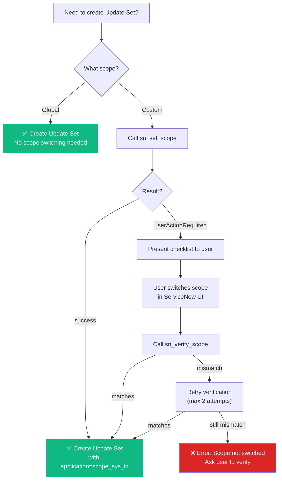

# CLAUDE.md - AI Agent Instructions

> ⚠️ **READ THIS FILE FIRST IN EVERY SESSION BEFORE DOING ANY WORK**

> **Version:** 2.0 | **Last Updated:** 2026-03-20 | **Maintainer:** AI Agent Team

This file contains mandatory rules, processes, and context for AI agents working on this project.

---

## 🚀 Quick Reference

**Before starting ANY work:**
- [ ] Read this file (you're doing it!)
- [ ] Check `specs/manifest.json` for existing requirements
- [ ] Read `specs/config.properties` for phase gate rules

**Common tasks:**
- Creating a requirement? → See [Section 7](#7-requirement-workflow-example)
- Need to switch scopes? → See [Section 13.6](#136-custom-scope-update-set-capture)
- Deploying code? → See [Section 9](#9-key-commands)
- Update set issues? → See [Section 13](#13-update-set-artifact-capture)

**Critical rules:**
- ⛔ NEVER skip phase gates ([Section 3](#3-mandatory-phase-gate-process))
- ⛔ NEVER auto-approve sign-offs ([Section 4](#4-never-do-these))
- ✅ ALWAYS use templates ([Section 5](#5-always-do-these))
- ✅ ALWAYS validate before deploy ([Section 5](#5-always-do-these))

---

## Table of Contents

1. [Project Overview](#1-project-overview)
2. [Core Concepts](#15-core-concepts) *(Key terms defined)*
3. [Critical Files to Read](#2-critical-files-to-read)
4. [⛔ Mandatory Phase Gate Process](#3-mandatory-phase-gate-process)
5. [❌ Never Do These](#4-never-do-these)
6. [✅ Always Do These](#5-always-do-these)
7. [Project Structure](#6-project-structure)
8. [Requirement Workflow Example](#7-requirement-workflow-example)
9. [ServiceNow Artifact Naming](#8-servicenow-artifact-naming)
10. [Key Commands](#9-key-commands)
11. [Sign-Off Format](#10-sign-off-format)
12. [Error Recovery](#11-error-recovery)
13. [Session Start Checklist](#12-session-start-checklist)
14. [Update Set Artifact Capture](#13-update-set-artifact-capture)
15. [Live Session Telemetry](#14-live-session-telemetry)
16. [AI Agent Type Coercion](#15-ai-agent-type-coercion-schema-hardening)
17. [Inline Agent Activity](#16-inline-agent-activity-chat-thinking-block)
18. [Theme System & Branding](#17-theme-system--branding)
19. [UI Layout Notes](#18-ui-layout-notes)
20. [Design Phase Diagram Generation](#19-design-phase-diagram-generation)
21. [Testing Phase Test Case Generation](#20-testing-phase-test-case-generation)

---

## 1. Project Overview

**Project**: SN AI Agent
**Purpose**: AI-powered ServiceNow development with spec-driven methodology  
**Instance**: dev300943.service-now.com  

This framework enables AI agents to develop, test, and deploy ServiceNow solutions following a structured, auditable process.

---

## 1.5. Core Concepts

Before diving into workflows, understand these key terms:

| Term | Definition |
|------|------------|
| **Update Set** | A ServiceNow container for grouping related customizations. All artifacts (business rules, scripts, etc.) are captured in an update set for promotion between instances. |
| **Scope** | An application boundary in ServiceNow. **Global scope** is the default; **custom scopes** isolate application files. Each scope has its own update sets. |
| **MCP** | Model Context Protocol — the communication layer between the webapp and ServiceNow. The `mcp-servicenow/` directory contains MCP tools. |
| **REQ-XXX** | Requirement identifier format (e.g., `REQ-001`, `REQ-002`). Each requirement has its own folder under `specs/REQ-XXX/`. |
| **Phase Gate** | A checkpoint between SDLC phases (Spec → Design → Implementation → Testing → Deployment). Some gates require user approval before proceeding. |
| **Sign-Off** | Formal approval in spec/design documents. Must be marked with ☑ before the phase is considered complete. |
| **Requirement** | A single feature or change request. Tracked in `specs/manifest.json` with status, phases, and metadata. |

---

## 2. Critical Files to Read

Before starting any requirement work, read these files:

| File | Purpose |
|------|---------|
| `specs/config.properties` | Phase gates and sign-off rules |
| `specs/manifest.json` | Registry of all requirements and their status |
| `templates/` | Templates for spec, design, test, deployment docs |

---

## 3. ⛔ MANDATORY PHASE GATE PROCESS

**YOU MUST STOP AND WAIT FOR USER APPROVAL AT EACH GATE**

```
┌─────────────────────────────────────────────────────────────┐
│                   REQUIRED WORKFLOW                          │
├─────────────────────────────────────────────────────────────┤
│                                                              │
│  1. CREATE SPEC (1-spec.md)                                 │
│     │                                                        │
│     └──▶ 🛑 STOP: "Please review the spec. Type 'approved'  │
│                    to proceed to design phase."              │
│                                                              │
│  2. CREATE DESIGN (2-design.md)                             │
│     │                                                        │
│     └──▶ 🛑 STOP: "Please review the design. Type 'approved'│
│                    to proceed to implementation."            │
│                                                              │
│  3. CREATE IMPLEMENTATION (3-implementation/)               │
│     │                                                        │
│     └──▶ 🛑 STOP: "Please review the code. Type 'approved'  │
│                    to deploy."                               │
│                                                              │
│  4. DEPLOY & TEST                                           │
│     │                                                        │
│     └──▶ 🛑 STOP: "Tests complete. Type 'approved' to mark  │
│                    requirement as done."                     │
│                                                              │
└─────────────────────────────────────────────────────────────┘
```

### Sign-Off Rules (from config.properties)

| Phase | Sign-off Required | Gate Enforced |
|-------|------------------|---------------|
| Spec → Design | ✅ YES | ✅ YES |
| Design → Implementation | ✅ YES | ✅ YES |
| Implementation → Testing | ❌ NO | ✅ YES |
| Testing → Deployment | ❌ NO | ✅ YES |

---

## 4. ❌ NEVER DO THESE

1. **NEVER auto-approve sign-offs** - Only the user can approve
2. **NEVER skip phases** - Spec before Design before Implementation
3. **NEVER mark sign-offs as complete yourself** - Use ☐ not ☑ until user approves
4. **NEVER deploy without user approval** - Always ask first
5. **NEVER create documentation files unless requested** - No README files, etc.
6. **NEVER commit/push code** - Only user can do this

---

## 5. ✅ ALWAYS DO THESE

1. **Read this file first** in every session
2. **Read config.properties** before starting requirement work
3. **Check manifest.json** for existing requirements and their status
4. **Use templates** from `templates/` for all documents
5. **Use clean naming** - No REQ-IDs in artifact names (e.g., `ValidateHighImpact` not `REQ003_ValidateHighImpact`)
6. **Validate before deploy** - Run `node scripts/validate.cjs REQ-XXX`

---

## 6. Project Structure

```
SN-AI-Dev-Agent/
│
├── CLAUDE.md                    # ← YOU ARE HERE - Read first!
├── README.md                    # Project readme
├── package.json
│
├── specs/                       # 📋 REQUIREMENT SPECIFICATIONS
│   ├── config.properties        # Phase gate settings
│   ├── manifest.json            # Requirement registry
│   └── REQ-XXX/                 # Requirement folders
│       ├── 1-spec.md
│       ├── 2-design.md
│       ├── 3-implementation/
│       ├── 4-testing/
│       └── 5-deployment.md
│
├── templates/                   # 📝 ALL TEMPLATES
│   ├── manifest.json            # Fresh project manifest template
│   ├── manifest.schema.md       # Manifest field documentation
│   ├── spec.md                  # Spec document template
│   ├── design.md                # Design document template
│   ├── test-plan.md             # Test plan template
│   ├── deployment.md            # Deployment record template
│   ├── business-rule.js         # ServiceNow code templates
│   ├── client-script.js
│   ├── script-include.js
│   └── deployment-manifest.json # Deployment manifest template
│
├── scripts/                     # 🔧 UTILITY SCRIPTS
│   ├── validate.cjs             # Requirement validation
│   ├── validate-deployment.js   # Deployment validation
│   └── atf-runner.cjs           # ATF test integration
│
├── mcp-servicenow/              # 🔌 MCP SERVER
│   ├── src/                     # MCP source code
│   │   ├── index.ts             # Entry point
│   │   ├── client/              # ServiceNow client
│   │   ├── tools/               # MCP tools
│   │   ├── deployer/            # DeploymentHelper class
│   │   └── types/               # TypeScript types
│   ├── deploy/                  # Generic deployer
│   │   └── deploy.js            # Generic deploy script
│   ├── tests/                   # Test scripts
│   └── lib/                     # Helper libraries
│
├── src/                         # 🛠️ CLI FRAMEWORK
│   ├── cli.js
│   ├── core/
│   └── utils/
│
└── docs/                        # 📚 DOCUMENTATION
    ├── architecture/            # Core platform & update-set docs
    ├── design/                  # UX/UI and feature design specs
    ├── planning/                # Roadmaps and enhancement plans
    ├── platform-redesign/       # Multi-agent platform redesign
    ├── learning/                # Session notes
    └── …                        # security/, reports/, servicenow/, etc.
```

---

## 7. Requirement Workflow Example

When user says: "Build a feature for X"

> **Note:** This workflow follows the phase gates defined in [Section 3](#3-mandatory-phase-gate-process). For scope switching in custom scopes, see [Section 13.9](#139-custom-scope-update-set-capture).

```
STEP 1: Understand
├── Ask clarifying questions if needed
└── Confirm scope with user

STEP 2: Create Spec
├── Create specs/REQ-XXX/1-spec.md using template
├── Leave sign-off section with ☐ (unchecked)
└── 🛑 STOP: "I've created the spec. Please review and reply 'approved' to continue."

STEP 3: Wait for Approval
├── User reviews spec
├── User says "approved"
└── Update sign-off to ☑ with user's approval

STEP 4: Create Design
├── Create specs/REQ-XXX/2-design.md using template
├── Leave sign-off section with ☐ (unchecked)
└── 🛑 STOP: "I've created the design. Please review and reply 'approved' to continue."

STEP 5: Wait for Approval
├── User reviews design
├── User says "approved"
└── Update sign-off to ☑ with user's approval

STEP 6: Create Implementation
├── Create specs/REQ-XXX/3-implementation/ files
├── Create deployment script in mcp-servicenow/deploy/
└── 🛑 STOP: "I've created the implementation. Please review and reply 'approved' to deploy."

STEP 7: Deploy & Test
├── Run deployment script
├── Run test suite
├── Capture results in 4-testing/
└── 🛑 STOP: "Deployment and tests complete. Please review results."

STEP 8: Complete
├── Update manifest.json status
└── Create 5-deployment.md with deployment record
```

---

## 8. ServiceNow Artifact Naming

| Artifact Type | Naming Pattern | Example | Don't Do This |
|--------------|----------------|---------|---------------|
| Script Include | PascalCase, descriptive | `HighImpactJustificationUtil` | `REQ003_Util`, `util`, `highImpactUtil` |
| Business Rule | PascalCase, action-based | `ValidateHighImpactJustification` | `REQ003_BR`, `validate_high_impact`, `BR_001` |
| Client Script | PascalCase, event-based | `HandleHighImpactChange` | `REQ003_CS`, `handleHighImpact`, `client_script_1` |
| UI Policy | PascalCase, behavior | `HighImpactFieldBehavior` | `REQ003_UI`, `ui_policy_1`, `HighImpactPolicy` |
| Custom Field | Snake_case with u_ prefix | `u_high_impact_justification` | `high_impact_justification`, `uHighImpact`, `REQ003_field` |

**Key principles:**
- No REQ-IDs in artifact names (see [Section 5](#5-always-do-these))
- Use descriptive, self-documenting names
- Follow ServiceNow naming conventions

---

## 9. Key Commands

**When to use each command:**

```bash
# Initialize a fresh project (resets manifest.json)
# Use: Starting a new project or resetting the requirement registry
node scripts/init-project.js

# Validate a requirement
# Use: Before deploying, to check spec/design completeness and phase gate compliance
# Example: node scripts/validate.cjs REQ-001
node scripts/validate.cjs REQ-XXX

# Deploy a requirement (generic deployer)
# Use: After implementation is approved, to deploy artifacts to ServiceNow
# Example: cd mcp-servicenow && node deploy/deploy.js REQ-001
cd mcp-servicenow
node deploy/deploy.js REQ-XXX

# Test ServiceNow connection
# Use: Troubleshooting connection issues or verifying credentials
cd mcp-servicenow
node tests/test-connection.js
```

---

## 10. Sign-Off Format

In spec and design documents, use this format:

**Before user approval:**
```markdown
## Sign-Off

| Role | Name | Date | Signature |
|------|------|------|-----------|
| Author | AI Agent | 2026-01-20 | ☐ |
| Approver | | | ☐ |

> **Status:** ⬜ Draft
```

**After user approval:**
```markdown
## Sign-Off

| Role | Name | Date | Signature |
|------|------|------|-----------|
| Author | AI Agent | 2026-01-20 | ☑ |
| Approver | Ratnesh Tiwari | 2026-01-20 | ☑ |

> **Status:** ☑ Approved
```

See [Section 3](#3-mandatory-phase-gate-process) for phase gate rules and [Section 4](#4-never-do-these) for sign-off constraints.

---

## 11. Error Recovery

If you make a mistake:
1. **Acknowledge it** - Don't hide errors
2. **Explain what went wrong** - Be transparent
3. **Propose fix** - Offer solution
4. **Wait for user direction** - Don't auto-fix without permission

### Common Error Scenarios

**Scenario 1: Artifact not captured in update set**
- **Symptom:** Created artifact but it's not in the update set
- **Solution:** 
  1. Verify with `sn_get_update_set_contents`
  2. Use `sn_move_to_update_set` to manually move the artifact
  3. Check if scope switching is needed (see [Section 13.9](#139-custom-scope-update-set-capture))

**Scenario 2: Phase gate violation**
- **Symptom:** Tried to proceed without approval
- **Solution:** 
  1. Stop immediately
  2. Go back to the previous phase
  3. Wait for user approval (see [Section 3](#3-mandatory-phase-gate-process))

**Scenario 3: Duplicate update set name**
- **Symptom:** `sn_create_update_set` returns `duplicateDetected: true`
- **Solution:** 
  1. Review existing update sets in the response
  2. Choose: use existing, create with timestamp, or force create
  3. See [Section 13.5](#135-duplicate-update-set-detection) for details

**Scenario 4: Scope switching failed**
- **Symptom:** `sn_set_scope` returns `userActionRequired: true`
- **Solution:** 
  1. Present the checklist to the user
  2. Wait for user to manually switch scope in ServiceNow UI
  3. Call `sn_verify_scope` to confirm
  4. See [Section 13.9](#139-custom-scope-update-set-capture) for full workflow

**Scenario 5: Validation failure**
- **Symptom:** `node scripts/validate.cjs REQ-XXX` reports errors
- **Solution:** 
  1. Review validation report
  2. Fix missing sign-offs, incomplete phases, or structural issues
  3. Re-run validation before deploying
  4. See [Section 5](#5-always-do-these) for validation requirements

**Scenario 6: Connection/authentication error**
- **Symptom:** ServiceNow API calls fail with 401/403
- **Solution:** 
  1. Verify credentials are correct
  2. Check user roles in ServiceNow
  3. Test connection: `cd mcp-servicenow && node tests/test-connection.js`
  4. Re-authenticate if needed

---

## 12. Session Start Checklist

At the start of every session involving requirements:

- [ ] Read this CLAUDE.md file
- [ ] Read `specs/config.properties` (see [Section 2](#2-critical-files-to-read))
- [ ] Check `specs/manifest.json` for context (see [Section 2](#2-critical-files-to-read))
- [ ] Identify which requirement(s) are in progress
- [ ] Confirm current phase with user before continuing (see [Section 3](#3-mandatory-phase-gate-process))

---

## 13. Update Set Artifact Capture

> ⚠️ **IMPORTANT: REST API does NOT honor "current update set" session context like the UI does**

Artifacts created via REST API land in the "Default" update set instead of the intended target. This framework implements a **three-layer defense strategy** to ensure reliable capture.

### 13.1 The Problem (Why This Exists)

ServiceNow's REST API does **NOT** honor "current update set" session context like the UI does. Artifacts created via REST API land in the "Default" update set instead of the intended target, even when the `application` field is correctly set on the `sys_update_set` record.

This is a known ServiceNow platform limitation (KB0867578): external REST API sessions always run in Global scope, so `GlideUpdateSet().set()` and artifact creation happen in Global context.

### 13.2 The Solution (Three-Layer Defense)

This framework implements a **three-layer defense strategy** to ensure reliable capture. You don't need to think about this — it happens automatically. Each artifact creation response includes an `updateSetCapture` field confirming which layer succeeded.

```mermaid
flowchart TD
    A["Create Artifact"] --> B["Layer 1: Session-based capture"]
    B -->|Success| Success["✅ Artifact captured"]
    B -->|Fail| C["Layer 2: Post-creation move"]
    C -->|Success| Success
    C -->|Fail| D["Layer 3: GlideUpdateManager2"]
    D -->|Success| Success
    D -->|Fail| Manual["⚠️ Manual intervention needed"]
    
    style Success fill:#10b981,color:#fff
    style Manual fill:#f59e0b,color:#fff
```



**For complete technical details:** See `docs/architecture/custom-scope-capture.md` and `docs/architecture/update-sets.md`

### 13.3 Quick Workflow

When creating artifacts in an update set:

1. **Create update set** → `sn_create_update_set` (handles duplicates automatically)
2. **If custom scope:** Call `sn_set_scope` with the scope sys_id first (see [Section 13.6](#136-custom-scope-update-set-capture))
3. **Set as current** → `sn_set_current_update_set` with the update set sys_id
4. **Create artifacts** → Auto-captured via three-layer defense
5. **Verify** → `sn_get_update_set_contents` to confirm all artifacts are present
6. **Fallback** → Use `sn_move_to_update_set` if any artifacts are missing

### 13.4 Three-Layer Defense Strategy (Detailed)

**Layer 1 — Session-based capture** (`sn-client.ts`):
- Cookie-jar session persistence via `axios-cookiejar-support` + `tough-cookie`
- `callSetCurrentUpdateSetApi()` calls the UpdateSetHelper Scripted REST API
- Server-side runs `GlideUpdateSet().set()` to bind the session to the target Update Set

**Layer 2 — Post-creation move** (fallback in `sn-client.ts`):
- `moveArtifactToUpdateSet()` queries `sys_update_xml` after every create/update
- Multi-strategy search: exact name match → LIKE search → metadata table broad search with payload filtering
- Retry logic with increasing delays (metadata tables like `sys_dictionary` get 1500ms initial + 3 retries)
- Moves records to the target update set if they landed in the wrong one
- Auto-move hooks in: `createRecord`, `updateRecord`, `createBusinessRule`, `createScriptInclude`, `createClientScript`

**Layer 3 — Server-side GlideUpdateManager2** (fallback in `sn-client.ts`):
- `callAddToUpdateSetApi()` calls the AddToUpdateSetHelper Scripted REST API
- Server-side uses `GlideUpdateManager2().saveRecord(gr)` to explicitly create `sys_update_xml` entry
- Works for ANY table type, including those that don't reliably generate `sys_update_xml` entries (e.g., `sys_dictionary`, `sysauto_script`, `sysevent_register`)
- Auto-deployed alongside other helper APIs on connection init

### 13.5 Duplicate Update Set Detection

`sn_create_update_set` checks for existing update sets with the same name **before** creating:

| Scenario | Behavior |
|----------|----------|
| No duplicate | Creates normally |
| Duplicate found (default) | Returns `duplicateDetected: true` with existing sets and 3 options |
| Duplicate + `autoTimestamp: true` | Auto-appends ISO timestamp to name |
| Duplicate + `force: true` | Skips check, creates duplicate |

**NEVER silently create duplicate Update Sets** — always surface the conflict to the user first.

### 13.6 New Tools

| Tool | Purpose |
|------|---------|
| `sn_move_to_update_set` | Manual fallback — move a specific artifact to a target Update Set |
| `sn_verify_update_set_capture` | Verify ALL artifacts are captured in the Update Set; auto-moves missing ones |

### 13.7 Required Setup

1. Deploy the UpdateSetHelper Scripted REST API:
   ```bash
   cd mcp-servicenow
   node src/deployer/setup-updateset-api.js
   ```
2. Configure in `.env`:
   ```bash
   SN_UPDATE_SET_API_PATH=/api/<namespace>/update_set_helper/set_current
   ```
   > **Note:** Replace `<namespace>` with your app's namespace (e.g., `x_snc_myapp`). The namespace is auto-detected during helper API deployment.

### 13.8 Implementation Workflow (for AI agents)

1. Call `sn_create_update_set` — handle `duplicateDetected` response if returned
2. **If custom scope:** Call `sn_set_scope` with the scope sys_id
   - If `userActionRequired`: present checklist to user, wait for confirmation, then call `sn_verify_scope`
3. Call `sn_set_current_update_set` with the update set sys_id
4. Create artifacts — each response includes `updateSetCapture` field confirming capture
5. Verify with `sn_get_update_set_contents`
6. Use `sn_move_to_update_set` as fallback for any missing artifacts

### 13.9 Custom Scope Update Set Capture

> 📖 **For complete technical details, see `docs/architecture/custom-scope-capture.md`**

**TL;DR:** Custom scopes require explicit scope switching. The system tries 5 methods automatically. The AI agent must call `sn_set_scope` at the start of each implementation turn when working in a custom scope.

**Scope Selection Decision Tree:**



**When you need this:**
- Creating Update Sets in a custom application scope (not Global)
- Working with multi-scope designs

**What you do:**
1. Call `sn_set_scope` with the scope sys_id
2. System tries 5 methods automatically (see table below)
3. If all fail, you'll get a checklist to do it manually

**The 5-tier fallback:**

| Tier | Method | Speed | When it works | Success Rate |
|------|--------|-------|---------------|--------------|
| 1 | `PUT /api/now/ui/concoursepicker/application` | ~200ms | ✅ Most common (zero deployment) | ~95% |
| 2 | ScopeHelper Scripted REST API | ~500ms | ✅ Auto-deployed on connect | ~90% |
| 3 | `sys_user_preference` write | ~1s | ⚠️ Needs session restart | ~60% |
| 4 | Playwright browser automation | ~30s | ⚠️ Optional, fails on MFA/SSO | ~40% |
| 5 | Manual (you do it) | User-paced | ✅ Always works | 100% |

**Tools:**
- `sn_set_scope` — Runs all 5 tiers. Returns `success` or `userActionRequired` with checklist. *(Available in `scope_selection` and `implementation` phases)*
- `sn_verify_scope` — Checks current scope via concoursepicker GET + sys_user_preference. *(Available in `scope_selection` and `implementation` phases)*

**Automatic scope switching:** If you create an Update Set in a custom scope but haven't switched to that scope yet, `sn_create_update_set` and `sn_set_current_update_set` automatically call `sn_set_scope` first. This catches cases where you forget to call `sn_set_scope`.

**Per-request lifecycle:** The REST client is recreated for each new chat message/request. The AI agent must call `sn_set_scope` at the start of each implementation turn when working in a custom scope.

**Phase 0 validation:** Run `node tests/test-scope-switching.js` in `mcp-servicenow/` to validate concoursepicker behavior on a specific instance before production use.

When creating Update Sets in a **custom application scope** (not Global), the REST session must be switched to the target scope first. The system uses a five-tier fallback via `ensureScopeActive()`:

| Tier | Method | Notes |
|------|--------|-------|
| 1 | `PUT /api/now/ui/concoursepicker/application` | Built-in SN API, zero deployment, ~200ms |
| 2 | ScopeHelper Scripted REST API | Auto-deployed, uses `gs.setCurrentApplicationId()` |
| 3 | `sys_user_preference` write | Needs session restart; preference-based |
| 4 | Playwright browser automation | Optional (`ENABLE_BROWSER_SCOPE_SWITCH=true`) |
| 5 | Manual user prompt | Last resort — user switches in SN UI, AI verifies |

**Tools:**
- `sn_set_scope` — Runs all 5 tiers. Returns `success` or `userActionRequired` with checklist.
- `sn_verify_scope` — Checks current scope via concoursepicker GET + sys_user_preference.

**Scope guard:** `sn_create_update_set` and `sn_set_current_update_set` auto-call `ensureScopeActive()` if the target scope isn't active. This catches cases where the AI forgets to call `sn_set_scope`.

**Per-request lifecycle:** The REST client is recreated each turn. The AI must call `sn_set_scope` at the start of each implementation turn when working in a custom scope.

**Phase 0 validation:** Run `node tests/test-scope-switching.js` in `mcp-servicenow/` to validate concoursepicker behavior on a specific instance.

---

## 14. Live Session Telemetry

Every AI agent session generates a live-updating telemetry dashboard at `webapp/logs/telemetry-session-{suffix}.md`.

### How It Works
1. User clicks **Connect** → POST `/api/session-start` logs connection metadata and starts a 15-second telemetry interval
2. Every `logger.log()` call triggers a throttled `updateTelemetry()` (max once per 15s)
3. The telemetry generator parses the session JSONL log and regenerates the markdown dashboard
4. One file per session, overwritten in place — open in VS Code to watch live

### What's Captured
- **Connect metadata**: instance URL, username, model, AI provider
- **Phase transitions**: spec → design → scope_selection → implementation
- **Round-by-round activity**: tools called, durations, tokens, stop reasons
- **Tool usage stats**: per-tool call counts, success/failure rates, avg duration
- **Errors**: timestamped with tool name and message
- **Session Updates**: conversational narration with intent-based tool descriptions, phase-aware context, error categorization, and efficiency assessment

### Key Files
| File | Purpose |
|------|---------|
| `webapp/src/lib/telemetry-generator.ts` | JSONL parser → markdown generator + conversational narration |
| `webapp/src/lib/logger.ts` | Hooks `updateTelemetry()` into every log write |
| `webapp/src/app/api/session-start/route.ts` | Logs connect event, starts telemetry stream |

---

## 15. AI Agent Type Coercion (Schema Hardening)

AI agents frequently send string values where schemas expect `boolean`, `number`, or `object`. All MCP tool schemas use `z.preprocess()` to transparently coerce these inputs. This prevents type errors when agents pass `"true"` instead of `true`, for example.

### Coerced Types
- **String → Boolean**: `"true"` / `"false"` → `true` / `false`
- **String → Number**: `"100"` → `100`
- **JSON String → Object**: `'{"name":"x"}'` → `{name:"x"}`

### Files with Coercion

The following MCP tool files include type coercion:
- `scripts.ts` — Script creation tools
- `records.ts` — Record CRUD operations
- `ui-policies.ts` — UI Policy management
- `notifications.ts` — Notification creation
- `update-sets.ts` — Update Set operations
- `scheduled-jobs.ts` — Scheduled job management
- `acls.ts` — ACL creation

### After Editing MCP Schemas

When you modify MCP tool schemas (e.g., in `scripts.ts`, `records.ts`), you must rebuild:

```bash
cd mcp-servicenow && rm -rf dist && npx tsc
```

Then restart the webapp server for changes to take effect.

---

## 16. Inline Agent Activity (Chat Thinking Block)

Agent activity is displayed **inline in the chat flow** as a collapsible thinking block during AI processing. There is no sidebar Agent Activity panel.

### Key Design
- **No emojis/icons** — only pulsing dot (active step) and ✓ checkmark (completed step) in muted gray
- **Conversational labels** — tool names are mapped to friendly text (e.g., `sn_get_business_rules` + `{table:"incident"}` → "Business rules on incident")
- **Collapsible** — header shows latest step + tool count, chevron toggles step list
- **Deduplication** — "Starting...", "Round N: Analyzing..." merged into single "Analyzing your request..."

### Key Files
| File | Purpose |
|------|---------|
| `webapp/src/components/ChatWindow.tsx` | `InlineAgentActivity` component, `friendlyToolLabel()`, `processActivityLog()` |
| `webapp/src/app/page.tsx` | Captures `tool_start` events with `toolName` + `toolInput` into `activityLog[]` |

---

## 17. Theme System & Branding

### Theme Toggle
- Dark/light mode via `ThemeProvider.tsx` + `ThemeToggle.tsx` (sun/moon button in header)
- Persists to `localStorage`; defaults to dark
- CSS vars defined per theme in `globals.css` via `[data-theme="light"]` / `[data-theme="dark"]`

### Branding Configuration
All values configurable via `NEXT_PUBLIC_*` env vars in `webapp/.env`:

| Env Var | Default |
|---------|---------|
| `NEXT_PUBLIC_APP_NAME` | "SN AI Agent" |
| `NEXT_PUBLIC_APP_TAGLINE` | "Say it. Ship it." |
| `NEXT_PUBLIC_HERO_TAGLINE` | "Ship ServiceNow Features with AI." |
| `NEXT_PUBLIC_APP_LOGO` | "/logo-r-v10.svg" |
| `NEXT_PUBLIC_PRIMARY_COLOR` | "blue" (or any preset: purple, green, teal, red, orange, indigo, or hex) |
| `NEXT_PUBLIC_ACCENT_COLOR` | "purple" |

### Key Files
| File | Purpose |
|------|---------|
| `webapp/src/lib/branding.ts` | Color presets (dark + light), env var resolution, CSS var exports |
| `webapp/src/components/ThemeProvider.tsx` | React context, theme state, CSS var injection |
| `webapp/src/components/ThemeToggle.tsx` | Toggle button UI |

---

## 18. UI Layout Notes

### Right Sidebar
Shows **only Connection info** (user, instance URL, roles). Pipeline Status and Agent Activity have been removed from the sidebar.

### Chat Avatars
User and AI avatars are **hidden** from the chat UI. The `userName` data is still available in the backend for telemetry/logging.

### Header Bar
Contains: Settings toggle, app title, connection badge, PhaseTracker (SDLC pipeline), theme toggle, New Chat button.

---

## 19. Design Phase Diagram Generation

### Diagram Types

The design phase generates **five types of diagrams** using Mermaid syntax:

| Diagram | Mermaid Type | When Generated | Source Data |
|---------|-------------|----------------|-------------|
| System Context | `flowchart TD` | Always | Artifacts (Section 4.2) + integrations (Section 6) |
| Component | `flowchart LR` | Always | Artifacts grouped by layer |
| Sequence | `sequenceDiagram` | Always | Artifacts + integration flows |
| ER | `erDiagram` | When new tables exist | Data model (Section 5) |
| Data Flow | `flowchart LR` | When integrations exist | Integration points (Section 6) |

### AUTO_DIAGRAM Markers

Design templates include placeholder markers that the enhancement script replaces:

```
<!-- AUTO_DIAGRAM:system_context -->
<!-- AUTO_DIAGRAM:component -->
<!-- AUTO_DIAGRAM:sequence -->
<!-- AUTO_DIAGRAM:er -->
<!-- AUTO_DIAGRAM:data_flow -->
```

### CLI Usage

```bash
# Generate/update diagrams in an existing design document
node scripts/enhance-design.cjs --req REQ-001

# Or specify a file directly
node scripts/enhance-design.cjs --file specs/REQ-001/2-design.md
```

### Key Files

| File | Purpose |
|------|---------|
| `src/core/diagram-generator.js` | Main orchestrator — generates all diagram types |
| `src/core/diagram-templates.js` | Mermaid syntax templates for each diagram type |
| `src/core/text-diagram-generator.js` | ASCII art fallback for non-Mermaid environments |
| `src/core/design-parser.js` | Parses 2-design.md into structured data for diagram generation |
| `scripts/enhance-design.cjs` | CLI script to auto-insert diagrams into design docs |

---

## 20. Testing Phase Test Case Generation

### Test Case Categories

Test cases are generated in **four categories** with a minimum 40% negative ratio:

| Category | Purpose | ID Pattern | Priority |
|----------|---------|------------|----------|
| Positive | Happy path, valid inputs, role-based success | TC-P### | High-Medium |
| Negative | Error handling, invalid inputs, boundary violations | TC-N### | High-Medium |
| Integration | Cross-system data flow, failure handling | TC-I### | High |
| Security | ACL verification, PII checks, BLOCK-tier scan | TC-S### | High |

### Coverage Requirements

- **Minimum 5 test cases** per functional requirement
- **At least 40%** of test cases must be negative
- **Every functional requirement** must have at least one positive test case
- Each test case must include: preconditions, steps (action + expected result), and requirement traceability

### CLI Usage

```bash
# Generate test plan from spec + design
node scripts/generate-test-plan.cjs --req REQ-001
```

Output: `specs/REQ-XXX/4-testing/test-plan.md` with categorized test cases and coverage matrix.

### Key Files

| File | Purpose |
|------|---------|
| `src/core/test-case-generator.js` | Main generator — builds positive, negative, integration, security TCs |
| `src/core/test-patterns.js` | Reusable pattern library for all test categories |
| `src/core/positive-test-generator.js` | Happy path, boundary, multi-role positive cases |
| `src/core/negative-test-generator.js` | Error handling, invalid input, unauthorized access cases |
| `src/core/test-categorizer.js` | Categorize by type/priority/automation, build coverage matrix |
| `scripts/generate-test-plan.cjs` | CLI script to generate test plans from spec + design |

### Validation Rules

The validation script (`scripts/validate.cjs`) now checks:

- Design documents have at least 3 Mermaid diagrams (system context, component, sequence)
- Test plans have minimum 5 test cases
- Negative test ratio meets 40% threshold
- Test cases include preconditions, steps, and expected results
- Coverage matrix is present

