# SN AI Agent — Internal Architecture & Sequence Diagrams

> **Classification:** PRIVATE / INTERNAL — Developer Reference Only  
> **Date:** 2026-03-24  
> **Version:** v0.1.0-beta.2  
> **Maintainer:** Ratnesh Tiwari

---

## Table of Contents

1. [Full System Architecture](#1-full-system-architecture)
2. [Chat Stream Internal Sequence Diagram](#2-chat-stream-internal-sequence-diagram)
3. [Authentication & Session Lifecycle](#3-authentication--session-lifecycle)
4. [Log Storage & Telemetry Pipeline](#4-log-storage--telemetry-pipeline)
5. [MCP Tool Execution & Update Set Capture](#5-mcp-tool-execution--update-set-capture)
6. [Key Resolution & Access Control Flow](#6-key-resolution--access-control-flow)

---

## 1. Full System Architecture

Every component, subgraph, data store, and external dependency.

```mermaid
flowchart TD
    subgraph Browser["Browser (React / Next.js Client)"]
        LP["LandingPage.tsx"]
        AppPage["app/page.tsx — Main Chat UI"]
        LoginPage["login/page.tsx"]
        AdminPage["admin/page.tsx"]
        CW["ChatWindow.tsx"]
        SP["SettingsPanel.tsx"]
        CM["ConnectModal.tsx"]
        MB["MessageBubble.tsx"]
        PT["PhaseTracker.tsx"]
        SugP["SuggestionPanel.tsx"]
        CP["CommandPalette.tsx"]
        AKGM["APIKeyGateModal.tsx"]
        SGM["SignupGateModal.tsx"]
        SPM["SharePromptModal.tsx"]
        BD["BannerDisplay.tsx"]
        TT["ThemeToggle.tsx / ThemeProvider.tsx"]
        FFab["FeedbackFAB.tsx"]
        GC["GlobalChrome.tsx"]
        hooks["useSessionState.ts\nuseSharePrompt.ts\nuseRotatingText.ts"]
    end

    subgraph NextServer["Next.js 16 Server (App Router)"]
        subgraph Middleware["Middleware Layer"]
            Proxy["proxy.ts\n(Next.js middleware)\nCookie extraction → Session validation\nRoute protection → User header injection"]
        end

        subgraph APIRoutes["API Routes (src/app/api/)"]
            ChatStreamRoute["/api/chat-stream\nroute.ts — POST\nmaxDuration=300"]
            ChatRoute["/api/chat\nroute.ts — POST"]
            TestConn["/api/test-connection\nroute.ts"]
            BrowserConn["/api/browser-session-connect\nroute.ts"]
            SessionStart["/api/session-start\nroute.ts"]
            SessionEnd["/api/session-end\nroute.ts"]
            AuthRoutes["/api/auth/*\nlogin, logout, register-invite\ncheck-email, forgot-password\nverify-email, verify-otp\nset-password, verify-magic-link\nme"]
            AdminRoutes["/api/admin/*\nusers, instances, banners\ninvite-codes, requests\nsession-logs, engine-config\naccess-tiers, trials\nlog-storage"]
            ConfigRoute["/api/config\nroute.ts"]
            FeedbackRoute["/api/feedback\nroute.ts"]
            ChangelogRoute["/api/changelog\nroute.ts"]
            BannerRoute["/api/banners\nroute.ts"]
            TrialRoute["/api/trial-status\nroute.ts"]
            EnhanceRoute["/api/enhance-prompt\nroute.ts"]
            TranscribeRoute["/api/transcribe\nroute.ts"]
            InstancePrompts["/api/instance-prompts\nroute.ts"]
            ORModels["/api/openrouter-models\nroute.ts"]
            ShareTracking["/api/share-tracking\nroute.ts"]
            ShareCard["/api/share-card\nroute.ts"]
            GenShareTag["/api/generate-share-tag\nroute.ts"]
            SNOAuth["/api/sn-oauth/exchange\nroute.ts"]
        end

        subgraph CoreLib["Core Libraries (src/lib/)"]
            SNEngine["sn-engine.ts\nchatStream() generator\nchat() sync\ntestConnection()\nfetchCategorizedPrompts()"]
            KeyResolver["key-resolver.ts\nresolveLlmApiKey()\nBYOK → Pool → env_fallback\nSession-sticky Map (10K cap)"]
            AccessTier["access-tier.ts\ncheckAccess()\n3-tier: anon/auth/byok\ngetTierLimits() — 60s cache"]
            TrialLimiter["trial-limiter.ts\ngetTrialStatus()\ncheckTrialLimit()\ntrial_config priority:\nuser → instance → global"]
            Auth["auth.ts\nbcrypt cost=12\nSession: 24h default, 15min temp\nTokens: magic_link 72h,\nemail_verify 24h, password_reset\nOTP: 6-digit, 10min\nCookie: sn-ai-session"]
            AuthRateLimit["auth-rate-limiter.ts\nPer-endpoint brute force protection"]
            AdminAuth["admin-auth.ts\nrequireAdmin()"]
            SDDPolicy["sdd-policy.ts\nresolvePolicy(): session override →\nuser pref → tenant → instance → global\nPhases: spec→design→scope_selection→\nimplementation→testing→deployment"]
            Logger["logger.ts\nStructured JSONL logging\nSession-specific files\nlogs/session-{date}-{ts}-{suffix}.txt"]
            LogPersist["log-persistence.ts\nLogPersistence class\nBuffer: 200/session, 50MB global\nFlush: 30s interval, batch 20, 10 conc\nRPC: append_session_log_entries\nJSONB cap: 500 entries\nSIGTERM: 7s flush"]
            TelGen["telemetry-generator.ts\n15s throttle\nJSONL → markdown dashboard\nnarrateRounds()"]
            LogStorage["log-storage/\nindex.ts — singleton\nlog-storage-sync.ts — LogStorageSync\nprovider-factory.ts\ns3-provider.ts — S3CompatibleProvider\nnoop-provider.ts\nmetadata-factory.ts\nsupabase-metadata-store.ts\nlocal-metadata-store.ts"]
            ReqValidation["request-validation.ts\nparseChatBody()"]
            SNAuth["servicenow-auth.ts\nnormalizeServiceNowAuthMethod()\nvalidateServiceNowCredentials()"]
            Branding["branding.ts\nColor presets, env var resolution"]
            ClientIP["client-ip.ts\ngetClientIp()"]
            DBErrors["db-errors.ts"]
            Email["email.ts"]
            FetchTimeout["fetch-with-timeout.ts"]
            FileParser["file-parser.ts\nprocessFileAttachments()"]
            SanitizeHTML["sanitize-html.ts"]
            SessionCache["session-cache.ts\ngetSessionCache()\nCross-phase data reuse"]
            SysPrompt["system-prompt.ts\nbuildSystemPrompt()\nbuildDynamicContext()"]
            TaskPlanner["task-planner.ts\nshouldPlan()\ngeneratePlan()\nexecutePlan()\nformatGatheredData()"]
            OpenRouter["openrouter.ts\nchatCompletion()"]
            ShareContent["share-content.ts"]
            ShareServer["share-server.ts"]
            ShareCardTpl["share-card-template.tsx"]
            AuthHint["auth-hint.ts"]
            BrowserScope["browser-scope-switcher.ts\nswitchScopeViaBrowser()"]
            Supabase["supabase.ts\ngetSupabase() — singleton"]
            SlashCmds["slash-commands/\nindex.ts, types.ts\ncommands: build, freeform, help, status"]
            SuggEngine["suggestion-engine/\nPromptComposer, scorer, selector\nProviders: generic-fallback,\ninstance-artifacts, role-based,\nupdate-sets, user-work\nregistry, hash, seen-tracker"]
        end
    end

    subgraph MCPServer["MCP Server (mcp-servicenow/)"]
        MCPIndex["src/index.ts\nStdioServerTransport\nMCP protocol handler"]
        ToolDefs["src/tool-definitions.ts\n115 tool JSON schemas\nALL_TOOLS array\nPHASE_ROUND_LIMITS\nDEFAULT_ROUND_LIMIT"]
        ToolRegistry["src/tool-registry.ts\nTOOL_HANDLERS dispatch map\nexecuteToolCall(name, input, client)"]
        SNClient["src/client/sn-client.ts\nServiceNowClient class\nAxios + tough-cookie jar\nBasic Auth / OAuth 2.0 /\nSession Token support\n3-layer update set capture\n5-tier scope switching"]

        subgraph ToolModules["src/tools/ (30+ modules)"]
            TConn["connection.ts"]
            TRecords["records.ts"]
            TScripts["scripts.ts"]
            TUpdateSets["update-sets.ts"]
            TUIPolicies["ui-policies.ts"]
            TNotifications["notifications.ts"]
            TACLs["acls.ts"]
            TCatalog["catalog.ts"]
            TScheduled["scheduled-jobs.ts"]
            TAnalyzer["instance-analyzer.ts"]
            TOOTBDetect["ootb-override-detector.ts"]
            TDepGraph["dependency-graph.ts"]
            TFlowDesigner["flow-designer.ts"]
            TScopedApps["scoped-apps.ts"]
            TServicePortal["service-portal.ts"]
            TAuditLogger["audit-logger.ts"]
            TPersona["persona-engine.ts"]
            T4GFramework["four-g-framework.ts"]
            TApproval["approval-gate.ts"]
            TInstRegistry["instance-registry.ts"]
            TInstCompare["instance-compare.ts"]
            TUpgradeReady["upgrade-readiness.ts"]
            TConflictPred["conflict-predictor.ts"]
            TRecommend["recommendation-engine.ts"]
            TMultiInst["multi-instance-manager.ts"]
            TPromotion["promotion-workflow.ts"]
        end

        subgraph Deployer["src/deployer/"]
            UpdateSetHelper["setup-updateset-api.js\nUpdateSetHelper Scripted REST API"]
            ScopeHelper["ScopeHelper Scripted REST API\ngs.setCurrentApplicationId()"]
            AddToUSHelper["AddToUpdateSetHelper\nGlideUpdateManager2"]
        end
    end

    subgraph AIProviders["AI Providers"]
        Anthropic["Anthropic API\nclaude-sonnet-4-6\nPrompt caching (ephemeral)"]
        OpenRouterAPI["OpenRouter API\nMulti-model: Claude, Gemini,\nLlama, etc."]
    end

    subgraph SupabaseDB["Supabase (PostgreSQL)"]
        TblUsers["users"]
        TblSessions["sessions\n(24h default, 15min temp)"]
        TblAuthTokens["auth_tokens\n(magic_link, email_verify,\npassword_reset)"]
        TblAuthRateLimits["auth_rate_limits"]
        TblAccessTierConfig["access_tier_config\n(anon_daily_limit, auth_daily_limit)"]
        TblAnonRequestLog["anon_request_log\n(ip, instance_url, date, count)\nDual-budget tracking"]
        TblRequestLog["request_log\n(user_id, date, count)"]
        TblTrialConfig["trial_config\n(scope: user/instance/global)"]
        TblTrialStart["trial_start"]
        TblSessionLogs["session_logs\n(JSONB log_entries, 500 cap)"]
        TblFeedbackReports["feedback_reports"]
        TblBanners["banners"]
        TblInviteCodes["invite_codes"]
        TblAccessRequests["access_requests"]
        TblChangelog["changelog"]
        TblReleases["releases"]
        TblLogFileUploads["log_file_uploads\n(S3 metadata)"]
        TblEngineConfig["engine_config\n(phase_round_limits,\ndefault_round_limit,\nplanner_budget_factor)"]
        TblShareTracking["share_prompt_tracking"]
        RPCAppendLogs["RPC: append_session_log_entries"]
        RPCIncrAnon["RPC: increment_anon_request_count"]
        RPCIncrAuth["RPC: increment_auth_request_count"]
    end

    subgraph S3Storage["S3-Compatible Storage"]
        DOSpaces["DigitalOcean Spaces\n(primary)"]
        SupaStorage["Supabase Storage\n(secondary)"]
    end

    subgraph SNInstance["ServiceNow Instance\ndev300943.service-now.com"]
        SNREST["REST API\n/api/now/table/*\n/api/now/ui/concoursepicker"]
        ScriptedAPIs["Scripted REST APIs\nUpdateSetHelper\nScopeHelper\nAddToUpdateSetHelper"]
        SysUpdateXML["sys_update_xml\n(Update Set entries)"]
    end

    subgraph LocalFS["Local Filesystem"]
        LogsDir["webapp/logs/\nsession-{date}-{ts}-{suffix}.txt\ntelemetry-session-{suffix}.md"]
    end

    %% Browser → Next.js
    Browser -->|"HTTPS / SSE"| Proxy
    Proxy -->|"Public paths pass-through\nAuth paths: validate → inject x-user-* headers"| APIRoutes

    %% API Routes → Core Libraries
    ChatStreamRoute --> SNEngine
    ChatStreamRoute --> KeyResolver
    ChatStreamRoute --> AccessTier
    ChatStreamRoute --> SDDPolicy
    ChatStreamRoute --> ReqValidation
    ChatStreamRoute --> Logger
    ChatRoute --> SNEngine
    TestConn --> SNEngine
    SessionStart --> Logger
    SessionEnd --> Logger
    AuthRoutes --> Auth
    AuthRoutes --> AuthRateLimit
    AuthRoutes --> Email
    AdminRoutes --> AdminAuth
    ConfigRoute --> KeyResolver
    TrialRoute --> TrialLimiter
    InstancePrompts --> SNEngine

    %% Core → MCP
    SNEngine -->|"require(mcp-servicenow/dist/)\ntool-registry.js + tool-definitions.js"| ToolRegistry
    SNEngine -->|"createSnClient()"| SNClient
    ToolRegistry -->|"TOOL_HANDLERS[name](args, client)"| ToolModules

    %% Core → AI Providers
    SNEngine -->|"anthropic.messages.create()\nPrompt caching + tool-use loop"| Anthropic
    SNEngine -->|"chatCompletion() via openrouter.ts"| OpenRouterAPI

    %% SNClient → ServiceNow
    SNClient -->|"Axios + cookie jar\nBasic / OAuth / Session Token"| SNREST
    SNClient -->|"Layer 1: Session-based capture"| ScriptedAPIs
    SNClient -->|"Layer 2: Post-creation move\nquery sys_update_xml"| SysUpdateXML
    SNClient -->|"Layer 3: GlideUpdateManager2"| ScriptedAPIs

    %% Core → Supabase
    Auth --> Supabase
    Supabase --> SupabaseDB
    AccessTier --> SupabaseDB
    TrialLimiter --> SupabaseDB
    LogPersist -->|"append_session_log_entries RPC\nupsert fallback"| SupabaseDB
    AdminRoutes --> SupabaseDB

    %% Logger pipeline
    Logger -->|"fs.appendFileSync()"| LogsDir
    Logger -->|"updateTelemetry() throttled 15s"| TelGen
    Logger -->|"LogPersistence.enqueue()"| LogPersist
    TelGen -->|"Writes telemetry-session-*.md"| LogsDir
    LogStorage -->|"Watches logs dir\nUploads completed sessions"| S3Storage
    LogStorage -->|"Metadata records"| SupabaseDB

    %% Task Planner
    SNEngine --> TaskPlanner
    TaskPlanner -->|"shouldPlan() → generatePlan()\n→ executePlan()"| ToolRegistry

    %% Slash Commands & Suggestions
    AppPage --> SlashCmds
    AppPage --> SuggEngine
    SuggEngine --> SNClient
```



---

## 2. Chat Stream Internal Sequence Diagram

Full internal flow of `chatStream()` — from HTTP request to SSE response.

```mermaid
sequenceDiagram
    participant FE as Browser (ChatWindow.tsx)
    participant Route as /api/chat-stream<br/>route.ts
    participant Parse as parseChatBody()<br/>request-validation.ts
    participant KR as resolveLlmApiKey()<br/>key-resolver.ts
    participant AT as checkAccess()<br/>access-tier.ts
    participant SDD as resolvePolicy()<br/>sdd-policy.ts
    participant EC as loadEngineConfig()<br/>sn-engine.ts
    participant CS as chatStream() generator<br/>sn-engine.ts
    participant TP as Task Planner<br/>task-planner.ts
    participant SC as SessionCache<br/>session-cache.ts
    participant TD as tool-definitions.ts<br/>getFilteredTools()
    participant AI as Anthropic / OpenRouter API
    participant TR as tool-registry.ts<br/>executeToolCall()
    participant SNC as ServiceNowClient<br/>sn-client.ts
    participant SN as ServiceNow Instance
    participant Log as logger.ts
    participant LP as LogPersistence
    participant Supa as Supabase

    FE->>+Route: POST /api/chat-stream<br/>{credentials, messages, model,<br/>aiProvider, sessionId, phase, sddMode}

    Route->>Parse: parseChatBody(body)
    Parse-->>Route: {credentials, messages, model, ...}

    Route->>SDD: resolvePolicy({sessionOverride, globalDefault})
    SDD-->>Route: {sddActive, enforcementLevel, reason}

    Route->>Route: resolvePhase(policy, clientPhase)

    Route->>Route: normalizeServiceNowAuthMethod()
    Route->>Route: validateServiceNowCredentials()

    Route->>KR: resolveLlmApiKey(sessionId, provider, userKey, allowUserKeys)
    alt BYOK key provided
        KR-->>Route: {apiKey: userKey, source: "byok"}
    else Pool available
        KR->>KR: getPoolKey() — session-sticky<br/>Map (10K cap, FIFO eviction)
        KR-->>Route: {apiKey: poolKey, source: "pool"}
    else Single env fallback
        KR-->>Route: {apiKey: envKey, source: "env_fallback"}
    end

    Route->>AT: checkAccess(ip, userId, isByok, instanceUrl)
    AT->>Supa: query access_tier_config (60s cache)
    alt BYOK
        AT-->>Route: {allowed: true, tier: "byok"}
    else Authenticated
        AT->>Supa: getAuthUsage(userId) + getAnonUsage(ip)
        AT-->>Route: {allowed: bool, tier: "authenticated",<br/>dailyUsed, dailyLimit, gate}
    else Anonymous
        AT->>Supa: getAnonUsage(ip, instanceUrl)<br/>IP + instance dual-budget
        AT-->>Route: {allowed: bool, tier: "anonymous",<br/>dailyUsed, dailyLimit, gate}
    end

    alt Access denied
        Route-->>FE: 429 {error, gate, message, tier}
    end

    Route->>Log: info(sessionId, "chat_stream", "Starting...")

    Route->>Route: Create ReadableStream + SSE encoder
    Route->>Route: Start 15s heartbeat interval

    Route->>+CS: chatStream(credentials, messages, model,<br/>30, sessionId, phase, signal, sddMode)

    CS->>EC: loadEngineConfig() — 5min cache
    EC->>Supa: engine_config table
    EC-->>CS: {phaseRoundLimits, defaultRoundLimit,<br/>plannerBudgetFactor, plannerBudgetMinimum}

    CS->>CS: effectiveMaxRounds = min(30, phaseRoundLimit)
    CS->>CS: createSnClient(credentials) — ServiceNowClient
    CS->>TD: getFilteredTools(phase)
    TD-->>CS: Anthropic.Tool[] (phase-filtered)

    CS->>CS: preprocessFileAttachments(messages)
    CS->>CS: toAnthropicMessages(processed)

    Note over CS,TP: Task Planner Phase

    CS->>TP: shouldPlan(userIntent, phase, msgCount)
    alt Plan needed
        CS-->>FE: SSE: {type: "status", message: "Planning execution..."}
        CS->>TP: generatePlan(userIntent, phase, toolNames,<br/>sessionCache, {provider, apiKey, model})
        TP->>AI: Plan generation prompt
        AI-->>TP: ExecutionPlan {tasks[]}
        CS-->>FE: SSE: {type: "plan", plan}

        loop Each plan task
            CS->>TP: executePlan(plan, toolExecutor, cache)
            CS-->>FE: SSE: {type: "task_start", taskId, taskName}

            loop Each tool in task
                CS-->>FE: SSE: {type: "tool_start", toolName}
                CS->>TR: executeToolCall(name, input, snClient)
                TR->>SNC: handler method (zod-parsed args)
                SNC->>SN: REST API call
                SN-->>SNC: Response
                SNC-->>TR: Result
                TR-->>CS: {execution, resultJson, success}
                CS-->>FE: SSE: {type: "tool_end", toolName, durationMs}
            end

            CS-->>FE: SSE: {type: "task_complete", taskId, taskName}
        end

        CS->>CS: Inject gatheredData into anthropicMessages<br/>(splice before last user msg)
        CS->>CS: adjustedMaxRounds = computeAdjustedRounds()<br/>(factor=0.75, minimum=10)
    end

    Note over CS,AI: Tool-Use Loop (up to adjustedMaxRounds)

    loop rounds < adjustedMaxRounds
        CS->>CS: Check signal.aborted
        CS->>CS: Check MAX_EXECUTION_TIME_MS (280s)
        CS->>CS: trimConversationHistory()<br/>Step 1: compressOldToolResults (preserveRecent=12)<br/>Step 2: Drop middle + extractive summary

        alt remainingRounds == ROUNDS_WARNING_THRESHOLD-1
            CS->>CS: Inject round-limit warning message
        end
        alt Phase gate reminder threshold reached
            CS->>CS: Inject PHASE_GATE_REMINDERS[phase].message
        end

        CS-->>FE: SSE: {type: "status", message: "Round N: Analyzing..."}

        loop Retry up to MAX_RETRIES=3
            CS->>AI: anthropic.messages.create({model, max_tokens: 8192,<br/>system: SYSTEM_PROMPT + dynamicContext,<br/>tools, messages, cache_control: ephemeral})
            alt Rate limit (429)
                CS->>CS: getRetryDelay() — Retry-After header or<br/>exponential backoff (5s→10s→20s)
                CS-->>FE: SSE: {type: "status", "Rate limited, retrying..."}
            else Success
                AI-->>CS: Anthropic.Message {content, stop_reason, usage}
            end
        end

        CS->>Log: info(sessionId, "claude_api", response metadata)

        alt stop_reason == "tool_use"
            CS->>CS: Extract tool_use blocks
            loop Each tool_use block
                CS->>CS: dedup.record(name, input) — ToolCallDeduplicator
                CS-->>FE: SSE: {type: "tool_start", toolName, input: pickDisplayFields()}
                CS->>TR: executeAndLogTool(registry, snClient, name, input, sessionId)
                TR->>SNC: Tool handler
                SNC->>SN: REST API
                SN-->>SNC: Result
                TR-->>CS: {execution, resultJson, success}
                CS->>Log: info/error(sessionId, "mcp_tool", ...)
                CS-->>FE: SSE: {type: "tool_end", toolName, durationMs, success}
            end

            alt Duplicate tool calls detected
                CS->>CS: Inject dedup WARNING/CRITICAL message
            end

            CS->>CS: Append tool_results to anthropicMessages

            alt Phase gate detected in tool-round text
                CS-->>FE: SSE: {type: "done", reply, toolExecutions}
            end
        else stop_reason == "end_turn" / "max_tokens"
            CS-->>FE: SSE: {type: "status", "Generating response..."}
            CS-->>FE: SSE: {type: "done", reply, toolExecutions}
        end
    end

    alt Max rounds reached
        CS-->>FE: SSE: {type: "max_rounds_reached", reply,<br/>toolExecutions, resumeAfterMs: 5000, phase}
    end

    CS-->>-Route: Generator exhausted
    Route->>Route: clearInterval(heartbeat)
    Route->>Route: controller.close()
    Route-->>-FE: SSE stream ends
```



---

## 3. Authentication & Session Lifecycle

Covers `proxy.ts` middleware, login flow, magic link, OTP, invite codes, and session management.

```mermaid
sequenceDiagram
    participant Client as Browser
    participant MW as proxy.ts<br/>(Next.js middleware)
    participant Auth as auth.ts
    participant Supa as Supabase
    participant Email as email.ts
    participant RL as auth-rate-limiter.ts

    Note over Client,Supa: Request Interception (Every Request)

    Client->>MW: HTTP Request (any path)

    MW->>MW: Check BYPASS_AUTH env (block in production)
    MW->>MW: Check SKIP_LANDING_PAGE → redirect / → /app

    alt Path is "/" and has session cookie
        MW->>Auth: validateSession(token)
        Auth->>Supa: SELECT from sessions<br/>JOIN users WHERE token=? AND expires_at > now()
        alt Valid non-temporary session
            Auth-->>MW: {user, is_temporary: false}
            MW-->>Client: 302 Redirect → /app
        end
    end

    alt isPublicPath(pathname)
        Note over MW: PUBLIC_PATHS: /, /app, /login, /request-access,<br/>/invite/:code, /auth/*, /api/auth/*,<br/>/api/config, /api/chat-stream, /api/chat, etc.
        MW->>MW: Extract session cookie (optional enrichment)
        alt Has valid session
            MW->>Auth: validateSession(token)
            Auth-->>MW: session.user
            MW->>MW: Inject x-user-id, x-user-email,<br/>x-user-name, x-user-role headers
        end
        MW-->>Client: NextResponse.next() (pass-through)
    else Protected path
        alt No session cookie
            MW-->>Client: Redirect /login?redirect={path}<br/>or 401 for /api/* routes
        end

        MW->>Auth: validateSession(token)
        Auth->>Supa: SELECT sessions JOIN users
        alt Invalid / expired
            Auth-->>MW: null
            MW-->>Client: Redirect /login + Set-Cookie: clear
        else Temporary session
            alt Path is /auth/set-password
                MW-->>Client: Allow through
            else Any other path
                MW-->>Client: Redirect /auth/set-password
            end
        else Valid session
            alt isAdminPath && role !== "admin"
                MW-->>Client: 403 Forbidden
            else
                MW->>MW: addUserHeaders(request, user)<br/>Sanitize client-supplied x-user-* first
                MW-->>Client: NextResponse.next()
            end
        end
    end

    Note over Client,Supa: Login Flow (Password)

    Client->>RL: POST /api/auth/login {email, password}
    RL->>RL: Rate limit check (per-endpoint)
    RL->>Auth: Check user exists, verify status
    Auth->>Supa: SELECT from users WHERE email=?
    Auth->>Auth: bcrypt.compare(password, hash)<br/>(cost factor: 12)
    alt Password valid
        Auth->>Auth: generateToken() — 96-char hex (48 random bytes)
        Auth->>Supa: INSERT session {token, user_id,<br/>expires_at: now()+24h}
        Auth-->>Client: 200 + Set-Cookie: sn-ai-session={token}<br/>httpOnly, secure, sameSite=lax,<br/>maxAge=86400
    end

    Note over Client,Supa: Magic Link Flow

    Client->>Auth: POST /api/auth/check-email {email}
    Auth->>Supa: Check user exists
    Auth->>Auth: generateToken() — magic_link type
    Auth->>Supa: INSERT auth_tokens {token, user_id,<br/>type: "magic_link", expires_at: now()+72h}
    Auth->>Email: Send magic link email
    Email-->>Client: Email with link /auth/verify?token={token}

    Client->>Auth: GET /auth/verify?token={token}
    Auth->>Supa: SELECT auth_tokens WHERE token=? AND type="magic_link"<br/>AND expires_at > now()
    Auth->>Auth: Create session (24h)
    Auth->>Supa: DELETE used auth_token
    Auth-->>Client: Redirect /app + Set-Cookie

    Note over Client,Supa: OTP Flow

    Client->>Auth: POST /api/auth/check-email/step {email}
    Auth->>Auth: generateOTP() — 6-digit, zero-padded
    Auth->>Supa: INSERT auth_tokens {token: otp_token,<br/>otp_code: "123456", type: "otp",<br/>expires_at: now()+10min}
    Auth->>Email: Send OTP email

    Client->>Auth: POST /api/auth/verify-otp {email, otp}
    Auth->>Supa: SELECT auth_tokens WHERE otp_code=?<br/>AND type="otp" AND expires_at > now()
    Auth->>Auth: Create session
    Auth->>Supa: DELETE used auth_token
    Auth-->>Client: 200 + Set-Cookie

    Note over Client,Supa: Invite Code Flow

    Client->>Auth: GET /invite/{code}
    Auth->>Supa: SELECT invite_codes WHERE code=?<br/>AND (max_uses IS NULL OR uses < max_uses)<br/>AND (expires_at IS NULL OR expires_at > now())
    alt Valid invite
        Client->>Auth: POST /api/auth/register-invite<br/>{code, email, name, password}
        Auth->>Auth: hashPassword(password) — bcrypt cost=12
        Auth->>Supa: INSERT user {email, name, password_hash,<br/>status: "active", role: "user"}
        Auth->>Supa: UPDATE invite_codes SET uses=uses+1
        Auth->>Auth: Create session
        Auth-->>Client: Set-Cookie + redirect /app
    end

    Note over Client,Supa: Session Expiry & Cleanup

    Note right of Auth: Sessions: 24h default (SESSION_MAX_AGE_DAYS=1)<br/>Temp sessions: 15min (set-password flow)<br/>Cookie name: sn-ai-session (configurable via env)
```



---

## 4. Log Storage & Telemetry Pipeline

Full data flow from `logger.ts` through all persistence layers.

```mermaid
flowchart LR
    subgraph Origin["Log Origin"]
        API["API Route handlers"]
        Engine["sn-engine.ts\nchatStream / chat"]
        ToolExec["executeAndLogTool()"]
    end

    subgraph LoggerMod["logger.ts"]
        LogFn["logger.info/warn/error/debug()"]
        GenSessId["generateSessionId()\nsess_{timestamp}_{random}"]
        LogFile["getLogFilename()\nsession-{date}-{ts}-{suffix}.txt"]
    end

    subgraph LocalWrite["Local Filesystem"]
        JSONL["logs/session-*.txt\nJSONL format (one JSON obj per line)\nfs.appendFileSync()"]
    end

    subgraph TelemetryGen["telemetry-generator.ts"]
        HasActive["hasActiveTelemetryStream()"]
        UpdateTel["updateTelemetry()\nThrottled: max once per 15s"]
        ParseJSONL["Parse JSONL → extract phases,\ntool calls, errors, durations"]
        Narrate["narrateRounds()\nConversational session updates"]
        TelFile["logs/telemetry-session-{suffix}.md\nOverwritten in place"]
    end

    subgraph LogPersistence["log-persistence.ts — LogPersistence class"]
        Enqueue["enqueue(sessionId, entry)"]
        Buffer["In-Memory Buffer\nMap<sessionId, LogEntry[]>\nPer-session cap: 200\nGlobal cap: ~50 MB\nFIFO on overflow"]
        FlushLoop["startFlushLoop()\nsetInterval(30s)"]
        Staggered["Staggered flush:\nBatch of 20 sessions\n500ms gaps between batches\nMax 10 concurrent flushes\nPer-session flush lock"]
        RPCAppend["Supabase RPC:\nappend_session_log_entries\nJSONB append (not overwrite)"]
        UpsertFB["Upsert fallback\nif session row missing"]
        JSONBCap["JSONB cap: 500 entries/row\nAfter cap: metadata-only updates\n(tool_count, error_count, etc.)"]
        CumCounters["Cumulative counters:\ntotalRounds, totalToolCalls,\ntotalErrors, totalInputTokens,\ntotalOutputTokens, currentPhase, phases[]"]
        FetchMerge["Fetch+merge fallback\nPrevents log_entries overwrite\non concurrent flushes"]
        Shutdown["SIGTERM hook\nBest-effort flush\n7s timeout"]
    end

    subgraph SupaLogs["Supabase"]
        SessionLogsTable["session_logs table\nColumns: session_id, user_id,\ninstance_url, model,\nlog_entries (JSONB, 500 cap),\ntool_count, error_count,\ntoken_usage, phases,\ncreated_at, updated_at"]
    end

    subgraph LogStorageSync["log-storage/ — LogStorageSync"]
        Singleton["index.ts\ngetLogStorageSync()\nGated: LOG_STORAGE_ENABLED=true"]
        Watcher["log-storage-sync.ts\nWatches logs/ directory\nDetects completed sessions"]
        ProviderFactory["provider-factory.ts\nLOG_STORAGE_PROVIDERS env\n(comma-separated IDs)"]
        S3Prov["s3-provider.ts\nS3CompatibleProvider\nAWS SDK v3\n@aws-sdk/client-s3"]
        NoopProv["noop-provider.ts\nNoopProvider (dev mode)"]
        MetaFactory["metadata-factory.ts\nsupabase / local / auto"]
        SupaMeta["supabase-metadata-store.ts\nlog_file_uploads table"]
        LocalMeta["local-metadata-store.ts\nLocal JSON file"]
    end

    subgraph S3Targets["S3-Compatible Storage"]
        DO["DigitalOcean Spaces\n(primary)"]
        SupaStore["Supabase Storage\n(secondary/backup)"]
    end

    %% Origin → Logger
    API --> LogFn
    Engine --> LogFn
    ToolExec --> LogFn

    %% Logger → Local FS
    LogFn -->|"fs.appendFileSync()"| JSONL

    %% Logger → Telemetry (throttled)
    LogFn -->|"updateTelemetry()\nmax once per 15s"| UpdateTel
    UpdateTel --> ParseJSONL
    ParseJSONL --> Narrate
    Narrate --> TelFile

    %% Logger → LogPersistence
    LogFn -->|"LogPersistence.enqueue()"| Enqueue
    Enqueue --> Buffer
    Buffer -->|"30s interval"| FlushLoop
    FlushLoop --> Staggered
    Staggered --> RPCAppend
    RPCAppend -->|"Success"| SessionLogsTable
    RPCAppend -->|"Failure"| UpsertFB
    UpsertFB --> FetchMerge
    FetchMerge --> SessionLogsTable
    Staggered --> JSONBCap
    Staggered --> CumCounters
    Buffer -.->|"SIGTERM"| Shutdown
    Shutdown --> SessionLogsTable

    %% Log Storage Sync → S3
    Singleton --> Watcher
    Watcher -->|"Detects completed sessions"| ProviderFactory
    ProviderFactory --> S3Prov
    ProviderFactory --> NoopProv
    S3Prov -->|"PutObject"| DO
    S3Prov -->|"PutObject"| SupaStore
    Watcher --> MetaFactory
    MetaFactory --> SupaMeta
    MetaFactory --> LocalMeta
    SupaMeta -->|"INSERT log_file_uploads"| SessionLogsTable
```



### Env Vars for Log Pipeline

| Env Var | Purpose | Default |
|---------|---------|---------|
| `LOG_PERSISTENCE_ENABLED` | Enable Supabase log persistence | `"false"` |
| `LOG_FLUSH_INTERVAL_MS` | Flush interval | `30000` |
| `LOG_STORAGE_ENABLED` | Enable S3 sync | `"false"` |
| `LOG_STORAGE_PROVIDERS` | Comma-separated provider IDs | — |
| `LOG_S3_ENDPOINT` | S3-compatible endpoint URL | — |
| `LOG_S3_BUCKET` | S3 bucket name | — |
| `LOG_S3_REGION` | S3 region | — |
| `LOG_S3_ACCESS_KEY_ID` | S3 access key | — |
| `LOG_S3_SECRET_ACCESS_KEY` | S3 secret key | — |

---

## 5. MCP Tool Execution & Update Set Capture

From `sn-engine.ts` through tool dispatch to ServiceNow, including the 3-layer update set capture defense.

```mermaid
sequenceDiagram
    participant Engine as sn-engine.ts<br/>chatStream()
    participant EAL as executeAndLogTool()
    participant TR as tool-registry.ts<br/>TOOL_HANDLERS Map
    participant Zod as Zod Schema<br/>z.preprocess() coercion
    participant SNC as ServiceNowClient<br/>sn-client.ts
    participant CJ as Cookie Jar<br/>tough-cookie + axios-cookiejar-support
    participant SN as ServiceNow Instance<br/>REST API
    participant USAPI as UpdateSetHelper<br/>Scripted REST API
    participant SUXML as sys_update_xml
    participant ATUS as AddToUpdateSetHelper<br/>Scripted REST API
    participant Log as logger.ts

    Note over Engine,SN: Tool Execution Flow

    Engine->>EAL: executeAndLogTool(registry, snClient,<br/>toolName, input, sessionId)
    EAL->>EAL: start = Date.now()
    EAL->>TR: registry.executeToolCall(toolName, input, snClient)
    TR->>TR: handler = TOOL_HANDLERS[toolName]
    TR->>Zod: Parse & coerce args via z.preprocess()<br/>String→Boolean: "true"→true<br/>String→Number: "100"→100<br/>JSON String→Object
    Zod-->>TR: Validated args

    alt Tool is sn_create_business_rule
        TR->>SNC: snClient.createBusinessRule(args)
    else Tool is sn_get_records
        TR->>SNC: snClient.getRecords(table, params)
    else Tool is sn_create_record
        TR->>SNC: snClient.createRecord(table, data)
    else Any other tool
        TR->>SNC: snClient.{method}(args)
    end

    SNC->>CJ: Attach session cookies
    SNC->>SN: Axios request<br/>(Basic Auth / OAuth / Session Token)
    SN-->>SNC: Response data

    SNC-->>TR: Result object
    TR-->>EAL: Result

    EAL->>EAL: durationMs = Date.now() - start
    EAL->>EAL: truncateToolResult(output)<br/>stripSnMetadata() → JSON<br/>MAX_TOOL_RESULT_CHARS = 8,000
    EAL->>Log: info/error(sessionId, "mcp_tool",<br/>{toolName, durationMs, input: summarizeToolInput()})
    EAL-->>Engine: {execution, resultJson, success}

    Note over SNC,ATUS: 3-Layer Update Set Capture<br/>(runs inside createRecord, createBusinessRule, etc.)

    rect rgb(230, 245, 230)
        Note over SNC,USAPI: Layer 1: Session-Based Capture
        SNC->>USAPI: callSetCurrentUpdateSetApi()<br/>POST /api/{namespace}/update_set_helper/set_current<br/>{update_set_sys_id}
        USAPI->>USAPI: Server-side:<br/>GlideUpdateSet().set(sys_id)
        USAPI-->>SNC: {success: true}
        Note right of SNC: Session is now bound to target Update Set.<br/>Subsequent creates should auto-capture.
    end

    SNC->>SN: Create artifact<br/>(e.g., POST /api/now/table/sys_script)
    SN-->>SNC: {sys_id: "abc123"}

    rect rgb(230, 235, 250)
        Note over SNC,SUXML: Layer 2: Post-Creation Move (Fallback)
        SNC->>SNC: moveArtifactToUpdateSet()
        SNC->>SUXML: Query sys_update_xml<br/>Strategy 1: exact name match<br/>Strategy 2: LIKE search<br/>Strategy 3: metadata table broad search
        Note right of SNC: Retry logic:<br/>Metadata tables get 1500ms initial + 3 retries
        SUXML-->>SNC: sys_update_xml records

        alt Artifact in wrong Update Set
            SNC->>SUXML: UPDATE sys_update_xml<br/>SET update_set = target_sys_id
        end
    end

    rect rgb(250, 235, 230)
        Note over SNC,ATUS: Layer 3: GlideUpdateManager2 (Last Resort)
        SNC->>ATUS: callAddToUpdateSetApi()<br/>POST /api/{namespace}/add_to_update_set_helper/add<br/>{table, sys_id, update_set_sys_id}
        ATUS->>ATUS: Server-side:<br/>var gr = new GlideRecord(table);<br/>gr.get(sys_id);<br/>new GlideUpdateManager2().saveRecord(gr);
        ATUS-->>SNC: {success: true}
        Note right of ATUS: Works for ANY table type including<br/>sys_dictionary, sysauto_script,<br/>sysevent_register
    end

    Note over SNC,SN: Scope Switching (5-Tier Fallback)

    rect rgb(245, 240, 230)
        SNC->>SNC: ensureScopeActive(scopeSysId)

        alt Tier 1: concoursepicker PUT (~200ms)
            SNC->>SN: PUT /api/now/ui/concoursepicker/application<br/>{app_id: scopeSysId}
        else Tier 2: ScopeHelper API (~500ms)
            SNC->>SN: POST /api/{ns}/scope_helper/set_scope<br/>Server: gs.setCurrentApplicationId()
        else Tier 3: sys_user_preference (~1s)
            SNC->>SN: POST /api/now/table/sys_user_preference<br/>{name: "apps.current_app", value: scopeSysId}
        else Tier 4: Playwright browser (~30s)
            SNC->>SNC: switchScopeViaBrowser()<br/>(browser-scope-switcher.ts)
        else Tier 5: Manual
            SNC-->>Engine: {userActionRequired: true, checklist}
        end
    end
```

---

## 6. Key Resolution & Access Control Flow

Full decision trees for API key resolution, access tier enforcement, and trial limits.

```mermaid
flowchart TD
    subgraph KeyResolution["key-resolver.ts — resolveLlmApiKey()"]
        Start["Request arrives with:\nsessionId, provider, userKey, allowUserKeys"]
        BYOK{"allowUserKeys &&\nuserKey is non-empty?"}
        Pool{"Pool available?\n(CLAUDE_API_KEYS or\nOPENROUTER_API_KEYS\ncomma-separated)"}
        Sticky["Session-sticky binding:\nMap<sessionId:provider, poolIndex>\nCapped at 10K entries\nFIFO eviction (batch 2K)"]
        EnvFallback{"Single-key fallback?\nCLAUDE_API_KEY or\nOPENROUTER_API_KEY"}
        NoKey["return null\n(API error 400)"]
        BYOKResult["return {\n  apiKey: userKey,\n  source: 'byok',\n  userSuppliedKey: true\n}"]
        PoolResult["return {\n  apiKey: pool[idx],\n  source: 'pool',\n  userSuppliedKey: false\n}"]
        FallbackResult["return {\n  apiKey: envKey,\n  source: 'env_fallback',\n  userSuppliedKey: false\n}"]

        Start --> BYOK
        BYOK -->|Yes| BYOKResult
        BYOK -->|No| Pool
        Pool -->|Yes| Sticky
        Sticky --> PoolResult
        Pool -->|No| EnvFallback
        EnvFallback -->|Yes| FallbackResult
        EnvFallback -->|No| NoKey
    end

    subgraph AccessControl["access-tier.ts — checkAccess()"]
        ACStart["checkAccess(ip, userId, isByok, instanceUrl)"]
        IsBYOK{"isByok?"}
        BYOKPass["return {\n  allowed: true,\n  tier: 'byok',\n  gate: 'none'\n}\n(unlimited)"]
        IsAuth{"userId present?"}

        subgraph AuthTier["Tier 2: Authenticated"]
            FetchLimits["getTierLimits()\nSupabase access_tier_config\n60s in-memory cache\nDefaults: anon=10, auth=20"]
            AuthUsage["Promise.all([\n  getAuthUsage(userId) → request_log,\n  getAnonUsage(ip, instanceUrl) → anon_request_log\n])"]
            Combined["combinedUsed = authUsed + anonUsed"]
            AuthCheck{"combinedUsed >= authDailyLimit?"}
            AuthBlocked["return {\n  allowed: false,\n  tier: 'authenticated',\n  gate: 'apikey',\n  message: 'Add your own API key'\n}"]
            AuthOK["consumeAuth(userId)\nRPC: increment_auth_request_count\nreturn {\n  allowed: true,\n  tier: 'authenticated'\n}"]
        end

        subgraph AnonTier["Tier 1: Anonymous"]
            AnonUsage["getAnonUsage(ip, instanceUrl)\nIP-level: sum all instances for IP today\nInstance-level: sum all IPs for instance today\nreturn max(ipTotal, instanceTotal)"]
            AnonCheck{"anonUsed >= anonDailyLimit?"}
            AnonBlocked["return {\n  allowed: false,\n  tier: 'anonymous',\n  gate: 'signup',\n  message: 'Sign up for more'\n}"]
            AnonOK["consumeAnon(ip, instanceUrl)\nRPC: increment_anon_request_count\n(upsert per ip+instance+date)\nreturn {\n  allowed: true,\n  tier: 'anonymous'\n}"]
        end

        ACStart --> IsBYOK
        IsBYOK -->|Yes| BYOKPass
        IsBYOK -->|No| IsAuth
        IsAuth -->|Yes| FetchLimits
        FetchLimits --> AuthUsage
        AuthUsage --> Combined
        Combined --> AuthCheck
        AuthCheck -->|Yes| AuthBlocked
        AuthCheck -->|No| AuthOK
        IsAuth -->|No| AnonUsage
        AnonUsage --> AnonCheck
        AnonCheck -->|Yes| AnonBlocked
        AnonCheck -->|No| AnonOK
    end

    subgraph TrialSystem["trial-limiter.ts"]
        TrialStart["getTrialStatus(userId, instanceUrl)"]
        TrialConfig["getEffectiveConfig(userId, instanceUrl)\nPriority: user → instance → global\nSupabase trial_config table"]
        TrialActive{"is_active &&\nwithin trial_days?"}
        TrialCheck{"dailyUsed < daily_limit?"}
        TrialOK["trialActive: true\ntrialExpired: false\ndaysLeft, dailyUsed, dailyLimit"]
        TrialExpired["trialActive: false\ntrialExpired: true"]
        TrialBlocked["Daily limit reached"]

        TrialStart --> TrialConfig
        TrialConfig --> TrialActive
        TrialActive -->|Yes| TrialCheck
        TrialActive -->|No| TrialExpired
        TrialCheck -->|Yes| TrialOK
        TrialCheck -->|No| TrialBlocked
    end
```



### Supabase Tables — Complete Schema Reference

| Table | Key Columns | Purpose |
|-------|-------------|---------|
| `users` | id, email, name, password_hash, role, status, must_set_password | User accounts |
| `sessions` | id, token, user_id, expires_at, is_temporary | Auth sessions (24h / 15min temp) |
| `auth_tokens` | id, token, user_id, type, otp_code, expires_at | Magic links, email verify, OTP, password reset |
| `auth_rate_limits` | id, key, attempts, window_start | Per-endpoint brute force protection |
| `access_tier_config` | id, anon_daily_limit, auth_daily_limit | Admin-configurable tier limits |
| `anon_request_log` | id, ip_address, instance_url, request_date, request_count | Anonymous dual-budget tracking |
| `request_log` | id, user_id, request_date, request_count | Authenticated user budget tracking |
| `trial_config` | id, scope (user/instance/global), scope_value, daily_limit, trial_days, is_active | Trial system configuration |
| `trial_start` | id, user_id, started_at | Trial period start tracking |
| `session_logs` | session_id, user_id, instance_url, model, log_entries (JSONB), tool_count, error_count, phases, ip | Session telemetry persistence |
| `feedback_reports` | id, session_id, user_id, rating, comment, metadata | User feedback |
| `banners` | id, message, type, is_active, is_dismissible, starts_at, ends_at | System-wide announcements |
| `invite_codes` | id, code, created_by, max_uses, uses, expires_at | Invite code registration |
| `access_requests` | id, email, name, status, reviewed_by | Access request queue |
| `changelog` | id, version, content, is_public, created_at | Changelog entries |
| `releases` | id, version, tag, notes, created_at | Release records |
| `log_file_uploads` | id, session_id, provider_id, s3_key, bucket, uploaded_at | S3 upload metadata |
| `engine_config` | id, key, value | Engine configuration (phase limits, planner settings) |
| `share_prompt_tracking` | id, session_id, prompt_hash, platform, shared_at | Social share analytics |

### RPC Functions

| RPC | Signature | Purpose |
|-----|-----------|---------|
| `append_session_log_entries` | (p_session_id, p_entries JSONB) | Atomic JSONB array append for log persistence |
| `increment_anon_request_count` | (p_ip_address, p_instance_url, p_request_date) | Atomic anonymous request counter |
| `increment_auth_request_count` | (p_user_id, p_request_date) | Atomic authenticated request counter |

### Key Env Vars — Complete Reference

| Category | Env Var | Purpose |
|----------|---------|---------|
| **AI Keys** | `CLAUDE_API_KEY` | Single Anthropic key (fallback) |
| | `CLAUDE_API_KEYS` | Comma-separated pool |
| | `OPENROUTER_API_KEY` | Single OpenRouter key (fallback) |
| | `OPENROUTER_API_KEYS` | Comma-separated pool |
| | `ALLOW_USER_API_KEYS` | Enable BYOK (`"true"/"false"`, default `"true"`) |
| **ServiceNow** | `SN_INSTANCE_URL` | Server-side SN instance URL |
| | `SN_USERNAME` | Server-side SN username |
| | `SN_PASSWORD` | Server-side SN password |
| | `SN_UPDATE_SET_API_PATH` | UpdateSetHelper API path |
| | `BROWSER_SCOPE_SWITCH_MODE` | headless/headed/cdp |
| | `ENABLE_BROWSER_SCOPE_SWITCH` | Enable Playwright Tier 4 |
| **Auth** | `SESSION_COOKIE_NAME` | Cookie name (default: `sn-ai-session`) |
| | `SESSION_MAX_AGE_DAYS` | Session duration (default: `1`) |
| | `MAGIC_LINK_EXPIRY_HOURS` | Magic link TTL (default: `72`) |
| | `EMAIL_VERIFY_EXPIRY_HOURS` | Email verify TTL (default: `24`) |
| | `OTP_EXPIRY_MINUTES` | OTP TTL (default: `10`) |
| | `BYPASS_AUTH` | Skip auth in dev (blocked in prod) |
| | `SKIP_LANDING_PAGE` | Redirect / → /app |
| **SDD** | `NEXT_PUBLIC_DEFAULT_SDD_MODE` | Global SDD default (`"true"/"false"`) |
| **Logging** | `LOG_PERSISTENCE_ENABLED` | Enable Supabase persistence |
| | `LOG_FLUSH_INTERVAL_MS` | Flush interval (default: `30000`) |
| | `LOG_STORAGE_ENABLED` | Enable S3 sync |
| | `LOG_STORAGE_PROVIDERS` | Comma-separated provider IDs |
| **Branding** | `NEXT_PUBLIC_APP_NAME` | App name (default: `SN AI Agent`) |
| | `NEXT_PUBLIC_APP_TAGLINE` | Tagline |
| | `NEXT_PUBLIC_APP_LOGO` | Logo path |
| | `NEXT_PUBLIC_PRIMARY_COLOR` | Primary color preset/hex |
| **Engine** | `EXPOSE_FULL_TOOL_EXECUTIONS` | Expose full tool results to client |
| **Supabase** | `SUPABASE_URL` | Supabase project URL |
| | `SUPABASE_SERVICE_KEY` | Supabase service role key |

### Constants Reference

| Constant | File | Value | Purpose |
|----------|------|-------|---------|
| `MAX_TOOL_RESULT_CHARS` | sn-engine.ts | 8,000 | Tool result truncation limit |
| `CHARS_PER_TOKEN` | sn-engine.ts | 3.5 | Token estimation ratio |
| `MAX_CONTEXT_TOKENS` | sn-engine.ts | 150,000 | Hard context budget |
| `CONTEXT_WARNING_TOKENS` | sn-engine.ts | 120,000 | Trimming trigger threshold |
| `MAX_RETRIES` | sn-engine.ts | 3 | Rate limit retry attempts |
| `BASE_BACKOFF_MS` | sn-engine.ts | 5,000 | Base retry delay |
| `MAX_EXECUTION_TIME_MS` | sn-engine.ts | 280,000 | Platform timeout guard (280s of 300s) |
| `ROUNDS_WARNING_THRESHOLD` | sn-engine.ts | 3 | Inject warning N rounds before limit |
| `HEARTBEAT_INTERVAL_MS` | chat-stream route | 15,000 | SSE keepalive interval |
| `BCRYPT_COST` | auth.ts | 12 | Password hash cost factor |
| `SESSION_BINDINGS_MAX` | key-resolver.ts | 10,000 | Pool binding map cap |
| `SESSION_BINDINGS_EVICT_BATCH` | key-resolver.ts | 2,000 | FIFO eviction batch size |
| `PER_SESSION_CAP` | log-persistence.ts | 200 | Buffer entries per session |
| `GLOBAL_BUFFER_BYTES_CAP` | log-persistence.ts | 50 MB | Total buffer memory cap |
| `JSONB_ENTRIES_CAP` | log-persistence.ts | 500 | Max entries per Supabase row |
| `FLUSH_BATCH_SIZE` | log-persistence.ts | 20 | Sessions per flush batch |
| `FLUSH_CONCURRENCY` | log-persistence.ts | 10 | Max concurrent flushes |
| `SIGTERM_TIMEOUT_MS` | log-persistence.ts | 7,000 | Graceful shutdown timeout |
| `CACHE_TTL_MS (access-tier)` | access-tier.ts | 60,000 | Tier limits cache TTL |
| `CACHE_TTL_MS (engine)` | sn-engine.ts | 300,000 | Engine config cache TTL (5min) |
| `DEFAULT_ANON_LIMIT` | access-tier.ts | 10 | Default anonymous daily limit |
| `DEFAULT_AUTH_LIMIT` | access-tier.ts | 20 | Default authenticated daily limit |

---

> **End of Internal Architecture Document**  
> This document is auto-generated and should be updated when significant architectural changes are made.
