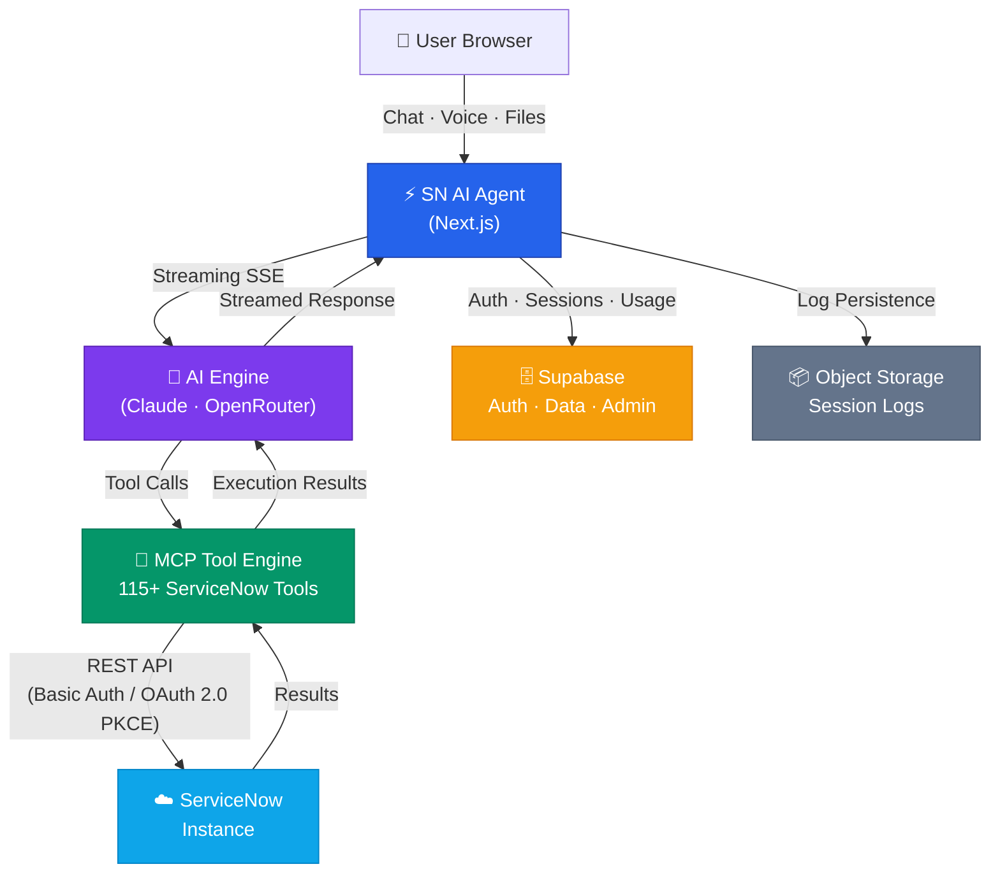
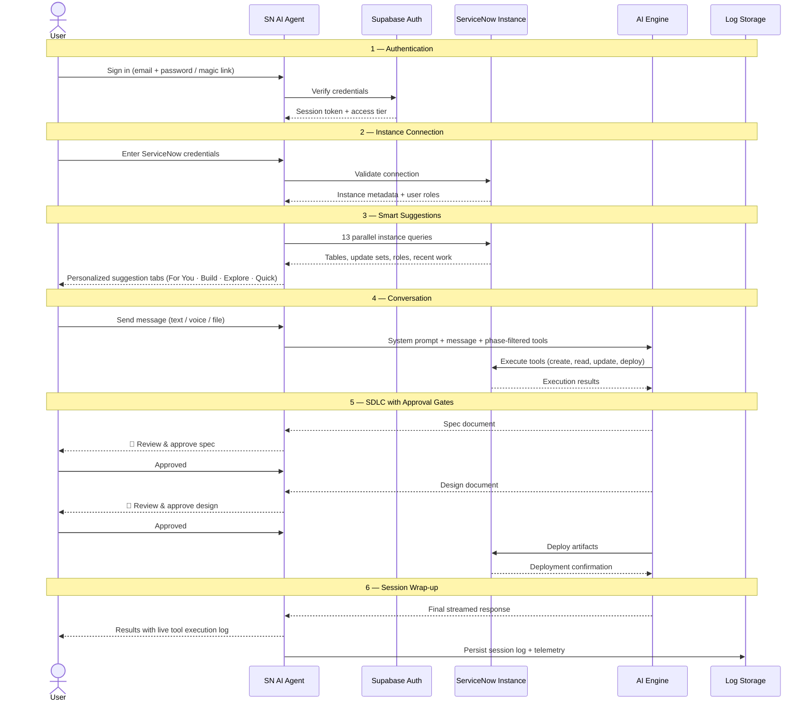
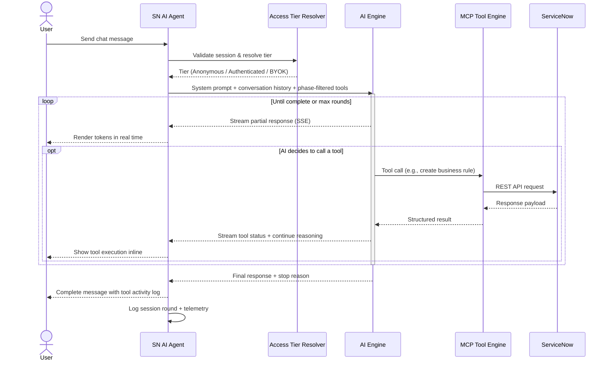

# SN AI Agent — Architecture & Flow Diagrams

**Date:** March 24, 2026  
**Version:** 0.1.0-beta.2  

---

SN AI Agent lets teams build, deploy, and manage ServiceNow solutions through natural-language conversation with AI. From a single chat prompt, the platform walks through a full software development lifecycle — spec, design, implementation, testing, and deployment — with human approval gates at the critical steps. Over 115 tools connect the AI directly to any ServiceNow instance, so what used to take days ships in minutes.

*Say it. Ship it.*

---

## 1. High-Level System Architecture

The platform is a Next.js application that orchestrates between an AI provider, a rich tool engine, and a live ServiceNow instance. Supabase handles identity, usage tracking, and session persistence. Logs are durably stored in S3-compatible object storage.

---

## 2. User Journey — End to End

This sequence shows the complete lifecycle from sign-in through deployment. The platform fetches instance metadata to generate smart suggestions, then guides each request through a phased pipeline with human approval at key milestones.

---

## 3. SDLC Phase Pipeline

Every request flows through a six-phase pipeline. Spec and Design require explicit human approval before the AI proceeds. The remaining phases advance automatically, ensuring speed without sacrificing governance.

```mermaid
flowchart LR
    Spec["📋 Spec"]
    Gate1{"👤 User\nApproval"}
    Design["📐 Design"]
    Gate2{"👤 User\nApproval"}
    Scope["🔍 Scope\nSelection"]
    Impl["⚙️ Implementation"]
    Test["🧪 Testing"]
    Deploy["🚀 Deployment"]

    Spec --> Gate1
    Gate1 -->|Approved| Design
    Gate1 -.->|Rejected| Spec
    Design --> Gate2
    Gate2 -->|Approved| Scope
    Gate2 -.->|Rejected| Design
    Scope --> Impl
    Impl --> Test
    Test --> Deploy

    style Spec fill:#3b82f6,color:#fff,stroke:#2563eb
    style Design fill:#8b5cf6,color:#fff,stroke:#7c3aed
    style Scope fill:#06b6d4,color:#fff,stroke:#0891b2
    style Impl fill:#10b981,color:#fff,stroke:#059669
    style Test fill:#f59e0b,color:#fff,stroke:#d97706
    style Deploy fill:#ef4444,color:#fff,stroke:#dc2626
    style Gate1 fill:#fbbf24,color:#1e293b,stroke:#f59e0b
    style Gate2 fill:#fbbf24,color:#1e293b,stroke:#f59e0b
```

---

## 4. Chat & Tool Execution — Single Message Flow

This diagram details what happens when a user sends a single message. The AI engine resolves the user's access tier, assembles a phase-aware system prompt, streams its response token by token, and executes tools against ServiceNow in a loop until the task is complete.

---

## Access Tier Summary

| Tier | Authentication | Rate Limit | AI Provider |
|------|---------------|------------|-------------|
| **Anonymous** | None (IP-tracked) | Limited daily messages | Platform key |
| **Authenticated** | Email + password or magic link | Higher daily quota | Platform key |
| **BYOK** | Authenticated + own API key | Unlimited | User's own key |

---

## Tool Coverage at a Glance

The MCP Tool Engine provides **115+ tools** across **30+ modules**, giving the AI deep operational access to any ServiceNow instance:

| Category | Examples |
|----------|---------|
| **Records & Tables** | CRUD on any table, bulk operations, encoded queries |
| **Scripts & Logic** | Business rules, client scripts, script includes, fix scripts |
| **UI & UX** | UI policies, UI actions, form layouts, catalog items |
| **Automation** | Flows, scheduled jobs, notifications, events |
| **Security** | ACLs, roles, scope management |
| **DevOps** | Update sets, scoped apps, instance analysis, promotion |
| **Multi-Instance** | Cross-instance comparison, artifact promotion workflows |

---

*Built with ❤️ by the SN AI Agent team.*
