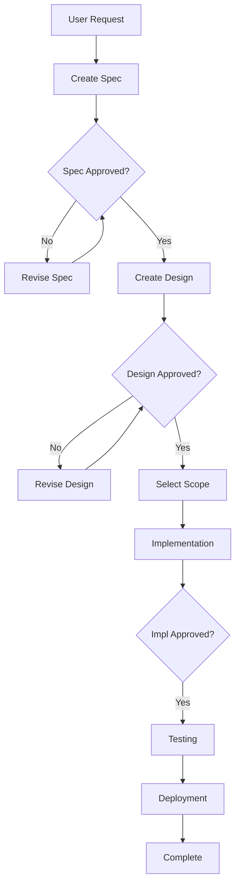
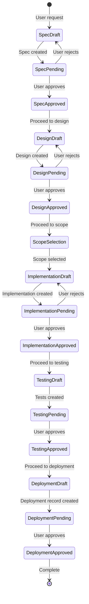

# Workflow Optimization Analysis

> **Date:** 2026-03-20  
> **Focus:** Process & Workflow Optimization for CLAUDE.md and Custom Scope Plan  
> **Analyst:** Process & Workflow Optimization Specialist

---

## Executive Summary

This analysis identifies workflow inefficiencies, decision point gaps, redundancies, and automation opportunities in the SN AI Agent's development process. The analysis covers both the main CLAUDE.md workflow and the custom scope update set capture process.

**Key Findings:**
- **5 major workflow issues** requiring clarification
- **8 decision point gaps** where choices are unclear
- **6 process redundancies** that can be eliminated
- **9 automation opportunities** to streamline operations
- **12 specific process improvements** with concrete recommendations

---

## 1. Workflow Issues

### 1.1 Unclear Scope Selection Decision Tree

**Issue:** The workflow for scope selection lacks a clear decision tree. CLAUDE.md Section 14.6 mentions scope switching but doesn't provide a step-by-step decision flowchart.

**Current State:**
- Section 14.6 describes the five-tier fallback but doesn't show WHEN to use it
- No clear "if Global, do X; if custom scope, do Y" decision tree
- The plan document has a flowchart but it's not integrated into CLAUDE.md

**Impact:** AI agents may skip scope switching or do it at the wrong time.

**Recommendation:**
Add a decision tree to Section 14.6:

```markdown
### 14.6.1 Scope Selection Decision Tree

```
┌─────────────────────────────────────────┐
│ User selects scope from options         │
└──────────────┬──────────────────────────┘
               │
       ┌───────┴────────┐
       │                │
   [Global]      [Custom Scope]
       │                │
       │         ┌──────▼──────────────┐
       │         │ Call sn_set_scope   │
       │         │ with scope sys_id   │
       │         └──────┬──────────────┘
       │                │
       │         ┌──────▼──────────────┐
       │         │ Check response:     │
       │         │ - success?          │
       │         │ - userActionRequired?│
       │         └──────┬──────────────┘
       │                │
       │         ┌──────▼──────────────┐
       │         │ If userActionRequired:│
       │         │ 1. Present checklist │
       │         │ 2. Wait for user     │
       │         │ 3. Call sn_verify_scope│
       │         └──────────────────────┘
       │
┌───────▼────────────────────────────────┐
│ Create update set (no application param│
│ for Global, application=scopeId for    │
│ custom scope)                          │
└────────────────────────────────────────┘
```

**Priority:** High

---

### 1.2 Missing "What to Do When Things Go Wrong" Workflow

**Issue:** CLAUDE.md Section 11 (Error Recovery) is generic. There's no specific workflow for common failure scenarios.

**Current State:**
- Section 11 says "acknowledge, explain, propose, wait" but doesn't cover:
  - What if scope switching fails at Tier 5?
  - What if update set capture verification fails?
  - What if duplicate update set is detected?
  - What if validation script fails?

**Impact:** AI agents may not know how to handle specific errors, leading to inconsistent recovery.

**Recommendation:**
Add Section 11.1 with error-specific workflows:

```markdown
### 11.1 Common Error Scenarios

#### Scenario: Scope Switching Fails (Tier 5)
1. Present user checklist (already documented)
2. Wait for user confirmation
3. Call `sn_verify_scope` (max 2 retries, 3s delay)
4. If still fails: Ask user to verify scope picker is visible
5. If succeeds: Continue with update set creation

#### Scenario: Duplicate Update Set Detected
1. Return `duplicateDetected: true` with options
2. Present options to user via USER_CHOICES:
   - "Use existing update set: [name]"
   - "Create with timestamp suffix"
   - "Create with different name"
3. Wait for user choice
4. Proceed based on choice

#### Scenario: Update Set Capture Verification Fails
1. Call `sn_verify_update_set_capture` with artifact list
2. If missing artifacts found: Auto-move them
3. If auto-move fails: Call `sn_move_to_update_set` for each
4. Re-verify after moves
5. If still missing: Report to user with artifact list
```

**Priority:** High

---

### 1.3 Unclear Multi-Scope Workflow Sequence

**Issue:** Section 14.6 mentions multi-scope workflows but doesn't provide a clear step-by-step sequence.

**Current State:**
- Mentions "group artifacts by scope" but doesn't show HOW
- Doesn't specify when to create update sets (one per scope? one total?)
- Doesn't clarify when to switch scopes (before each artifact? before each group?)

**Impact:** AI agents may create artifacts in the wrong scope or create update sets incorrectly.

**Recommendation:**
Add Section 14.6.2 with explicit multi-scope workflow:

```markdown
### 14.6.2 Multi-Scope Implementation Workflow

**Step 1: Analyze Design**
- Identify all artifacts and their target scopes
- Group artifacts by scope (e.g., `{ "global": [artifact1, artifact2], "custom_app": [artifact3] }`)

**Step 2: For Each Scope Group:**
1. **Switch Scope:**
   ```
   Call sn_set_scope with scope sys_id
   If userActionRequired: present checklist, wait, verify
   ```

2. **Create Update Set:**
   ```
   Call sn_create_update_set with application=scopeSysId (or omit for Global)
   Handle duplicateDetected if returned
   ```

3. **Set Current Update Set:**
   ```
   Call sn_set_current_update_set with update set sys_id
   ```

4. **Create Artifacts:**
   ```
   For each artifact in this scope group:
     - Create artifact (business rule, script include, etc.)
     - Verify updateSetCapture in response
   ```

5. **Verify Capture:**
   ```
   Call sn_verify_update_set_capture with all artifacts from this scope
   ```

6. **Tell User:**
   ```
   "Created [N] artifacts in scope [scope name], update set [name]"
   ```

**Step 3: Final Summary**
- List all update sets created
- Provide links/names for each
```

**Priority:** Medium

---

### 1.4 Phase Gate Workflow Lacks Decision Points

**Issue:** Section 3 shows the phase gate process but doesn't clarify decision points (e.g., when to skip validation, when to auto-proceed).

**Current State:**
- Shows sequential flow but doesn't show conditional branches
- Doesn't explain when `validation.on.failure=warn` vs `block` applies
- Doesn't show what happens if user rejects a phase (can they redo it?)

**Impact:** Unclear when to proceed vs. stop, leading to inconsistent behavior.

**Recommendation:**
Add decision points to Section 3:

```markdown
### 3.1 Phase Gate Decision Points

**Decision: User Rejects Spec/Design**
- Action: AI revises based on feedback
- Gate: Still at same phase until approved
- No progression until sign-off is ☑

**Decision: Validation Fails (validation.on.failure=block)**
- Action: Stop deployment, show violations
- Gate: Cannot proceed until violations fixed
- AI must fix issues before retry

**Decision: Validation Fails (validation.on.failure=warn)**
- Action: Show violations, allow proceed
- Gate: User can choose to proceed anyway
- AI presents violations + "Continue anyway?" option

**Decision: Duplicate Update Set Detected**
- Action: Present options (use existing, timestamp, rename)
- Gate: Wait for user choice before proceeding
- No auto-decision on duplicates
```

**Priority:** Medium

---

### 1.5 Per-Request Scope Reset Not Clearly Documented in Workflow

**Issue:** Section 14.6 mentions "per-request lifecycle" but doesn't show this in the main workflow example (Section 7).

**Current State:**
- Section 7 (Requirement Workflow Example) doesn't mention scope switching
- Section 14.6 mentions it but it's buried in technical details
- AI agents may not realize they need to call `sn_set_scope` at the start of implementation

**Impact:** Scope may not be set correctly at the start of implementation, causing artifacts to land in Global.

**Recommendation:**
Update Section 7 to include scope switching:

```markdown
STEP 6: Create Implementation
├── **If custom scope:** Call sn_set_scope with scope sys_id
│   ├── If success: Continue
│   └── If userActionRequired: Present checklist, wait, verify
├── Create specs/REQ-XXX/3-implementation/ files
├── Create update set (with application=scopeId if custom scope)
├── Create deployment script in mcp-servicenow/deploy/
└── 🛑 STOP: "I've created the implementation. Please review and reply 'approved' to deploy."
```

**Priority:** High

---

## 2. Decision Point Gaps

### 2.1 No Decision Table for Scope Selection

**Issue:** The custom scope plan mentions a "decision table" in system-prompt.ts but it's not visible in CLAUDE.md.

**Current State:**
- Plan document mentions decision table but it's not in CLAUDE.md
- AI agents must infer when to use Global vs. custom scope

**Recommendation:**
Add Section 14.6.3 with decision table:

```markdown
### 14.6.3 Scope Selection Decision Table

| Condition | Action | Tool to Use |
|-----------|--------|-------------|
| User selects "Global" | Create update set with no `application` param | `sn_create_update_set` (no application) |
| User selects custom scope | 1. Call `sn_set_scope`<br>2. If success: create update set with `application=scopeId`<br>3. If userActionRequired: present checklist | `sn_set_scope` → `sn_create_update_set` |
| Design specifies multiple scopes | Group artifacts by scope, switch scope before each group | `sn_set_scope` per group |
| Implementation phase starts | Always call `sn_set_scope` again (scope resets per request) | `sn_set_scope` at start of implementation |
| Update set creation fails scope guard | Auto-call `ensureScopeActive()` before creating | Automatic (scope guard in `createUpdateSet()`) |
```

**Priority:** High

---

### 2.2 Missing Decision Point: When to Use Each Update Set Tool

**Issue:** Section 14.3 lists tools but doesn't explain WHEN to use each.

**Current State:**
- Lists `sn_move_to_update_set` and `sn_verify_update_set_capture` but no decision logic
- AI agents may not know when to verify vs. when to move

**Recommendation:**
Add decision logic to Section 14.3:

```markdown
### 14.3.1 When to Use Each Tool

**Use `sn_verify_update_set_capture`:**
- After creating ALL artifacts for an update set
- Before marking implementation phase complete
- When user asks "Did everything get captured?"

**Use `sn_move_to_update_set`:**
- Only when `sn_verify_update_set_capture` reports missing artifacts
- As a manual fallback if auto-move in verification fails
- When user explicitly requests moving a specific artifact

**Decision Flow:**
```
After creating artifacts → Call sn_verify_update_set_capture
  ├─ If all captured: Continue
  └─ If missing found: Auto-move runs, then re-verify
      └─ If still missing: Call sn_move_to_update_set for each
```

**Priority:** Medium

---

### 2.3 No Decision Point for Validation Failure Handling

**Issue:** Section 9 mentions validation but doesn't show decision logic for failure scenarios.

**Current State:**
- Says "Run `node scripts/validate.cjs REQ-XXX`" but doesn't say what to do if it fails
- `config.properties` has `validation.on.failure=warn|block` but workflow doesn't show how this affects behavior

**Recommendation:**
Add Section 9.1 with validation decision tree:

```markdown
### 9.1 Validation Failure Decision Tree

```
┌─────────────────────────────────────┐
│ Run: node scripts/validate.cjs REQ-XXX │
└──────────────┬──────────────────────┘
               │
       ┌───────▼────────┐
       │ Validation     │
       │ Result?        │
       └───────┬────────┘
               │
    ┌──────────┴──────────┐
    │                     │
[PASS]              [FAIL]
    │                     │
    │         ┌───────────▼──────────────┐
    │         │ Check config.properties: │
    │         │ validation.on.failure   │
    │         └───────────┬──────────────┘
    │                     │
    │         ┌───────────▼──────────────┐
    │         │ = block?                 │
    │         └───────────┬──────────────┘
    │                     │
    │         ┌───────────┴──────────────┐
    │         │                          │
    │      [YES]                      [NO (warn)]
    │         │                          │
    │         │                  ┌───────▼──────────────┐
    │         │                  │ Show violations      │
    │         │                  │ Present: "Continue    │
    │         │                  │ anyway?" option       │
    │         │                  └───────┬──────────────┘
    │         │                          │
    │         │                  ┌───────▼──────────────┐
    │         │                  │ Wait for user choice │
    │         │                  └─────────────────────┘
    │         │
    │  ┌──────▼──────────────┐
    │  │ STOP: Cannot deploy │
    │  │ Fix violations first│
    │  └─────────────────────┘
    │
┌────▼─────────────────────────┐
│ Proceed to deployment        │
└──────────────────────────────┘
```

**Priority:** Medium

---

### 2.4 Missing Decision: When to Use Browser Automation (Tier 4)

**Issue:** Section 14.6 mentions Tier 4 (Playwright) but doesn't explain when it's available or when to enable it.

**Current State:**
- Mentions `ENABLE_BROWSER_SCOPE_SWITCH=true` but doesn't show decision logic
- Doesn't explain when Tier 4 is attempted vs. skipped

**Recommendation:**
Add to Section 14.6:

```markdown
### 14.6.4 Tier 4 (Browser Automation) Decision Logic

**When Tier 4 is Attempted:**
- Tiers 1-3 have all failed
- `ENABLE_BROWSER_SCOPE_SWITCH=true` in webapp `.env`
- `browserFallback` callback is provided (injected by webapp)
- User's instance URL matches SSRF allowlist (`*.service-now.com`)

**When Tier 4 is Skipped:**
- `ENABLE_BROWSER_SCOPE_SWITCH` is not set or `false`
- `playwright-core` is not installed
- Instance URL doesn't match allowlist
- MFA/SSO detected (fails fast)

**Decision Flow:**
```
Tier 3 fails → Check: browserFallback provided?
  ├─ Yes → Attempt Tier 4 (max 30s timeout)
  │   ├─ Success → Verify scope
  │   └─ Fail (MFA/SSO/timeout) → Tier 5
  └─ No → Skip to Tier 5
```

**Priority:** Low (documentation only, not blocking)

---

### 2.5 No Decision Point for Duplicate Update Set Handling

**Issue:** Section 14.2 mentions duplicate detection but doesn't show the decision flow for handling it.

**Current State:**
- Lists 3 options but doesn't show WHEN to use each
- Doesn't clarify if AI should auto-choose or always ask user

**Recommendation:**
Add decision flow to Section 14.2:

```markdown
### 14.2.1 Duplicate Update Set Decision Flow

```
┌─────────────────────────────────────┐
│ sn_create_update_set called         │
└──────────────┬──────────────────────┘
               │
       ┌───────▼────────┐
       │ Check for      │
       │ duplicate name │
       └───────┬────────┘
               │
    ┌──────────┴──────────┐
    │                     │
[No duplicate]      [Duplicate found]
    │                     │
    │         ┌───────────▼──────────────┐
    │         │ Return duplicateDetected: │
    │         │ true with options        │
    │         └───────────┬──────────────┘
    │                     │
    │         ┌───────────▼──────────────┐
    │         │ Present USER_CHOICES:    │
    │         │ 1. Use existing: [name]  │
    │         │ 2. Create with timestamp │
    │         │ 3. Create with new name  │
    │         └───────────┬──────────────┘
    │                     │
    │         ┌───────────▼──────────────┐
    │         │ Wait for user choice    │
    │         └───────────┬──────────────┘
    │                     │
    │         ┌───────────▼──────────────┐
    │         │ Proceed based on choice: │
    │         │ - Option 1: Use existing  │
    │         │ - Option 2: Retry with   │
    │         │   autoTimestamp: true     │
    │         │ - Option 3: Retry with   │
    │         │   new name               │
    │         └──────────────────────────┘
    │
┌────▼─────────────────────────┐
│ Create update set            │
└──────────────────────────────┘
```

**NEVER auto-choose** — always present options to user.

**Priority:** Medium

---

### 2.6 Missing Decision: When to Re-verify Scope

**Issue:** Section 14.6 mentions verification but doesn't clarify when to re-check scope during a long implementation session.

**Current State:**
- Says "call sn_set_scope at start of each implementation turn" but doesn't say when to verify
- Doesn't clarify if verification is needed after each artifact creation

**Recommendation:**
Add to Section 14.6:

```markdown
### 14.6.5 Scope Verification Timing

**Always Verify:**
- After calling `sn_set_scope` (if userActionRequired was returned)
- Before creating update set in custom scope
- If user reports "artifacts landed in wrong scope"

**Optional Verify (for long sessions):**
- After creating 10+ artifacts (scope shouldn't change, but good to check)
- If implementation phase spans multiple chat turns

**Never Verify:**
- After every single artifact (too frequent, adds latency)
- In Global scope (no scope switching needed)

**Decision:**
```
sn_set_scope called → Check response
  ├─ success: Continue (no immediate verify needed)
  └─ userActionRequired: Verify after user confirms
```

**Priority:** Low

---

### 2.7 No Decision Point for Multi-Scope Artifact Grouping

**Issue:** Multi-scope workflow mentions "group artifacts" but doesn't show HOW to decide groupings.

**Current State:**
- Says "group by scope" but doesn't show decision logic for edge cases:
  - What if an artifact's scope isn't specified in design?
  - What if design says "Global" but artifact table requires custom scope?

**Recommendation:**
Add decision logic:

```markdown
### 14.6.6 Artifact Scope Assignment Decision

**Priority Order:**
1. **Explicit in design:** Use design-specified scope
2. **Table default:** Some tables (e.g., `sys_script_include`) default to Global if not specified
3. **Update set scope:** If artifact is created in an update set's scope, inherit that scope
4. **Fallback:** If unclear, ask user or default to Global

**Decision Table:**
| Design Specifies Scope? | Table Requires Scope? | Action |
|------------------------|----------------------|--------|
| Yes | N/A | Use design scope |
| No | Yes | Use table's default scope |
| No | No | Use update set's scope (if set) or Global |
| Conflict (design vs table) | - | Ask user or use design scope (user intent) |
```

**Priority:** Medium

---

### 2.8 Missing Decision: When to Skip Phase Gates (Emergency/Override)

**Issue:** No documentation on whether phase gates can be bypassed in emergencies or for hotfixes.

**Current State:**
- Section 3 says "NEVER skip phases" but doesn't address edge cases
- No process for urgent fixes that need to skip spec/design

**Recommendation:**
Add Section 3.2:

```markdown
### 3.2 Phase Gate Override (Emergency Only)

**When Override is Allowed:**
- Critical production hotfix (system down)
- User explicitly requests "skip approval, deploy now"
- Emergency security patch

**Override Process:**
1. User must explicitly state "override phase gates" or "emergency deployment"
2. AI acknowledges: "⚠️ Emergency override requested. Skipping [phase] approval."
3. AI documents override in deployment record
4. Normal workflow resumes after emergency

**What Cannot Be Overridden:**
- Validation failures (if `validation.on.failure=block`)
- Scope switching (must succeed or use Tier 5)
- Update set creation (must have valid update set)

**Documentation:**
- Override reason must be recorded in `5-deployment.md`
- User approval still required for deployment phase (final gate)
```

**Priority:** Low (edge case, but good to document)

---

## 3. Process Redundancies

### 3.1 Redundant Scope Switching Calls

**Issue:** Section 14.6 says "call sn_set_scope at start of each implementation turn" but `createUpdateSet()` also has a scope guard that calls `ensureScopeActive()`. This means scope switching may happen twice.

**Current State:**
- AI calls `sn_set_scope` at start of implementation
- Then `createUpdateSet()` calls `ensureScopeActive()` again if scope doesn't match
- Both use the same five-tier fallback

**Impact:** Unnecessary API calls if scope is already set correctly.

**Recommendation:**
Optimize by making scope guard check if scope is already active:

```markdown
### 14.6.7 Scope Guard Optimization

The scope guard in `createUpdateSet()` should check `client.getActiveScope()` first:
- If scope matches: Skip `ensureScopeActive()` (no redundant call)
- If scope doesn't match: Call `ensureScopeActive()` (safety net)

This means:
- If AI correctly calls `sn_set_scope` first: No redundant call
- If AI forgets: Scope guard catches it (defense in depth)

**Best Practice:** AI should still call `sn_set_scope` explicitly for clarity, but guard prevents errors.
```

**Priority:** Low (optimization, not blocking)

---

### 3.2 Redundant Verification Steps

**Issue:** Section 14.5 says "verify with sn_get_update_set_contents" but `sn_verify_update_set_capture` also verifies. Two verification steps may be redundant.

**Current State:**
- Step 4: "Verify with sn_get_update_set_contents"
- Step 5: "Use sn_move_to_update_set as fallback"
- But `sn_verify_update_set_capture` already does verification + auto-move

**Impact:** AI may call both tools unnecessarily.

**Recommendation:**
Clarify in Section 14.5:

```markdown
### 14.5 Implementation Workflow (Revised)

1. Call `sn_create_update_set` — handle `duplicateDetected` if returned
2. Call `sn_set_current_update_set` with the update set sys_id
3. Create artifacts — each response includes `updateSetCapture` field
4. **After ALL artifacts created:** Call `sn_verify_update_set_capture` (this replaces manual verification)
   - If all captured: Continue
   - If missing: Auto-move runs, then re-verify
5. **Only if auto-move fails:** Use `sn_move_to_update_set` for specific artifacts

**Note:** `sn_get_update_set_contents` is for inspection/debugging, not required in workflow.
```

**Priority:** Medium

---

### 3.3 Duplicate "Never Do" and "Always Do" Lists

**Issue:** Sections 4 and 5 have some overlap (e.g., "never skip phases" vs "always follow phase order").

**Current State:**
- Section 4: "NEVER skip phases"
- Section 5: Implicitly requires following phase order
- Some rules appear in both sections

**Impact:** Redundancy makes it harder to maintain consistency.

**Recommendation:**
Consolidate into a single "Rules" section with subcategories:

```markdown
## 4. Mandatory Rules

### 4.1 Phase Gates (Never Skip)
- NEVER skip phases
- NEVER auto-approve sign-offs
- NEVER mark sign-offs as complete yourself

### 4.2 Artifacts (Always Validate)
- Always validate before deploy
- Always use templates
- Always use clean naming (no REQ-IDs in names)

### 4.3 Scope & Update Sets (Always Verify)
- Always call sn_set_scope at start of implementation (custom scope)
- Always verify update set capture after creating artifacts
- Never silently create duplicate update sets
```

**Priority:** Low (organizational improvement)

---

### 3.4 Redundant Error Recovery Instructions

**Issue:** Section 11 (Error Recovery) is generic, and specific error handling is scattered in other sections.

**Current State:**
- Section 11: Generic "acknowledge, explain, propose, wait"
- Section 14.2: Specific duplicate update set handling
- Section 14.6: Specific scope switching failures
- No single place for all error scenarios

**Impact:** AI agents must search multiple sections to find error handling.

**Recommendation:**
Keep Section 11 generic, but add cross-references:

```markdown
## 11. Error Recovery

**General Process:**
1. Acknowledge the error
2. Explain what went wrong
3. Propose a fix
4. Wait for user direction

**Specific Error Scenarios:**
- **Duplicate update set:** See Section 14.2.1
- **Scope switching failure:** See Section 14.6 (Tier 5)
- **Update set capture failure:** See Section 14.5
- **Validation failure:** See Section 9.1
```

**Priority:** Low

---

### 3.5 Redundant Session Start Checklist Items

**Issue:** Section 12 (Session Start Checklist) has items that are already covered in Section 2 (Critical Files to Read).

**Current State:**
- Section 2: Lists files to read
- Section 12: Repeats "Read config.properties" and "Check manifest.json"

**Impact:** Minor redundancy, but could be streamlined.

**Recommendation:**
Make Section 12 reference Section 2:

```markdown
## 12. Session Start Checklist

At the start of every session involving requirements:

- [ ] Read this CLAUDE.md file (Section 1-5)
- [ ] Read critical files (see Section 2)
- [ ] Identify which requirement(s) are in progress
- [ ] Confirm current phase with user before continuing
```

**Priority:** Low

---

### 3.6 Redundant Tool Documentation

**Issue:** Section 14.3 lists tools, but the custom scope plan document also lists them. Some information is duplicated.

**Current State:**
- CLAUDE.md Section 14.3: Tool list
- Plan document: Same tool list with more detail
- No clear "source of truth"

**Impact:** Maintenance burden if one gets updated but not the other.

**Recommendation:**
Keep CLAUDE.md as the source of truth for AI agents, reference plan document for implementation details:

```markdown
### 14.3 New Tools

| Tool | Purpose | Full Design |
|------|---------|-------------|
| `sn_move_to_update_set` | Manual fallback — move artifact to update set | See [Custom Scope Capture](docs/custom-scope-capture.md#tools) |
| `sn_verify_update_set_capture` | Verify all artifacts captured; auto-moves missing | See [Custom Scope Capture](docs/custom-scope-capture.md#tools) |

**For implementation details, see:** `docs/custom-scope-capture.md`
```

**Priority:** Low

---

## 4. Automation Opportunities

### 4.1 Auto-Detect Scope from Design Document

**Opportunity:** Parse design document to extract scope requirements automatically.

**Current State:**
- AI must manually identify scope from design
- User must select scope in UI
- No automatic scope detection

**Proposed Automation:**
- Parse `2-design.md` for scope references (e.g., "application: custom_app", "scope: x_my_app")
- Pre-populate scope selection UI with detected scope
- AI can confirm or user can override

**Implementation:**
```markdown
### 4.1.1 Auto-Scope Detection

**In design phase, AI should:**
1. Identify target scope(s) from design document
2. Emit scope metadata: `<!-- SCOPE_DETECTED: sys_id, name -->`
3. Frontend pre-selects scope in UI
4. User can confirm or change

**Benefits:**
- Reduces manual scope selection step
- Catches scope mismatches early
- Faster workflow for single-scope designs
```

**Priority:** Medium

---

### 4.2 Auto-Create Update Set Name from Requirement

**Opportunity:** Generate update set name automatically from requirement title/ID.

**Current State:**
- AI must generate update set name
- User may need to approve name
- Names may be inconsistent

**Proposed Automation:**
- Auto-generate name from `REQ-XXX` and requirement title
- Format: `REQ-XXX: [Requirement Title]`
- AI can override if needed

**Implementation:**
```markdown
### 4.2.1 Auto-Update Set Naming

**Default Naming Pattern:**
```
REQ-{ID}: {Requirement Title}
```

**Examples:**
- `REQ-001: High Impact Change Validation`
- `REQ-042: Custom Scope Update Set Fix`

**Override:**
- AI can specify custom name if default doesn't fit
- User can edit name in UI before creation
```

**Priority:** Low (nice-to-have)

---

### 4.3 Auto-Verify After Artifact Creation

**Opportunity:** Automatically verify update set capture after each artifact creation, not just at the end.

**Current State:**
- Verification happens after ALL artifacts created
- If capture fails, must move artifacts retroactively

**Proposed Automation:**
- After each artifact creation, check `updateSetCapture` field in response
- If `updateSetCapture.success === false`, immediately call `sn_move_to_update_set`
- Only do final verification at end for completeness check

**Implementation:**
```markdown
### 4.3.1 Per-Artifact Capture Verification

**Current Flow:**
```
Create artifact → Check updateSetCapture field
  ├─ success: true → Continue
  └─ success: false → Immediately call sn_move_to_update_set
```

**Benefits:**
- Catches capture failures immediately
- No need to retroactively move multiple artifacts
- Faster error detection
```

**Priority:** Medium

---

### 4.4 Auto-Group Artifacts by Scope

**Opportunity:** Automatically group artifacts by scope during implementation planning.

**Current State:**
- AI must manually group artifacts by scope
- Multi-scope designs require manual grouping step

**Proposed Automation:**
- Parse design document for artifact-scope mappings
- Auto-generate implementation plan with scope groups
- AI presents grouped plan to user for confirmation

**Implementation:**
```markdown
### 4.4.1 Auto-Scope Grouping

**Process:**
1. Parse `2-design.md` for artifacts and their scopes
2. Group artifacts: `{ "global": [...], "custom_app": [...] }`
3. Generate implementation plan:
   ```
   Scope Group 1: Global
     - Business Rule: ValidateHighImpact
     - Script Include: HighImpactUtil
   
   Scope Group 2: Custom App (x_my_app)
     - Flow: ProcessHighImpact
   ```
4. AI confirms plan with user before starting
```

**Priority:** Low (can be done manually, but automation would help)

---

### 4.5 Auto-Retry on Transient Failures

**Opportunity:** Automatically retry scope switching and update set operations on transient failures.

**Current State:**
- If Tier 1 (concoursepicker) fails, immediately falls to Tier 2
- No retry logic for transient network errors

**Proposed Automation:**
- Add retry logic to `ensureScopeActive()`:
  - Retry Tier 1 up to 2 times with 1s delay
  - Only fall to Tier 2 if retries fail
- Similar retry for update set creation (network timeouts)

**Implementation:**
```markdown
### 4.5.1 Transient Failure Retry

**Retry Logic:**
- Network errors (ECONNRESET, ETIMEDOUT): Retry 2x with 1s delay
- 5xx server errors: Retry 1x with 2s delay
- 4xx client errors: No retry (permanent failure)

**Applied To:**
- `ensureScopeActive()` Tier 1 (concoursepicker)
- `sn_create_update_set` (network timeouts)
- `sn_verify_update_set_capture` (query timeouts)
```

**Priority:** Medium

---

### 4.6 Auto-Detect Duplicate Update Sets Before Creation

**Opportunity:** Check for duplicates before attempting creation, not just after.

**Current State:**
- Duplicate check happens in `createUpdateSet()` after name is provided
- If duplicate found, must retry with different name

**Proposed Automation:**
- Pre-check for duplicates when AI proposes update set name
- Suggest alternatives immediately if duplicate found
- User can choose from suggestions before creation

**Implementation:**
```markdown
### 4.6.1 Pre-Creation Duplicate Check

**Flow:**
1. AI proposes update set name: "High Impact Validation"
2. System checks for duplicates (async, non-blocking)
3. If duplicate found: Present suggestions:
   - "High Impact Validation 2026-03-20"
   - "High Impact Validation v2"
4. User selects or provides custom name
5. Create with confirmed name
```

**Priority:** Low (current flow works, but this would be smoother)

---

### 4.7 Auto-Update Manifest After Phase Completion

**Opportunity:** Automatically update `manifest.json` when phases complete.

**Current State:**
- Section 5 says "auto.update.manifest=true" in config
- But workflow doesn't show when this happens

**Proposed Automation:**
- After each phase gate passes, auto-update manifest status
- AI doesn't need to manually update manifest
- Reduces chance of stale manifest data

**Implementation:**
```markdown
### 4.7.1 Auto-Manifest Updates

**Triggers:**
- Spec approved → Update `manifest.json`: `status: "design"`
- Design approved → Update `manifest.json`: `status: "implementation"`
- Implementation complete → Update `manifest.json`: `status: "testing"`
- Testing complete → Update `manifest.json`: `status: "deployment"`
- Deployment complete → Update `manifest.json`: `status: "done"`

**AI Role:**
- AI doesn't manually edit manifest
- System updates based on phase gate approvals
- AI can read manifest to check status
```

**Priority:** Medium (if `auto.update.manifest=true` is already in config, should be implemented)

---

### 4.8 Auto-Generate Deployment Record

**Opportunity:** Automatically generate `5-deployment.md` from deployment results.

**Current State:**
- Section 7 Step 8 says "Create 5-deployment.md with deployment record"
- AI must manually create this document

**Proposed Automation:**
- After deployment completes, auto-generate deployment record
- Include: update set name, artifacts deployed, test results, timestamp
- AI can add notes/comments, but structure is auto-generated

**Implementation:**
```markdown
### 4.8.1 Auto-Deployment Record

**Template Auto-Fill:**
- Update set: [from sn_create_update_set response]
- Artifacts: [from sn_verify_update_set_capture response]
- Test results: [from testing phase]
- Timestamp: [current date/time]
- Deployed by: [from session metadata]

**AI Role:**
- Review auto-generated record
- Add deployment notes if needed
- Confirm record is complete
```

**Priority:** Low (current manual process works, but automation would save time)

---

### 4.9 Auto-Suggest Scope Based on Artifact Type

**Opportunity:** Suggest scope based on artifact type (some artifacts are typically Global, others are typically scoped).

**Current State:**
- No scope suggestions based on artifact type
- AI must infer scope from design or ask user

**Proposed Automation:**
- Business rules, script includes: Often Global (suggest Global)
- Flows, applications: Often custom scope (suggest custom)
- UI policies: Depends on table (suggest based on table scope)

**Implementation:**
```markdown
### 4.9.1 Scope Suggestions by Artifact Type

**Default Scope Suggestions:**
| Artifact Type | Typical Scope | Reasoning |
|---------------|---------------|-----------|
| Business Rule | Global | Often cross-table logic |
| Script Include | Global | Reusable utilities |
| Client Script | Global | UI behavior, not app-specific |
| Flow | Custom | Usually app-specific |
| Application | Custom | Defines the app itself |
| UI Policy | Table scope | Inherits from target table |

**AI Role:**
- Use suggestions as starting point
- Override if design specifies different scope
- Confirm with user if unclear
```

**Priority:** Low (heuristic-based, may not always be accurate)

---

## 5. Specific Process Improvements

### 5.1 Add Workflow Diagrams to CLAUDE.md

**Improvement:** Include visual workflow diagrams for complex processes.

**Current State:**
- Section 3 has ASCII art workflow
- Section 14.6 has mermaid diagram in plan doc but not in CLAUDE.md
- No visual decision trees

**Recommendation:**
Add mermaid diagrams to CLAUDE.md:

```markdown
### 3.3 Visual Workflow Diagram



**Priority:** Medium

---

### 5.2 Create Quick Reference Card

**Improvement:** Add a one-page quick reference for common workflows.

**Current State:**
- CLAUDE.md is comprehensive but long
- AI agents must search for specific workflows

**Recommendation:**
Add Section 19: Quick Reference

```markdown
## 19. Quick Reference Card

### Common Workflows

**Single-Scope Implementation:**
1. `sn_set_scope` (if custom scope)
2. `sn_create_update_set`
3. `sn_set_current_update_set`
4. Create artifacts
5. `sn_verify_update_set_capture`

**Multi-Scope Implementation:**
1. Group artifacts by scope
2. For each scope: `sn_set_scope` → create update set → create artifacts → verify
3. Summary of all update sets

**Error Recovery:**
- Duplicate update set → Present options, wait for choice
- Scope switch fails → Tier 5 checklist, wait for user
- Capture fails → Auto-move, then re-verify

### Decision Points

| Question | Answer |
|----------|--------|
| When to call sn_set_scope? | Start of implementation (custom scope) |
| When to verify capture? | After ALL artifacts created |
| When to retry scope switch? | Never auto-retry; use next tier |
| When to skip phase gate? | Never (unless emergency override) |
```

**Priority:** High

---

### 5.3 Add "Common Mistakes" Section

**Improvement:** Document common mistakes AI agents make to prevent them.

**Current State:**
- No section on common mistakes
- AI agents may repeat errors

**Recommendation:**
Add Section 20: Common Mistakes to Avoid

```markdown
## 20. Common Mistakes to Avoid

### Mistake 1: Forgetting to Set Scope
**Symptom:** Artifacts land in Global when they should be in custom scope
**Prevention:** Always call `sn_set_scope` at start of implementation (custom scope)
**Detection:** Scope guard in `createUpdateSet()` catches this, but better to prevent

### Mistake 2: Creating Update Set Before Setting Scope
**Symptom:** Update set has correct `application` field but artifacts don't capture
**Prevention:** Set scope BEFORE creating update set
**Detection:** Scope guard prevents this

### Mistake 3: Not Verifying Capture
**Symptom:** Missing artifacts in update set, discovered later
**Prevention:** Always call `sn_verify_update_set_capture` after creating artifacts
**Detection:** Manual check required

### Mistake 4: Auto-Choosing Duplicate Update Set Option
**Symptom:** User expects to choose, but AI auto-proceeds
**Prevention:** Always present options, never auto-choose
**Detection:** User feedback

### Mistake 5: Skipping Phase Gates
**Symptom:** Implementation starts before design is approved
**Prevention:** Check phase gate status before proceeding
**Detection:** Phase gate enforcement
```

**Priority:** Medium

---

### 5.4 Add "Workflow Templates" Section

**Improvement:** Provide copy-paste workflow templates for common scenarios.

**Current State:**
- Workflows are described but not in template form
- AI agents must construct workflows from descriptions

**Recommendation:**
Add Section 21: Workflow Templates

```markdown
## 21. Workflow Templates

### Template: Single-Scope Implementation

```
1. Call sn_set_scope with scope sys_id
   - If success: Continue
   - If userActionRequired: Present checklist, wait, verify

2. Call sn_create_update_set
   - If duplicateDetected: Present options, wait, retry
   - If success: Note update set sys_id

3. Call sn_set_current_update_set with update set sys_id

4. For each artifact:
   - Create artifact
   - Check updateSetCapture field

5. Call sn_verify_update_set_capture with all artifact sys_ids

6. If missing artifacts: Auto-move runs, re-verify

7. Present summary: "Created [N] artifacts in update set [name]"
```

### Template: Multi-Scope Implementation

```
1. Group artifacts by scope from design document

2. For each scope group:
   a. Call sn_set_scope
   b. Create update set for this scope
   c. Set current update set
   d. Create all artifacts in this scope
   e. Verify capture
   f. Tell user: "Created [N] artifacts in [scope name]"

3. Final summary: List all update sets created
```

### Template: Error Recovery

```
1. Acknowledge: "I encountered [error type]"

2. Explain: "[What went wrong and why]"

3. Propose: "I can [solution option 1] or [solution option 2]"

4. Wait: Present options via USER_CHOICES, wait for user direction

5. Execute: Proceed based on user choice
```
```

**Priority:** High

---

### 5.5 Add "Validation Checklist" Section

**Improvement:** Provide checklists for each phase to ensure nothing is missed.

**Current State:**
- Section 12 has session start checklist
- No phase-specific checklists

**Recommendation:**
Add Section 22: Phase Validation Checklists

```markdown
## 22. Phase Validation Checklists

### Spec Phase Checklist
- [ ] Spec document created using template
- [ ] All required sections filled
- [ ] Sign-off section present with ☐ (unchecked)
- [ ] Phase gate marker emitted: `<!-- PHASE_GATE:spec -->`
- [ ] User approval requested

### Design Phase Checklist
- [ ] Design document created using template
- [ ] All artifacts identified with target scopes
- [ ] Multi-scope designs have scope groups defined
- [ ] Sign-off section present with ☐ (unchecked)
- [ ] Phase gate marker emitted: `<!-- PHASE_GATE:design -->`
- [ ] User approval requested

### Scope Selection Checklist
- [ ] Scope options presented via USER_CHOICES
- [ ] User selects scope (Global or custom)
- [ ] If custom: Call sn_set_scope
- [ ] If userActionRequired: Present checklist, wait, verify
- [ ] Scope confirmed before proceeding

### Implementation Checklist
- [ ] Scope set (if custom scope)
- [ ] Update set created (handle duplicates)
- [ ] Current update set set
- [ ] All artifacts created
- [ ] Update set capture verified
- [ ] Phase gate marker emitted: `<!-- PHASE_GATE:implementation -->`
- [ ] User approval requested

### Testing Checklist
- [ ] Test plan created
- [ ] Tests executed
- [ ] Results captured
- [ ] Phase gate marker emitted: `<!-- PHASE_GATE:testing -->`
- [ ] User approval requested

### Deployment Checklist
- [ ] Deployment record created
- [ ] Manifest updated
- [ ] Phase gate marker emitted: `<!-- PHASE_GATE:deployment -->`
- [ ] User approval requested
```

**Priority:** Medium

---

### 5.6 Add "Troubleshooting Guide" Section

**Improvement:** Provide troubleshooting steps for common issues.

**Current State:**
- Error recovery is generic
- No troubleshooting guide

**Recommendation:**
Add Section 23: Troubleshooting Guide

```markdown
## 23. Troubleshooting Guide

### Issue: Artifacts Not Captured in Update Set

**Symptoms:**
- `sn_verify_update_set_capture` reports missing artifacts
- Artifacts exist in ServiceNow but not in update set

**Diagnosis:**
1. Check scope: Was scope set correctly before creating update set?
2. Check update set: Is update set in the correct scope?
3. Check artifacts: Are artifacts in the correct scope?

**Resolution:**
1. Call `sn_verify_update_set_capture` (auto-move should run)
2. If auto-move fails: Call `sn_move_to_update_set` for each missing artifact
3. Re-verify after moves
4. If still missing: Check scope mismatch (artifacts in wrong scope)

### Issue: Scope Switch Fails at All Tiers

**Symptoms:**
- All 5 tiers fail
- `sn_set_scope` returns `userActionRequired: true`

**Diagnosis:**
- Instance may have restrictions (non-admin user, custom security)
- Browser automation may be disabled or blocked
- MFA/SSO may be required

**Resolution:**
1. Present Tier 5 checklist to user
2. User manually switches scope in ServiceNow UI
3. Call `sn_verify_scope` to confirm
4. If verification fails: Ask user to refresh ServiceNow page and try again

### Issue: Duplicate Update Set Detected

**Symptoms:**
- `sn_create_update_set` returns `duplicateDetected: true`

**Diagnosis:**
- Update set with same name already exists

**Resolution:**
1. Present options to user:
   - Use existing update set
   - Create with timestamp
   - Create with different name
2. Wait for user choice
3. Proceed based on choice

### Issue: Validation Fails

**Symptoms:**
- `node scripts/validate.cjs REQ-XXX` reports violations

**Diagnosis:**
- Check `config.properties`: `validation.on.failure` setting
- Review violation report

**Resolution:**
- If `validation.on.failure=block`: Fix violations before proceeding
- If `validation.on.failure=warn`: Review violations, user can proceed anyway
```

**Priority:** High

---

### 5.7 Add "Workflow Examples" Section

**Improvement:** Provide complete worked examples of common workflows.

**Current State:**
- Section 7 has a workflow example but it's high-level
- No detailed step-by-step examples

**Recommendation:**
Add Section 24: Workflow Examples

```markdown
## 24. Workflow Examples

### Example 1: Single Business Rule in Global Scope

**User Request:** "Create a business rule that validates high impact changes"

**AI Workflow:**
1. **Spec Phase:**
   - Create `specs/REQ-001/1-spec.md`
   - Emit `<!-- PHASE_GATE:spec -->`
   - Wait for approval

2. **Design Phase:**
   - Create `specs/REQ-001/2-design.md`
   - Identify: Business Rule, Global scope
   - Emit `<!-- PHASE_GATE:design -->`
   - Wait for approval

3. **Scope Selection:**
   - Present scope options (Global selected)
   - No `sn_set_scope` needed (Global is default)

4. **Implementation:**
   - Create update set: `sn_create_update_set({ name: "REQ-001: High Impact Validation" })`
   - Set current: `sn_set_current_update_set({ update_set_id: "..." })`
   - Create business rule: `sn_create_business_rule({ ... })`
   - Verify: `sn_verify_update_set_capture({ update_set_id: "...", artifacts: [...] })`
   - Emit `<!-- PHASE_GATE:implementation -->`
   - Wait for approval

5. **Testing:**
   - Create test plan
   - Execute tests
   - Emit `<!-- PHASE_GATE:testing -->`
   - Wait for approval

6. **Deployment:**
   - Create deployment record
   - Emit `<!-- PHASE_GATE:deployment -->`
   - Wait for approval

### Example 2: Multi-Scope Flow + Business Rule

**User Request:** "Create a flow in custom app and a business rule in Global"

**AI Workflow:**
1. **Spec & Design:** (same as Example 1)

2. **Scope Selection:**
   - User selects custom app scope
   - Call `sn_set_scope({ scope_id: "x_my_app" })`
   - If success: Continue

3. **Implementation:**
   - **Group 1: Custom App Scope**
     - Call `sn_set_scope({ scope_id: "x_my_app" })`
     - Create update set: `sn_create_update_set({ name: "REQ-002: Custom App Flow", application: "x_my_app" })`
     - Create flow: `sn_create_flow({ ... })`
     - Verify capture
   
   - **Group 2: Global Scope**
     - Call `sn_set_scope({ scope_id: "global" })` (or skip, already Global)
     - Create update set: `sn_create_update_set({ name: "REQ-002: Global Business Rule" })`
     - Create business rule: `sn_create_business_rule({ ... })`
     - Verify capture
   
   - Summary: "Created 2 update sets: [names]"

4. **Testing & Deployment:** (same as Example 1)
```

**Priority:** Medium

---

### 5.8 Add "Performance Optimization" Section

**Improvement:** Document performance best practices for workflows.

**Current State:**
- No performance optimization guidance
- AI agents may make inefficient API calls

**Recommendation:**
Add Section 25: Performance Optimization

```markdown
## 25. Performance Optimization

### Batch Operations
- **Don't:** Verify capture after each artifact
- **Do:** Create all artifacts, then verify once at the end

### Scope Switching
- **Don't:** Switch scope before each artifact (if all artifacts are in same scope)
- **Do:** Switch scope once per scope group, then create all artifacts

### Update Set Queries
- **Don't:** Call `sn_get_update_set_contents` repeatedly
- **Do:** Call once after all artifacts created, or use `sn_verify_update_set_capture` (includes contents)

### Retry Logic
- **Don't:** Retry on every failure (some failures are permanent)
- **Do:** Retry only on transient errors (network timeouts, 5xx errors)

### Caching
- **Don't:** Re-query scope list for every operation
- **Do:** Cache scope list for the session duration
```

**Priority:** Low

---

### 5.9 Add "Workflow State Machine" Diagram

**Improvement:** Provide a state machine diagram showing all possible states and transitions.

**Current State:**
- Workflow is linear in description
- No state machine visualization

**Recommendation:**
Add Section 26: Workflow State Machine

```markdown
## 26. Workflow State Machine


```

**Priority:** Low

---

### 5.10 Add "Workflow Metrics" Section

**Improvement:** Document what metrics to track for workflow optimization.

**Current State:**
- No metrics documentation
- Can't measure workflow efficiency

**Recommendation:**
Add Section 27: Workflow Metrics

```markdown
## 27. Workflow Metrics

### Key Metrics to Track

**Phase Duration:**
- Time from phase start to approval
- Identify bottlenecks (e.g., long wait times for approval)

**Error Rates:**
- Scope switching failures by tier
- Update set capture failures
- Validation failures

**Automation Success:**
- Tier 1 (concoursepicker) success rate
- Auto-move success rate in verification
- Duplicate detection accuracy

**User Actions:**
- Number of phase rejections
- Number of manual interventions (Tier 5)
- Number of duplicate update set resolutions

### How to Use Metrics

- **High error rates:** Review error handling workflows
- **Long phase durations:** Identify approval bottlenecks
- **Low automation success:** Review tier fallback logic
- **High manual interventions:** Identify automation opportunities
```

**Priority:** Low (future enhancement)

---

## 6. Summary of Recommendations

### High Priority (Implement First)

1. **Add Scope Selection Decision Tree** (Section 1.1)
2. **Add "What to Do When Things Go Wrong" Workflow** (Section 1.2)
3. **Update Requirement Workflow Example to Include Scope** (Section 1.5)
4. **Add Decision Table for Scope Selection** (Section 2.1)
5. **Add Quick Reference Card** (Section 5.2)
6. **Add Troubleshooting Guide** (Section 5.6)

### Medium Priority (Implement Next)

1. **Add Multi-Scope Workflow Sequence** (Section 1.3)
2. **Add Phase Gate Decision Points** (Section 1.4)
3. **Add Decision Point for Update Set Tools** (Section 2.2)
4. **Add Validation Failure Decision Tree** (Section 2.3)
5. **Add Duplicate Update Set Decision Flow** (Section 2.5)
6. **Clarify Verification Workflow** (Section 3.2)
7. **Add Workflow Templates** (Section 5.4)
8. **Add Phase Validation Checklists** (Section 5.5)
9. **Add Workflow Examples** (Section 5.7)

### Low Priority (Nice to Have)

1. **Optimize Scope Guard** (Section 3.1)
2. **Consolidate Rules Sections** (Section 3.3)
3. **Add Cross-References for Error Recovery** (Section 3.4)
4. **Streamline Session Checklist** (Section 3.5)
5. **Reference Plan Document for Tool Details** (Section 3.6)
6. **Add Decision Point for Browser Automation** (Section 2.4)
7. **Add Decision Point for Re-verification** (Section 2.6)
8. **Add Decision for Multi-Scope Grouping** (Section 2.7)
9. **Add Emergency Override Process** (Section 2.8)
10. **All Automation Opportunities** (Section 4)
11. **Add Workflow Diagrams** (Section 5.1)
12. **Add Common Mistakes Section** (Section 5.3)
13. **Add Performance Optimization** (Section 5.8)
14. **Add State Machine Diagram** (Section 5.9)
15. **Add Workflow Metrics** (Section 5.10)

---

## 7. Implementation Plan

### Phase 1: Critical Workflow Clarifications (Week 1)
- Add scope selection decision tree
- Add error recovery workflows
- Update main workflow example
- Add decision tables

### Phase 2: Process Improvements (Week 2)
- Add quick reference card
- Add troubleshooting guide
- Add workflow templates
- Add validation checklists

### Phase 3: Documentation Enhancements (Week 3)
- Add workflow examples
- Add common mistakes section
- Add performance optimization
- Add visual diagrams

### Phase 4: Automation Opportunities (Future)
- Evaluate automation opportunities
- Implement high-value automations
- Measure impact

---

## 8. Conclusion

This analysis identified **5 major workflow issues**, **8 decision point gaps**, **6 process redundancies**, and **9 automation opportunities**. The recommendations focus on making CLAUDE.md more process-oriented with clear workflows, decision points, and error handling.

**Key Themes:**
1. **Decision clarity:** Add decision trees and tables for all major choices
2. **Error handling:** Document specific error scenarios and recovery steps
3. **Workflow templates:** Provide copy-paste templates for common scenarios
4. **Visual aids:** Add diagrams and flowcharts for complex processes
5. **Automation:** Identify opportunities to reduce manual steps

**Next Steps:**
1. Review this analysis with the team
2. Prioritize recommendations based on impact
3. Implement high-priority items first
4. Iterate based on AI agent feedback

---

**Document Version:** 1.0  
**Last Updated:** 2026-03-20  
**Next Review:** After Phase 1 implementation
