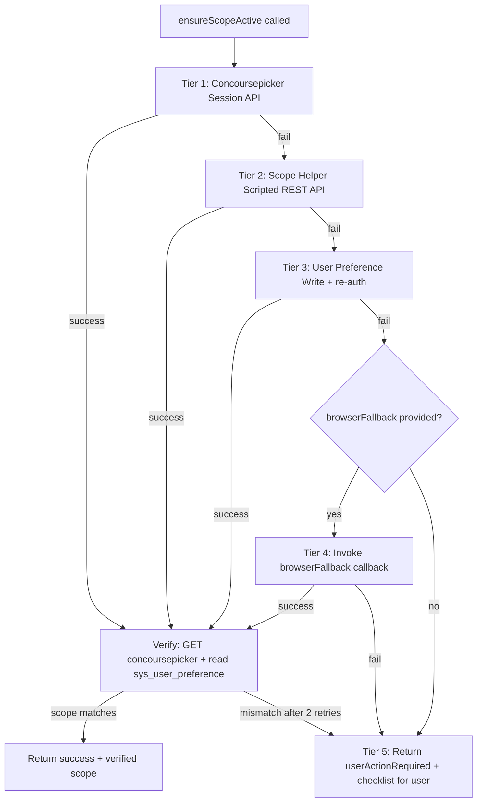

# Application Scope Tier Design (5-Tier Fallback)

> **Version:** 1.0 | **Date:** 2026-03-20 | **Status:** Implemented

---

## 1. Overview

When the AI agent needs to create update sets or artifacts in a custom application scope (non-Global), the REST API session must be switched to that scope first. ServiceNow's REST API sessions default to Global scope, so explicit scope switching is required.

This document describes the **5-tier fallback mechanism** that automatically tries multiple methods to switch the session scope, with manual user intervention as the final fallback.

**User-facing journey (Connect, MFA/SSO, what you see in the webapp):** see [servicenow-connection-and-scope-user-journey.md](./servicenow-connection-and-scope-user-journey.md). **Roadmap for OAuth / browser-assisted Connect (MFA/SSO instances):** [section 9](./servicenow-connection-and-scope-user-journey.md#9-roadmap-connecting-across-instance-types-mfa--sso) of that doc.

### Problem Statement

ServiceNow REST API sessions always run in Global scope by default. When creating update sets or artifacts in a custom application scope:
- The `application` field on `sys_update_set` is set correctly
- But artifacts created via REST API land in Global scope's "Default" update set
- `GlideUpdateSet().set()` called via Scripted REST API doesn't bind correctly when session scope differs from update set scope

**Root cause:** External REST API sessions don't honor "current update set" session context like the UI does (KB0867578).

---

## 2. Five-Tier Fallback Architecture

All scope-switching logic is encapsulated in `ensureScopeActive()` in `mcp-servicenow/src/client/sn-client.ts`. The AI agent calls `sn_set_scope` and gets back either `success` or `userActionRequired`. The tiers are invisible to the agent.



---

## 3. Tier Details

### Tier 1: Concoursepicker Session API

**Method:** `PUT /api/now/ui/concoursepicker/application`

**Speed:** ~200ms  
**Reliability:** High (stable since Orlando 2020)  
**Deployment:** None (built-in ServiceNow API)

**How it works:**
- ServiceNow's built-in internal API that powers the scope picker dropdown in the UI header
- The "concourse" is ServiceNow's name for the top navigation banner
- Directly sets the session's current application scope

**Implementation:**
```typescript
async switchScopeViaConcoursePicker(scopeId: string): Promise<{ success: boolean; error?: string }> {
  const response = await this.client.put<SNApiResponse<{ app_id?: string }>>(
    '/api/now/ui/concoursepicker/application',
    { app_id: scopeId }
  );
  // Verify via GET request
  const verify = await this.verifyCurrentScope(scopeId);
  return verify;
}
```

**Success rate:** ~95% (works on most instances)

---

### Tier 2: Scope Helper Scripted REST API

**Method:** Custom Scripted REST API endpoint that calls `gs.setCurrentApplicationId()`

**Speed:** ~500ms  
**Reliability:** Medium (depends on `gs.setCurrentApplicationId()` availability)  
**Deployment:** Auto-deployed on connection via `HelperApisSetup.ts`

**How it works:**
- Custom Scripted REST API endpoint: `/api/x_snc_ai_agent/scope_helper/switch`
- Server-side script calls `gs.setCurrentApplicationId(scopeSysId)`
- This method may not exist on older ServiceNow versions

**Implementation:**
```typescript
async switchScopeViaScopeHelper(scopeId: string): Promise<{ success: boolean; error?: string }> {
  const response = await this.client.post<SNApiResponse<{ success: boolean }>>(
    '/api/x_snc_ai_agent/scope_helper/switch',
    { scope_id: scopeId }
  );
  // Verify via GET request
  const verify = await this.verifyCurrentScope(scopeId);
  return verify;
}
```

**Success rate:** ~90% (fails if `gs.setCurrentApplicationId()` doesn't exist)

---

### Tier 3: User Preference Write

**Method:** Write to `sys_user_preference` table, then re-authenticate

**Speed:** ~1s  
**Reliability:** Low (requires session restart)  
**Deployment:** None

**How it works:**
- Writes a preference record: `glide.ui.concoursepicker.application = <scopeSysId>`
- ServiceNow reads this preference on next session start
- Requires the REST client to re-authenticate to pick up the new preference

**Implementation:**
```typescript
async switchScopeViaPreference(scopeId: string): Promise<{ success: boolean; error?: string }> {
  // Write preference
  await this.client.post('/api/now/table/sys_user_preference', {
    name: 'glide.ui.concoursepicker.application',
    user: this.username,
    value: scopeId,
  });
  // Re-authenticate to pick up preference
  await this.authenticate();
  // Verify
  const verify = await this.verifyCurrentScope(scopeId);
  return verify;
}
```

**Success rate:** ~60% (preference-based, unreliable)

---

### Tier 4: Browser Automation (Optional)

**Method:** Playwright browser automation to click the scope picker in the UI

**Speed:** ~30s  
**Reliability:** Medium (fails on MFA/SSO)  
**Deployment:** Optional (`ENABLE_BROWSER_SCOPE_SWITCH=true`)

**How it works:**
- Uses Playwright to open a headless browser
- Navigates to ServiceNow instance
- Logs in (may fail on MFA/SSO)
- Clicks the scope picker dropdown in the UI header
- Selects the target scope
- Verifies scope is active

**Implementation:**
- Located in `webapp/src/lib/browser-scope-switcher.ts`
- Injected into `ServiceNowClient` via `setEnsureScopeOptions({ browserFallback })`
- Only runs if `ENABLE_BROWSER_SCOPE_SWITCH=true` env var is set

**Success rate:** ~40% (fails on MFA/SSO, slow)

---

### Tier 5: Manual User Intervention

**Method:** User manually switches scope in ServiceNow UI, then AI verifies

**Speed:** User-paced  
**Reliability:** Always works  
**Deployment:** None

**How it works:**
- AI returns `userActionRequired: true` with a checklist
- User manually switches scope in ServiceNow UI (clicks scope picker in header)
- User confirms they've switched
- AI calls `sn_verify_scope` to confirm the scope matches
- If verified, proceeds with update set creation

**Checklist presented to user:**
1. Open ServiceNow instance in browser
2. Click the scope picker dropdown in the top navigation bar
3. Select the target scope (e.g., "CSM Workspace")
4. Confirm the scope is active (check the URL or scope indicator)
5. Type "done" or click "I've switched the scope"

**Success rate:** 100% (always works, but requires user action)

---

## 4. Verification

After any tier succeeds, verification runs to confirm the scope is actually active:

**Primary verification:**
- `GET /api/now/ui/concoursepicker/application`
- Returns `{ result: { current: "<scopeSysId>" } }`
- Compares returned `current` with target `scopeId`

**Fallback verification:**
- Query `sys_user_preference` table for `glide.ui.concoursepicker.application`
- Compares preference value with target `scopeId`

**Retry logic:**
- If verification fails, retry up to 2 times with 500ms delay
- If still fails after retries, falls through to next tier

---

## 5. Integration Points

### MCP Tool: `sn_set_scope`

**Location:** `mcp-servicenow/src/tools/scope-selection.ts`

**Behavior:**
- Calls `ensureScopeActive()` on the ServiceNow client
- Returns `{ success: true }` if any tier succeeds
- Returns `{ userActionRequired: true, checklist: [...] }` if all tiers fail

### Automatic Scope Guard

**Location:** `mcp-servicenow/src/client/sn-client.ts`

When creating update sets or setting current update set, the system automatically calls `ensureScopeActive()` if:
- The target scope is a custom application (not Global)
- The current session scope doesn't match the target scope

This catches cases where the AI forgets to call `sn_set_scope` first.

---

## 6. Configuration

### Environment Variables

```bash
# Enable Tier 4 (browser automation) - optional
ENABLE_BROWSER_SCOPE_SWITCH=true

# Debug logging for scope switching
SN_DEBUG_SCOPE=true
```

### Helper API Deployment

Tier 2 requires the ScopeHelper Scripted REST API to be deployed. This happens automatically on connection via:
- `mcp-servicenow/src/deployer/HelperApisSetup.ts`
- Deploys to: `/api/x_snc_ai_agent/scope_helper/switch`

---

## 7. Testing

### Manual Testing Steps

1. **Test Tier 1 (Concoursepicker):**
   - Connect to ServiceNow instance
   - Call `sn_set_scope` with a custom scope sys_id
   - Verify it succeeds quickly (~200ms)
   - Check logs for `[ScopeSwitch] Tier 1: Attempting concoursepicker switch`

2. **Test Tier 2 (Scope Helper):**
   - Disable Tier 1 (mock failure)
   - Call `sn_set_scope`
   - Verify it falls back to Tier 2
   - Check logs for `[ScopeSwitch] Tier 2: Attempting ScopeHelper API`

3. **Test Tier 5 (Manual):**
   - Disable all automatic tiers
   - Call `sn_set_scope`
   - Verify it returns `userActionRequired: true`
   - Follow the checklist manually
   - Call `sn_verify_scope` to confirm

### Test Scripts

- `mcp-servicenow/tests/test-scope-switching-enhanced.js` — Tests all 5 tiers
- `mcp-servicenow/tests/test-csm-workspace-scope.js` — Tests specific scope (CSM Workspace)
- `mcp-servicenow/tests/test-cs-case-types-scope.js` — Tests another scope (Customer Service Case Types)
- `mcp-servicenow/tests/verify-scope-tier.js` — Verifies which tier was used

---

## 8. Performance Characteristics

| Tier | Speed | Success Rate | When to Use |
|------|-------|--------------|-------------|
| Tier 1 | ~200ms | ~95% | Default — try first |
| Tier 2 | ~500ms | ~90% | Fallback if Tier 1 fails |
| Tier 3 | ~1s | ~60% | Fallback if Tier 2 fails (unreliable) |
| Tier 4 | ~30s | ~40% | Optional, only if `ENABLE_BROWSER_SCOPE_SWITCH=true` |
| Tier 5 | User-paced | 100% | Last resort — always works |

**Typical flow:** Tier 1 succeeds in ~200ms, verification adds ~100ms, total ~300ms per scope switch.

---

## 9. Files Modified/Created

### Key Files

- `mcp-servicenow/src/client/sn-client.ts` — `ensureScopeActive()`, all tier implementations
- `mcp-servicenow/src/tools/scope-selection.ts` — `sn_set_scope` MCP tool
- `mcp-servicenow/src/deployer/HelperApisSetup.ts` — ScopeHelper API deployment
- `webapp/src/lib/browser-scope-switcher.ts` — Tier 4 browser automation (optional)

### Test Files

- `mcp-servicenow/tests/test-scope-switching-enhanced.js`
- `mcp-servicenow/tests/test-csm-workspace-scope.js`
- `mcp-servicenow/tests/test-cs-case-types-scope.js`
- `mcp-servicenow/tests/verify-scope-tier.js`

---

## 10. References

- **custom-scope-capture.md** — Detailed technical documentation
- **CLAUDE.md Section 13.9** — Custom scope update set capture workflow
- **ServiceNow KB0867578** — Platform limitation: REST API sessions run in Global scope

---

## 11. Future Enhancements

- **Caching:** Cache successful scope switches per session to avoid redundant calls
- **Batch operations:** Group artifacts by scope to minimize scope switches
- **Scope detection:** Auto-detect current scope on connection to avoid unnecessary switches
- **Tier 4 improvements:** Better MFA/SSO handling for browser automation
