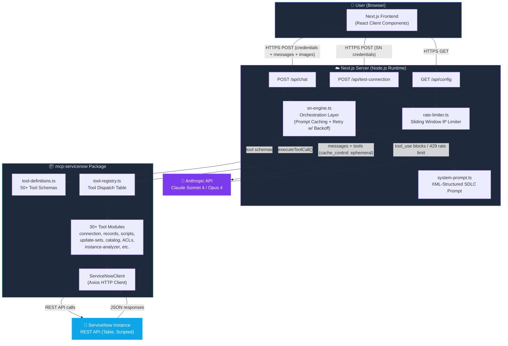
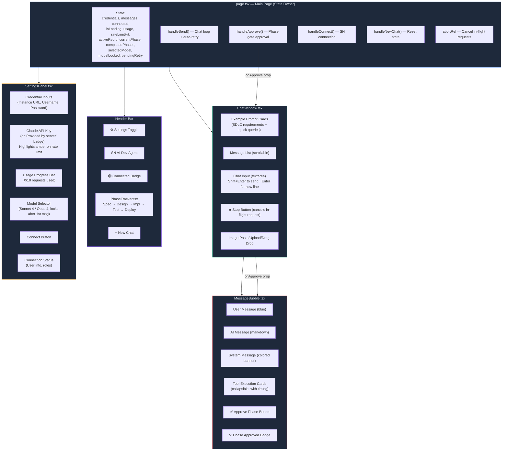
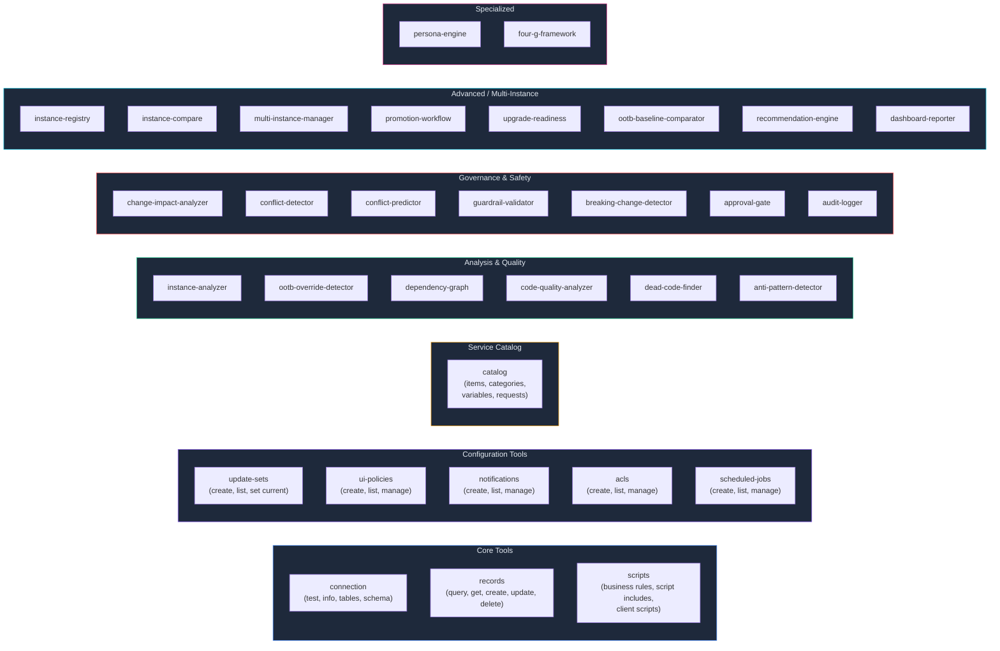

# SN AI Dev Agent — Technical Architecture

> **Version:** 1.1 | **Date:** 2026-02-22 | **Branch:** `v1-as-webapp`

---

## 1. High-Level System Architecture



---

## 2. Frontend Component Architecture



---

## 3. Tool-Use Conversation Loop


---

## 4. SDLC Phase Gate Workflow

```mermaid
stateDiagram-v2
    [*] --> UserRequest: User describes a requirement

    UserRequest --> SpecPhase: Claude generates spec

    state SpecPhase {
        [*] --> SpecGenerated
        SpecGenerated --> SpecGate: &lt;!-- PHASE_GATE:spec --&gt;
        SpecGate --> SpecApproved: User clicks "Approve Spec"
    }

    SpecPhase --> DesignPhase: "approved" sent to Claude

    state DesignPhase {
        [*] --> InstanceDiscovery: Claude uses SN tools to analyze
        InstanceDiscovery --> DesignGenerated
        DesignGenerated --> DesignGate: &lt;!-- PHASE_GATE:design --&gt;
        DesignGate --> DesignApproved: User clicks "Approve Design"
    }

    DesignPhase --> ImplPhase: "approved" sent to Claude

    state ImplPhase {
        [*] --> CreateUpdateSet
        CreateUpdateSet --> DeployArtifacts: Business rules, scripts, etc.
        DeployArtifacts --> ImplGate: &lt;!-- PHASE_GATE:implementation --&gt;
    }

    ImplPhase --> TestPhase: Auto-proceed

    state TestPhase {
        [*] --> CreateTestPlan
        CreateTestPlan --> ExecuteTests: Query/verify via SN tools
        ExecuteTests --> TestGate: &lt;!-- PHASE_GATE:testing --&gt;
    }

    TestPhase --> DeployPhase: Auto-proceed

    state DeployPhase {
        [*] --> DeployRecord
        DeployRecord --> DeployGate: &lt;!-- PHASE_GATE:deployment --&gt;
    }

    DeployPhase --> [*]: Requirement Complete ✅
```

---

## 5. Credential & API Key Flow

```mermaid
flowchart TD
    START["User opens app"] --> CHECK_CFG["GET /api/config"]
    CHECK_CFG --> HAS_KEY{Server has<br/>CLAUDE_API_KEY?}

    HAS_KEY -->|Yes| SHOW_BADGE["Show 'Provided by server' badge<br/>+ usage counter (X/10)"]
    HAS_KEY -->|No| SHOW_INPUT["Show Claude API Key input field"]

    SHOW_BADGE --> ENTER_SN["User enters SN credentials"]
    SHOW_INPUT --> ENTER_KEY["User enters Claude API Key"]
    ENTER_KEY --> ENTER_SN

    ENTER_SN --> CONNECT["POST /api/test-connection"]
    CONNECT --> ROLES{Check admin &<br/>security_admin roles}
    ROLES -->|Has roles| READY["✅ Connected — ready to chat"]
    ROLES -->|Missing roles| WARN["⚠️ Warning banner + continue"]
    WARN --> READY

    READY --> CHAT_MSG["User sends message"]
    CHAT_MSG --> KEY_SRC{Using server key?}
    KEY_SRC -->|Yes| RATE_CHECK["Rate limiter: consume(IP)"]
    KEY_SRC -->|No| BYPASS["Bypass rate limit"]

    RATE_CHECK --> UNDER{Under limit?}
    UNDER -->|Yes| PROCESS["Process chat request"]
    UNDER -->|No| APP_BLOCK["429 (app): Show upgrade prompt<br/>Open settings, highlight API key field"]
    BYPASS --> PROCESS

    PROCESS --> ANTHROPIC_CALL["sn-engine: call Claude API<br/>(with retry + backoff)"]
    ANTHROPIC_CALL --> API_OK{Anthropic<br/>succeeds?}
    API_OK -->|Yes| RESPONSE["✅ Show response"]
    API_OK -->|No (429 after retries)| API_BLOCK["429 (anthropic_rate_limit):<br/>Store msg in pendingRetry<br/>Show inline 🔑 error<br/>Open settings, highlight API key"]

    API_BLOCK --> USER_KEY["User enters own API key"]
    USER_KEY --> AUTO_RETRY["Auto-retry failed message<br/>with new key + full history"]
    AUTO_RETRY --> ANTHROPIC_CALL

    style START fill:#1e293b,stroke:#3b82f6,color:#e2e8f0
    style READY fill:#065f46,stroke:#10b981,color:#e2e8f0
    style APP_BLOCK fill:#7f1d1d,stroke:#ef4444,color:#e2e8f0
    style API_BLOCK fill:#7f1d1d,stroke:#f59e0b,color:#e2e8f0
    style WARN fill:#78350f,stroke:#f59e0b,color:#e2e8f0
    style RESPONSE fill:#065f46,stroke:#10b981,color:#e2e8f0
    style AUTO_RETRY fill:#1e3a5f,stroke:#3b82f6,color:#e2e8f0
```

---

## 6. MCP Tool Categories (50+ Tools)



---

## 7. Project Directory Structure

```
SN-AI-Dev-Agent/
│
├── webapp/                          ← Next.js Web Application
│   ├── src/
│   │   ├── app/
│   │   │   ├── page.tsx             ← Main page (state owner, orchestration)
│   │   │   ├── layout.tsx           ← Root layout (HTML, fonts, metadata)
│   │   │   ├── globals.css          ← Tailwind CSS + custom styles
│   │   │   └── api/
│   │   │       ├── chat/route.ts    ← POST /api/chat (main AI endpoint)
│   │   │       ├── test-connection/ ← POST /api/test-connection
│   │   │       └── config/route.ts  ← GET /api/config (public settings)
│   │   ├── components/
│   │   │   ├── SettingsPanel.tsx     ← Credentials, API key, usage meter
│   │   │   ├── ChatWindow.tsx       ← Message list, input, example prompts
│   │   │   ├── MessageBubble.tsx    ← Message rendering, tool cards, approve btn
│   │   │   └── PhaseTracker.tsx     ← SDLC phase stepper in header
│   │   └── lib/
│   │       ├── sn-engine.ts         ← Anthropic tool-use loop orchestrator
│   │       ├── system-prompt.ts     ← SDLC methodology system prompt
│   │       ├── rate-limiter.ts      ← IP-based sliding window rate limiter
│   │       └── types.ts             ← Shared types, phase gate parser
│   ├── package.json
│   └── .env.example                 ← CLAUDE_API_KEY, RATE_LIMIT_MAX, etc.
│
├── mcp-servicenow/                  ← ServiceNow Tool Engine (npm package)
│   ├── src/
│   │   ├── index.ts                 ← MCP server entry point (stdio transport)
│   │   ├── tool-definitions.ts      ← 50+ tool JSON schemas (single source of truth)
│   │   ├── tool-registry.ts         ← Tool dispatch table + executeToolCall()
│   │   ├── client/
│   │   │   └── sn-client.ts         ← ServiceNowClient (Axios HTTP wrapper)
│   │   ├── tools/                   ← 30+ tool implementation modules
│   │   │   ├── connection.ts        ├── records.ts
│   │   │   ├── scripts.ts           ├── update-sets.ts
│   │   │   ├── catalog.ts           ├── acls.ts
│   │   │   ├── notifications.ts     ├── ui-policies.ts
│   │   │   ├── scheduled-jobs.ts    ├── instance-analyzer.ts
│   │   │   ├── code-quality-analyzer.ts  ├── dead-code-finder.ts
│   │   │   ├── anti-pattern-detector.ts  ├── change-impact-analyzer.ts
│   │   │   ├── conflict-detector.ts      ├── guardrail-validator.ts
│   │   │   └── ... (16 more)
│   │   ├── deployer/                ← Deployment automation
│   │   └── types/                   ← TypeScript type definitions
│   └── package.json
│
├── specs/                           ← Requirement specifications (SDLC artifacts)
│   ├── config.properties            ← Phase gate settings
│   ├── manifest.json                ← Requirement registry
│   └── REQ-XXX/                     ← Per-requirement folders
│
├── templates/                       ← Document templates (spec, design, test, deploy)
├── scripts/                         ← Validation & utility scripts
├── CLAUDE.md                        ← AI agent instructions (local CLI usage)
└── PROJECT-TRACKER.md               ← Project status & session notes
```

---

## 8. Key Design Decisions

| Decision | Choice | Rationale |
|----------|--------|-----------|
| **Stateless API** | Credentials sent per-request | No server-side sessions = simpler, no auth infrastructure needed |
| **Per-request SN client** | New `ServiceNowClient` per chat | Supports multiple users simultaneously, no credential mixing |
| **Tool-use loop** | Up to 15 rounds | Claude can chain multiple tool calls to complete complex tasks |
| **System prompt injection** | XML-tagged SDLC prompt (117 lines) | Web app can't read filesystem; XML tags = native Claude parsing, 50% token reduction |
| **Phase gate markers** | HTML comments `<!-- PHASE_GATE:xxx -->` | Invisible in rendered markdown, parseable by frontend |
| **Rate limiting** | In-memory sliding window | Simple, no Redis needed for MVP; resets on server restart |
| **createRequire** | Runtime module loading | Bypasses Turbopack static analysis for mcp-servicenow ESM modules |
| **Single tool registry** | Shared between MCP server & web app | Tool definitions and handlers defined once, consumed by both transports |
| **Prompt caching** | `cache_control: { type: "ephemeral" }` | 90% token cost reduction on cache hits (rounds 2-15, valid 5 min) |
| **Retry with backoff** | 3 retries: 5s → 10s → 20s | Handles transient Anthropic 429 errors; respects `retry-after` header |
| **Model selection** | Sonnet 4 (fast) / Opus 4 (capable) | User choice, locked after first message to avoid mid-conversation confusion |
| **Pending retry pattern** | `pendingRetry` state stores failed msg | On Anthropic 429 exhaustion: user provides API key → auto-retry with full history |
| **AbortController** | Cancel in-flight requests | User can stop long-running requests; send button toggles to stop button |
| **Shift+Enter to send** | Enter = new line, Shift+Enter = send | Better UX for multi-line prompts (ServiceNow code snippets) |

