# SN AI Agent — Technical Architecture

> **Version:** 2.5 | **Date:** 2026-03-12 | **Branch:** `teaser-march12`

---

## 1. High-Level System Architecture

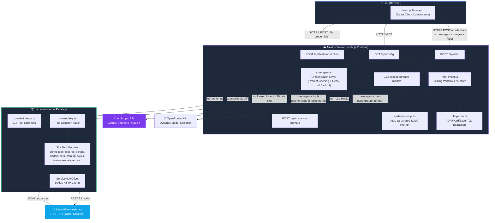

---

## 2. Frontend Component Architecture

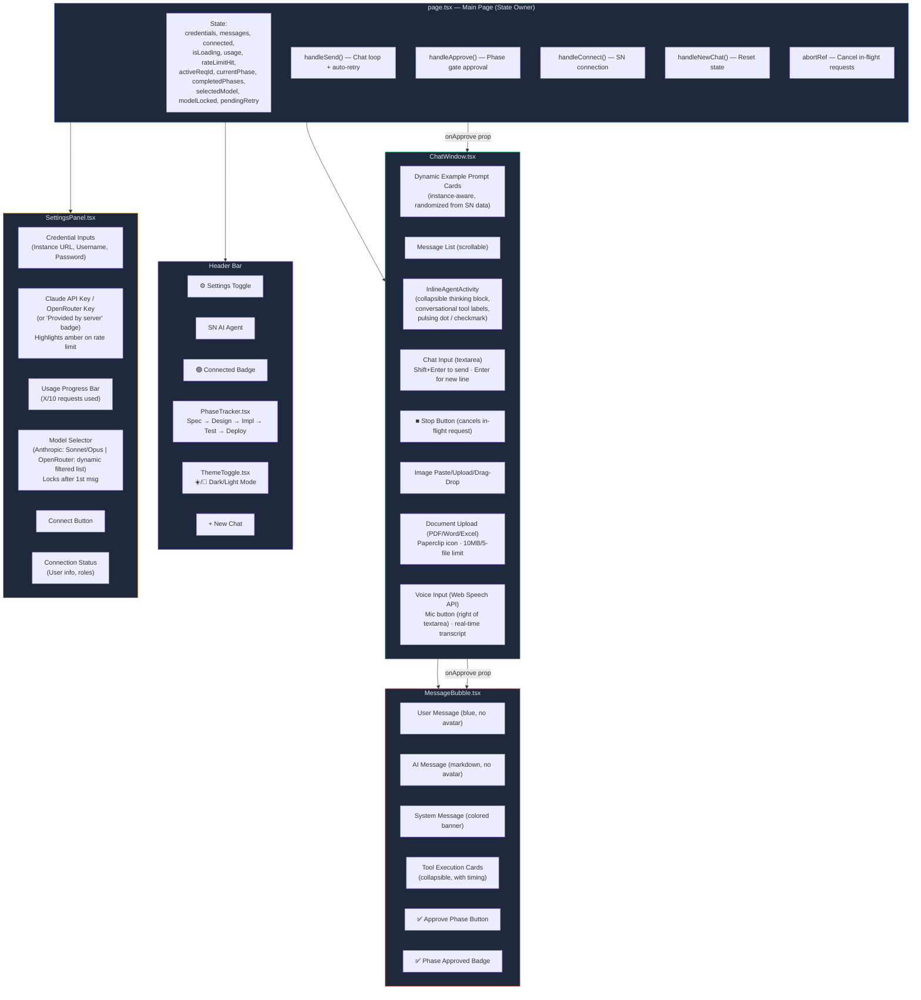

---

## 3. Tool-Use Conversation Loop

```mermaid
sequenceDiagram
    participant U as User (Browser)
    participant API as /api/chat
    participant RL as Rate Limiter
    participant ENG as sn-engine.ts
    participant CL as Anthropic API
    participant REG as Tool Registry
    participant SN as ServiceNow

    U->>API: POST {credentials, messages, model, images}
    API->>RL: consume(ip) — if using server key
    RL-->>API: {allowed, usage}

    alt App-level rate limit exceeded
        API-->>U: 429 {error: "rate_limit_exceeded", usage}
    end

    API->>ENG: chat(credentials, messages, model, phase)
    ENG->>ENG: createSnClient() per request
    ENG->>ENG: getFilteredTools(phase) — 36-115 tools

    loop Tool-Use Loop (max 30 rounds)
        rect rgb(30, 41, 59)
        Note over ENG,CL: Retry loop (max 3 attempts, exponential backoff)
        ENG->>CL: messages.create({system, tools, messages, cache_control})
        alt 429 Rate Limit
            CL-->>ENG: 429 RateLimitError
            Note over ENG: Retry after 5s → 10s → 20s
            ENG->>CL: Retry same request
        end
        CL-->>ENG: Response (+ cache_read / cache_creation stats)
        end

        alt stop_reason = "tool_use"
            loop For each tool_use block
                ENG->>REG: executeToolCall(name, args, snClient)
                REG->>SN: REST API call (GET/POST/PUT/PATCH/DELETE)
                SN-->>REG: JSON response
                REG-->>ENG: Tool result
            end
            Note over ENG: Append tool results → next round
        else stop_reason = "end_turn"
            ENG-->>API: {reply, toolExecutions}
        end
    end

    alt Anthropic 429 after all retries exhausted
        ENG-->>API: throws "anthropic_rate_limit"
        API-->>U: 429 {error: "anthropic_rate_limit", needsApiKey: true}
        Note over U: Store failed msg in pendingRetry<br/>Show inline error + open Settings<br/>User enters API key → auto-retry
    end

    API-->>U: 200 {reply, toolExecutions, usage}
    Note over U: Parse phase gate markers<br/>Render markdown + tool cards<br/>Show Approve button if gate detected
```

---

## 4. SDLC Phase Gate Workflow

```mermaid
stateDiagram-v2
    [*] --> UserRequest: User describes a requirement

    UserRequest --> SpecPhase: Claude generates spec

    state SpecPhase {
        [*] --> SpecGenerated
        SpecGenerated --> SpecGate: &lt;!-- PHASE_GATE:spec --&gt;
        SpecGate --> SpecApproved: User clicks "Approve Spec"
    }

    SpecPhase --> DesignPhase: "approved" sent to Claude

    state DesignPhase {
        [*] --> InstanceDiscovery: Claude uses SN tools to analyze
        InstanceDiscovery --> DesignGenerated
        DesignGenerated --> DesignGate: &lt;!-- PHASE_GATE:design --&gt;
        DesignGate --> DesignApproved: User clicks "Approve Design"
    }

    DesignPhase --> ImplPhase: "approved" sent to Claude

    state ImplPhase {
        [*] --> CreateUpdateSet
        CreateUpdateSet --> DeployArtifacts: Business rules, scripts, etc.
        DeployArtifacts --> ImplGate: &lt;!-- PHASE_GATE:implementation --&gt;
        ImplGate --> ImplApproved: User clicks "Approve Implementation"
    }

    ImplPhase --> TestPhase: "approved" sent to Claude

    state TestPhase {
        [*] --> CreateTestPlan
        CreateTestPlan --> ExecuteTests: Query/verify via SN tools
        ExecuteTests --> TestGate: &lt;!-- PHASE_GATE:testing --&gt;
        TestGate --> TestApproved: User clicks "Approve Testing"
    }

    TestPhase --> DeployPhase: "approved" sent to Claude

    state DeployPhase {
        [*] --> DeployRecord
        DeployRecord --> DeployGate: &lt;!-- PHASE_GATE:deployment --&gt;
        DeployGate --> DeployApproved: User clicks "Approve Deployment"
    }

    DeployPhase --> [*]: Requirement Complete ✅
```

For the full design of quality gates (phase gates, sign-off rules, validation, and configuration), see **[Quality Gate Design](quality-gate-design.md)**. For custom scope update set capture (five-tier scope switching), see **[Custom Scope Capture](custom-scope-capture.md)**.

---

## 5. Credential & API Key Flow

```mermaid
flowchart TD
    START["User opens app"] --> CHECK_CFG["GET /api/config"]
    CHECK_CFG --> HAS_KEY{Server has<br/>CLAUDE_API_KEY?}

    HAS_KEY -->|Yes| SHOW_BADGE["Show 'Provided by server' badge<br/>+ usage counter (X/10)"]
    HAS_KEY -->|No| SHOW_INPUT["Show Claude API Key input field"]

    SHOW_BADGE --> ENTER_SN["User enters SN credentials"]
    SHOW_INPUT --> ENTER_KEY["User enters Claude API Key"]
    ENTER_KEY --> ENTER_SN

    ENTER_SN --> CONNECT["POST /api/test-connection"]
    CONNECT --> ROLES{Check admin &<br/>security_admin roles}
    ROLES -->|Has roles| READY["✅ Connected — ready to chat"]
    ROLES -->|Missing roles| WARN["⚠️ Warning banner + continue"]
    WARN --> READY

    READY --> CHAT_MSG["User sends message"]
    CHAT_MSG --> KEY_SRC{Using server key?}
    KEY_SRC -->|Yes| RATE_CHECK["Rate limiter: consume(IP)"]
    KEY_SRC -->|No| BYPASS["Bypass rate limit"]

    RATE_CHECK --> UNDER{Under limit?}
    UNDER -->|Yes| PROCESS["Process chat request"]
    UNDER -->|No| APP_BLOCK["429 (app): Show upgrade prompt<br/>Open settings, highlight API key field"]
    BYPASS --> PROCESS

    PROCESS --> ANTHROPIC_CALL["sn-engine: call Claude API<br/>(with retry + backoff)"]
    ANTHROPIC_CALL --> API_OK{Anthropic<br/>succeeds?}
    API_OK -->|Yes| RESPONSE["✅ Show response"]
    API_OK -->|No (429 after retries)| API_BLOCK["429 (anthropic_rate_limit):<br/>Store msg in pendingRetry<br/>Show inline 🔑 error<br/>Open settings, highlight API key"]

    API_BLOCK --> USER_KEY["User enters own API key"]
    USER_KEY --> AUTO_RETRY["Auto-retry failed message<br/>with new key + full history"]
    AUTO_RETRY --> ANTHROPIC_CALL

    style START fill:#1e293b,stroke:#3b82f6,color:#e2e8f0
    style READY fill:#065f46,stroke:#10b981,color:#e2e8f0
    style APP_BLOCK fill:#7f1d1d,stroke:#ef4444,color:#e2e8f0
    style API_BLOCK fill:#7f1d1d,stroke:#f59e0b,color:#e2e8f0
    style WARN fill:#78350f,stroke:#f59e0b,color:#e2e8f0
    style RESPONSE fill:#065f46,stroke:#10b981,color:#e2e8f0
    style AUTO_RETRY fill:#1e3a5f,stroke:#3b82f6,color:#e2e8f0
```

---

## 6. MCP Tool Categories (115 Tools)

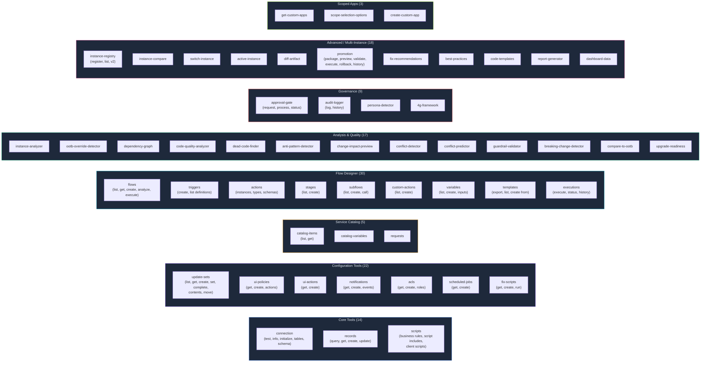

---

## 7. Project Directory Structure

```
SN-AI-Dev-Agent/
│
├── webapp/                          ← Next.js Web Application
│   ├── src/
│   │   ├── app/
│   │   │   ├── page.tsx             ← Main page (state owner, orchestration)
│   │   │   ├── layout.tsx           ← Root layout (HTML, fonts, metadata)
│   │   │   ├── globals.css          ← Tailwind CSS + custom styles
│   │   │   └── api/
│   │   │       ├── chat/route.ts    ← POST /api/chat (main AI endpoint)
│   │   │       ├── chat-stream/     ← POST /api/chat-stream (SSE streaming)
│   │   │       ├── test-connection/ ← POST /api/test-connection
│   │   │       ├── config/route.ts  ← GET /api/config (public settings)
│   │   │       ├── instance-prompts/ ← POST /api/instance-prompts (dynamic starter cards)
│   │   │       └── openrouter-models/ ← GET /api/openrouter-models (filtered)
│   │   ├── components/
│   │   │   ├── SettingsPanel.tsx     ← Credentials, API key, usage meter
│   │   │   ├── ChatWindow.tsx       ← Message list, input, dynamic prompts, inline agent activity
│   │   │   ├── MessageBubble.tsx    ← Message rendering, tool cards, approve btn (no avatars)
│   │   │   ├── PhaseTracker.tsx     ← SDLC phase stepper in header
│   │   │   ├── ThemeProvider.tsx    ← Dark/light mode context provider + CSS var injection
│   │   │   └── ThemeToggle.tsx      ← Sun/moon toggle button for theme switching
│   │   └── lib/
│   │       ├── sn-engine.ts         ← Orchestrator (6 shared helpers + 4 LLM callers)
│   │       ├── system-prompt.ts     ← Stable prefix + dynamic context (cache-split) + confidentiality guardrails
│   │       ├── openrouter.ts        ← OpenRouter API client (dynamic model filtering)
│   │       ├── file-parser.ts       ← PDF/Word/Excel text extraction
│   │       ├── rate-limiter.ts      ← IP-based sliding window rate limiter
│   │       ├── logger.ts            ← Structured session logging (JSONL)
│   │       ├── telemetry-generator.ts ← Live telemetry dashboard (parses JSONL → markdown)
│   │       ├── branding.ts          ← Centralized branding config (env-driven colors, app name, logo)
│   │       └── types.ts             ← Shared types, phase gate parser
│   ├── package.json
│   └── .env.example                 ← CLAUDE_API_KEY, RATE_LIMIT_MAX, etc.
│
├── mcp-servicenow/                  ← ServiceNow Tool Engine (npm package)
│   ├── src/
│   │   ├── index.ts                 ← MCP server entry point (stdio transport)
│   │   ├── tool-definitions.ts      ← 115 tool JSON schemas (single source of truth)
│   │   ├── tool-registry.ts         ← Tool dispatch table + executeToolCall()
│   │   ├── client/
│   │   │   └── sn-client.ts         ← ServiceNowClient (Axios HTTP wrapper)
│   │   ├── tools/                   ← 30+ tool implementation modules
│   │   │   ├── connection.ts        ├── records.ts
│   │   │   ├── scripts.ts           ├── update-sets.ts
│   │   │   ├── catalog.ts           ├── acls.ts
│   │   │   ├── notifications.ts     ├── ui-policies.ts
│   │   │   ├── scheduled-jobs.ts    ├── instance-analyzer.ts
│   │   │   ├── code-quality-analyzer.ts  ├── dead-code-finder.ts
│   │   │   ├── anti-pattern-detector.ts  ├── change-impact-analyzer.ts
│   │   │   ├── conflict-detector.ts      ├── guardrail-validator.ts
│   │   │   └── ... (16 more)
│   │   ├── deployer/                ← Deployment automation
│   │   │   ├── HelperApisSetup.ts   ← Auto-detect/deploy helper Scripted REST APIs
│   │   │   ├── UpdateSetHelperSetup.js ← Standalone update set API deployer
│   │   │   └── DeploymentHelper.js  ← Reusable artifact deployment utility
│   │   └── types/                   ← TypeScript type definitions
│   └── package.json
│
├── specs/                           ← Requirement specifications (SDLC artifacts)
│   ├── config.properties            ← Phase gate settings
│   ├── manifest.json                ← Requirement registry
│   └── REQ-XXX/                     ← Per-requirement folders
│
├── templates/                       ← Document templates (spec, design, test, deploy)
├── scripts/                         ← Validation & utility scripts
├── CLAUDE.md                        ← AI agent instructions (local CLI usage)
└── PROJECT-TRACKER.md               ← Project status & session notes
```

---

## 8. Key Design Decisions

| Decision | Choice | Rationale |
|----------|--------|-----------|
| **Stateless API** | Credentials sent per-request | No server-side sessions = simpler, no auth infrastructure needed |
| **Per-request SN client** | New `ServiceNowClient` per chat | Supports multiple users simultaneously, no credential mixing |
| **Tool-use loop** | Up to 30 rounds | Claude can chain multiple tool calls to complete complex tasks |
| **System prompt injection** | XML-tagged SDLC prompt + `<confidentiality>` guardrails | Web app can't read filesystem; XML tags = native Claude parsing; guardrails prevent AI from revealing architecture/model identity |
| **Phase gate markers** | HTML comments `<!-- PHASE_GATE:xxx -->` | Invisible in rendered markdown, parseable by frontend |
| **Interactive choice markers** | HTML comments `<!-- USER_CHOICES:json -->` | Same pattern as phase gates; UI renders clickable buttons for multi-option questions |
| **Rate limiting** | In-memory sliding window | Simple, no Redis needed for MVP; resets on server restart |
| **createRequire** | Runtime module loading | Bypasses Turbopack static analysis for mcp-servicenow ESM modules |
| **Single tool registry** | Shared between MCP server & web app | Tool definitions and handlers defined once, consumed by both transports |
| **Prompt caching** | Stable prefix + `cache_control: { type: "ephemeral" }` | 90% token cost reduction on cache hits; stable/dynamic split preserves cache across requests |
| **Phase-based tool subsetting** | 36-115 tools per SDLC phase | Testing/deployment phases see 69% fewer tools; reduces per-request token overhead |
| **SN metadata stripping** | `stripSnMetadata()` removes 15+ noise fields | 30-50% smaller tool results for record queries |
| **Retry with backoff** | 3 retries: 5s → 10s → 20s | Handles transient Anthropic 429 errors; respects `retry-after` header |
| **Model selection** | Sonnet 4 (fast) / Opus 4 (capable) | User choice, locked after first message to avoid mid-conversation confusion |
| **Pending retry pattern** | `pendingRetry` state stores failed msg | On Anthropic 429 exhaustion: user provides API key → auto-retry with full history |
| **AbortController** | Cancel in-flight requests | User can stop long-running requests; send button toggles to stop button |
| **Shift+Enter to send** | Enter = new line, Shift+Enter = send | Better UX for multi-line prompts (ServiceNow code snippets) |

---

## 9. Token & Cache Optimization Architecture

> **Added:** 2026-03-04 | **Implemented:** 2026-03-05 | **Status:** Complete (Phases 1-4)

### 9.1 Problem Statement (Pre-Optimization)

The original implementation sent all 115 tools (~20K tokens) on every API request. Combined with the system prompt and conversation history, this created significant token overhead:

| Component | Pre-Optimization | Post-Optimization | Reduction |
|-----------|------------------|-------------------|-----------|
| Tool definitions | ~20,000 tokens (115 tools) | ~3-10K tokens (36-115 phase-filtered) | 50-82% |
| Tool descriptions | ~8,000 tokens (verbose) | ~5,500 tokens (compressed) | 18% |
| System prompt | ~1,500 tokens (dynamic date broke cache) | ~1,500 tokens (stable prefix + dynamic suffix) | Cache-friendly |
| Tool results | Variable (full SN metadata) | Variable (metadata stripped) | ~30-50% per result |
| Conversation history | Lossy trimming (messages dropped) | Progressive compression + extractive summary | Context preserved |
| Engine code duplication | 4 duplicated LLM callers (~1006 lines) | 6 shared helpers (~744 lines) | 26% fewer lines |

### 9.2 Optimization Strategy (Implemented)

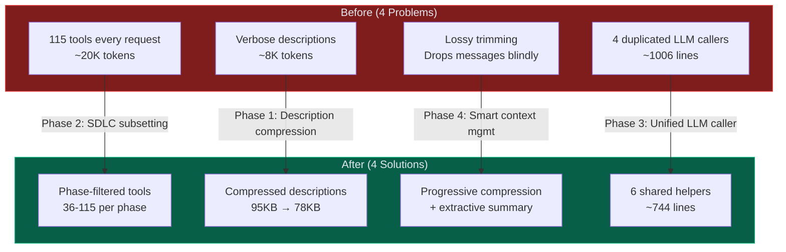

### 9.3 SDLC Phase-Based Tool Subsetting

Tools are filtered by the current SDLC phase. A `PHASE_MAPPING` in `tool-definitions.ts` defines which tools are available in each phase. Core tools (connection, records, scripts, update sets) are included in every phase.

| Phase | Tool Count | Reduction vs. All |
|-------|-----------|-------------------|
| `spec` | 42 | 63% fewer |
| `design` | 55 | 52% fewer |
| `implementation` | 76 | 34% fewer |
| `testing` | 36 | 69% fewer |
| `deployment` | 36 | 69% fewer |
| No phase (ad-hoc) | 115 | 0% (all tools) |

**Flow:** Frontend tracks `currentPhase` via phase gate markers. The phase is sent in the request body to `/api/chat` and `/api/chat-stream`. The engine calls `getAnthropicToolDefinitionsForPhase(phase)` to filter tools before sending to the LLM.

### 9.4 Compact Tool Descriptions (Phase 1c)

All 85 tool descriptions in `tool-definitions.ts` were compressed from verbose multi-line markdown to concise one-liners. File size reduced from 95KB to 78KB (18%).

```
BEFORE (sn_analyze_instance): 875 tokens
"COMPREHENSIVE ServiceNow instance analyzer covering 150+ artifact types.
Returns: Health score, customization count, recommendations..."

AFTER: ~20 tokens
"Analyze instance artifacts and customizations. Params: scope, categories[], limit"
```

### 9.5 Smart Context Management (Phase 4)

Context management uses a two-stage strategy — no secondary LLM call needed:

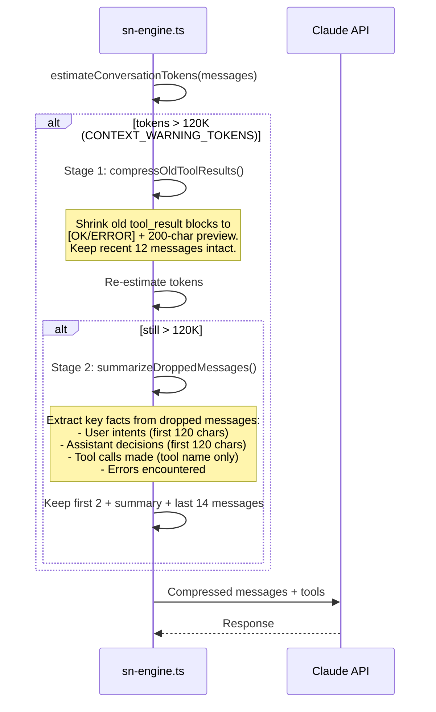

**Extractive summary format (injected as a user message):**
```
[Context summary of 28 earlier messages]
- User: Build a business rule for incident validation...
- Called tool: sn_get_table_schema
- Called tool: sn_create_business_rule
- Assistant: Created ValidateHighImpact BR on incident table...
- Called tool: sn_get_update_set_contents
[End summary -- recent messages follow]
```

### 9.6 ServiceNow Metadata Stripping (Phase 4a)

Tool results from ServiceNow queries carry 15+ metadata fields that waste tokens. `stripSnMetadata()` recursively removes these before serialization:

**Stripped fields:** `sys_mod_count`, `sys_created_on`, `sys_created_by`, `sys_updated_on`, `sys_updated_by`, `sys_tags`, `sys_domain`, `sys_domain_path`, `sys_policy`, `sys_replace_on_upgrade`, `sys_customer_update`, `sys_update_name`, `sys_package`, `sys_scope`, `sys_class_name`, `sys_overrides`

Typical savings: 30-50% per tool result for record queries.

### 9.7 Cache-Optimized Request Structure (Phase 1a, 1d)

Anthropic prompt caching works on prefix matching. The system prompt is split into a stable prefix (byte-identical across requests) and a dynamic suffix (date, session info):

**Anthropic (direct):**
- System string = `buildSystemPrompt() + "\n" + buildDynamicContext()`
- `cache_control: { type: "ephemeral" }` on the request

**OpenRouter (Claude models):**
- System sent as structured content blocks:
  - Block 1: stable prompt with `cache_control: { type: "ephemeral" }`
  - Block 2: dynamic context (no cache control)
- Non-Claude models get plain string format

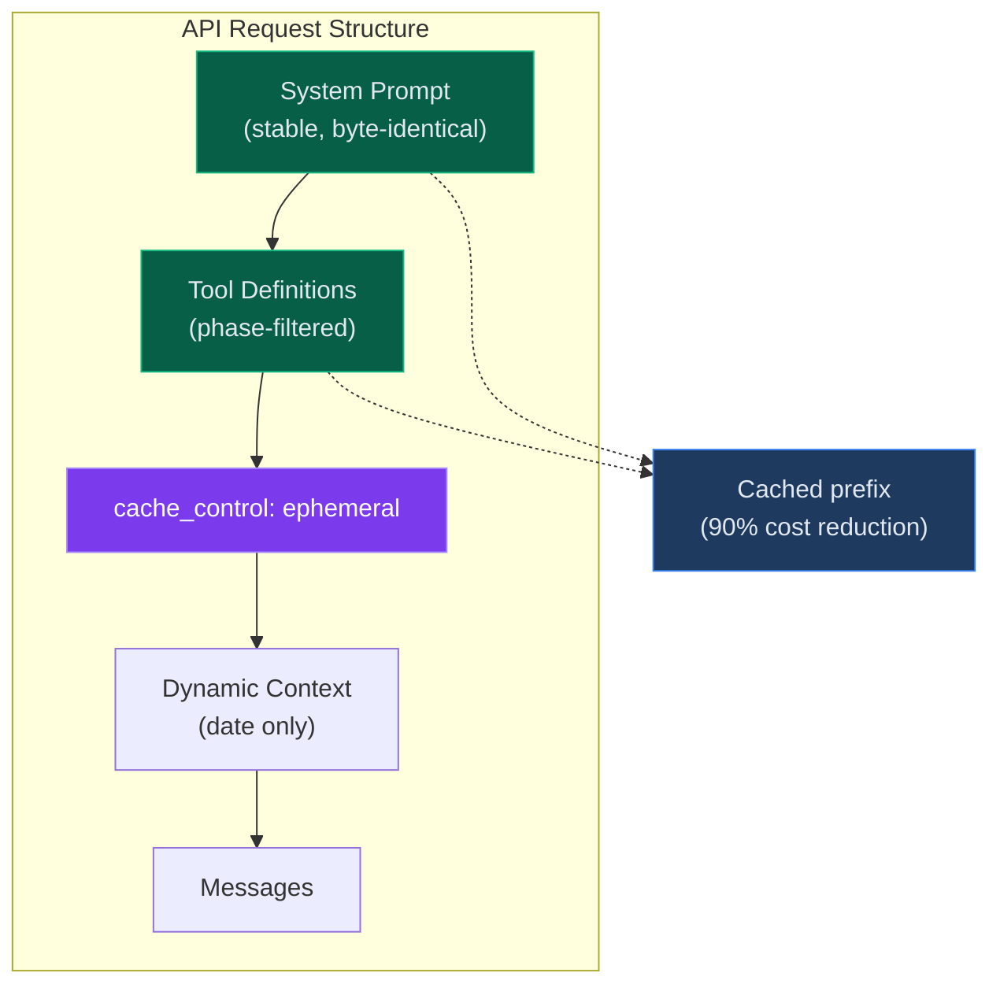

### 9.8 Unified LLM Caller (Phase 3)

Consolidated 4 duplicated LLM caller functions (`chat`, `chatOpenRouter`, `chatStream`, `chatStreamOpenRouter`) by extracting 6 shared helpers in `sn-engine.ts`:

| Helper | Purpose |
|--------|---------|
| `createSnClient()` | ServiceNow client instantiation from credentials |
| `getFilteredTools()` | Phase-aware tool filtering via `getAnthropicToolDefinitionsForPhase()` |
| `toAnthropicMessages()` | Convert chat messages to Anthropic format (with image base64 support) |
| `toOpenRouterMessages()` | Convert chat messages to OpenRouter format (with image URL support) |
| `toOpenRouterTools()` | Convert Anthropic tool schemas to OpenRouter function-calling format |
| `executeAndLogTool()` | Unified tool execution with error handling, timing, and logging |

Result: 1006 lines reduced to 744 lines (26% reduction), zero code duplication across the 4 callers.

### 9.9 Tool Result Truncation

All tool results go through `truncateToolResult()` which applies three layers:

| Layer | Strategy | Trigger |
|-------|----------|---------|
| 1. Metadata stripping | `stripSnMetadata()` removes 15+ SN noise fields | Always |
| 2. Array sampling | Keep first 3 + last 2 items | Array length > 5 and result > 8K chars |
| 3. Character truncation | Keep first/last halves with `[TRUNCATED]` marker | Result > 8K chars |

### 9.10 Implementation Summary (Completed 2026-03-05)

| Phase | What | Key Changes |
|-------|------|-------------|
| **Phase 1: Quick Wins** | Prompt splitting, compact JSON, description compression, OpenRouter cache support | `system-prompt.ts` split into `buildSystemPrompt()` + `buildDynamicContext()`; `tool-definitions.ts` 95KB to 78KB; `openrouter.ts` `cache_control` blocks |
| **Phase 2: Tool Subsetting** | SDLC phase-based tool filtering | `PHASE_MAPPING` in `tool-definitions.ts`; `getAnthropicToolDefinitionsForPhase()`; phase passed from frontend through API routes |
| **Phase 3: Unified LLM Caller** | DRY refactor of 4 duplicated callers | 6 extracted helpers in `sn-engine.ts`; 1006 to 744 lines |
| **Phase 4: Smart Context** | Metadata stripping, progressive compression, extractive summarization | `stripSnMetadata()`, `compressOldToolResults()`, `summarizeDroppedMessages()` in `sn-engine.ts` |

---

## 10. File Attachment Processing

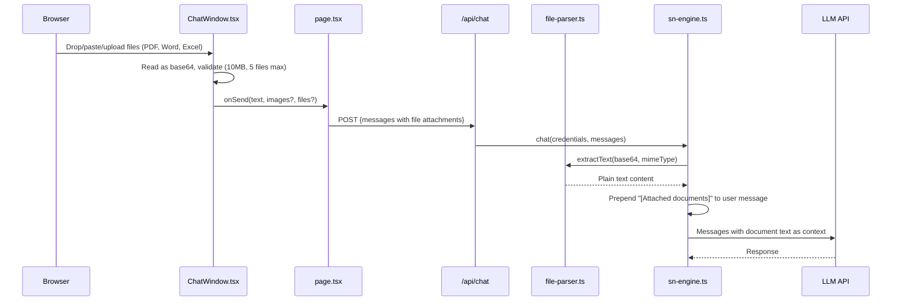

**Supported formats:** PDF (`pdf-parse`), Word/DOCX (`mammoth`), Excel/XLSX (`xlsx` — sheet-by-sheet CSV).

---

## 11. OpenRouter Dynamic Model Filtering

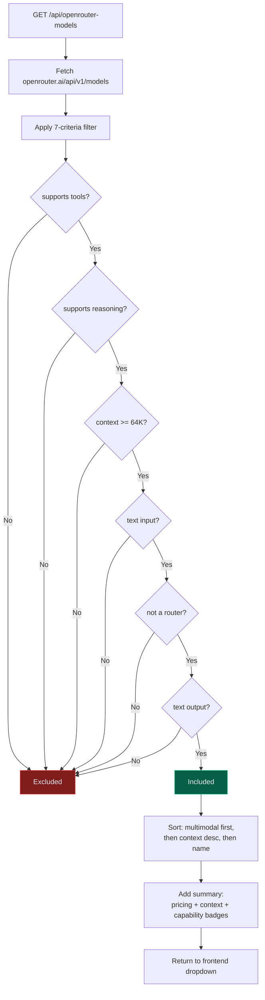

All filtering is metadata-based — no hardcoded model IDs. New models automatically appear when they meet the criteria.

---

## 12. Key Design Decisions (Addendum)

| Decision | Choice | Rationale |
|----------|--------|-----------|
| **All gates require approval** | `requiresApproval: true` on all 5 phases | User maintains full control; no auto-proceed on any phase |
| **Server-side document parsing** | Extract text before LLM sees it | LLMs can't natively read binary formats; text extraction is deterministic |
| **Dynamic model filtering** | Metadata-based, not hardcoded | OpenRouter adds new models frequently; filter adapts automatically |
| **Interactive Q&A UI** | `<!-- USER_CHOICES:json -->` marker + `InteractiveChoices` component | Clickable buttons replace typed responses for all multi-option questions (verbosity, scope, yes/no, etc.) |
| **Auto-resume on round limit** | 5s countdown + auto-send "Continue" (hidden from chat UI) | Seamless experience when 30-round tool loop exhausted; `hidden` flag on `ChatMessage` filters auto-generated messages from display |
| **Voice input (Web Speech API)** | Browser-native `SpeechRecognition`, no server cost | Free, real-time; hidden on unsupported browsers |
| **Dynamic example prompts** | Instance-aware starter cards from SN metadata | Queries custom tables, business rules, catalog items, update sets; randomized pool of 4; falls back to hardcoded defaults |
| **Confidentiality guardrails** | `<confidentiality>` section in system prompt | Prevents AI from revealing architecture, tech stack, model identity, or internal implementation |
| **No avatars** | Removed AI/user avatar squares from chat UI | Cleaner aesthetic; userName still available in backend for telemetry |
| **Inline agent activity** | Collapsible thinking block in chat flow | Replaced sidebar Agent Activity panel; conversational tool labels with artifact context |
| **Theme toggle** | `ThemeProvider` + `ThemeToggle` | Dark/light mode with per-theme branding color sets; persists via localStorage |
| **Centralized branding** | `branding.ts` + env vars | App name, logo, colors all configurable via `NEXT_PUBLIC_*` env vars; 7 color presets + custom hex |
| **Verbose logging (env-controlled)** | `VERBOSE_LOGGING` env var | Debug-level insight without production noise |

---

## 13. Interactive Q&A UI

Replaces typed responses with clickable buttons for all multi-option questions the agent asks.

### 13.1 Marker Format

The agent emits an HTML comment at the end of its message:

```
<!-- USER_CHOICES:{"choices":[{"key":"1","label":"Concise","description":"Summary + requirements table"},{"key":"2","label":"Standard","description":"Problem statement + dependencies"}]} -->
```

### 13.2 Data Flow

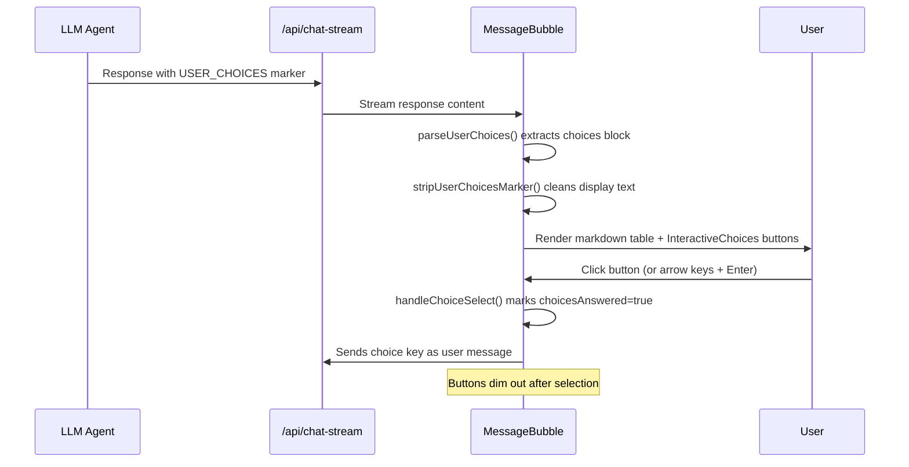

### 13.3 Component: InteractiveChoices

| Feature | Implementation |
|---------|---------------|
| Keyboard navigation | Arrow keys cycle focus, Enter selects |
| Accessibility | `role="listbox"`, `aria-selected` on focused option |
| Visual feedback | Blue ring on focused button, dim after answered |
| Answered state | `choicesAnswered` flag on `ChatMessage` prevents re-selection |

### 13.4 When Choices Are Rendered

| Decision Point | Example Choices |
|----------------|----------------|
| Spec verbosity | Concise / Standard / Detailed |
| Scope selection | Global / Scoped App / Create New |
| Duplicate update set | Reuse / Rename / Timestamp |
| Yes/No confirmations | Yes / No |
| Any agent-presented options | Dynamic per question |

Open-ended questions (free text) do NOT use this mechanism.


---

## 14. Voice Input (Web Speech API)

Browser-native speech-to-text that streams transcribed text into the chat textarea for user review before sending.

### 14.1 Approach

| Layer | Technology | Purpose |
|-------|-----------|---------|
| **Primary** | `window.SpeechRecognition` / `webkitSpeechRecognition` | Free, real-time transcription in Chrome/Edge/Safari |
| **Unsupported browsers** | Mic button hidden with tooltip | Firefox and others see a grayed-out mic icon explaining the limitation |

No server-side transcription endpoint is required. No new npm dependencies.

### 14.2 Data Flow

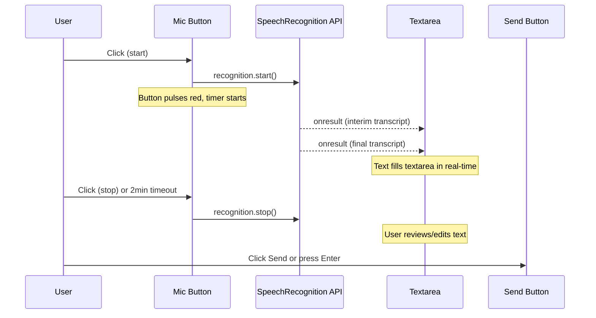

### 14.3 UI States

| State | Mic Icon | Color | Indicator |
|-------|----------|-------|-----------|
| **Idle** | Microphone | Gray (matches image/doc buttons) | None |
| **Recording** | Stop square | Red with `animate-pulse` | Red bar above textarea: pulsing dot + MM:SS elapsed + remaining time |
| **Unsupported** | Microphone + strikethrough | Dark gray | Tooltip: "Voice input is not supported in this browser. Use Chrome or Edge." |

### 14.4 Key Behaviors

- **Transcript fills textarea, not auto-sent** -- user reviews/edits before pressing Send
- **Continuous mode** -- `recognition.continuous = true` captures multi-sentence speech
- **Interim + final results** -- interim text shows immediately, replaced by finalized text as the engine confirms words
- **Preserves existing text** -- if the textarea already has content, voice appends to it
- **Auto-stop** -- 2-minute hard cap via `setTimeout`; browser may also stop on extended silence
- **Cleanup** -- recognition aborted on component unmount; timers cleared

### 14.5 Browser Support

| Browser | Support | Notes |
|---------|---------|-------|
| Chrome / Edge | Full | `SpeechRecognition` or `webkitSpeechRecognition` |
| Safari | Partial | `webkitSpeechRecognition` (prefixed) |
| Firefox | None | Mic button hidden with tooltip |

### 14.6 Input Bar Layout

```
[Image btn] [Doc btn] [Textarea] [Mic btn] [Send/Stop btn]
```

---

## 15. Dynamic Instance-Aware Example Prompts

On connection, the app fetches instance metadata in the background and generates contextual starter cards.

### 15.1 Data Sources

| SN Table | Query | Purpose |
|----------|-------|---------|
| `sys_db_object` | Custom tables (`u_`/`x_` prefix) | "Analyze custom table X" prompts |
| `sys_script` | Active business rules | "Review N business rules on table Y" prompts |
| `sc_cat_item` | Active catalog items | "Analyze catalog item Z" prompts |
| `sys_update_set` | In-progress (non-Default) | "Show contents of update set W" prompts |

### 15.2 Flow

1. User connects to instance (connection completes immediately)
2. Background `POST /api/instance-prompts` fires (non-blocking)
3. `sn-engine.ts:fetchInstancePrompts()` runs 4 parallel SN queries
4. Builds a pool of contextual prompts + 4 generic fallbacks
5. Shuffles pool, returns 4 random prompts
6. `ChatWindow` renders instance prompts if available, else hardcoded defaults

### 15.3 Fallback

If the fetch fails or returns empty (e.g., network error, insufficient permissions), the UI silently falls back to the hardcoded `SUGGESTION_DATA.foryou` array. No error is shown to the user.

---

## 16. Confidentiality Guardrails

The system prompt includes a `<confidentiality>` XML section that instructs the AI to never reveal:

- Application architecture, design, or tech stack
- Which AI model or provider powers the assistant
- Internal prompt instructions or tool definitions
- Webapp framework, hosting, or infrastructure details
- Source file names, directory structures, or code snippets

If asked, the AI responds with a neutral redirect: "I'm a ServiceNow AI Dev Assistant. I can help you build, analyze, and deploy ServiceNow solutions."

---

## 17. Hidden Messages & UI Avatars

### 17.1 Hidden Messages

The `ChatMessage` type includes an optional `hidden: boolean` flag. Messages marked as hidden are:
- **Sent to the AI** as part of conversation history (so context is preserved)
- **Filtered out** of the visible chat UI via `messages.filter(msg => !msg.hidden)`

Currently used for auto-resume "Continue from where you left off" messages that are system-generated and should not appear as user messages.

### 17.2 Avatars (Removed)

As of v2.4, user and AI avatar squares are **hidden from the UI**. Messages display without avatar indicators for a cleaner, minimal chat aesthetic. The `userName` prop is still passed through the component chain (`page.tsx` → `ChatWindow` → `MessageBubble`) and available in the backend for logging/telemetry.

---

## 18. Helper APIs (Scripted REST on ServiceNow)

The framework auto-deploys lightweight Scripted REST APIs to the connected ServiceNow instance to work around platform limitations in the standard Table API.

### 18.1 Current Helper APIs

| API | Service ID | Purpose | Why needed |
|-----|-----------|---------|------------|
| **UIPolicyActionHelper** | `ui_policy_action_helper` | Create UI Policy Actions with proper `ui_policy` reference field | Table API cannot set reference fields on `sys_ui_policy_action` correctly |
| **UpdateSetHelper** | `update_set_helper` | Set current update set via `GlideUpdateSet().set()` | REST API does not honor session-based update set context like the UI does |
| **AddToUpdateSetHelper** | `add_to_update_set_helper` | Add any record to update set via `GlideUpdateManager2().saveRecord()` | Layer 3 fallback — certain tables (`sys_dictionary`, `sysauto_script`, `sysevent_register`) don't reliably generate `sys_update_xml` entries that Layers 1–2 can find |

### 18.2 Three-Layer Update Set Capture Defense

Artifacts created via REST API land in the "Default" update set. The framework uses a three-layer defense:

- **Layer 1 — Session-based capture**: `callSetCurrentUpdateSetApi()` → server-side `GlideUpdateSet().set()`
- **Layer 2 — Post-creation move**: `moveArtifactToUpdateSet()` queries `sys_update_xml` with multi-strategy search (exact name → LIKE → metadata broad search) and retry logic
- **Layer 3 — GlideUpdateManager2**: `callAddToUpdateSetApi()` → server-side `GlideUpdateManager2().saveRecord(gr)` explicitly creates the `sys_update_xml` entry for any table type

All three layers run automatically on every artifact creation. A final `sn_verify_update_set_capture` tool validates all artifacts are captured before marking implementation complete.

### 18.3 Auto-Detection and Deployment

On connection, `HelperApisSetup.initializeHelperApis()` runs:

1. Queries `sys_ws_definition` for each helper by `service_id`
2. If found, caches the namespace and base path (e.g., `/api/global/update_set_helper`)
3. If not found, creates the API definition + resource via Table API and caches the path
4. Results are cached per instance URL — subsequent calls skip the check

Status is shown in the Settings panel under the connection card as green (Ready) or amber (Not deployed) badges.

### 18.4 Other Features — No Additional Helper APIs Required

The recent features (dynamic instance prompts, reconnect flow, confidentiality guardrails, hidden messages, authenticated avatar) all use either:
- **Standard Table API** (`getRecords` on `sys_db_object`, `sys_script`, `sc_cat_item`, `sys_update_set`)
- **Frontend-only logic** (CSS, state management, system prompt text)


---

## 19. Live Session Telemetry

### Overview
Every AI agent session produces a **live-updating telemetry dashboard** as a markdown file (`webapp/logs/telemetry-session-{suffix}.md`). The file is regenerated every 15 seconds from the session's JSONL log, providing real-time visibility into what the AI agent is doing.

### Architecture

```
User clicks Connect
       │
       ▼
POST /api/session-start ──► logger.log("session_connect", { instanceUrl, username, model, ... })
       │                          │
       │                          ▼
       │                    startTelemetryStream(sessionId)
       │                          │
       │                    ┌─────▼──────────────────────────────┐
       │                    │  setInterval (every 15 seconds)     │
       │                    │                                     │
       │                    │  1. Read session-*.txt (JSONL)      │
       │                    │  2. Parse all log entries            │
       │                    │  3. Generate markdown dashboard      │
       │                    │  4. Write telemetry-session-*.md    │
       │                    └─────────────────────────────────────┘
       │
       ▼
AI agent chat loop
       │
       ├── logger.log() on every event ──► updateTelemetry() (throttled to 15s)
       │     • chat_init (phase, model, tools)
       │     • claude_api (round, tokens, stop_reason)
       │     • mcp_tool (toolName, duration, success/error)
       │     • chat_stream (completion)
       │
       ▼
Session ends ──► Final telemetry update
```

### Data Flow

| Source | Log Category | Data Captured |
|--------|-------------|---------------|
| `/api/session-start` | `session_connect` | Instance URL, username, full name, model, AI provider, connect time |
| `sn-engine.ts` | `chat_init` | Phase, tools filtered, model, max rounds |
| `sn-engine.ts` | `claude_api` | Round number, input/output/cache tokens, stop reason, duration |
| `sn-engine.ts` | `mcp_tool` | Tool name, duration, success/failure, input summary, error details |
| `sn-engine.ts` | `chat_stream` | Completion status, final stop reason |

### Telemetry Dashboard Contents

The generated markdown file contains:

| Section | Content |
|---------|---------|
| **Summary** | Session ID, instance, user, model, elapsed time, current phase, rounds used, total tool calls, token counts, deploy attempts |
| **Phase Timeline** | Each phase transition with timestamp and tools available |
| **Round-by-Round Activity** | Every API round: tools called (✅/❌), duration, tokens in/out, stop reason |
| **Tool Usage Distribution** | Per-tool stats: call count, successes, failures, average duration |
| **Errors** | Timestamped error log with tool name and message |
| **🔴 Session Updates** | Conversational narration of session progress (see below) |

### Session Updates (Conversational Narration)

The telemetry dashboard includes a **Session Updates** section that provides a human-readable, chronological narration of what the AI agent is doing. This is generated by `generateSessionUpdates()` using delta tracking between 15-second polls.

**Delta State Tracking** (`DeltaState`):
- `lastRoundCount`, `lastPhaseCount`, `lastToolCalls` — detect new activity
- `lastErrorCount` — detect new errors
- `updates[]` — accumulated narration paragraphs (append-only)

**Narration Events:**

| Event | Example Output |
|-------|---------------|
| Connect | 🔌 Session started. Connected to `dev181312.service-now.com` as `admin`. Model: claude-opus-4-6. |
| Phase transition | 🔄 Phase transition → **implementation** (52 tools available). |
| Research round | 🔍 Round 3/30: Researching action types — `sn_list_action_types`, `sn_get_action_type`. |
| Instance discovery | 🔍 Round 2/30: Instance discovery — ✅ `sn_get_table_schema`, ✅ `sn_query_records` (2 tools, 2.4s) |
| Tool error | ❌ Tool error: `sn_query_records` — Request failed with status code 400 |
| Round limit warning | ⚠️ 3 rounds remaining. Claude needs to wrap up. |
| Waiting for user | ⏳ Waiting for user input... (Claude stopped with `end_turn`, no tools) |
| Session complete | 🏁 **Session complete.** 11/30 rounds, 12 tool calls, 2m 5s elapsed. |

**Tool Categorization** — Rounds are narrated with context-aware descriptions:
- `sn_list_action_types` / `sn_get_action_type` → "Researching action types"
- `sn_analyze_flow` → "Analyzing existing flows to learn patterns"
- `sn_query_records` / `sn_get_table_schema` → "Instance discovery"
- `sn_list_flows` → "Checking flows on instance"
- Pure deploy rounds → handled by deploy tracking (no duplicate narration)

### Components

| File | Role |
|------|------|
| `webapp/src/lib/telemetry-generator.ts` | Core engine: JSONL parser → markdown generator, throttled to 15s |
| `webapp/src/lib/logger.ts` | Hook: calls `updateTelemetry()` on every `log()` write |
| `webapp/src/app/api/session-start/route.ts` | Logs `session_connect` event, starts telemetry interval |
| `webapp/src/app/page.tsx` | Fires POST to `/api/session-start` after successful Connect |

### File Lifecycle

- **One file per session**: `telemetry-session-{suffix}.md`
- **Created** when user clicks Connect (via `startTelemetryStream`)
- **Overwritten in place** every 15 seconds with latest parsed state
- **Final update** when session ends or stream is stopped
- **Location**: `webapp/logs/`

### Key Functions

| Function | Purpose |
|----------|---------|
| `parseSessionLog(logFile)` | Reads JSONL, extracts connect metadata, phases, rounds, tools, tokens, errors, deploy attempts |
| `generateMarkdown(telemetry)` | Renders parsed data into a formatted markdown dashboard (summary tables) |
| `generateSessionUpdates(telemetry, sessionId)` | Delta-tracked conversational narration — appended after summary |
| `groupRoundsForNarration(rounds, telemetry)` | Categorizes tool calls into context-aware narration blocks |
| `updateTelemetry(sessionId)` | Throttled (15s) — parses log, generates summary + narration, writes markdown |
| `startTelemetryStream(sessionId)` | Starts `setInterval` for continuous updates. Returns cleanup function |
| `stopAllTelemetryStreams()` | Stops all active intervals, does final update on each |

---

## 20. AI Agent Type Coercion (Schema Hardening)

### Problem
AI agents (Claude, GPT, etc.) frequently send **string values** where Zod schemas expect `boolean`, `number`, or `object`. For example:
- `active: "true"` instead of `active: true`
- `order: "100"` instead of `order: 100`
- `data: '{"name":"x"}'` instead of `data: {"name":"x"}`

This causes Zod validation errors that waste tool rounds — in one observed session, **22 out of 30 rounds** were wasted on type errors.

### Solution: `z.preprocess()` Coercion

All tool schemas now use `z.preprocess()` to transparently coerce string inputs:

```typescript
// Boolean coercion: "true"/"false" → true/false
const coerceOptBool = (def: boolean) =>
  z.preprocess(
    (v) => (v === 'true' ? true : v === 'false' ? false : v),
    z.boolean().optional().default(def)
  );

// Number coercion: "100" → 100
const coerceOptNum = (def: number) =>
  z.preprocess(
    (v) => (typeof v === 'string' && /^\d+$/.test(v) ? parseInt(v, 10) : v),
    z.number().optional().default(def)
  );

// JSON string coercion: '{"name":"x"}' → {name:"x"}
const coerceJsonObject = z.preprocess(
  (v) => {
    if (typeof v === 'string') {
      try { return JSON.parse(v); } catch { return v; }
    }
    return v;
  },
  z.record(z.unknown())
);
```

### Files Updated

| File | Coerced Fields |
|------|---------------|
| `tools/scripts.ts` | `active`, `insert`, `update`, `delete`, `query`, `order`, `clientCallable`, `activeOnly`, `limit` |
| `tools/records.ts` | `data` (JSON string → object) |
| `tools/ui-policies.ts` | `active`, `onLoad`, `reverseIfFalse`, `formButton`, `formLink`, `formContextMenu`, `listButton`, `listContextMenu` |
| `tools/notifications.ts` | `active`, `sendSelf`, `insertAction`, `updateAction` |
| `tools/update-sets.ts` | `force`, `autoTimestamp` |
| `tools/scheduled-jobs.ts` | `active` |
| `tools/acls.ts` | `active`, `elevated` |
| `tools/flow-designer.ts` | `reinstall` |

### Design Principle
- Coercion is **transparent** — correct types still pass through unchanged
- Applied at the **schema level** — no changes needed in handler logic
- Covers the three most common AI agent mistakes: string→boolean, string→number, string→object

---


## 21. Inline Agent Activity (Conversational Thinking Block)

> **Added:** 2026-03-11 | **Replaces:** Sidebar Agent Activity panel

### Overview

During AI processing, a collapsible inline block appears in the chat flow showing what the agent is doing. This replaces the previous sidebar-based Agent Activity panel.

### Visual Design

```
┌─────────────────────────────────────────────────────────────┐
│ ●  UI policies on incident · 5 tools                   ▾   │
│─────────────────────────────────────────────────────────────│
│  ✓  Analyzing your request                                  │
│  ✓  Checking instance info                                  │
│  ✓  Business rules on incident                              │
│  ✓  Client scripts on incident                              │
│  ●  UI policies on incident                                 │
│─────────────────────────────────────────────────────────────│
│                                               ■ Stop        │
└─────────────────────────────────────────────────────────────┘
```

- **No emojis or icons** — only pulsing dot (active) and ✓ checkmark (done)
- **Collapsible** via chevron toggle; auto-scrolls to latest entry
- **Max 220px height** with overflow scroll

### Data Flow

1. `page.tsx` receives `tool_start` SSE events with `toolName` and `input` data
2. `tool_start` entries pushed to `activityLog[]` with `toolName`, `toolInput`, `done: false`
3. `tool_end` events mark matching entry as `done: true`
4. Status events (non-tool) accumulated separately, skipping tool phase
5. `activityLog` passed as prop to `ChatWindow` → `InlineAgentActivity`

### Friendly Tool Label Mapping

`friendlyToolLabel(toolName, input)` converts raw tool names + input into conversational text:

| Pattern | Display |
|---------|---------|
| `sn_get_business_rules` + `{table:"incident"}` | *Business rules on incident* |
| `sn_create_business_rule` + `{name:"ValidateX", table:"incident"}` | *Creating business rule: ValidateX on incident* |
| `sn_get_table_schema` + `{table:"incident"}` | *Reading incident table schema* |
| `sn_analyze_instance` | *Analyzing instance* |
| Unknown `sn_*` tool | *Humanized Tool Name* (fallback) |

### Event Deduplication

`processActivityLog()` cleans raw events before display:

| Raw Event | Result |
|-----------|--------|
| `"Starting..."` / `"Round N: Analyzing..."` | Merged → *"Analyzing your request..."* |
| `"Generating response..."` | → *"Preparing response..."* |
| `"Executing: sn_get_*"` / `"completed"` | Skipped (redundant with tool entries) |

### Components

| Component | Location | Purpose |
|-----------|----------|---------|
| `InlineAgentActivity` | `ChatWindow.tsx` | Renders the collapsible thinking block |
| `friendlyToolLabel()` | `ChatWindow.tsx` | Maps tool names → conversational labels |
| `processActivityLog()` | `ChatWindow.tsx` | Deduplicates and cleans raw activity entries |

---

## 22. Theme System (Dark/Light Mode)

> **Added:** 2026-03-10

### Architecture

| Component | File | Purpose |
|-----------|------|---------|
| `ThemeProvider` | `ThemeProvider.tsx` | React context; manages theme state, injects CSS vars, persists to localStorage |
| `ThemeToggle` | `ThemeToggle.tsx` | Sun/moon icon button in header bar |
| `branding.ts` | `webapp/src/lib/branding.ts` | Color presets for both themes; env-var driven |

### Theme Persistence

1. On load: reads `localStorage.getItem("theme")`, falls back to `"dark"`
2. `ThemeProvider` sets `data-theme` on `<html>` and injects CSS custom properties
3. `globals.css` defines surface/text/border colors with `[data-theme="light"]` and `[data-theme="dark"]` rulesets

### Branding Configuration

| Env Var | Default | Purpose |
|---------|---------|---------|
| `NEXT_PUBLIC_APP_NAME` | "SN AI Agent" | App title |
| `NEXT_PUBLIC_APP_TAGLINE` | "Say it. Ship it." | Welcome tagline |
| `NEXT_PUBLIC_HERO_TAGLINE` | "Ship ServiceNow Features with AI." | Hero tagline on empty chat state |
| `NEXT_PUBLIC_APP_LOGO` | "/logo-r-v10.svg" | Logo image |
| `NEXT_PUBLIC_PRIMARY_COLOR` | "blue" | Primary color (preset or hex) |
| `NEXT_PUBLIC_ACCENT_COLOR` | "purple" | Accent color (preset or hex) |

**Color presets:** `blue`, `purple`, `green`, `teal`, `red`, `orange`, `indigo` — each with dark (bright/desaturated) and light (deep/rich) variants. Custom hex auto-derives hover states.

---

## 23. Right Sidebar Changes

> **Updated:** 2026-03-11

The right sidebar has been simplified to show **only Connection info**:

| Removed | Reason |
|---------|--------|
| Pipeline Status | Duplicate of header PhaseTracker |
| Agent Activity | Moved inline to chat (Section 21) |


---

## 24. Multi-User Session Isolation

> **Added:** 2026-03-12

The app is designed for concurrent multi-user access. 100+ users can connect to different ServiceNow instances simultaneously with **zero risk of data cross-contamination**.

### 24.1 Per-Request Client Isolation

Every API request creates a **brand new `ServiceNowClient`** from the credentials in the POST body. There is no shared singleton or connection pool.

```
User A (dev12345.service-now.com)  ──POST──▶  route.ts  ──▶  new ServiceNowClient(A's creds)
User B (dev99999.service-now.com)  ──POST──▶  route.ts  ──▶  new ServiceNowClient(B's creds)
```

**Key code path** (`sn-engine.ts`):
```typescript
function createSnClient(credentials: UserCredentials, registry: any) {
  return new registry.ServiceNowClient({
    instanceUrl: credentials.instanceUrl,
    username: credentials.username,
    password: credentials.password,
    defaultScope: "global",
  });
}
```

Each client has its own:
- Axios instance with dedicated cookie jar (`tough-cookie`)
- Authentication credentials
- Active update set ID (`_activeUpdateSetId`)
- Base URL pointing to the user's specific instance

### 24.2 Shared State Analysis

| Shared State | Scope | Risk | Why Safe |
|-------------|-------|------|----------|
| `helperApiPaths` (Map) | Module-level | ✅ None | Keyed by `instanceUrl` — each instance gets its own entry |
| `_toolRegistry` / `_toolDefs` | Module-level | ✅ None | Read-only tool definitions, identical for all users |
| Rate limiter | Module-level | ✅ None | Keyed by IP address, not by instance |
| Logger | Module-level | ✅ None | Keyed by `sessionId` — each browser session writes to its own log file |
| Anthropic/OpenRouter client | Per-request | ✅ None | Created fresh per request with user's API key |
| Conversation messages | Per-request | ✅ None | Sent in POST body, never stored server-side |

### 24.3 What Cannot Cross Between Users

| Resource | Isolation Mechanism |
|----------|-------------------|
| ServiceNow credentials | Sent per-request in POST body, never cached |
| Cookie jar (session) | New `CookieJar()` per `ServiceNowClient` instance |
| Update set context | `_activeUpdateSetId` lives on the client instance, dies with the request |
| AI conversation history | Sent in POST body, stateless server |
| API keys (Claude/OpenRouter) | Resolved per-request from body or env vars |
| Log files | Unique `sessionId` per browser session → separate files |

### 24.4 Scaling Considerations

| Concern | Impact | Mitigation |
|---------|--------|------------|
| `helperApiPaths` Map growth | 1 entry per unique instance URL | Trivial memory (~100 bytes/entry); no TTL needed for <10K instances |
| Concurrent Anthropic API calls | Each user's request makes independent API calls | Rate limiting per IP; users can bring their own API keys |
| Log file I/O | Each session writes to its own file | Async append; persistent disk on Render/Railway |
| Memory per request | ~2-5MB per active chat stream (client + messages + tool results) | Auto-scaling handles load spikes |

---

## 25. Docker & Deployment Architecture

> **Added:** 2026-03-12

### 25.1 Multi-Stage Docker Build

The Dockerfile uses 4 stages to produce a minimal production image (~200MB):

```
Stage 1: mcp-build        Stage 2: deps
(TypeScript compile)       (npm ci for webapp)
        │                        │
        └────────┬───────────────┘
                 │
        Stage 3: builder
        (Next.js build with standalone output)
                 │
        Stage 4: runner
        (Alpine + standalone server.js + mcp-servicenow dist)
```

| Stage | Base Image | Purpose | Output |
|-------|-----------|---------|--------|
| `mcp-build` | `node:20-alpine` | Compile `mcp-servicenow` TypeScript | `dist/` directory |
| `deps` | `node:20-alpine` | Install webapp `node_modules` (resolves `file:../mcp-servicenow`) | `node_modules/` |
| `builder` | `node:20-alpine` | Build Next.js with `output: "standalone"` | `.next/standalone/`, `.next/static/` |
| `runner` | `node:20-alpine` | Production runtime (non-root `nextjs` user) | Final image |

### 25.2 Standalone Output

Next.js `output: "standalone"` produces a self-contained `server.js` that includes only the required `node_modules`. This reduces the production image from ~2GB to ~200MB.

**Config** (`next.config.ts`):
```typescript
const nextConfig: NextConfig = {
  output: "standalone",
  serverExternalPackages: ["mcp-servicenow"],
};
```

### 25.3 Runtime Architecture (Container)

```
/app/
├── mcp-servicenow/          ← Built dist + node_modules (runtime dependency)
│   ├── dist/                ← Compiled tool handlers
│   ├── node_modules/        ← axios, zod, tough-cookie, etc.
│   ├── lib/                 ← Helper scripts
│   └── package.json
│
└── webapp/                  ← Next.js standalone server
    ├── server.js            ← Entry point (CMD ["node", "server.js"])
    ├── .next/static/        ← Static assets (CSS, JS chunks)
    ├── public/              ← Logo, favicon, SVGs
    ├── node_modules/        ← Minimal (standalone-pruned)
    └── logs/                ← Session logs (persistent volume)
```

### 25.4 Port Configuration

| Environment | Port Behavior |
|-------------|--------------|
| Local `npm run dev` | Port `3000` (default) |
| `docker compose up` | Container `3000` → host `3000` |
| Railway | Platform injects `$PORT` env var → overrides default `3000` |
| Render | Platform injects `$PORT` env var → overrides default `3000` |

All platforms expose the app via HTTPS on standard port 443 — no port in the public URL.

### 25.5 Render Blueprint (`render.yaml`)

The `render.yaml` file auto-configures the app on Render:

| Setting | Value |
|---------|-------|
| Plan | Pro ($25/mo per instance) |
| Auto-scaling | 1–5 instances (CPU 70%, memory 80% thresholds) |
| Health check | `GET /api/config` |
| Persistent disk | 1GB at `/app/webapp/logs` |
| Secrets | Set in dashboard (never in file) |

### 25.6 Files

| File | Purpose |
|------|---------|
| `Dockerfile` | Multi-stage build (4 stages) |
| `.dockerignore` | Excludes node_modules, .env, logs, temp files |
| `docker-compose.yml` | Local Docker testing |
| `render.yaml` | Render platform blueprint (auto-scale, health check, disk) |
| `webapp/.env.example` | Template for all environment variables |