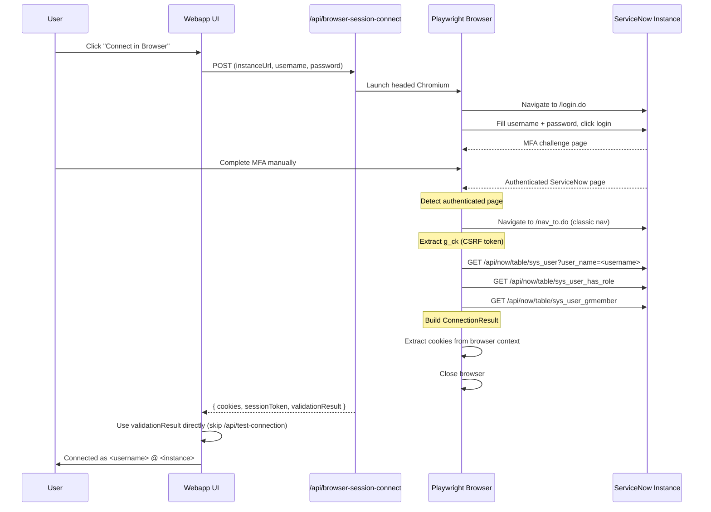

# Browser Session Authentication — Implementation Record

> **Status:** Implemented and verified  
> **Last verified:** 2026-03-20  
> **Test instance:** dev181312.service-now.com (MFA-enabled, Next Experience UI)

---

## Summary

Browser Session is an authentication method that lets users connect to MFA/SSO-enabled ServiceNow instances by completing sign-in in a real browser window. The app captures the authenticated session and uses it for API operations.

This document consolidates findings from three planning iterations and records the final working implementation.

---

## Architecture



---

## Key Design Decisions

### 1. Browser-proxied validation (not cookie export)

ServiceNow browser sessions are bound to the process that created them. Exporting cookies and g_ck to Node.js and making REST calls from a different process fails with 401 on most instances. The solution is to run all validation queries **inside the Playwright browser context** using `page.evaluate(() => fetch(...))` before closing the browser. This is the same pattern used for Tier 4 scope switching.

### 2. Classic nav navigation before validation

After MFA, ServiceNow often lands on the Next Experience shell (`/now/nav/ui/classic/...`). This shell renders content in iframes where the **top frame** does not have:
- `window.g_ck` (CSRF token)
- Authenticated API access (REST calls return 401)

The code navigates to `/nav_to.do` (classic ServiceNow navigator) before running validation, because that page exposes `g_ck` and has proper authenticated API access.

### 3. Username-based user lookup

`/api/now/ui/user/me` can return a different user on some ServiceNow pages (observed: returned `crissy.stark` instead of `abel.tuter` on the classic nav page). The validation now queries `sys_user` table directly using the username entered in the form, falling back to `/api/now/ui/user/me` only if no username was provided.

### 4. Skip /api/test-connection for browser session

When browser-proxied validation succeeds, the frontend uses that result directly and skips the separate `/api/test-connection` call. This avoids the cookie-export problem entirely.

### 5. OAuth methods hidden from UI

OAuth App (Client Credentials) and OAuth Sign-In (Authorization Code) code exists but is hidden from the settings UI. Only **Basic** and **Browser Session** are visible. OAuth can be re-enabled later by adding the entries back to the auth method array in `SettingsPanel.tsx`.

---

## Files Modified

### Browser automation core
- **`webapp/src/lib/browser-scope-switcher.ts`**
  - `BrowserValidationResult` interface for browser-proxied validation
  - `BrowserScopeSwitchResult` extended with `sessionToken` and `validationResult`
  - `connectViaBrowser` — navigates to `/nav_to.do`, extracts `g_ck`, runs full validation inside browser, returns `validationResult`
  - `hasAuthenticatedServiceNowSession` — server-side cookie probe + JSESSIONID check
  - `hasPasswordForm` — visibility-aware (checks `isVisible()` not just DOM presence)
  - `waitForAuthenticatedShell` — tracks active page across redirects, handles page closure
  - `chooseActivePage` — picks the best open page from the browser context
  - `probeServiceNowUiSession` — server-side session probe using extracted cookies
  - `forceMode` and `manualTimeoutMs` parameters (no more `process.env` mutation)

### API routes
- **`webapp/src/app/api/browser-session-connect/route.ts`** — returns `sessionToken` and `validationResult`; uses `forceMode: "headed"` and `manualTimeoutMs: 300000`
- **`webapp/src/proxy.ts`** — `/api/browser-session-connect` and `/api/sn-oauth/` added to `PUBLIC_PATHS`

### Types
- **`webapp/src/lib/types.ts`** — `Credentials` extended with `sessionToken`
- **`mcp-servicenow/src/types/index.ts`** — `SNConfig` extended with `sessionToken`

### Frontend
- **`webapp/src/app/app/page.tsx`**
  - `completeBrowserSessionSignIn` stores `sessionToken` and `validationResult` from browser-session response
  - `handleConnect` uses `validationResult` directly for session auth (skips `/api/test-connection`)
  - Phase-specific connect labels: "Waiting for browser sign-in..." / "Validating ServiceNow session..."
  - Post-browser validation error messages are separate from generic connection errors
  - Anonymous `/api/auth/me` calls removed (gated on `isAuthenticated` from `/api/config`)
  - LCP logo images marked with `priority`
- **`webapp/src/components/SettingsPanel.tsx`**
  - Auth method buttons: only Basic and Browser Session shown
  - Username and Password labels: no longer marked "optional" for any auth method
  - `connectingLabel` prop for phase-specific button text
  - `priority` on settings panel logo image

### MCP client
- **`mcp-servicenow/src/client/sn-client.ts`**
  - `applyAuthToRequest` — sends `X-UserToken` header when `authType === 'session'`
  - `importCookies` — accepts optional `sessionToken` parameter
  - Constructor and `resetSession` — pass `sessionToken` through

### Engine
- **`webapp/src/lib/sn-engine.ts`**
  - `UserCredentials` extended with `sessionToken`
  - `buildServiceNowConfig` pipes `sessionToken` for session auth

---

## Environment Variables

| Variable | Default | Purpose |
|----------|---------|---------|
| `BROWSER_SCOPE_SWITCH_MODE` | (none) | `headed` for visible browser, `headless` for automated, `cdp` for attach |
| `ENABLE_BROWSER_SCOPE_SWITCH` | (none) | Legacy flag; falls back to `headless` when `true` and no MODE set |
| `BROWSER_SCOPE_SWITCH_CDP_URL` | (none) | Required when MODE=cdp (e.g., `http://127.0.0.1:9222`) |
| `BROWSER_SCOPE_SWITCH_MANUAL_TIMEOUT_MS` | 180000 | Timeout for headed/CDP manual login (overridden to 300000 for connect) |
| `BROWSER_SCOPE_SWITCH_TIMEOUT_MS` | 30000 | Timeout for headless browser attempts |
| `BROWSER_SCOPE_SWITCH_MAX_ATTEMPTS_PER_HOUR` | 2 | Rate limit for browser scope-switch attempts |
| `BROWSER_CONNECT_MAX_ATTEMPTS_PER_HOUR` | 2 | Rate limit for browser connect attempts |

Recommended local dev values:
```env
BROWSER_SCOPE_SWITCH_MODE=headed
BROWSER_CONNECT_MAX_ATTEMPTS_PER_HOUR=10
BROWSER_SCOPE_SWITCH_MAX_ATTEMPTS_PER_HOUR=10
```

---

## Known Limitations

1. **Session cookies are not usable from Node.js** — ServiceNow sessions are bound to the browser process. The exported cookies and g_ck token are stored for potential future use but do not currently authenticate Node.js REST calls. All validation runs inside the browser.

2. **Chat/tool execution** — After browser-session connect, the MCP tools that make REST API calls from Node.js will still use the session cookies + g_ck. Whether those calls succeed depends on the instance's session binding policies. On strictly bound instances, tool execution may fail even though connection succeeded.

3. **g_ck token lifetime** — The CSRF token captured at connect time may expire. There is no automatic refresh mechanism for session auth.

4. **OAuth methods** — OAuth App and OAuth Sign-In code exists but is not tested end-to-end and is hidden from the UI.

5. **Edge middleware crypto warning** — `webapp/src/lib/auth.ts` imports Node.js `crypto` module which triggers a warning in Next.js Edge runtime. This is cosmetic and unrelated to browser session auth.

---

## Verification Checklist

- [x] Browser opens in headed mode when "Connect in Browser" is clicked
- [x] Username and password are filled automatically on the login page
- [x] User can complete MFA manually in the browser window
- [x] Browser navigates to `/nav_to.do` after MFA for validation
- [x] `g_ck` is extracted from the classic nav page
- [x] User info, roles, and groups are fetched from within the browser
- [x] Correct username is shown (from form input, not `/api/now/ui/user/me`)
- [x] Browser closes automatically after validation
- [x] UI shows "Connected as <user> @ <instance>"
- [x] No `/api/auth/me` 401 on anonymous page load
- [x] No LCP warning for logo images
- [x] Rate limiter respects `BROWSER_CONNECT_MAX_ATTEMPTS_PER_HOUR`
- [x] Basic auth flow is unaffected
- [x] `next build` passes cleanly

---

## Relationship to Earlier Plans

This document supersedes and consolidates:

1. **Tier 4 MFA/SSO plan** (`tier_4_mfa_sso_e093a654.plan.md`) — The original investigation that identified the MFA/SSO gap. All phases and guardrails were implemented. Browser Session connect was the outcome of Phase 2 (interactive Tier 4).

2. **Fix Browser Connect plan** (`fix_browser_connect_40c22fad.plan.md`) — Fixed the browser session detection, lifecycle, and UI noise. All five items were completed. The plan's approach of "server-side cookie/session probe" evolved into browser-proxied validation after discovering that exported cookies don't authenticate from Node.js.

3. **Browser Session g_ck fix plan** (`browser_session_g_ck_fix_29c7d705.plan.md`) — Added g_ck extraction and X-UserToken injection. All four items were completed. The plan's primary approach (cookies + g_ck from Node.js) didn't solve the 401, but its documented fallback (browser-proxied validation) was implemented and is the working solution.
