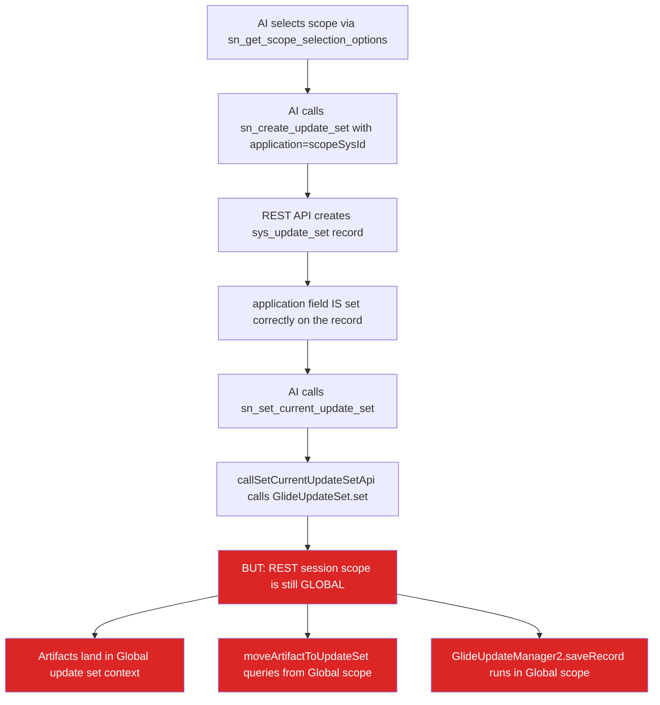
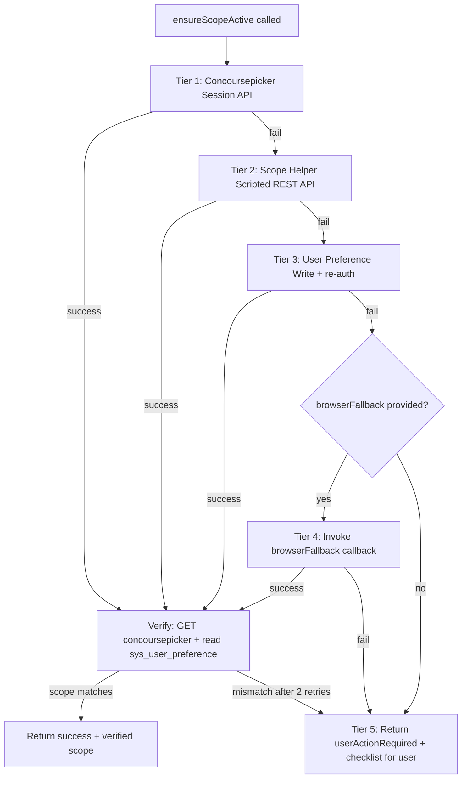

# Custom Scope Capture for Update Sets

> **Version:** 1.0 | **Date:** 2026-03-19 | **Branch:** `cursor/custom-scope-capture-for-updateset`

---

## 1. Problem Statement

When the AI agent creates an update set within a custom application scope (non-Global), the update set and its captured artifacts land in Global scope instead of the intended scope. This is a known ServiceNow platform limitation (KB0867578): external REST API sessions always run in Global scope, so `GlideUpdateSet().set()` and artifact creation happen in Global context even when the `application` field is correctly set on the `sys_update_set` record.

### Symptoms

- Update set is created with the correct `application` reference, but artifacts land in the Default update set
- `GlideUpdateSet().set()` called via the UpdateSetHelper API does not bind correctly when the session scope differs from the update set scope
- The three-layer update set defense (session, post-creation move, GlideUpdateManager2) all operate in Global context and don't account for custom scopes

---

## 2. Root Cause



**Six confirmed gaps:**

1. No session scope switching — REST sessions always default to Global
2. Three-layer defense is scope-unaware — all layers operate in Global context
3. `defaultScope` was hardcoded to `"global"` in `sn-engine.ts`
4. `scope-manager.js` existed (uses `sys_scope` correctly) but was not integrated into MCP tools
5. No scope verification tool existed
6. Scope choice UI sent only the label text, not the `sys_id` — fragile mapping

---

## 3. Solution: Five-Tier Scope Switching Fallback

All scope-switching logic is encapsulated in a single function `ensureScopeActive()` in `sn-client.ts`. The AI agent calls `sn_set_scope` and gets back either `success` or `userActionRequired`. The tiers are invisible to the agent.

### Tier summary

| Tier | Method | Deployment | Speed | Reliability |
|------|--------|------------|-------|-------------|
| 1 | `PUT /api/now/ui/concoursepicker/application` | None (built-in) | ~200ms | High (stable since Orlando 2020) |
| 2 | ScopeHelper Scripted REST API | Auto-deployed on connect | ~500ms | Medium (`gs.setCurrentApplicationId()` may not exist) |
| 3 | `sys_user_preference` write + session refresh | None | ~1s | Low (needs session restart) |
| 4 | Playwright browser automation | Optional (`ENABLE_BROWSER_SCOPE_SWITCH=true`) | ~30s | Medium (fails on MFA/SSO) |
| 5 | Manual user prompt + verification | None | User-paced | Always works |

### Fallback flow



After any tier succeeds, verification runs via `GET /api/now/ui/concoursepicker/application` (primary) or `sys_user_preference` query (fallback). If verification fails after 2 retries, falls through to the next tier.

---

## 4. Tier Details

### 4.1 Tier 1: Concoursepicker Session API

ServiceNow's built-in internal API that powers the scope picker dropdown in the UI header. The "concourse" is ServiceNow's name for the top navigation banner.

**Endpoints:**

- `GET /api/now/ui/concoursepicker/application`
  - Returns: `{ result: { list: [{sysId, name, scope, ...}], current: "<sys_id>" } }`
  - Used for: listing available scopes, verifying current scope

- `PUT /api/now/ui/concoursepicker/application`
  - Body: `{ "app_id": "<scope_sys_id>" }`
  - Switches the session's application scope immediately
  - Returns: `{ result: { app_id: "<sys_id>" } }`

**Why it works from external clients:**
- The SN AI Agent's `sn-client.ts` uses `axios-cookiejar-support` + `tough-cookie` for session persistence
- The concoursepicker PUT updates the scope for the HTTP session (identified by `JSESSIONID` cookie)
- Subsequent REST calls on the same session inherit the new scope

**Risks:**
- Internal/undocumented API — could change between ServiceNow releases
- Stable since at least Orlando (2020) through Washington/Xanadu (2024-2025)
- May require admin or delegated developer access

**File:** `mcp-servicenow/src/client/sn-client.ts` — `switchScopeViaConcoursePicker()`

### 4.2 Tier 2: ScopeHelper Scripted REST API

A custom Scripted REST API auto-deployed on the ServiceNow instance alongside the existing UpdateSetHelper and AddToUpdateSetHelper.

**Endpoints:**

- `POST /api/<namespace>/scope_helper/set_scope`
  - Body: `{ "scope_id": "<sys_id>", "update_set_id": "<optional_sys_id>" }`
  - Server-side: validates scope in `sys_scope`, calls `gs.setCurrentApplicationId()` (wrapped in try/catch), optionally calls `GlideUpdateSet().set()`
  - Returns: `{ result: { success, currentScope, scopeName, currentUpdateSet } }`

- `GET /api/<namespace>/scope_helper/get_scope`
  - Returns: `{ result: { success, currentScope, currentScopeName } }`

**Limitation:** `gs.setCurrentApplicationId()` may not exist as a writable API on all ServiceNow releases. The script wraps it in try/catch so it degrades gracefully. The value of Tier 2 is calling `GlideUpdateSet().set()` in the correct scope context.

**Files:**
- `mcp-servicenow/src/deployer/HelperApisSetup.ts` — auto-deploy definition
- `mcp-servicenow/src/client/sn-client.ts` — `switchScopeViaScopeHelper()`
- `mcp-servicenow/src/tools/connection.ts` — wires up `scopeHelper` path on connect

### 4.3 Tier 3: User Preference Write

Writes to `sys_user_preference` to set `apps.current.app` = scope sys_id for the REST API user.

**Limitation:** Preferences only take effect after a new session/login, not for the current session.

**Conflict risk:** If multiple users share the same REST account, preference writes will race. This tier should not be used with shared service accounts.

**File:** `mcp-servicenow/src/client/sn-client.ts` — `switchScopeViaPreference()`

### 4.4 Tier 4: Browser Automation (Optional)

Uses Playwright to log into the ServiceNow instance via headless Chromium and switch scope through the UI. This calls the concoursepicker API from within the browser session (same-origin, with `g_ck` CSRF token).

**Security controls:**
- SSRF protection: strict URL allowlist (`*.service-now.com`, `*.servicenow.com`)
- MFA/SSO detection: fails fast if login redirects to an IdP or shows OTP prompt
- No screenshots or traces in production
- Credential sanitization in all error paths
- Rate limited: max 2 attempts per scope per hour per user
- 30-second timeout

**Dependency inversion:** `ensureScopeActive()` in `mcp-servicenow/` accepts an optional `browserFallback` callback. The webapp injects the Playwright function at client creation time:

```typescript
// webapp/src/lib/sn-engine.ts
client.setEnsureScopeOptions({
  browserFallback: (scopeId, scopeName) =>
    switchScopeViaBrowser(credentials, scopeId, scopeName)
});
```

This keeps `mcp-servicenow` free of browser dependencies.

**Activation:** Set `ENABLE_BROWSER_SCOPE_SWITCH=true` in the webapp `.env`. Requires `playwright-core` as an optional dependency.

**Files:**
- `webapp/src/lib/browser-scope-switcher.ts` — Playwright automation
- `webapp/src/lib/sn-engine.ts` — callback injection

### 4.5 Tier 5: Manual User Prompt

If all automated tiers fail, the system returns `{ success: false, userActionRequired: true }` with a structured checklist. The AI presents:

```
I tried to switch to scope "My Custom App" automatically but it didn't work.
Please do this manually:

1. Open your instance: https://<instance>.service-now.com/nav_to.do
2. In the header, click the scope picker (globe icon) and select "My Custom App"
3. If you don't see the scope picker, go to Settings (gear) > Developer >
   enable "Show application picker in header"
4. Once switched, come back here and click "Scope switched" below.
```

The AI emits a `USER_CHOICES` block with a "Scope switched" button. When clicked, the AI calls `sn_verify_scope` to confirm. Up to 2 verification retries with 3-second delay.

---

## 5. MCP Tools

Only two agent-facing tools:

| Tool | Purpose | Schema |
|------|---------|--------|
| `sn_set_scope` | Switch session to a target scope. Runs all 5 tiers via `ensureScopeActive()`. | `{ scope_id: string, scope_name?: string }` |
| `sn_verify_scope` | Check current scope. Does NOT use `gs.getCurrentApplicationId()` (always returns global in REST). | `{ target_scope_id?: string }` |

Both are available in the `scope_selection` and `implementation` SDLC phases.

### Scope guard on existing tools

`sn_create_update_set` and `sn_set_current_update_set` include an automatic scope guard:

```typescript
if (input.application && client.getActiveScope() !== input.application) {
  const scopeResult = await client.ensureScopeActive(input.application);
  if (!scopeResult.success) return scopeResult;
}
```

This catches cases where the AI forgets to call `sn_set_scope` before creating an update set in a custom scope.

---

## 6. Scope Verification Strategy

`sn_verify_scope` does NOT rely on `gs.getCurrentApplicationId()` (always returns `"global"` in REST context). Instead:

1. **Primary:** `GET /api/now/ui/concoursepicker/application` — read `result.current`
2. **Fallback:** Query `sys_user_preference` where `name=apps.current.app` and `user=<current_user>` — read `value`

---

## 7. Per-Request Lifecycle

`ServiceNowClient` is created fresh per chat request in `sn-engine.ts`. The `_activeScopeId` resets each turn. Therefore:

- The system prompt instructs the AI to call `sn_set_scope` at the start of each implementation turn (not just once)
- `ensureScopeActive()` is lightweight when Tier 1 works (single PUT + GET, ~200ms)
- The cookie jar is per-request, so the concoursepicker scope switch must happen on the same client instance used for artifact creation

---

## 8. Multi-Scope Workflows

When a design specifies artifacts in multiple scopes (e.g., a flow in a scoped app + a business rule in Global):

1. Group artifacts by scope
2. For each scope group:
   a. Call `sn_set_scope` with the target scope
   b. Create a separate update set for that scope
   c. Create all artifacts for that scope
3. Tell the user before each switch: "Switching to [scope name]..."
4. Verify each update set with `sn_verify_update_set_capture`

---

## 9. System Prompt Changes

The `<scope_selection>` phase instructions now include:

- A decision table for Global vs custom scope flows
- Instruction to use `sys_id` as the `key` in `USER_CHOICES` for scope selection
- Reference to `sn_set_scope` for custom scopes with `userActionRequired` handling

The `<implementation>` phase instructions now include:

- "At the START of implementation, call `sn_set_scope` again (scope resets per request)"
- Multi-scope grouping instructions
- Per-switch status messaging

---

## 10. sys_app vs sys_scope

Investigation confirmed that `sys_app` extends `sys_scope` in ServiceNow. They share the same `sys_id` for any given application. The `sys_update_set.application` field references `sys_scope`. Since `sys_app.sys_id === sys_scope.sys_id`, the scope IDs returned by `sn_get_custom_apps` (which queries `sys_app`) are directly usable in `sn_set_scope` and `sn_create_update_set`.

---

## 11. Phase 0 Validation

Before relying on the five-tier fallback on a new instance, run the validation script:

```bash
cd mcp-servicenow
node tests/test-scope-switching.js
```

This tests:
1. Concoursepicker GET — list available scopes
2. Concoursepicker PUT — switch to a custom scope
3. CSRF requirement — does PUT need `X-UserToken`?
4. Preference key name — `apps.current.app` vs `apps.current_app`
5. End-to-end — switch scope → create update set → verify `application` field

---

## 12. Implementation Reference

| File | What was added/changed |
|------|------------------------|
| `mcp-servicenow/src/client/sn-client.ts` | `_activeScopeId`, `EnsureScopeOptions`, `switchScopeViaConcoursePicker()`, `switchScopeViaScopeHelper()`, `switchScopeViaPreference()`, `verifyCurrentScope()`, `ensureScopeActive()` |
| `mcp-servicenow/src/deployer/HelperApisSetup.ts` | `ScopeHelper` Scripted REST API (auto-deployed with `/set_scope` POST and `/get_scope` GET) |
| `mcp-servicenow/src/tools/connection.ts` | Wires up `scopeHelper` path on connect and initialize |
| `mcp-servicenow/src/tools/update-sets.ts` | `sn_set_scope`, `sn_verify_scope` tools; scope guard in `createUpdateSet()` and `setCurrentUpdateSet()` |
| `mcp-servicenow/src/tool-definitions.ts` | 2 new tool schemas; phase tool set updates for `scope_selection` and `implementation` |
| `mcp-servicenow/src/tool-registry.ts` | Registered `sn_set_scope` and `sn_verify_scope` handlers |
| `webapp/src/lib/browser-scope-switcher.ts` | Optional Playwright-based browser automation (Tier 4) |
| `webapp/src/lib/system-prompt.ts` | Scope selection decision table, `USER_CHOICES` key=sys_id, per-turn scope re-set |
| `webapp/src/lib/sn-engine.ts` | Removed hardcoded `defaultScope: "global"`, injects browser fallback |
| `mcp-servicenow/tests/test-scope-switching.js` | Phase 0 validation script |

---

## 13. Known Limitations and Risks

| Item | Risk | Mitigation |
|------|------|------------|
| Concoursepicker is undocumented | Could change between SN releases | Tier 2 (ScopeHelper) as deployed fallback |
| `gs.setCurrentApplicationId()` may not exist | Tier 2 script may be a no-op on some releases | Wrapped in try/catch; Tier 1 is primary |
| User preference write (Tier 3) needs session restart | May not take effect for current session | Best-effort; Tiers 1-2 are preferred |
| Playwright (Tier 4) fails on MFA/SSO | Cannot complete MFA flows | Detects and skips; falls to Tier 5 |
| Shared REST accounts | Tier 3 preference writes will race | Documented; Tier 3 is low priority |
| Non-admin users | Concoursepicker may return 403 | Falls through to Tier 2/5 |
| Per-request scope reset | AI must call `sn_set_scope` each turn | Scope guard in `createUpdateSet()` as safety net |

---

## 14. Review History

This design was produced through:
- 5 exploration agents (scope mechanics, update set defense, webapp flow, REST API behavior, sys_app vs sys_scope)
- 2 rounds of 4 reviewer agents each (ServiceNow platform, security/DevOps, software architecture, UX/agent behavior)
- Concoursepicker API discovery via web research and ServiceNow community analysis

All reviewer findings were incorporated into the final design before implementation.
