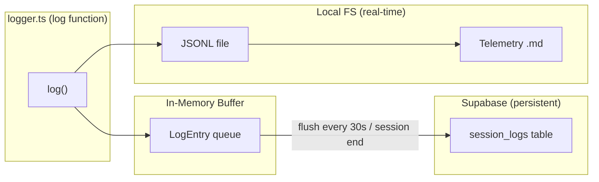

# Log Persistence Architecture — Supabase

> Persist session logs and telemetry to the existing Supabase Pro instance using a dual-write architecture (local filesystem for real-time telemetry + async Supabase for persistence), with 90-day auto-retention and admin query APIs.

---

## Decision: Use Existing Supabase (Pro Tier)

**Why Supabase wins over alternatives:**

| Option                  | Monthly Cost       | Queryable | Setup Effort                |
| ----------------------- | ------------------ | --------- | --------------------------- |
| **Supabase (existing)** | **$0 incremental** | Yes (SQL) | Low -- client already wired |
| DO App Platform Disk (current)   | ~$0.25/GB          | No        | Already configured          |
| Datadog / Logtail       | $15-50+            | Yes       | New SDK, new vendor         |
| DO Managed Postgres         | $7+                | Yes       | New DB, new client          |
| S3/R2 blob storage      | ~$0.01/GB          | No        | New SDK, no querying        |

**Cost analysis:** Pro tier has 8 GB database storage. Current tables use under 100 MB. A typical session log is 20 KB-1 MB. Even at 50 sessions/day of 200 KB each, that's ~300 MB/month. With 90-day retention, worst case is ~900 MB -- well within the 8 GB limit at zero incremental cost.

---

## Architecture: Dual-Write with Async Buffer



**Key principle:** Local filesystem writes remain synchronous and unchanged -- the telemetry generator depends on reading JSONL files from disk. Supabase writes are fully async and fire-and-forget, so they never block or break the logging pipeline.

---

## Scale Safety Analysis (2000 concurrent users)

DigitalOcean App Platform = 2 GB RAM/instance, auto-scale 1-5 instances. Worst case: 400 sessions/instance.

| Failure Mode                                                  | Risk     | Safeguard                                                                                                        |
| ------------------------------------------------------------- | -------- | ---------------------------------------------------------------------------------------------------------------- |
| **OOM from unbounded buffer** (Supabase down 30 min = 360 MB) | CRITICAL | Per-session cap: 200 entries. Global cap: 50 MB. Drop oldest on overflow.                                        |
| **Thundering herd** (400 flushes simultaneously every 30s)    | CRITICAL | Staggered flush: process 20 sessions/tick with 500ms gaps. Concurrency limit: max 10 parallel Supabase requests. |
| **JSONB write amplification** (append rewrites entire column) | HIGH     | Cap `log_entries` at 500 entries/row. Beyond that, update only metadata counters (full data is on local FS).      |
| **SIGTERM flush timeout** (DigitalOcean gives 10s)            | MEDIUM   | Best-effort flush with 7s timeout. Accept last-interval data loss (it's on local disk anyway).                    |
| **initSession fails, UPDATE finds no row**                    | MEDIUM   | Flush uses upsert (`INSERT ... ON CONFLICT DO UPDATE`), not plain UPDATE. Self-healing.                           |
| **Supabase rate limits** (2000 req burst from all instances)  | LOW      | Staggered flush + concurrency limit keeps peak at ~100 req/s, well under Pro's ~1000 req/s.                       |

---

## Schema: `007_session_logs.sql`

One table with session-level granularity (not per-event rows -- that would be too many writes):

```sql
CREATE TABLE IF NOT EXISTS session_logs (
  id UUID DEFAULT gen_random_uuid() PRIMARY KEY,
  session_id TEXT NOT NULL UNIQUE,
  user_id UUID REFERENCES users(id) ON DELETE SET NULL,
  instance_url TEXT,
  username TEXT,
  user_full_name TEXT,
  ai_provider TEXT,
  model TEXT,
  current_phase TEXT,
  started_at TIMESTAMPTZ NOT NULL DEFAULT now(),
  ended_at TIMESTAMPTZ,
  total_rounds INTEGER DEFAULT 0,
  total_tool_calls INTEGER DEFAULT 0,
  total_errors INTEGER DEFAULT 0,
  total_input_tokens INTEGER DEFAULT 0,
  total_output_tokens INTEGER DEFAULT 0,
  phases TEXT[] DEFAULT '{}',
  status TEXT DEFAULT 'active',
  log_entries JSONB DEFAULT '[]'::jsonb,
  entries_overflow BOOLEAN DEFAULT false,
  telemetry_summary JSONB,
  created_at TIMESTAMPTZ DEFAULT now(),
  updated_at TIMESTAMPTZ DEFAULT now()
);
```

`entries_overflow` flag is set to `true` when the JSONB array hits the 500-entry cap. Admin queries can check this flag to know the full log is only available on local disk.

### Flush Strategy

Each flush appends only NEW buffered entries via Postgres `||`. When `log_entries` exceeds 500 entries, subsequent flushes update only metadata counters:

```sql
-- Normal flush (entries < 500):
UPDATE session_logs
SET log_entries = log_entries || $1::jsonb,
    total_rounds = $2, total_tool_calls = $3, total_errors = $4,
    current_phase = $5, updated_at = now()
WHERE session_id = $6

-- Overflow flush (entries >= 500):
UPDATE session_logs
SET total_rounds = $2, total_tool_calls = $3, total_errors = $4,
    current_phase = $5, entries_overflow = true, updated_at = now()
WHERE session_id = $6
```

Self-healing upsert: if the initial `initSession` INSERT failed, the first flush uses `INSERT ... ON CONFLICT (session_id) DO UPDATE` to create the row automatically.

---

## LogPersistence Class Design

**`webapp/src/lib/log-persistence.ts`** (~200 lines):

- `buffer: Map<sessionId, LogEntry[]>` -- in-memory queue per session
- `entriesFlushed: Map<sessionId, number>` -- tracks entries already in Supabase (for 500-entry JSONB cap)
- `enqueue(sessionId, entry)` -- per-session cap of 200 entries (drops oldest), global cap of ~50 MB
- `flush(sessionId)` -- JSONB append or metadata-only update, upsert-based self-healing
- `flushAll(timeoutMs?)` -- concurrency limit of 10, SIGTERM timeout of 7s
- `initSession(sessionId, metadata)` -- non-fatal INSERT
- `finalizeSession(sessionId, telemetry)` -- marks complete, stores summary

**Staggered flush loop:** Batches of 20 sessions with 500ms gaps. Max 10 concurrent Supabase requests per batch.

**SIGTERM handler:** `process.on('SIGTERM', () => flushAll(7000))` -- best-effort.

**Feature flag:** `LOG_PERSISTENCE_ENABLED` -- when false, zero overhead.

---

## Files Changed

| File | Change |
|------|--------|
| `webapp/supabase/migrations/007_session_logs.sql` | New: table, indexes, retention function |
| `webapp/src/lib/log-persistence.ts` | New: persistence layer |
| `webapp/src/lib/logger.ts` | Modified: enqueue to LogPersistence after fs write |
| `webapp/src/app/api/session-start/route.ts` | Modified: initSession call + log() param order bugfix |
| `webapp/src/app/api/admin/session-logs/route.ts` | New: list/query session logs |
| `webapp/src/app/api/admin/session-logs/cleanup/route.ts` | New: retention cleanup trigger |
| `webapp/.env` | Modified: LOG_PERSISTENCE_ENABLED, LOG_RETENTION_DAYS, LOG_FLUSH_INTERVAL_MS |
| DigitalOcean App Platform env vars | Modified: same env vars in envVars section |

---

## Retention Strategy

- **Default:** 90 days (configurable via `LOG_RETENTION_DAYS`)
- **Mechanism:** SQL function `cleanup_old_session_logs(retention_days INT)` deletes rows where `started_at < now() - interval`
- **Trigger:** Admin cleanup endpoint or Supabase `pg_cron`
- **Override:** Set `LOG_RETENTION_DAYS=0` to keep everything

---

## DigitalOcean App Platform Disk

The existing 1 GB persistent disk (`webapp-logs`) is kept as-is:

1. Fast local storage for the telemetry generator
2. Short-term cache for current deployment sessions
3. Fallback if Supabase is temporarily unreachable

---

## What This Does NOT Change

- Telemetry markdown generator (reads local JSONL files)
- Console logging
- Export button (exports from in-memory conversation)
- `sn-engine.ts` log calls (all flow through `logger.ts`)
