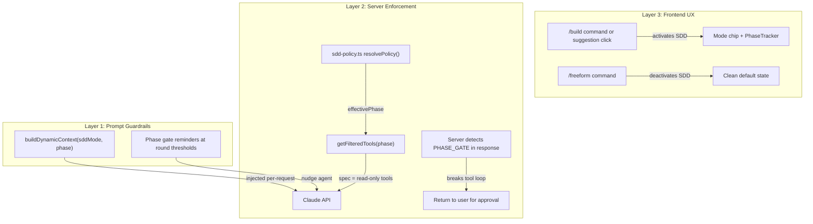

# SDD Enforcement System Design

> **Version:** 1.0 | **Date:** 2026-03-20 | **Status:** Implemented

---

## 1. Overview

The SDD (Spec-Driven Development) Enforcement System ensures the AI agent follows the mandatory SDLC workflow (SPEC → DESIGN → SCOPE_SELECT → IMPLEMENT → TEST → DEPLOY) with phase gates that require user approval. It implements a **three-layer defense** architecture to prevent bypass attempts.

### Problem Statement

Previously, the AI agent could skip SDLC phases because:
- `phase=null` gave access to all 100+ tools including create/update operations
- Phase gates were prompt-only instructions with no server enforcement
- No server-side phase state machine — the server trusted whatever `phase` the client sent
- The "non-requirement" escape hatch in the system prompt was too vague

### Solution Architecture



---

## 2. Three-Layer Defense

### Layer 1: Prompt Guardrails

**Location:** `webapp/src/lib/system-prompt.ts`

- **Dynamic Context Injection:** `buildDynamicContext()` injects SDD mode and current phase into every Claude request
- **Mode-Aware Instructions:** System prompt explicitly tells Claude when SDD is active vs. off
- **Phase Gate Reminders:** `PHASE_GATE_REMINDERS` in `sn-engine.ts` nudge Claude at phase-specific round thresholds

**Example dynamic context:**
```
SDD Mode: ACTIVE. Current phase: spec.
You MUST follow the SDLC workflow. When this phase is complete, emit <!-- PHASE_GATE:spec --> in your text response and STOP to wait for user approval.
```

### Layer 2: Server Enforcement

**Location:** `webapp/src/lib/sn-engine.ts`, `webapp/src/app/api/chat-stream/route.ts`

- **Policy Resolution:** `resolvePolicy()` validates client-sent `sddMode` and `phase` against a layered policy engine
- **Phase Validation:** `resolvePhase()` ensures only valid SDLC phases are used for tool filtering
- **Tool Filtering:** `getFilteredTools(phase)` restricts available tools based on current phase (e.g., `spec` phase = read-only tools only)
- **Phase Gate Detection:** `parsePhaseGate()` detects `<!-- PHASE_GATE:phase -->` markers in Claude's responses **between tool rounds** (never mid-round to avoid orphaned artifacts)
- **Loop Breaking:** When a gate is detected, the tool execution loop stops and returns to the user for approval

**Critical enforcement point:**
```typescript
// After all tools in a round are executed, before next API call:
const gateInToolRound = parsePhaseGate(textInToolResponse);
if (gateInToolRound) {
  logger.info(sessionId, "phase_gate", `Phase gate detected: ${gateInToolRound}`);
  yield { type: "done", reply: textInToolResponse, toolExecutions };
  return; // Break loop — user must approve
}
```

### Layer 3: Frontend UX

**Location:** `webapp/src/app/app/page.tsx`, `webapp/src/components/ChatWindow.tsx`

- **Slash Commands:** `/build` activates SDD mode, `/freeform` deactivates it
- **Command Palette:** Floating popover on `/` keystroke for discoverability
- **SDD Mode Chip:** Contextual indicator above textarea showing current mode and phase
- **Session Persistence:** `sddMode` stored in `sessionStorage` to survive page refresh
- **State Management:** `sddMode` boolean sent in every API request body

---

## 3. Policy Engine

**Location:** `webapp/src/lib/sdd-policy.ts`

### Policy Resolution Priority

The policy engine resolves SDD enforcement using a layered priority system (highest wins):

1. **Session Override** — User typed `/build` or `/freeform` this session (stored in React state + sessionStorage)
2. **User Preference** — Stored in Supabase user profile (future — stubbed)
3. **Tenant Policy** — Stored in Supabase tenant/org record (future — stubbed)
4. **Instance Policy** — Derived from instance URL or metadata (future — stubbed)
5. **Global Default** — `NEXT_PUBLIC_DEFAULT_SDD_MODE` env var (default: `false`)

### Current Implementation

**Active layers:**
- `sessionOverride` — `/build` or `/freeform` commands
- `globalDefault` — `NEXT_PUBLIC_DEFAULT_SDD_MODE` env var

**Stubbed layers (return defaults):**
- `userPreference` — Will query Supabase `user_profiles` table when implemented
- `tenantPolicy` — Will query Supabase `tenant_policies` table when implemented
- `instanceType` — Will classify instance URL when implemented

### Enforcement Levels

- **`strict`** — No bypass allowed, all phase gates mandatory
- **`guided`** — User can skip gates if needed, but system enforces by default
- **`off`** — No enforcement, full tool access

---

## 4. Slash Commands

**Location:** `webapp/src/lib/slash-commands/`

### Command Registry

Extensible registry pattern — new commands added by creating a file in `commands/` and registering in `index.ts`.

### Available Commands

| Command | Aliases | Category | Behavior |
|---------|---------|----------|----------|
| `/build` | `/sdd`, `/new-requirement`, `/req` | mode | Activate SDD, set `phase=spec`, show system message |
| `/freeform` | `/skip-sdd`, `/free` | mode | Deactivate SDD, set `phase=null`, show system message |
| `/status` | `/info` | context | Show current phase, scope, update set as system message |
| `/help` | `/commands`, `/?` | meta | Show all available commands as formatted system message |

### Command Execution Flow

1. User types `/build` in chat input
2. `handleSend()` in `page.tsx` calls `dispatchSlashCommand(text, ctx)`
3. Registry finds command and executes it
4. Command returns `{ type: "state_update", updates: { sddMode: true, currentPhase: "spec" } }`
5. Frontend updates React state and shows system message
6. Next API call includes `sddMode: true` in request body

---

## 5. Phase Gate Detection

### Detection Point

Phase gates are detected **between tool execution rounds**, never mid-round:

1. Claude sends response with `tool_use` blocks
2. Server executes all tools in the round
3. **After all tools complete**, server extracts text content from response
4. Server calls `parsePhaseGate(textContent)`
5. If gate detected, server breaks the loop and returns to user

This ensures no orphaned artifacts — all tools in a round complete before the gate is honored.

### Phase Gate Format

Claude emits gates as HTML comments:
```html
<!-- PHASE_GATE:spec -->
```

The server strips these markers before displaying to the user.

### Auto-Approval

Some phases don't require explicit user approval:
- `scope_selection` — Auto-proceeds after scope choice

All other phases (`spec`, `design`, `implementation`, `testing`, `deployment`) require user to type "approved" or click the approval button.

---

## 6. Phase Gate Reminders

**Location:** `webapp/src/lib/sn-engine.ts`

To prevent Claude from getting stuck in a phase, reminders are injected at phase-specific round thresholds:

| Phase | Threshold | Reminder Message |
|-------|-----------|------------------|
| `spec` | 10 rounds | "Create the spec and emit PHASE_GATE:spec" |
| `design` | 12 rounds | "Finalize design and emit PHASE_GATE:design" |
| `scope_selection` | 3 rounds | "Emit PHASE_GATE:scope_selection NOW" |
| `implementation` | 25 rounds | "If artifacts are created, emit PHASE_GATE:implementation" |
| `testing` | 15 rounds | "Complete testing and emit PHASE_GATE:testing" |

---

## 7. Configuration

### Environment Variables

```bash
# Global default SDD mode (true = on by default, false = off by default)
NEXT_PUBLIC_DEFAULT_SDD_MODE=false
```

### Session Storage Keys

- `ai-sdd-mode` — Boolean string (`"true"` or `"false"`)

### No Database Tables (Current)

The system is designed to be extensible for database-backed policies, but currently uses:
- **Env var** for global default
- **Session state** for per-session override

Future database tables (when needed):
- `user_sdd_preferences` — Per-user preference (always/never/default)
- `tenant_sdd_policies` — Per-tenant policy (strict/flexible/default)
- `instance_classifications` — Instance type classification (dev/test/prod)

---

## 8. Audit Logging

**Location:** `webapp/src/lib/telemetry-generator.ts`

### Log Categories

- **`sdd_mode`** — Logged when SDD mode is activated/deactivated, with policy resolution reason
- **`phase_gate`** — Logged when a gate is detected server-side, with round number and tool count
- **`phase_violation`** — Logged if the client sends a phase that doesn't match server expectations

### Telemetry Dashboard

The live telemetry dashboard (`telemetry-session-{suffix}.md`) includes a "SDD Enforcement" section showing:
- Mode activations/deactivations
- Phase gates detected (with timestamps and round numbers)
- Phase violations (if any)
- Enforcement level

---

## 9. Files Modified/Created

### New Files

- `webapp/src/lib/sdd-policy.ts` — Policy engine
- `webapp/src/lib/slash-commands/types.ts` — Command type definitions
- `webapp/src/lib/slash-commands/index.ts` — Command registry and dispatcher
- `webapp/src/lib/slash-commands/commands/build.ts` — `/build` command
- `webapp/src/lib/slash-commands/commands/freeform.ts` — `/freeform` command
- `webapp/src/lib/slash-commands/commands/status.ts` — `/status` command
- `webapp/src/lib/slash-commands/commands/help.ts` — `/help` command
- `webapp/src/components/CommandPalette.tsx` — Floating command palette UI
- `webapp/src/components/SDDModeChip.tsx` — Mode indicator chip
- `webapp/src/hooks/useSessionState.ts` — Session state hook (extracted from page.tsx)

### Modified Files

- `webapp/src/lib/sn-engine.ts` — Phase gate detection, reminders, dynamic context
- `webapp/src/lib/system-prompt.ts` — Removed escape hatch, added SDD context injection
- `webapp/src/app/api/chat-stream/route.ts` — Policy resolution, phase validation
- `webapp/src/app/api/chat/route.ts` — Policy resolution, phase validation
- `webapp/src/app/app/page.tsx` — Slash command dispatch, `sddMode` state management
- `webapp/src/components/ChatWindow.tsx` — Integrated CommandPalette and SDDModeChip
- `webapp/src/lib/telemetry-generator.ts` — SDD stats tracking and telemetry section

---

## 10. Testing

### Manual Testing Steps

1. **Activate SDD mode:**
   - Type `/build` in chat input
   - Verify SDD mode chip appears above textarea
   - Verify system message: "SDD mode activated. Phase gates are now enforced."

2. **Verify phase gate enforcement:**
   - Ask AI to "create a new requirement"
   - AI should start in `spec` phase (read-only tools only)
   - AI should emit `<!-- PHASE_GATE:spec -->` after creating spec
   - Server should break tool loop and return to user
   - User must approve before proceeding to `design` phase

3. **Deactivate SDD mode:**
   - Type `/freeform` in chat input
   - Verify SDD mode chip disappears
   - Verify system message: "Freeform mode. Phase gates disabled."
   - AI should have full tool access (no phase restrictions)

4. **Check telemetry:**
   - Open `webapp/logs/telemetry-session-{suffix}.md`
   - Verify "SDD Enforcement" section shows mode activations and phase gates

---

## 11. Future Enhancements

- **Database-backed policies:** Add Supabase queries for user/tenant/instance policies
- **Settings UI:** Build a settings page where users can set their SDD preference
- **Admin dashboard:** Multi-tenant management for policy configuration
- **Instance classification:** Auto-detect instance type (dev/test/prod) from URL patterns
- **Phase transition validation:** Server-side validation of phase transitions (currently client-controlled)

---

## 12. References

- **CLAUDE.md** — Mandatory phase gate process documentation
- **system-prompt.ts** — SDLC workflow instructions for Claude
- **sdd-policy.ts** — Policy resolution engine
- **sn-engine.ts** — Phase gate detection and tool filtering
