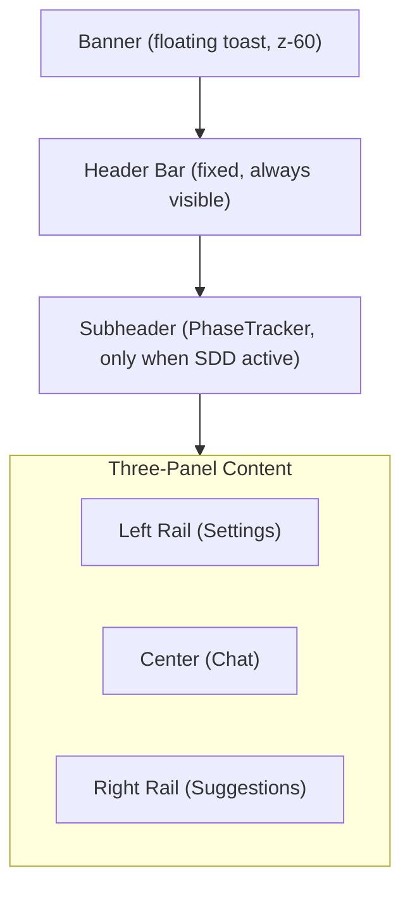

# UI/UX Elevation — Design Document

> **Version:** 1.0 | **Date:** 2026-03-21 | **Author:** AI Agent

---

## 1. Overview

A comprehensive UI/UX redesign of the SN AI Agent webapp, guided by two formal plans and several follow-up refinements. The redesign preserves the existing architecture while applying proven patterns from Linear, GitHub, Notion, Figma, Vercel, ChatGPT, Claude, and Perplexity.

**Goals:**
- Clear visual contrast between all app sections (header, left rail, center, right rail)
- QHD-quality logo that works in both themes
- Simple, theme-consistent banners with minimal configuration
- Consistent accent color system driven by a single configurable token
- Clean header with progressive disclosure
- Long-session usability (Focus Mode, accessibility, reduced motion)

---

## 2. Design Direction

Default to a restrained, dark-first productivity shell. Borrow principles, not visuals:

| Source | What We Took |
|--------|-------------|
| Linear, Vercel | Typography-led hierarchy, low-noise chrome, restrained motion, rem-based scaling |
| GitHub, Notion | Scanability, predictable layout, progressive disclosure |
| Figma | Left/right rail inspector model, hairline dividers, tonal surface separation |
| ChatGPT, Claude | Clear streaming states, prompt guidance, trustworthy system status |

---

## 3. App Shell Architecture



### 3.1 Header (Tier 1)

Always visible. Contains global navigation and controls. All items use **text + icon** labels on desktop (text hidden on mobile via `hidden md:inline`).

```
Left Zone                          Right Zone
-------------------------------    -------------------------------------------------------------------------------------
[Left toggle] [Logo = Home]        [i About] [* Release] [[] Feedback] [rotate Clear Cache] | [theme] [+ New] [Profile] [Right toggle]
```

- **Logo** is clickable and navigates to `/` (Home)
- **About** (info icon + "About") opens the existing InfoModal
- **Release** (sparkles icon + "Release") opens a dropdown backed by the Supabase `changelog` table; if `NEXT_PUBLIC_CHANGELOG_URL` is set, a "View full changelog" external link appears at the bottom
- **Feedback** (message icon + "Feedback") opens the feedback modal (moved from the floating FAB)
- **Clear Cache** (rotate icon + "Clear Cache") navigates to `/clearcache` to clear session and refresh
- A vertical **separator** divides navigation items from utility controls
- **Theme toggle** (sun/moon icon) -- icon-only, universally understood
- **New Chat** (+ icon + "New") only appears when `messages.length > 0`
- **Profile** (avatar + "Sign In") contains Sign In/Out, Admin Dashboard, Clear Cache
- Both sidebar toggles are always visible (icon-only, spatial context)

**CSS class:** `.header-nav-btn` -- flex, gap-1, icon + text, 0.75rem, hover via CSS

**Feedback FAB removed from `layout.tsx`** and replaced with a header-triggered instance in `page.tsx`. The `FeedbackFAB` component now accepts `hideButton`, `externalOpen`, and `onExternalClose` props for external control.

**File:** `webapp/src/app/app/page.tsx`

### 3.2 Subheader (Tier 2)

Conditional. Only renders when `activeReqId && currentPhase` are set.

```
[REQ-001]  [1 Spec] --- [2 Design] --- [3 Scope] --- [4 Impl] --- [5 Testing] --- [6 Deploy]    [instance indicator]
```

- Background: `var(--surface-secondary)` with bottom border
- Connection instance shown as a compact pill on the right

**File:** `webapp/src/components/PhaseTracker.tsx`

### 3.3 Banner System

Banners render as a **full-width highlighted notice strip in normal document flow**, directly above the header inside the **center column** (`app/page.tsx` → `<main>`), so the message aligns with the logo / primary content. Layout order: `Banner -> Header -> Subheader -> Content`. The app shell uses a column flex layout so the banner keeps natural height and never overlaps the header.

```
|  full-width semantic gradient strip (theme-aware)                                              |
|        [icon 16px]  message (padding in .app-banner-inner)                    [dismiss X 28x28]   |
|  bottom border = semantic tint (not generic --border-default on variants)                      |
```

**Design rules:**
- **Dark theme:** High-chroma vertical gradient (~44–50% semantic mix at top → ~22–28% at bottom on surfaces), **strong semantic bottom border** (~52–60%), and **dual shadow** (inset top highlight + subtle outer 1px glow) so the strip clearly pops from the app chrome.
- **Light theme:** **Flat fills** (no vertical gradient) — semantic color mixed into a **cool neutral canvas** per variant (e.g. blue-gray / mint / warm sand / rose-gray) so the bar doesn’t read as “dirty white→gray” next to pure white panels. **5px inset left stripe** in full semantic color + **light top edge highlight** (`rgba(255,255,255,0.85)`). Strong **bottom border** (~48–52% semantic). Slightly taller inner padding; dismiss control opacity bumped for contrast on tinted fields.
- Banner **body text** uses `--text-primary` (neutral) — links still use `--color-primary` with underline.
- Only the **icon** (16px) uses the full semantic color (`--color-info` / success / warning / danger).
- Dismiss button: 28×28 touch target, rounded, clear hover state.
- No fixed positioning; header stays fully visible.

**Semantic variant model (4 types):**

| Variant | Background (concept) | Icon | Text | Dismissible |
|---------|------------------------|------|------|-------------|
| `info` | Gradient: semantic + `--surface-elevated` → `--surface-secondary` (dark); white-tinted gradient (light) | `--color-info` | `--text-primary` | Yes |
| `success` | Same pattern with `--color-success` | `--color-success` | `--text-primary` | Yes |
| `warning` | Same pattern with `--color-warning` | `--color-warning` | `--text-primary` | Yes |
| `critical` | Same pattern with `--color-danger` | `--color-danger` | `--text-primary` | No |

- Data: Supabase `banners` table with `variant` column
- Dismissals persisted in `localStorage`
- Only one banner visible at a time (latest)
- Links inside banner text use `--color-primary` with underline

**CSS classes:** `.app-banner`, `.app-banner-{variant}`, `.app-banner-inner`, `.app-banner-icon`, `.app-banner-text`, `.app-banner-dismiss`

**Files:** `webapp/src/components/BannerDisplay.tsx`, `webapp/src/app/app/page.tsx` (banner placement above header), `webapp/src/app/layout.tsx` (column shell), `webapp/src/app/globals.css`

---

## 4. Design Token System

All tokens live in `webapp/src/app/globals.css` and are mapped into Tailwind v4 via `@theme inline`.

### 4.1 Surface Hierarchy

**Dark mode** (4% HSL lightness steps, blue undertone `hsl(222)`):

| Token | Value | Purpose |
|-------|-------|---------|
| `--surface-app` | `#0B0D12` | Base canvas |
| `--surface-sidebar` | `#111318` | Left and right panels |
| `--surface-primary` | `#161A22` | Header, cards |
| `--surface-secondary` | `#1C2029` | Hover states, subheader |
| `--surface-elevated` | `#232833` | Dropdowns, modals, tooltips |

**Light mode** (elevation-based separation):

| Token | Value | Purpose |
|-------|-------|---------|
| `--surface-app` | `#F5F6F8` | Base canvas |
| `--surface-sidebar` | `#EEEEF2` | Left and right panels |
| `--surface-primary` | `#FFFFFF` | Header, cards |
| `--surface-secondary` | `#F0F0F4` | Hover states, subheader |
| `--surface-elevated` | `#E6E6EC` | Dropdowns, modals |

### 4.2 Text Colors (WCAG AA Compliant)

| Token | Dark | Light | Purpose |
|-------|------|-------|---------|
| `--text-primary` | `#E6EDF3` | `#1A1A2E` | Body text, headings |
| `--text-secondary` | `#8B949E` | `#5C5C66` | Descriptions, metadata |
| `--text-disabled` | `#848D97` | `#71717A` | Inactive, placeholder |

### 4.3 Borders

| Token | Dark | Light |
|-------|------|-------|
| `--border-subtle` | `rgba(255,255,255,0.05)` | `rgba(0,0,0,0.04)` |
| `--border-default` | `rgba(255,255,255,0.10)` | `rgba(0,0,0,0.10)` |
| `--border-emphasis` | `rgba(255,255,255,0.16)` | `rgba(0,0,0,0.16)` |

### 4.4 Semantic Colors

| Token | Dark | Light | Purpose |
|-------|------|-------|---------|
| `--color-info` | `#4C7DFF` | `#2E5FE0` | Informational states only |
| `--color-success` | `#38C976` | `#1A9B50` | Complete, connected |
| `--color-warning` | `#F5C451` | `#C09000` | Caution, in-progress status |
| `--color-danger` | `#F97373` | `#D93636` | Error, critical |
| `--color-primary` | `#4C7DFF` | `#2E5FE0` | Accent, active, selected (configurable via env) |

### 4.5 Spacing, Shadows, Z-Index

**Spacing scale:** `--space-1` (0.25rem) through `--space-20` (5rem)

**Elevation shadows:** `--shadow-xs` through `--shadow-xl` + `--shadow-glow` (theme-adapted in light mode)

**Z-index scale:**

| Token | Value | Purpose |
|-------|-------|---------|
| `--z-base` | 0 | Default |
| `--z-sticky` | 10 | Header, subheader |
| `--z-sidebar` | 30 | Side panels |
| `--z-state` | 40 | State overlays |
| `--z-banner` | 45 | Banner toasts |
| `--z-modal` | 50 | Modals, dropdowns |
| `--z-toast` | 60 | Floating toasts |
| `--z-overlay` | 100 | Full-screen overlays |

---

## 5. Typography

All values in `rem` for browser accessibility (user zoom support).

| Class | Size | Weight | Line Height | Use |
|-------|------|--------|-------------|-----|
| `.text-display` | 2rem | 600 | 1.2 | Landing hero |
| `.text-title` | 1.5rem | 600 | 1.25 | Section titles |
| `.text-heading` | 1.25rem | 500 | 1.3 | Panel headers |
| `.text-large` | 1rem | 400 | 1.5 | Emphasized body |
| `.text-body` | 0.875rem | 400 | 1.5 | Default body |
| `.text-small` | 0.8125rem | 400 | 1.5 | Secondary text |
| `.text-caption` | 0.75rem | 400 | 1.4 | Labels, metadata |
| `.text-micro` | 0.6875rem | 400 | 1.3 | Badges, counters |

---

## 6. Accent Color System

All interactive highlights flow from a single token: `var(--color-primary)`.

### Before (problem)
- Hardcoded `rgba(76,125,255,...)` scattered across 6+ components
- `var(--color-info)` used as a general accent (semantic mismatch)
- Blue always, regardless of brand color configuration

### After (solution)
- All accent backgrounds use `color-mix(in srgb, var(--color-primary) XX%, transparent)`
- `var(--color-info)` reserved for genuine informational contexts only
- Changing `NEXT_PUBLIC_PRIMARY_COLOR` in `.env` updates the entire app accent

**Components updated:** `SettingsPanel`, `MessageBubble`, `ChatWindow`, `ChatSearch`, `ChatTOC`, `FeedbackFAB`, `PhaseTracker`

---

## 7. PhaseTracker Design

### Labels
Clean step numbers instead of Palantir-style `/0.x` prefixes:

| Before | After |
|--------|-------|
| `/0.1 Spec` | `1 Spec` |
| `/0.2 Design` | `2 Design` |
| `/0.3 Scope` | `3 Scope` |

### Color States

| State | Dot | Text | Background | Ring |
|-------|-----|------|-----------|------|
| In progress | Amber (pulsing) | Amber (`--status-progress`) | Amber 12% | Amber 30% |
| Complete | Green | Green (`--color-success`) | Green 6% | None |
| Pending | Gray | Gray (`--text-disabled`) | Transparent | None |

---

## 8. Logo Treatment

### SVG Design (`webapp/public/logo-r-v10.svg`)
- Transparent background (no baked-in dark circle)
- Orbital rings with gradient strokes and glow filters
- "r" letterform with blue-to-purple gradient
- Accent dots at varying sizes for depth

### Animated hero logo (`webapp/src/components/AppLogo.tsx`)
- **Where:** Chat empty state (disconnected + connected) and **landing** hero only — header, settings, and modals still use static `<Image src={APP_LOGO}>` for performance and clarity at 32px.
- **How:** Inline SVG (same geometry as `logo-r-v10.svg`) with two rotating `<g>` layers (`app-logo-orbit-a` 90s / `app-logo-orbit-b` 120s reverse, both `ease-in-out` for gentle float); inner ring uses a **5s opacity pulse** (0.50–0.68). Accent dots sit inside their nearest orbit group so they drift with the rings. No animated filters on moving layers (QHD / GPU-friendly).
- **IDs:** Pass unique `idPrefix` per mount (e.g. `chat-hero`, `landing-hero`) so `<defs>` gradient/filter URLs never collide.
- **Trigger:** Runs continuously while the hero is visible (CSS-only, GPU-composited); unmounts with the empty state.
- **Accessibility:** `prefers-reduced-motion: reduce` disables orbit + inner-ring pulse (see `globals.css`).

### Theme Adaptation
- **Dark mode:** Orbital effects naturally glow against the dark surface
- **Light mode:** Dark circular backdrop (`#0e1018`) applied via CSS so the logo renders at full fidelity; soft elevation shadow for grounding

### Fallback
- `branding.ts` defaults to `/logo-r-v10.svg` if `NEXT_PUBLIC_APP_LOGO` is empty
- Hero still respects `{APP_LOGO && ...}`; inline `AppLogo` is only shown when branding includes a logo path

### Implementation reference
See [`docs/design/logo-hero-animation.md`](logo-hero-animation.md) for the full plan summary, out-of-scope notes, and file list.

---

## 9. Interaction Patterns

### 9.1 Focus Mode
Auto-triggers when:
- Conversation reaches 10+ non-system messages AND
- Current phase is `implementation`

Behavior: Collapses both sidebars. A floating "Exit Focus Mode" pill appears at the bottom center.

### 9.2 Progressive Disclosure
- **Settings panel:** Auth Method selector hidden behind `<details>` "Advanced Settings" toggle
- **Composer:** Grammar/Enhance buttons grouped under a single "AI" popover
- **Profile dropdown:** Admin Dashboard, Clear Cache, Sign Out nested under avatar

### 9.3 FOUC Prevention
A blocking `<script>` in `<head>` reads the theme from `localStorage` and sets `data-theme` before React hydrates, preventing the flash of dark-to-light on page load.

---

## 10. Accessibility

| Feature | Implementation |
|---------|---------------|
| Reduced motion | `@media (prefers-reduced-motion: reduce)` kills all animations/transitions |
| Zoom | Viewport allows user zoom (removed `maximumScale`, `userScalable`) |
| Focus rings | `2px solid var(--color-info)` on `*:focus-visible` |
| Screen reader | `aria-live="polite"` region for streaming status |
| Keyboard | Tab order through all panels; Escape closes dropdowns/modals |
| Contrast | WCAG AA for `--text-disabled` in both themes |

---

## 11. Data Requirements

### Supabase: `banners` table (existing, add column)
```sql
ALTER TABLE banners ADD COLUMN IF NOT EXISTS variant text DEFAULT 'info';
```

### Supabase: `changelog` table (new)
```sql
CREATE TABLE changelog (
  id uuid DEFAULT gen_random_uuid() PRIMARY KEY,
  title text NOT NULL,
  status text NOT NULL DEFAULT 'released',
  created_at timestamptz DEFAULT now()
);
```

The `status` column accepts: `released`, `upcoming`, `planned`.

---

## 12. Files Modified

| File | Category |
|------|----------|
| `webapp/src/app/globals.css` | Design system |
| `webapp/src/app/app/page.tsx` | App shell, header |
| `webapp/src/app/layout.tsx` | Root layout, FOUC, FeedbackFAB removed (moved to header) |
| `webapp/src/lib/branding.ts` | Brand config |
| `webapp/public/logo-r-v10.svg` | Logo asset |
| `webapp/src/components/AppLogo.tsx` | Inline animated hero logo |
| `docs/design/logo-hero-animation.md` | Logo animation plan + scope |
| `webapp/src/components/BannerDisplay.tsx` | Banner system |
| `webapp/src/components/PhaseTracker.tsx` | Phase tracker |
| `webapp/src/components/SDDModeChip.tsx` | Bug fix |
| `webapp/src/components/ChatWindow.tsx` | Composer |
| `webapp/src/components/SettingsPanel.tsx` | Settings UX |
| `webapp/src/components/InfoModal.tsx` | Logo guard |
| `webapp/src/components/MessageBubble.tsx` | Accent colors |
| `webapp/src/components/ChatSearch.tsx` | Accent colors |
| `webapp/src/components/ChatTOC.tsx` | Accent colors |
| `webapp/src/components/FeedbackFAB.tsx` | Accent colors, `hideButton`/`externalOpen`/`onExternalClose` props |
| `webapp/src/app/api/banners/route.ts` | Banner API |
| `webapp/src/app/api/admin/banners/route.ts` | Admin banner API |
| `webapp/src/app/api/changelog/route.ts` | Changelog API (new) |

---

## 13. Configuration

All branding and theming values are configurable via environment variables:

| Variable | Default | Effect |
|----------|---------|--------|
| `NEXT_PUBLIC_PRIMARY_COLOR` | `blue` | Accent color throughout the app (presets: blue, purple, green, teal, red, orange, indigo; or hex) |
| `NEXT_PUBLIC_ACCENT_COLOR` | `purple` | AI avatar gradient accent |
| `NEXT_PUBLIC_APP_LOGO` | `/logo-r-v10.svg` | Logo path |
| `NEXT_PUBLIC_APP_NAME` | (empty) | App name in header |
| `NEXT_PUBLIC_SHOW_INFO_BUTTON` | `true` | Show/hide About button in header |
| `NEXT_PUBLIC_CHANGELOG_URL` | (empty) | External changelog link (GitHub Releases, GitBook, etc.) shown in Release dropdown |

---

## 14. Header Button Taxonomy

| Button | Icon | Text (md+) | Behavior | Always Visible |
|--------|------|-----------|----------|----------------|
| Left toggle | `PanelLeftOpen`/`Close` | -- | Toggle left sidebar | Yes |
| Logo | App logo image | App name | Link to `/` (Home) | Yes |
| About | `Info` | "About" | Opens InfoModal | Configurable |
| Release | `Sparkles` | "Release" | Opens changelog dropdown | Yes |
| Feedback | `MessageSquare` | "Feedback" | Opens feedback modal | Yes |
| Clear Cache | `RotateCcw` | "Clear Cache" | Navigates to `/clearcache` | Yes |
| Theme | `Sun`/`Moon` | -- | Toggle dark/light | Yes |
| New Chat | `Plus` | "New" | Resets conversation | When messages exist |
| Sign In | `User` | "Sign In" | Opens auth modal | When not signed in |
| Profile | Avatar initial | -- | Opens profile dropdown | When signed in |
| Right toggle | `PanelRightOpen`/`Close` | -- | Toggle right sidebar | Yes |

---

## 15. Testing Summary

39 test cases executed across 4 rounds. All pass except 2 mobile viewport tests which are noted (mobile uses a separate overlay architecture that requires real device testing).

Full test report with screenshots: `webapp/test-screenshots/TEST-REPORT.md`
