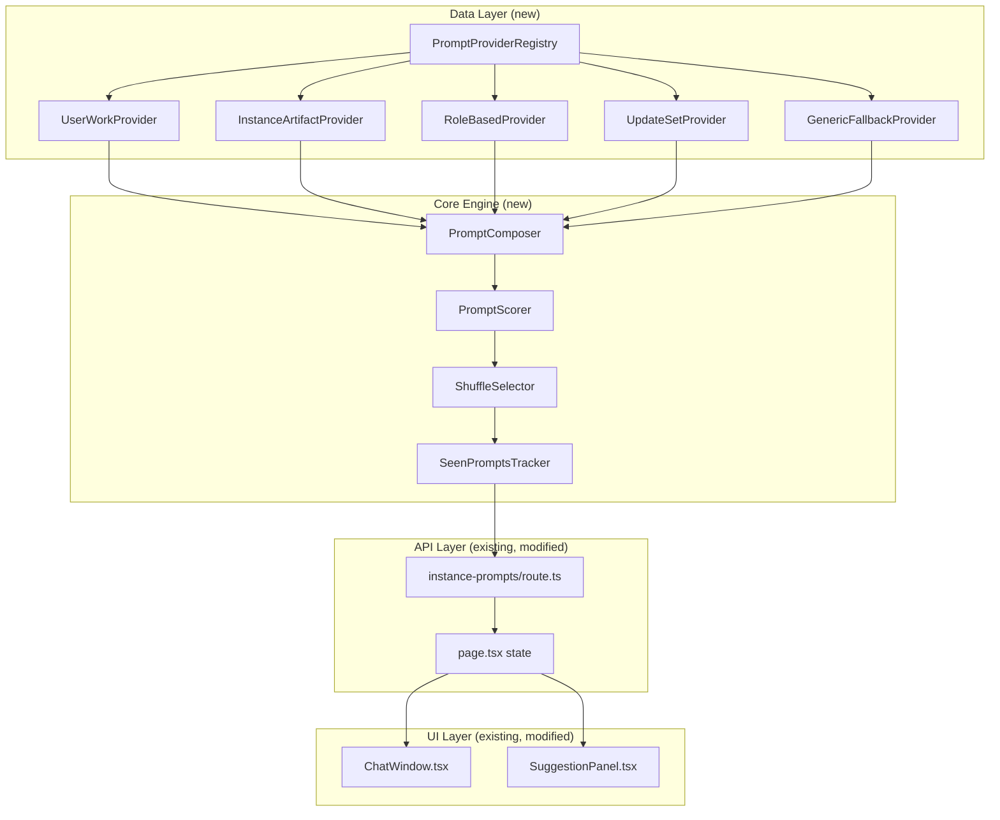
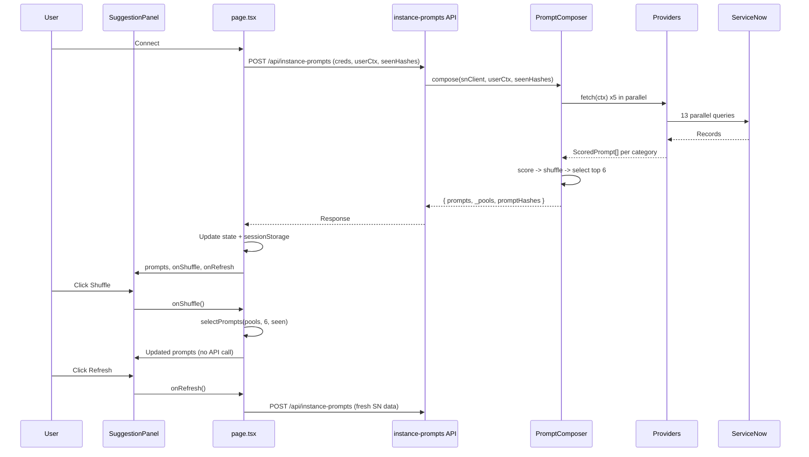

# Suggestion Engine Enhancement

## Overview

Refactors the suggestion engine into a modular, extensible architecture that produces varied, fresh suggestions on every refresh/load. Introduces shuffle-within-priority-tiers, seen-prompt deprioritization (via djb2 hashing), expanded prompt templates, client-side re-shuffle, and unified fallback behavior.

## Root Cause

Suggestions never changed on refresh because the pipeline was 100% deterministic:

1. `topN()` sorted strictly by descending priority with V8 stable sort preserving insertion order
2. Fixed priority values (10, 9, 7, 6, 5, 2) with no jitter
3. ServiceNow queries used fixed `ORDER BY` and `sysparm_limit`
4. No shuffle, rotation, or seen-tracking existed
5. `categorizedPrompts` was not persisted to sessionStorage

## Architecture



**Module Structure:**

```
suggestion-engine/
  types.ts              -- Shared types: PromptProvider, ScoredPrompt, ProviderContext, PromptPoolMap
  registry.ts           -- PromptProviderRegistry (register/unregister/getAll), lazy singleton
  scorer.ts             -- Priority scoring with configurable jitter (default +/- 0.4)
  selector.ts           -- Fisher-Yates shuffle within tiers (Math.floor grouping), djb2 hash-based seen-deprioritization
  seen-tracker.ts       -- djb2 hash-based tracker, sessionStorage, LRU eviction at 200 entries
  composer.ts           -- Orchestrates providers -> scorer -> selector, merges updates from all providers
  index.ts              -- Barrel export
  providers/
    user-work.ts        -- My incidents, changes, approvals, group unassigned (priority 10/9), multi-group labels
    instance-artifacts.ts -- Tables, rules, catalog, jobs, KBs, workflows, notifs, ACLs (5-7), 2-4 templates each
    role-based.ts       -- Admin/ITIL suggestions (priority 7), unbiased Fisher-Yates selection
    update-sets.ts      -- Update set prompts + summaries (6-7), extended stateMap
    generic-fallback.ts -- Static fallbacks (priority 2) + shared SUGGESTION_FALLBACK constant
```

## Data Flow



**Text Summary:**

```
User connects
  -> POST /api/instance-prompts (creds, userCtx, seenHashes)
  -> PromptComposer.compose(snClient, userCtx, seenHashes)
  -> Providers fetch data in parallel (13 SN queries)
  -> Scorer applies priority + jitter (configurable range)
  -> Selector groups by Math.floor(priority), Fisher-Yates within tiers
  -> deprioritizeSeen hashes prompt text via djb2 and checks against seen set
  -> Returns { prompts, _pools, promptHashes }
  -> page.tsx stores state + sessionStorage (prompts + seen hashes)
  -> Feeds ChatWindow (hero) + SuggestionPanel (sidebar)

Shuffle button (no API call):
  -> selectPrompts(pools[tab], N, seenHashes) client-side
  -> N from DEFAULT_CONFIG.promptsPerCategory
  -> Updates categorizedPrompts state instantly
  -> Wrapped in try/catch for robustness

Refresh button (API call):
  -> fetchCategorizedPromptsFromApi() hits ServiceNow
  -> Sends current seenHashes from sessionStorage
  -> Fresh data + fresh shuffle
  -> Merges returned promptHashes into seen set (LRU capped at 200)
```

## Key Design Decisions

1. **Isomorphic selector**: `selectPrompts()` works on both server and client. Imports `hashPromptText` (pure djb2 function) from `seen-tracker.ts` -- no browser APIs in the hash function itself.
2. **Shuffle within tiers**: `Math.floor` grouping so jitter (+/- 0.4) can push items across tier boundaries. Higher-priority prompts generally win; within same tier, order is randomized via Fisher-Yates.
3. **Seen tracking**: djb2 hash of prompt text, max 200 entries with LRU eviction, stored in sessionStorage, cleared on New Chat. Selector hashes `item.text` before checking the seen set (not raw text comparison).
4. **Provider pattern**: New suggestion sources = new file in `providers/`, implement `PromptProvider` interface, register in the lazy singleton registry. No changes needed to API route or UI.
5. **Expanded templates**: 2-4 prompt templates per data source. `pick()` randomly selects one per item, with guard against empty arrays. All templates in a group share the same function signature.
6. **Unified fallback**: Single `SUGGESTION_FALLBACK` constant in `generic-fallback.ts`, shared by both `ChatWindow.tsx` and `SuggestionPanel.tsx`.
7. **Lazy singleton registry**: `getDefaultRegistry()` creates and caches the provider registry on first use, avoiding re-registration on every API request.
8. **Updates merging**: Composer uses `push(...pr.updates)` to merge update sets from all providers (not overwrite).

## Bugs Fixed During Review

| Severity | Issue | Fix |
|----------|-------|-----|
| Critical | Seen-tracking compared raw text against djb2 hashes (never matched) | Selector now hashes via `hashPromptText(item.text)` before checking seen set |
| High | Unused imports (`Menu`, `ScoredPrompt`, `CategorizedPromptsWithPool`) | Removed from all files |
| Medium | Composer overwrote `updates` instead of merging | Changed to `push(...pr.updates)` |
| Medium | Jitter was no-op due to `Math.round` grouping | Changed to `Math.floor` |
| Medium | `pick()` could crash on empty arrays | Added guard in all 4 providers |
| Medium | Biased shuffle in role-based.ts via `sort(() => Math.random() - 0.5)` | Replaced with proper Fisher-Yates |
| Medium | Group name showed only first group for multi-group users | Shows "GroupName (+N more)" for multiple groups |
| Medium | Pre-existing stale closure: `handleSend` missing `aiProvider`/`openRouterModels` deps | Added to dependency array |
| Medium | Pre-existing stale closure: `handleConnect` missing `aiProvider`/`openRouterModels`/`selectedModel` deps | Added to dependency array |
| Low | Registry re-created per request | Made lazy singleton via `getDefaultRegistry()` |
| Low | Incomplete `stateMap` in update-sets.ts | Added `retrieved`, `previewed`, `committed` states |
| Low | Hardcoded `6` in client-side shuffle | Uses `DEFAULT_CONFIG.promptsPerCategory` |
| Low | No error boundary in shuffle handler | Wrapped in try/catch |
| Low | Inconsistent template function signatures | All templates take same params |
| Low | Duplicate JSDoc comments | Removed duplicates |

## Files Created

| File | Purpose |
|------|---------|
| `webapp/src/lib/suggestion-engine/types.ts` | Shared types and interfaces |
| `webapp/src/lib/suggestion-engine/registry.ts` | Provider registry class |
| `webapp/src/lib/suggestion-engine/scorer.ts` | Priority scoring with jitter |
| `webapp/src/lib/suggestion-engine/selector.ts` | Shuffle + selection (isomorphic) |
| `webapp/src/lib/suggestion-engine/seen-tracker.ts` | Seen prompt tracking (djb2 hash) |
| `webapp/src/lib/suggestion-engine/composer.ts` | Orchestrator with lazy singleton registry |
| `webapp/src/lib/suggestion-engine/index.ts` | Barrel export |
| `webapp/src/lib/suggestion-engine/providers/user-work.ts` | User work prompts (2-3 templates) |
| `webapp/src/lib/suggestion-engine/providers/instance-artifacts.ts` | Instance data prompts (2-4 templates) |
| `webapp/src/lib/suggestion-engine/providers/role-based.ts` | Role-based prompts (Fisher-Yates) |
| `webapp/src/lib/suggestion-engine/providers/update-sets.ts` | Update set prompts + summaries |
| `webapp/src/lib/suggestion-engine/providers/generic-fallback.ts` | Fallback prompts + shared constant |
| `webapp/tests/suggestion-engine.test.mjs` | Test suite (unit + API + VAPT + load) |

## Files Modified

| File | Change |
|------|--------|
| `webapp/src/lib/sn-engine.ts` | Delegate to PromptComposer, remove inline pool logic |
| `webapp/src/lib/types.ts` | Re-export PromptPoolMap from suggestion-engine |
| `webapp/src/app/api/instance-prompts/route.ts` | Accept seenHashes, return pools + promptHashes, proper error codes |
| `webapp/src/app/app/page.tsx` | Seen-hash state, sessionStorage persistence, shuffle handler, collapse/expand icons, Sign In reorder, stale closure fixes |
| `webapp/src/components/SuggestionPanel.tsx` | Shuffle button, shared fallback, crossfade animation |
| `webapp/src/components/ChatWindow.tsx` | Shared fallback import from suggestion-engine |
| `webapp/src/app/globals.css` | Shuffle button + crossfade animation styles |
