# Platform Redesign — Architecture Diagrams

---

## 1. High-Level System Architecture

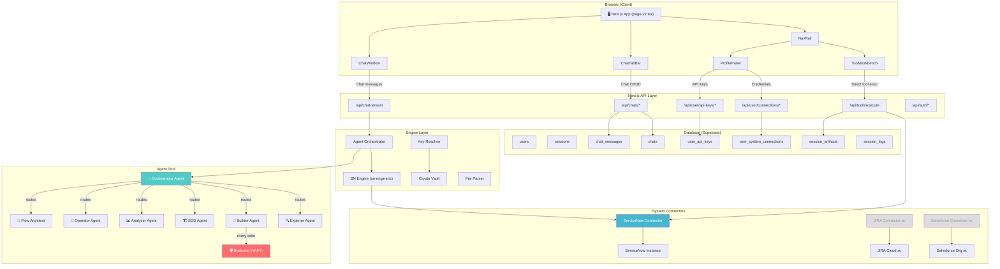

---

## 2. Two Interaction Modes — User Flow

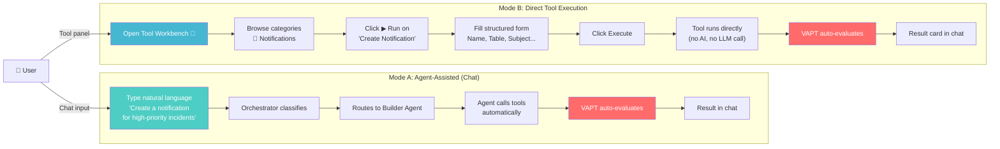

---

## 3. Agent Harness Architecture (Anthropic Pattern)

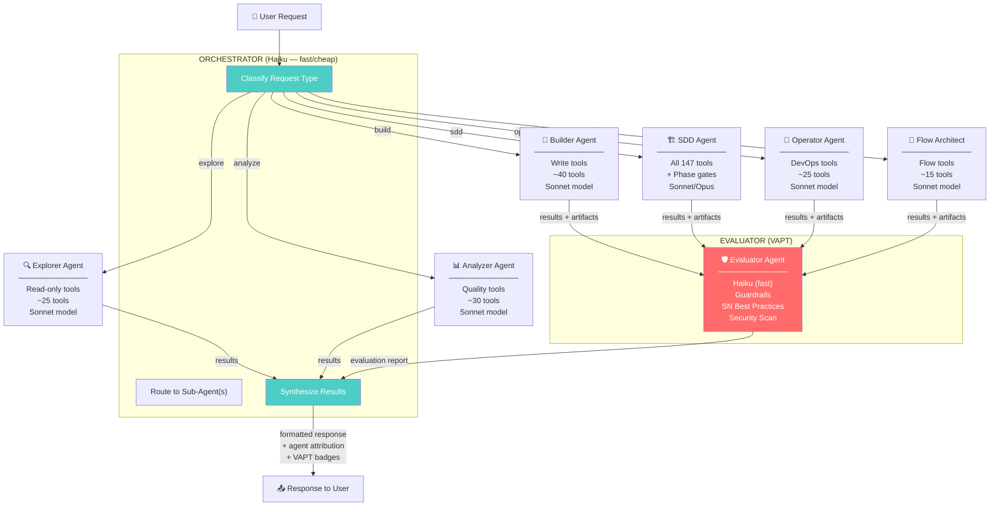

---

## 4. Structured Handoff Between Agents

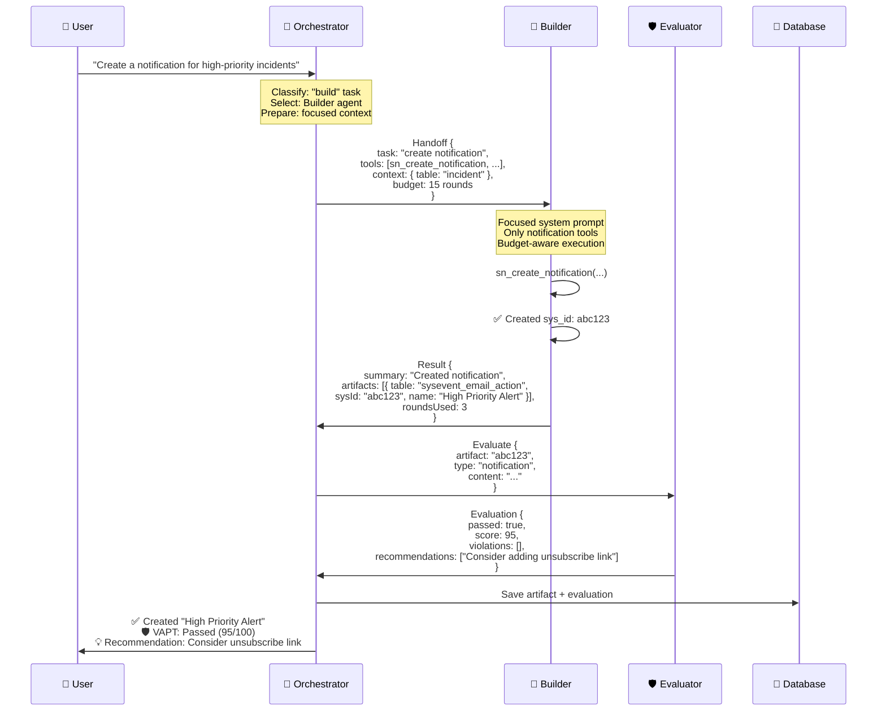

---

## 5. Database Schema (ER Diagram)

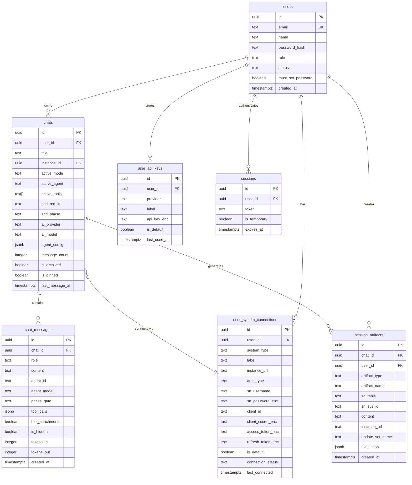

---

## 6. UI Layout Structure

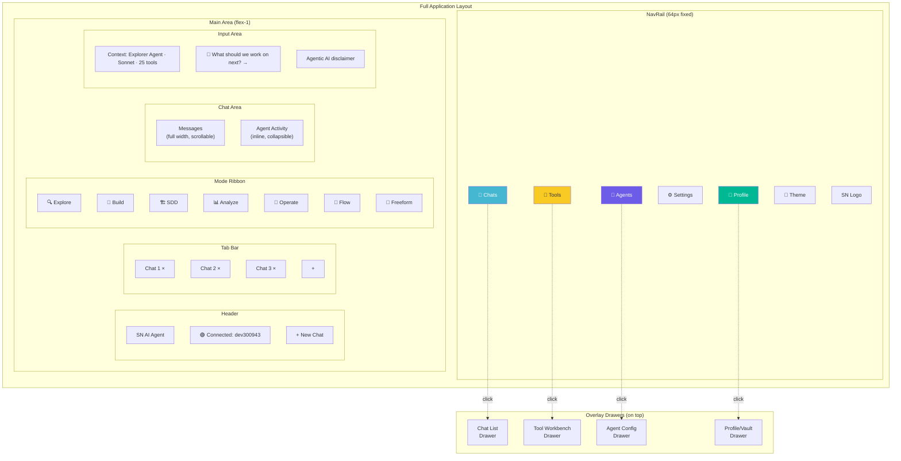

---

## 7. Tool Category Hierarchy

```mermaid
graph TD
    ROOT["🔧 Tool Workbench"]
    
    ROOT --> SYS["📡 SYSTEMS"]
    ROOT --> REC["📋 Records & Data"]
    ROOT --> SS["💻 Server Scripts"]
    ROOT --> CU["🖥️ Client & UI"]
    ROOT --> SEC["🔐 Security & Access"]
    ROOT --> NOT["📧 Notifications"]
    ROOT --> DEV["📦 DevOps"]
    ROOT --> AUT["🔄 Automation"]
    ROOT --> POR["🎨 Portal & UX"]
    ROOT --> CAT["🛒 Service Catalog"]
    ROOT --> ANA["📊 Analysis & Quality"]
    ROOT --> TST["🧪 Testing"]
    ROOT --> SDD_M["🏗️ SDD Mode"]
    ROOT --> EXT["📋 External Systems"]
    
    SYS --> SN["🟢 ServiceNow\n(connected)"]
    SYS --> JR["⚫ JIRA\n(not configured)"]
    SYS --> SF["⚫ Salesforce\n(coming soon)"]
    SYS --> WD["⚫ Workday\n(coming soon)"]
    
    REC --> RC1["Records CRUD\n4 tools"]
    REC --> RC2["🔜 Data Migration\n3 tools"]
    REC --> RC3["🔜 Import/Export"]
    
    SS --> SS1["Business Rules\n2 tools"]
    SS --> SS2["Script Includes\n2 tools"]
    SS --> SS3["Fix Scripts\n3 tools"]
    SS --> SS4["Scheduled Jobs\n2 tools"]
    
    CU --> CU1["Client Scripts\n2 tools"]
    CU --> CU2["UI Policies\n4 tools"]
    CU --> CU3["UI Actions\n2 tools"]
    CU --> CU4["🔜 UI Builder"]
    
    AUT --> AU1["Flow Designer\n8+ tools"]
    AUT --> AU2["Scheduled Jobs\n2 tools"]
    AUT --> AU3["🔜 IntegrationHub"]
    
    POR --> PO1["Service Portal\n14 tools"]
    POR --> PO2["🔜 Workspace"]
    POR --> PO3["🔜 Now Experience"]
    
    ANA --> AN1["Instance Analysis\n3 tools"]
    ANA --> AN2["Code Quality\n4 tools"]
    ANA --> AN3["OOTB Detection\n2 tools"]
    ANA --> AN4["Dependencies\n4 tools"]
    
    EXT --> EX1["🔜 JIRA Issues"]
    EXT --> EX2["🔜 SN Agile Stories"]
    EXT --> EX3["🔜 Linear Issues"]
    
    style SN fill:#45b7d1,color:#fff
    style JR fill:#ddd,color:#999
    style SF fill:#ddd,color:#999
    style WD fill:#ddd,color:#999
    style RC2 fill:#fff3cd,color:#856404
    style RC3 fill:#fff3cd,color:#856404
    style CU4 fill:#fff3cd,color:#856404
    style AU3 fill:#fff3cd,color:#856404
    style PO2 fill:#fff3cd,color:#856404
    style PO3 fill:#fff3cd,color:#856404
    style EX1 fill:#fff3cd,color:#856404
    style EX2 fill:#fff3cd,color:#856404
    style EX3 fill:#fff3cd,color:#856404
```

---

## 8. Direct Tool Execution Flow

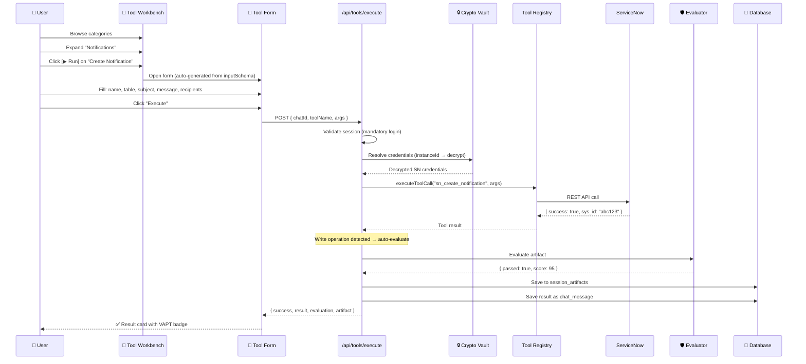

---

## 9. Multi-Chat / Multi-Tab Architecture

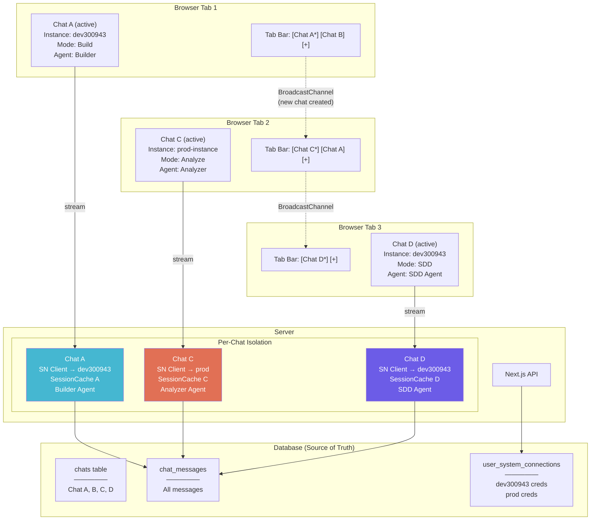

---

## 10. System Connector Architecture (Extensible)

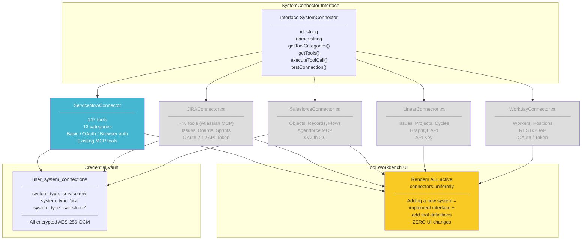

---

## 11. VAPT (Evaluator) Auto-Enforcement Flow

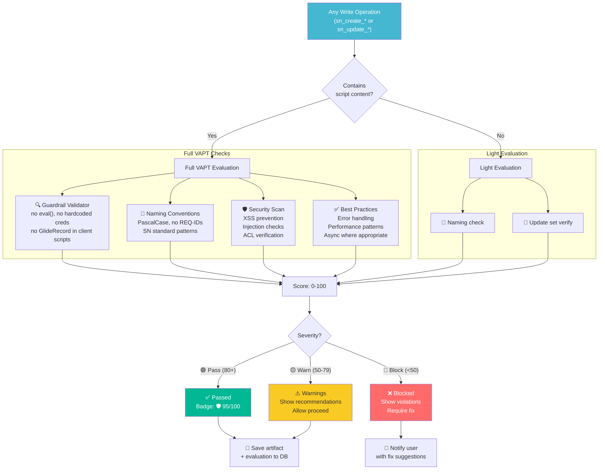

---

## 12. Implementation Phase Dependencies

```mermaid
gantt
    title Implementation Phases
    dateFormat X
    axisFormat %s
    
    section Foundation
    Copy page-v2.tsx           :p1a, 0, 1
    DB Migrations (021-024)    :p1b, 0, 2
    Crypto Vault               :p1c, 1, 2
    System Connectors interface :p1d, 1, 3
    Tool Categories mapping    :p1e, 1, 3
    API Routes (chats, vault)  :p1f, 2, 4
    
    section Agent Harness
    Agent Definitions          :p2a, 3, 4
    Agent Orchestrator         :p2b, 4, 6
    VAPT Auto-enforcement      :p2c, 5, 7
    Modify sn-engine.ts        :p2d, 5, 7
    
    section Tool Workbench
    ToolWorkbench.tsx           :p3a, 4, 6
    ToolExecutionPanel.tsx      :p3b, 5, 7
    Tool Form Generator        :p3c, 4, 6
    Direct Execution API       :p3d, 4, 6
    
    section UI Shell
    NavRail + DrawerOverlay    :p4a, 3, 5
    ChatTabBar + ChatList      :p4b, 5, 7
    Refactor page-v2.tsx       :p4c, 5, 8
    
    section Chat Persistence
    useChatManager hook        :p5a, 6, 8
    DB message persistence     :p5b, 7, 9
    Cross-tab sync             :p5c, 8, 9
    
    section Profile & Vault
    ProfilePanel.tsx           :p6a, 7, 9
    Connection management UI   :p6b, 7, 9
    
    section Polish
    Unified Attachments        :p7a, 8, 10
    Artifact persistence       :p7b, 8, 10
    Mobile + Theme             :p7c, 9, 10
```

---

## 13. Notification Creation — Complete User Journey (Both Modes)

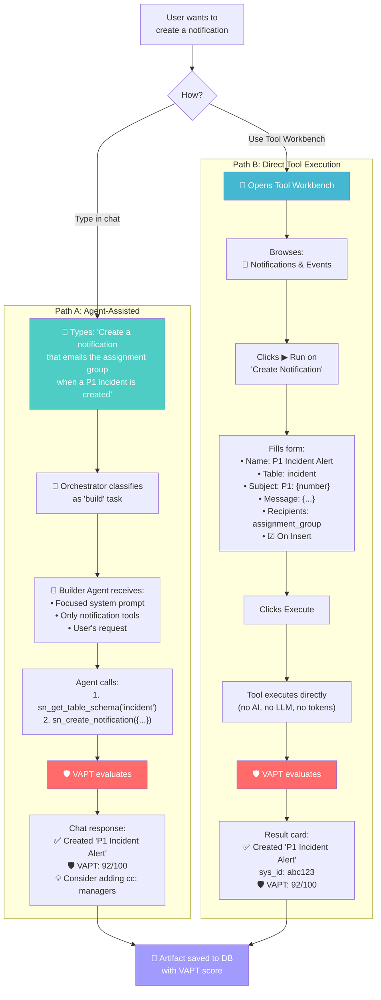

---

## 14. Data Flow — Message Persistence & Multi-Tab

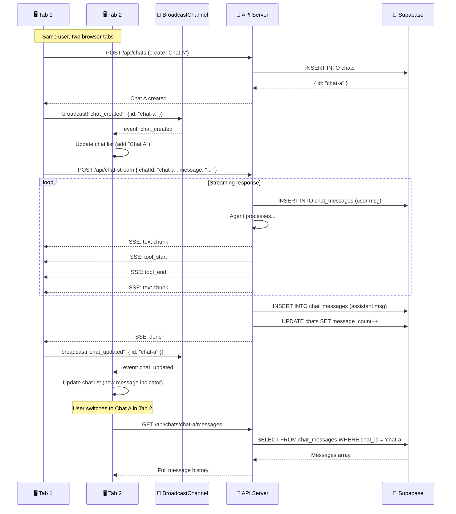

---

## 15. Auto-Generated Tool Form — Schema to UI Mapping

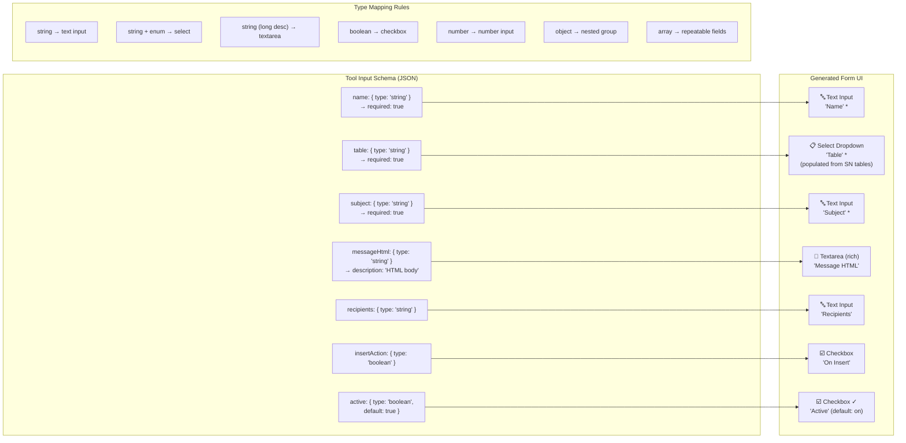

---

*All diagrams use Mermaid syntax. View in any Mermaid-compatible renderer (GitHub, VS Code with Mermaid extension, Notion, etc.)*
