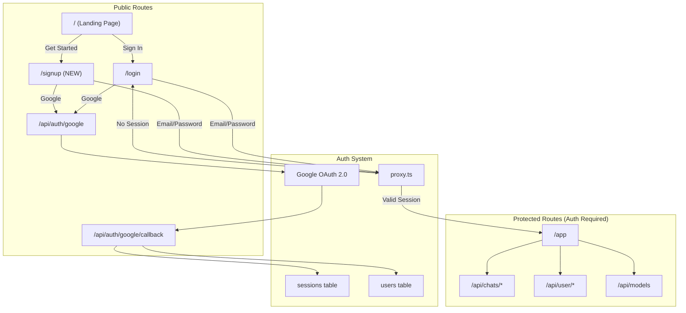

## Plan: Landing Page + Auth Security Implementation

Based on comprehensive research from 5 specialized agents, this plan covers:

1. **Securing the app** - Making `/app` and all user APIs require authentication
2. **Google OAuth** - Hybrid approach adding OAuth to existing custom auth
3. **Landing Page Redesign** - Palantir FDE + Material Design 3 patterns
4. **Auth UX** - New signup page and improved login flow

---

## Phase 1: Secure the App

### 1.1 Update Middleware Protection

**File:** [webapp/src/proxy.ts](webapp/src/proxy.ts)

Current state: `/app` is PUBLIC with rate limiting. Change to protected.

```typescript
// Remove "/app" from PUBLIC_PATHS array
// Add new Google OAuth routes to PUBLIC_PATHS
const PUBLIC_PATHS = [
  "/",
  "/login",
  "/signup",           // NEW
  "/api/auth/google",  // NEW  
  "/api/auth/google/callback", // NEW
  // ... rest of public paths
];
```

### 1.2 Audit API Protection

Verify these routes are protected (not in PUBLIC_PATHS):

- `/api/chats/*` - Already protected
- `/api/user/*` - Already protected  
- `/api/models` - Already protected
- `/api/quick-agent-stream` - Already protected

---

## Phase 2: Google OAuth Integration

### 2.1 Database Migration

**File:** `webapp/supabase/migrations/026_google_oauth.sql`

```sql
-- Add OAuth tracking columns
ALTER TABLE users 
  ADD COLUMN IF NOT EXISTS auth_provider TEXT DEFAULT 'email'
    CHECK (auth_provider IN ('email', 'google')),
  ADD COLUMN IF NOT EXISTS google_id TEXT UNIQUE;

CREATE INDEX IF NOT EXISTS idx_users_google_id ON users(google_id);
```

### 2.2 OAuth API Routes

**File:** `webapp/src/app/api/auth/google/route.ts` (NEW)

```typescript
// Initiate Google OAuth flow
// - Generate state token for CSRF protection
// - Redirect to Google consent screen
// - Store state in httpOnly cookie
```

**File:** `webapp/src/app/api/auth/google/callback/route.ts` (NEW)

```typescript
// Handle Google OAuth callback
// - Verify state matches cookie
// - Exchange code for tokens
// - Fetch user info from Google
// - Create or find user in users table
// - Create session using existing auth.ts
// - Redirect to /app
```

### 2.3 Environment Variables

Add to `.env`:

```bash
GOOGLE_CLIENT_ID=your-client-id.apps.googleusercontent.com
GOOGLE_CLIENT_SECRET=your-client-secret
APP_URL=http://localhost:3000  # or production URL
```

---

## Phase 3: Landing Page CMS + Palantir Design

### 3.1 Database Schema for Configurable Landing Page

**File:** `webapp/supabase/migrations/027_landing_page_cms.sql`

```sql
-- ============================================
-- LANDING PAGE CMS TABLES
-- Fully configurable content via database
-- ============================================

-- 1. LANDING PAGE SECTIONS
-- Controls the order and visibility of sections
CREATE TABLE IF NOT EXISTS landing_sections (
  id              UUID PRIMARY KEY DEFAULT gen_random_uuid(),
  section_key     TEXT NOT NULL UNIQUE,        -- 'hero', 'features', 'stats', 'cta', 'footer'
  section_type    TEXT NOT NULL,               -- 'hero', 'two_column', 'cards', 'stats', 'cta'
  title           TEXT,                        -- Section title (optional)
  subtitle        TEXT,                        -- Section subtitle (optional)
  layout_config   JSONB DEFAULT '{}',          -- Layout options: {columns: 2, reversed: true, bg_color: '#0B0D12'}
  display_order   INT NOT NULL DEFAULT 0,
  is_visible      BOOLEAN DEFAULT true,
  created_at      TIMESTAMPTZ DEFAULT now(),
  updated_at      TIMESTAMPTZ DEFAULT now()
);

-- 2. HERO CONTENT
-- Single row for hero section
CREATE TABLE IF NOT EXISTS landing_hero (
  id              UUID PRIMARY KEY DEFAULT gen_random_uuid(),
  headline        TEXT NOT NULL,               -- "SHIP SERVICENOW FEATURES WITH AI"
  tagline         TEXT,                        -- "Ship features 10x faster..."
  badge_text      TEXT,                        -- "AI-first · Human-governed"
  primary_cta_text  TEXT DEFAULT 'Get Started',
  primary_cta_link  TEXT DEFAULT '/signup',
  secondary_cta_text TEXT,                     -- Optional secondary button
  secondary_cta_link TEXT,
  background_type   TEXT DEFAULT 'solid',      -- 'solid', 'gradient', 'image'
  background_value  TEXT DEFAULT '#0B0D12',    -- Color or URL
  visual_type       TEXT,                      -- 'card', 'image', 'video', 'none'
  visual_url        TEXT,                      -- URL for visual element
  visual_alt        TEXT,
  layout_split      JSONB DEFAULT '{"left": 60, "right": 40}',
  is_active         BOOLEAN DEFAULT true,
  created_at        TIMESTAMPTZ DEFAULT now(),
  updated_at        TIMESTAMPTZ DEFAULT now()
);

-- 3. VALUE PROPOSITIONS (Two-column sections)
-- For alternating text/visual sections
CREATE TABLE IF NOT EXISTS landing_value_props (
  id              UUID PRIMARY KEY DEFAULT gen_random_uuid(),
  section_id      UUID REFERENCES landing_sections(id) ON DELETE CASCADE,
  headline        TEXT NOT NULL,               -- "SPEC-DRIVEN DEVELOPMENT"
  description     TEXT NOT NULL,               -- Long description
  quote_text      TEXT,                        -- Optional testimonial
  quote_author    TEXT,                        -- "Actor Name"
  quote_role      TEXT,                        -- "Role, Company"
  visual_type     TEXT,                        -- 'card', 'image', 'icon', 'none'
  visual_url      TEXT,
  visual_icon     TEXT,                        -- Icon name if type='icon'
  visual_position TEXT DEFAULT 'right',        -- 'left' or 'right'
  display_order   INT DEFAULT 0,
  is_visible      BOOLEAN DEFAULT true,
  created_at      TIMESTAMPTZ DEFAULT now(),
  updated_at      TIMESTAMPTZ DEFAULT now()
);

-- 4. FEATURE CARDS
-- For grid/card sections
CREATE TABLE IF NOT EXISTS landing_features (
  id              UUID PRIMARY KEY DEFAULT gen_random_uuid(),
  section_id      UUID REFERENCES landing_sections(id) ON DELETE CASCADE,
  title           TEXT NOT NULL,
  description     TEXT NOT NULL,
  icon_name       TEXT,                        -- 'lightning', 'refresh', 'check', etc.
  icon_color      TEXT DEFAULT '#4C7DFF',
  card_style      TEXT DEFAULT 'default',      -- 'default', 'highlighted', 'minimal'
  link_url        TEXT,                        -- Optional link
  link_text       TEXT,
  display_order   INT DEFAULT 0,
  is_visible      BOOLEAN DEFAULT true,
  created_at      TIMESTAMPTZ DEFAULT now(),
  updated_at      TIMESTAMPTZ DEFAULT now()
);

-- 5. STATISTICS
-- For big number displays
CREATE TABLE IF NOT EXISTS landing_stats (
  id              UUID PRIMARY KEY DEFAULT gen_random_uuid(),
  section_id      UUID REFERENCES landing_sections(id) ON DELETE CASCADE,
  value           TEXT NOT NULL,               -- "500+", "10x", "99%"
  label           TEXT NOT NULL,               -- "Artifacts Deployed"
  description     TEXT,                        -- Optional longer description
  icon_name       TEXT,
  display_order   INT DEFAULT 0,
  is_visible      BOOLEAN DEFAULT true,
  created_at      TIMESTAMPTZ DEFAULT now(),
  updated_at      TIMESTAMPTZ DEFAULT now()
);

-- 6. CTA SECTIONS
-- For call-to-action banners
CREATE TABLE IF NOT EXISTS landing_ctas (
  id              UUID PRIMARY KEY DEFAULT gen_random_uuid(),
  section_id      UUID REFERENCES landing_sections(id) ON DELETE CASCADE,
  headline        TEXT NOT NULL,
  description     TEXT,
  button_text     TEXT NOT NULL DEFAULT 'Get Started',
  button_link     TEXT NOT NULL DEFAULT '/signup',
  button_style    TEXT DEFAULT 'primary',      -- 'primary', 'secondary', 'outline'
  background_type TEXT DEFAULT 'gradient',     -- 'solid', 'gradient', 'transparent'
  background_value TEXT DEFAULT 'linear-gradient(135deg, #4C7DFF, #7C3AED)',
  display_order   INT DEFAULT 0,
  is_visible      BOOLEAN DEFAULT true,
  created_at      TIMESTAMPTZ DEFAULT now(),
  updated_at      TIMESTAMPTZ DEFAULT now()
);

-- 7. NAVIGATION LINKS
-- Header navigation items
CREATE TABLE IF NOT EXISTS landing_nav_links (
  id              UUID PRIMARY KEY DEFAULT gen_random_uuid(),
  label           TEXT NOT NULL,
  url             TEXT NOT NULL,
  is_button       BOOLEAN DEFAULT false,       -- True for CTA buttons
  button_style    TEXT,                        -- 'primary', 'secondary', 'ghost'
  display_order   INT DEFAULT 0,
  is_visible      BOOLEAN DEFAULT true,
  created_at      TIMESTAMPTZ DEFAULT now(),
  updated_at      TIMESTAMPTZ DEFAULT now()
);

-- 8. FOOTER LINKS
-- Footer navigation grouped by category
CREATE TABLE IF NOT EXISTS landing_footer_links (
  id              UUID PRIMARY KEY DEFAULT gen_random_uuid(),
  category        TEXT NOT NULL,               -- 'Product', 'Resources', 'Legal'
  label           TEXT NOT NULL,
  url             TEXT NOT NULL,
  display_order   INT DEFAULT 0,
  is_visible      BOOLEAN DEFAULT true,
  created_at      TIMESTAMPTZ DEFAULT now(),
  updated_at      TIMESTAMPTZ DEFAULT now()
);

-- 9. THEME CONFIG
-- Light/Dark theme color tokens
CREATE TABLE IF NOT EXISTS landing_theme_config (
  id              UUID PRIMARY KEY DEFAULT gen_random_uuid(),
  theme_mode      TEXT NOT NULL UNIQUE,        -- 'light', 'dark'
  
  -- Backgrounds
  bg_primary      TEXT NOT NULL,               -- Main background
  bg_secondary    TEXT NOT NULL,               -- Card background
  bg_elevated     TEXT NOT NULL,               -- Elevated surfaces
  
  -- Text
  text_primary    TEXT NOT NULL,
  text_secondary  TEXT NOT NULL,
  text_muted      TEXT NOT NULL,
  
  -- Accents
  accent_primary    TEXT NOT NULL,             -- Brand color
  accent_primary_hover TEXT,
  accent_secondary  TEXT,
  
  -- Borders & Shadows
  border_color      TEXT,
  shadow_value      TEXT,
  
  -- Typography
  font_family       TEXT DEFAULT 'Inter, sans-serif',
  headline_hero     TEXT DEFAULT 'clamp(48px, 8vw, 80px)',
  headline_section  TEXT DEFAULT 'clamp(32px, 4vw, 48px)',
  body_large        TEXT DEFAULT '20px',
  body              TEXT DEFAULT '16px',
  
  is_active       BOOLEAN DEFAULT true,
  created_at      TIMESTAMPTZ DEFAULT now(),
  updated_at      TIMESTAMPTZ DEFAULT now()
);

-- 10. LANDING PAGE MEDIA/IMAGES
-- Centralized image management for all landing page visuals
CREATE TABLE IF NOT EXISTS landing_media (
  id              UUID PRIMARY KEY DEFAULT gen_random_uuid(),
  media_key       TEXT NOT NULL UNIQUE,         -- 'hero_visual', 'value_prop_1_image', 'feature_icon_spec'
  media_type      TEXT NOT NULL CHECK (media_type IN ('image', 'video', 'icon', 'illustration')),
  
  -- Storage source (one of these must be set)
  storage_source  TEXT,                        -- 'supabase' = use Supabase Storage
  storage_path    TEXT,                        -- 'landing/hero-visual.png' path in bucket
  external_url    TEXT,                        -- 'https://cdn.example.com/image.png'
  
  -- Image optimization
  alt_text        TEXT NOT NULL,               -- Accessibility description
  width           INT,                         -- Original width
  height          INT,                         -- Original height
  mime_type       TEXT,                        -- 'image/png', 'image/webp', 'video/mp4'
  file_size       INT,                         -- Size in bytes
  
  -- Responsive variants (stored as JSONB)
  variants        JSONB DEFAULT '{}',           -- {"sm": "path-sm.webp", "md": "path-md.webp", "lg": "path-lg.webp"}
  
  -- Metadata
  title           TEXT,                        -- Internal title
  description     TEXT,                        -- Internal notes
  is_active       BOOLEAN DEFAULT true,
  created_at      TIMESTAMPTZ DEFAULT now(),
  updated_at      TIMESTAMPTZ DEFAULT now()
);

-- Create storage bucket for landing page media
-- Note: Run this in Supabase Dashboard > Storage
-- INSERT INTO storage.buckets (id, name, public) VALUES ('landing-media', 'landing-media', true);

-- ============================================
-- INDEXES
-- ============================================
CREATE INDEX IF NOT EXISTS idx_landing_sections_order ON landing_sections(display_order);
CREATE INDEX IF NOT EXISTS idx_landing_value_props_section ON landing_value_props(section_id);
CREATE INDEX IF NOT EXISTS idx_landing_features_section ON landing_features(section_id);
CREATE INDEX IF NOT EXISTS idx_landing_stats_section ON landing_stats(section_id);
CREATE INDEX IF NOT EXISTS idx_landing_ctas_section ON landing_ctas(section_id);
CREATE INDEX IF NOT EXISTS idx_landing_nav_order ON landing_nav_links(display_order);
CREATE INDEX IF NOT EXISTS idx_landing_footer_category ON landing_footer_links(category);

-- ============================================
-- ROW LEVEL SECURITY
-- ============================================
ALTER TABLE landing_sections ENABLE ROW LEVEL SECURITY;
ALTER TABLE landing_hero ENABLE ROW LEVEL SECURITY;
ALTER TABLE landing_value_props ENABLE ROW LEVEL SECURITY;
ALTER TABLE landing_features ENABLE ROW LEVEL SECURITY;
ALTER TABLE landing_stats ENABLE ROW LEVEL SECURITY;
ALTER TABLE landing_ctas ENABLE ROW LEVEL SECURITY;
ALTER TABLE landing_nav_links ENABLE ROW LEVEL SECURITY;
ALTER TABLE landing_footer_links ENABLE ROW LEVEL SECURITY;
ALTER TABLE landing_theme_config ENABLE ROW LEVEL SECURITY;

-- Public read access (landing page is public)
CREATE POLICY "Public can read landing content" ON landing_sections FOR SELECT USING (true);
CREATE POLICY "Public can read landing hero" ON landing_hero FOR SELECT USING (true);
CREATE POLICY "Public can read landing value props" ON landing_value_props FOR SELECT USING (true);
CREATE POLICY "Public can read landing features" ON landing_features FOR SELECT USING (true);
CREATE POLICY "Public can read landing stats" ON landing_stats FOR SELECT USING (true);
CREATE POLICY "Public can read landing ctas" ON landing_ctas FOR SELECT USING (true);
CREATE POLICY "Public can read landing nav" ON landing_nav_links FOR SELECT USING (true);
CREATE POLICY "Public can read landing footer" ON landing_footer_links FOR SELECT USING (true);
CREATE POLICY "Public can read landing theme" ON landing_theme_config FOR SELECT USING (true);

-- Admin write access
CREATE POLICY "Admins can manage landing sections" ON landing_sections FOR ALL 
  USING (current_setting('request.jwt.claims', true)::json->>'role' = 'admin');
-- (Repeat for all other tables...)

-- ============================================
-- SEED DATA - DEFAULT CONTENT
-- ============================================

-- Theme configs
INSERT INTO landing_theme_config (theme_mode, bg_primary, bg_secondary, bg_elevated, text_primary, text_secondary, text_muted, accent_primary, accent_primary_hover, accent_secondary, border_color, shadow_value) VALUES
('dark', '#0B0D12', '#161A22', '#1C2029', '#E6EDF3', '#8B949E', '#6B7280', '#4C7DFF', '#6B93FF', '#7C3AED', 'rgba(255,255,255,0.08)', '0 4px 24px rgba(0,0,0,0.4)'),
('light', '#FFFFFF', '#F9FAFB', '#F3F4F6', '#111827', '#6B7280', '#9CA3AF', '#2563EB', '#1D4ED8', '#7C3AED', '#E5E7EB', '0 4px 24px rgba(0,0,0,0.08)');

-- Sections
INSERT INTO landing_sections (section_key, section_type, title, display_order) VALUES
('hero', 'hero', 'Hero Section', 0),
('value_1', 'two_column', 'Spec-Driven Development', 10),
('value_2', 'two_column', 'Multi-Agent Orchestration', 20),
('features', 'cards', 'Features', 30),
('stats', 'stats', 'By the Numbers', 40),
('cta', 'cta', 'Get Started', 50);

-- Hero content
INSERT INTO landing_hero (headline, tagline, badge_text, primary_cta_text, primary_cta_link, background_type, background_value, layout_split) VALUES
('SHIP SERVICENOW FEATURES WITH AI', 
 'Ship features 10x faster with AI-powered development. Spec-driven, secure, and validated by design.',
 'AI-first · Human-governed',
 'Get Started',
 '/signup',
 'solid',
 '#0B0D12',
 '{"left": 60, "right": 40}');

-- Value propositions
INSERT INTO landing_value_props (section_id, headline, description, quote_author, quote_role, visual_position, display_order) VALUES
((SELECT id FROM landing_sections WHERE section_key = 'value_1'),
 'SPEC-DRIVEN DEVELOPMENT',
 'Define requirements before writing code. Every feature follows a structured spec-design-implement-test-deploy cycle with full audit trails.',
 'Development Lead',
 'Enterprise SaaS Company',
 'right', 0),
((SELECT id FROM landing_sections WHERE section_key = 'value_2'),
 'MULTI-AGENT ORCHESTRATION',
 'Eight specialized AI agents working together. Explorer, Builder, SDD, Analyzer, and more handle every phase of development automatically.',
 'Platform Architect',
 'Fortune 500',
 'left', 0);

-- Features
INSERT INTO landing_features (section_id, title, description, icon_name, icon_color, display_order) VALUES
((SELECT id FROM landing_sections WHERE section_key = 'features'), 'Spec-Driven', 'Define specs before code. Structured requirements with approval gates.', 'file-text', '#4C7DFF', 0),
((SELECT id FROM landing_sections WHERE section_key = 'features'), 'Multi-Agent', '8 specialized AI agents working in concert for complete development lifecycle.', 'users', '#7C3AED', 10),
((SELECT id FROM landing_sections WHERE section_key = 'features'), 'VAPT Secured', 'Every artifact reviewed for security vulnerabilities before deployment.', 'shield-check', '#22C55E', 20);

-- Stats
INSERT INTO landing_stats (section_id, value, label, display_order) VALUES
((SELECT id FROM landing_sections WHERE section_key = 'stats'), '500+', 'Artifacts Deployed', 0),
((SELECT id FROM landing_sections WHERE section_key = 'stats'), '10x', 'Faster Development', 10),
((SELECT id FROM landing_sections WHERE section_key = 'stats'), '99%', 'Secure Deployments', 20);

-- CTA
INSERT INTO landing_ctas (section_id, headline, button_text, button_link, background_type, background_value) VALUES
((SELECT id FROM landing_sections WHERE section_key = 'cta'),
 'Ready to transform your ServiceNow development?',
 'Get Started Free',
 '/signup',
 'gradient',
 'linear-gradient(135deg, #4C7DFF, #7C3AED)');

-- Navigation
INSERT INTO landing_nav_links (label, url, is_button, button_style, display_order) VALUES
('Features', '#features', false, null, 0),
('Documentation', '/docs', false, null, 10),
('Sign In', '/login', false, null, 20),
('Get Started', '/signup', true, 'primary', 30);

-- Footer
INSERT INTO landing_footer_links (category, label, url, display_order) VALUES
('Product', 'Features', '#features', 0),
('Product', 'Pricing', '/pricing', 10),
('Product', 'Security', '/security', 20),
('Resources', 'Documentation', '/docs', 0),
('Resources', 'API Reference', '/api-docs', 10),
('Resources', 'Changelog', '/changelog', 20),
('Legal', 'Privacy', '/privacy', 0),
('Legal', 'Terms', '/terms', 10),
('Legal', 'Cookies', '/cookies', 20);
```

### 3.2 API Endpoint for Landing Page Content

**File:** `webapp/src/app/api/landing-content/route.ts` (NEW)

```typescript
// GET /api/landing-content
// Returns all landing page content in a single optimized response
// Includes: sections, hero, value_props, features, stats, ctas, nav, footer, theme
// Cached at edge for 60 seconds
```

### 3.3 Design Principles (Palantir FDE)


| Principle             | Implementation                  |
| --------------------- | ------------------------------- |
| **Big Type**          | Hero headline 48-80px           |
| **Two-Column**        | 60/40 split, alternating        |
| **Deep blacks**       | Background #0B0D12              |
| **2px radius**        | All buttons, cards              |
| **30-40% whitespace** | Section padding                 |
| **Single CTA**        | One primary action per section  |
| **Blueprint tokens**  | Surface hierarchy with 4% steps |


### 3.4 Refactored LandingPage Component

**File:** [webapp/src/components/LandingPage.tsx](webapp/src/components/LandingPage.tsx)

The component will:

1. Fetch content from `/api/landing-content` on mount
2. Render sections dynamically based on `section_type`
3. Apply theme tokens from `landing_theme_config`
4. Support both light and dark modes
5. Handle loading states with skeletons

---

## Phase 4: Auth UX Improvements

### 4.1 New Signup Page

**File:** `webapp/src/app/signup/page.tsx` (NEW)

Structure:

```
┌─────────────────────────────────────────┐
│          Create Account                  │
│                                         │
│  [  Sign in with Google  ]              │
│                                         │
│  ─────────── or ───────────             │
│                                         │
│  Email: [________________]               │
│  Name:  [________________]               │
│  Password: [______________]              │
│  Confirm:  [______________]              │
│                                         │
│  [      Create Account      ]           │
│                                         │
│  Already have an account? Sign in       │
└─────────────────────────────────────────┘
```

### 4.2 Login Page Google Button

**File:** [webapp/src/app/login/page.tsx](webapp/src/app/login/page.tsx)

Add after email/password form:

- Divider with "or"
- Google Sign-In button with official Google colors
- Link to signup page

### 4.3 Material Design 3 Form Styles

Apply M3 text field patterns:

- Filled or outlined variant (consistent)
- Label always visible
- Helper text below
- Error text with icon for accessibility
- Focus state with primary color indicator

---

## Architecture Diagram




---

## Files to Create


| File                                               | Purpose                        |
| -------------------------------------------------- | ------------------------------ |
| `webapp/supabase/migrations/026_google_oauth.sql`  | DB migration for OAuth columns |
| `webapp/src/app/api/auth/google/route.ts`          | OAuth initiation endpoint      |
| `webapp/src/app/api/auth/google/callback/route.ts` | OAuth callback handler         |
| `webapp/src/app/signup/page.tsx`                   | New signup page                |


## Files to Modify


| File                                    | Changes                                           |
| --------------------------------------- | ------------------------------------------------- |
| `webapp/src/proxy.ts`                   | Remove `/app` from PUBLIC_PATHS, add OAuth routes |
| `webapp/src/components/LandingPage.tsx` | Palantir-style hero, simplified header            |
| `webapp/src/app/login/page.tsx`         | Add Google Sign-In button, link to signup         |
| `webapp/src/app/globals.css`            | Add Blueprint tokens, 2px radius standard         |


---

## Execution Order

1. **Phase 1** - Secure app routes first (no breaking changes if users already logged in)
2. **Phase 2** - Add Google OAuth (optional feature, doesn't affect existing users)
3. **Phase 3** - Redesign landing page (visual only)
4. **Phase 4** - Improve auth UX (polish)

---

## Google Cloud Console Setup (Manual)

User must configure in [Google Cloud Console](https://console.cloud.google.com/auth/clients):

1. Create OAuth 2.0 Client ID (Web application)
2. Add authorized JavaScript origins: `http://localhost:3000`, `https://yourdomain.com`
3. Add authorized redirect URIs: `http://localhost:3000/api/auth/google/callback`
4. Copy Client ID and Client Secret to `.env`

