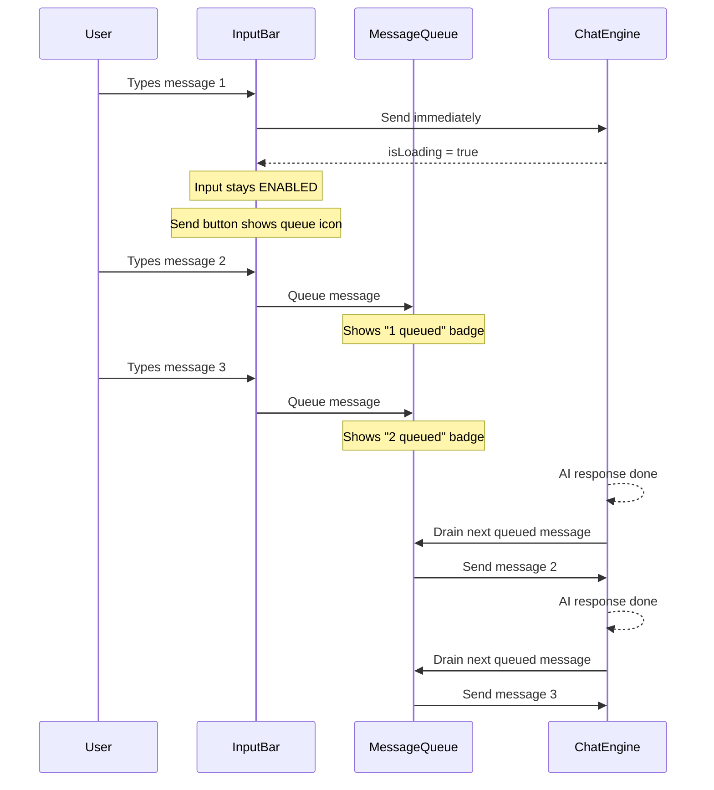

# Chat Message Queue Feature

## Problem

Currently, the textarea is disabled (`disabled={!connected || isLoading}`) and the send button becomes a stop button while the AI is processing. Users cannot type or queue follow-up messages. They must wait for the full response before sending their next message.

## Design

### UX Pattern (based on Claude Chat / Cursor Chat / Cline research)




### Key Behaviors

- Input remains **enabled** while AI is processing — users can type freely
- Sending while `isLoading` **queues** the message instead of blocking
- Queued messages appear in the chat immediately with a **"Queued" badge** (subtle pill, muted style)
- When the AI finishes, the **next queued message is automatically sent** to the API
- Users can **cancel queued messages** individually (X button on the badge) or cancel all (clear queue)
- The stop button remains available to **abort the current AI request** (existing behavior)
- A small **queue counter badge** appears on the send button when messages are queued
- Queued messages include temporal context: `[This message was typed while the AI was responding]` is prepended as a hidden system hint so the AI understands the user was reacting to earlier context, not the just-completed response

### What NOT to change

- Backend API routes — no changes needed; the queue is entirely client-side
- Message streaming/SSE — unchanged
- AbortController/cancel — existing behavior preserved

## Architecture

### State Changes

In [webapp/src/app/app/page.tsx](webapp/src/app/app/page.tsx):

- New state: `const [messageQueue, setMessageQueue] = useState<QueuedMessage[]>([])` 
- New type: `QueuedMessage = { id: string; text: string; images?: string[]; files?: FileAttachment[]; timestamp: string }`
- Modify `handleSend`: when `isLoading`, push to `messageQueue` instead of returning early
- New effect: when `isLoading` transitions from `true` to `false` and `messageQueue` is non-empty, auto-send the first queued message
- New callback: `handleDequeueMessage(id: string)` to remove a queued message
- New callback: `handleClearQueue()` to clear all queued messages

### ChatMessage Type Change

In [webapp/src/lib/types.ts](webapp/src/lib/types.ts):

- Add `queued?: boolean` to `ChatMessage` interface — marks messages displayed in chat but not yet sent to the API

### ChatWindow Changes

In [webapp/src/components/ChatWindow.tsx](webapp/src/components/ChatWindow.tsx):

- Remove the `isLoading` guard from `handleSubmit` — allow sending while loading
- Keep textarea **enabled** when `isLoading` (remove `disabled={isLoading}` from textarea, attach button, mic button)
- When `isLoading`, the send button shows a queue icon instead of the regular send arrow
- Add a small queue counter badge near the send/stop area when queue is non-empty
- Pass new props: `queueLength`, `onDequeue`, `onClearQueue`

### MessageBubble Changes

In [webapp/src/components/MessageBubble.tsx](webapp/src/components/MessageBubble.tsx):

- Render queued user messages with a "Queued" pill badge and muted opacity
- Add a cancel (X) button on queued messages

### Props Flow

```
page.tsx (state owner)
  |-- messageQueue state
  |-- handleSend (modified: queue when isLoading)
  |-- drain effect (auto-send on isLoading false)
  |
  +-> ChatWindow (props)
        |-- queueLength: number
        |-- onDequeue: (id) => void
        |-- onClearQueue: () => void
        |
        +-> MessageBubble (existing)
              |-- message.queued === true -> render queued badge
```

## Files to Modify


| File                                      | Change                                                                                                                                             |
| ----------------------------------------- | -------------------------------------------------------------------------------------------------------------------------------------------------- |
| `webapp/src/lib/types.ts`                 | Add `queued?: boolean` to `ChatMessage`                                                                                                            |
| `webapp/src/app/app/page.tsx`             | Add `messageQueue` state, modify `handleSend` to queue when loading, add drain effect, add dequeue/clear callbacks, pass queue props to ChatWindow |
| `webapp/src/components/ChatWindow.tsx`    | Enable input during loading, change send button to queue icon when loading, add queue counter badge, accept new props                              |
| `webapp/src/components/MessageBubble.tsx` | Render queued badge on `message.queued === true`, add cancel button for queued messages                                                            |


## Implementation Details

### handleSend modification (page.tsx)

Current guard at line 942:

```ts
if ((...) || isLoading) return;
```

New behavior:

```ts
if (isLoading) {
  // Queue the message instead of blocking
  const queuedMsg: QueuedMessage = { id: genMsgId(), text, images, files, timestamp: new Date().toISOString() };
  setMessageQueue(prev => [...prev, queuedMsg]);
  // Show queued message in chat immediately
  const displayMsg: ChatMessage = { id: queuedMsg.id, role: "user", content: text, queued: true, timestamp: queuedMsg.timestamp, ... };
  setMessages(prev => [...prev, displayMsg]);
  messagesRef.current = [...messagesRef.current, displayMsg];
  return;
}
```

### Drain effect (page.tsx)

```ts
useEffect(() => {
  if (!isLoading && messageQueue.length > 0) {
    const next = messageQueue[0];
    setMessageQueue(prev => prev.slice(1));
    // Remove the "queued" flag from the message in chat
    setMessages(prev => prev.map(m => m.id === next.id ? { ...m, queued: false } : m));
    messagesRef.current = messagesRef.current.map(m => m.id === next.id ? { ...m, queued: false } : m);
    // Small delay to let the UI update, then send
    setTimeout(() => handleSendRef.current(
      `[This message was typed while the AI was responding]\n\n${next.text}`,
      next.images, next.files, false
    ), 300);
  }
}, [isLoading, messageQueue]);
```

### Input bar changes (ChatWindow.tsx)

- Textarea: `disabled={!connected}` (remove `|| isLoading`)
- Attach button: `disabled={!connected}` (remove `|| isLoading`)
- Mic button: `disabled={!connected}` (remove `|| isLoading`)
- Send button when `isLoading`: show **queue send icon** (stacked arrows or clock icon) instead of hiding
- Stop button: keep as-is, positioned separately from send
- When `isLoading` and queue is non-empty: show small badge like "2 queued"

### Queued message rendering (MessageBubble.tsx)

When `message.queued === true`:

- Reduce opacity to 0.6
- Add a small "Queued" pill badge below the message text
- Add a cancel (X) button that calls `onDequeue(message.id)`

