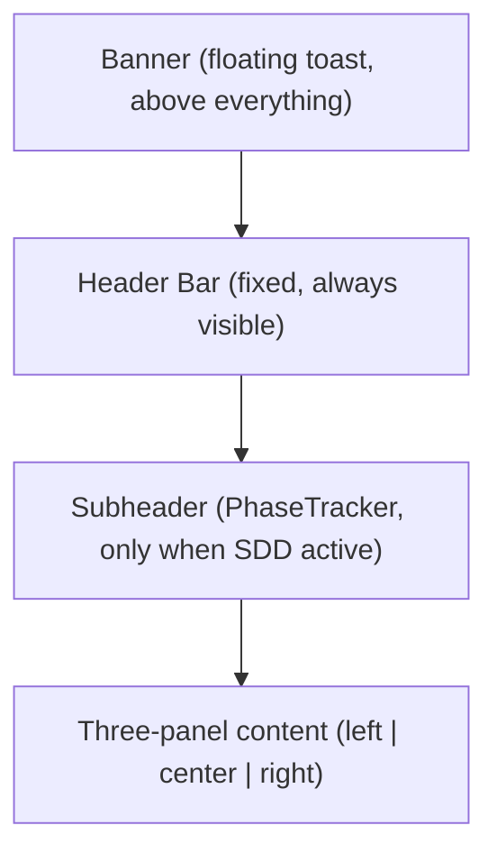

# Header Redesign

## Current State

Everything lives in a single `<header>` row in [webapp/src/app/app/page.tsx](webapp/src/app/app/page.tsx) (lines 1823-2003): sidebar toggle, logo, app name, theme toggle, connection pill, info button, PhaseTracker, New Chat, Sign In/profile dropdown, and right panel toggle. When the PhaseTracker activates (6 phases + REQ-ID), the header overflows and wraps on smaller screens.

The right panel defaults to 288px (`useState(288)` at line 147).

## Proposed Layout

Split the current single row into two tiers: a persistent **header** and a conditional **subheader**.




### Header Bar Structure

```
Left Zone                    Center (spacer)              Right Zone
--------------------------   -------------------------    --------------------------------
[Left toggle] [Logo+Name]                                [About] [Release] [Theme] [Profile] [Right toggle]
```

- **Left Zone:**
  - Left sidebar toggle (`PanelLeftOpen`/`PanelLeftClose`) -- already exists
  - Logo (clickable = Home, navigates to `/`) -- already exists but not linked
  - App name (hidden on mobile) -- already exists
- **Right Zone (5 items, icon-driven):**
  - **About** -- reuse existing InfoModal trigger, keep the `(i)` icon
  - **Release** -- new: opens a small dropdown or modal with changelog / "What's Next" content
  - **Theme toggle** -- already exists, stays as sun/moon icon
  - **Profile menu** -- consolidate: avatar dropdown containing Sign In/Out, Settings link, Clear Cache (already exists scattered)
  - Right sidebar toggle (`PanelRightOpen`/`PanelRightClose`) -- already exists, currently conditional on `connected`; move to always-visible

**Removed from header:** Connection pill (move into the right panel's CONNECTION section where it already duplicates), New Chat button (move into the subheader or keep only when messages exist).

### Subheader (Contextual, below header)

Only renders when `reqId && currentPhase` are set (same condition as PhaseTracker today):

```
[REQ-001]  [1 Spec] --- [2 Design] --- [3 Scope] --- [4 Impl] --- [5 Testing] --- [6 Deploy]    [+ New Chat]
```

- Background: `var(--surface-secondary)` with a subtle bottom border
- Sticky below the header
- `New Chat` button moves here (contextually relevant when a conversation is active)

### Banner Position

The banner is already rendered above `{children}` in [webapp/src/app/layout.tsx](webapp/src/app/layout.tsx). Since the banner is now a floating toast (centered, fixed position, z-60), it naturally sits above the header without pushing layout. No change needed.

## Right Panel Width

Increase default from 288px to 374px (30% wider):

```
// page.tsx line 147
const [rightWidth, setRightWidth] = useState(374);
```

## Files to Change

### 1. `webapp/src/app/app/page.tsx`

- **Header refactor:** Restructure the `<header>` element into the two-zone layout described above
- **Subheader:** Extract PhaseTracker + New Chat into a new conditional `<div>` below the header
- **Connection pill:** Remove from header (it already shows in the right panel's CONNECTION section)
- **Logo link:** Wrap the logo `<Image>` in a `<Link href="/">` for Home navigation
- **Release dropdown:** Add a small "megaphone" or "sparkles" icon button that opens a popover/dropdown
- **Profile consolidation:** Move Clear Cache into the existing profile dropdown (it is already there); ensure Sign In/Out and any settings link are grouped cleanly
- **Right panel width:** Change `useState(288)` to `useState(374)`
- **Right toggle:** Make the right panel toggle always visible (remove the `connected &&` condition)

### 2. `webapp/src/app/globals.css`

- Add styles for the subheader bar (sticky, surface-secondary background, bottom border)
- Add styles for the Release dropdown (reuse existing `attach-dropdown` pattern)

### 3. New: Release/Changelog content

- Add a small `ReleaseDropdown` component (or inline in page.tsx) that shows a short list of recent changes and a "What's Next" section
- Content can be hardcoded initially or loaded from a simple JSON/markdown file

## What NOT to Change

- `BannerDisplay.tsx` -- already positioned correctly as a floating toast
- `PhaseTracker.tsx` -- no changes needed; it already renders the right content
- `SettingsPanel.tsx` -- stays in the left sidebar as-is
- `InfoModal.tsx` -- stays as the About/Info modal, triggered from the header
- `ThemeToggle.tsx` -- stays as-is

## Design Principles Applied

- **5-7 visible controls max** in the header (left toggle, logo, about, release, theme, profile, right toggle = 7)
- **Logo = Home** (no separate "Home" text link needed)
- **Progressive disclosure:** About, Release, Clear Cache, Sign Out all behind icons/menus
- **PhaseTracker in subheader:** gives it dedicated horizontal space without competing with header controls
- **Consistent with Linear/Notion/ChatGPT:** minimal top chrome, overflow menus for secondary actions

