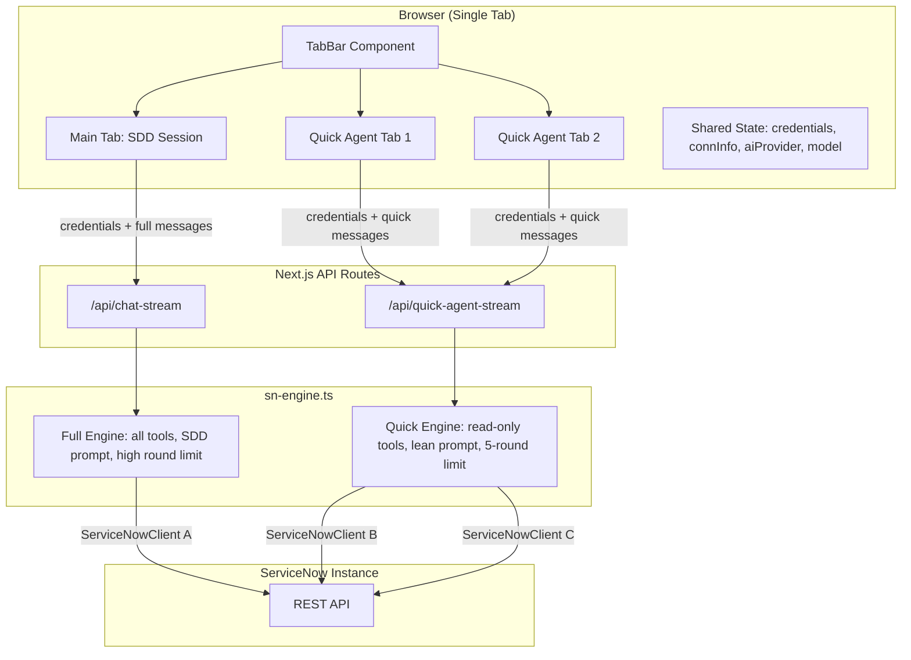
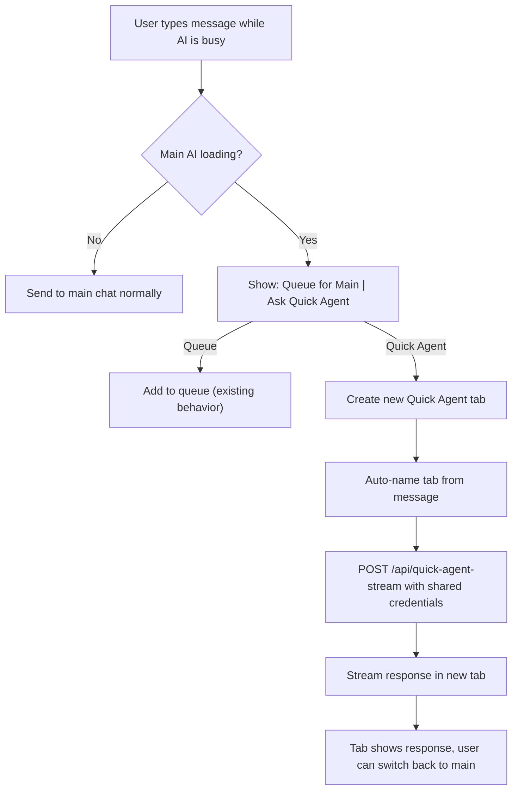

# Multi-Agent Quick Tabs

## Current State

The app has a **single chat thread** in `[webapp/src/app/app/page.tsx](webapp/src/app/app/page.tsx)` with ~40 state variables. When the user types while the AI is busy, messages are **queued** and drained sequentially (one at a time) after the current response completes. There is no tab bar, no multi-session UI, and no parallel conversation support.

The backend is **stateless per request** -- credentials are passed in each API call body, and a fresh `ServiceNowClient` is created per request in `[webapp/src/lib/sn-engine.ts](webapp/src/lib/sn-engine.ts)`. This makes parallel sessions architecturally trivial on the server side.

## Architecture




## Key Design Decisions

- **Shared credentials, isolated everything else**: `credentials`, `connected`, `connInfo`, `aiProvider`, `selectedModel` are shared across all tabs. Each tab gets its own `messages`, `isLoading`, `activityLog`, `liveStatus`, `clientSessionId`, and `abortRef`.
- **Quick agents are read-only**: They get a restricted tool set (query/get tools only, no create/update/deploy) and a lightweight system prompt (no SDD workflow). This prevents conflicts with the main session's update sets or deployments.
- **Round limit of 5**: Quick agents cap at 5 tool rounds (vs 30+ for main), keeping responses fast.
- **Tab auto-naming**: First 4-5 words of the user's message become the tab title (client-side, no API call needed). Can be refined by AI response later.
- **Queue behavior changes**: When user types while main AI is busy, instead of just queuing, show two options: "Queue for main" (existing behavior) or "Ask Quick Agent" (spawns new tab).

## Files to Create

- `**webapp/src/components/TabBar.tsx`** -- Tab bar UI above the chat area with main tab + quick agent tabs. Each tab shows a name, loading indicator, and close button. Visual badge distinguishes "Quick Agent" tabs from the main "SDD" tab.
- `**webapp/src/lib/conversation-state.ts**` -- `ConversationState` type and factory. Extracts per-tab state (messages, isLoading, activityLog, liveStatus, sessionId, abortController) into a reusable structure with `createConversation()` helper.
- `**webapp/src/app/api/quick-agent-stream/route.ts**` -- Dedicated API route for quick agents. Same credential validation as `chat-stream` but uses the quick agent system prompt and read-only tool set.
- `**webapp/src/lib/quick-agent-prompt.ts**` -- Lightweight system prompt for quick agents: "You are a ServiceNow query assistant. Answer questions about the instance using read-only tools. Do not create, update, or deploy anything."

## Files to Modify

- `**[webapp/src/app/app/page.tsx](webapp/src/app/app/page.tsx)**` -- Major refactor:
  - Add `conversations: Map<string, ConversationState>` and `activeTabId` state
  - Keep main tab state as `conversations.get("main")`, SDD state stays at page level
  - Add `handleQuickAgentSend()` that creates a new tab, starts a parallel streaming request
  - Modify queue UI to offer "Ask Quick Agent" option
  - Render `TabBar` between header and `ChatWindow`
  - Switch `ChatWindow` props based on `activeTabId`
- `**[webapp/src/components/ChatWindow.tsx](webapp/src/components/ChatWindow.tsx)**` -- Minor changes:
  - Accept `isQuickAgent?: boolean` prop to hide SDD-specific UI (phase tracker, SDD chip, approval buttons)
  - Show a subtle "Quick Agent -- separate session" indicator when `isQuickAgent`
  - Queue UI: add "Ask Quick Agent" button alongside existing queue behavior
- `**[webapp/src/lib/sn-engine.ts](webapp/src/lib/sn-engine.ts)**` -- Add `chatStreamQuickAgent()` variant:
  - Uses `getFilteredTools("quick_query")` for read-only tool set
  - Uses `buildQuickAgentPrompt()` instead of `buildSystemPrompt()`
  - Caps `maxToolRounds` at 5
  - Skips task planner, phase gate parsing, and SDD-specific logic
- `**[mcp-servicenow/src/tool-definitions.ts](mcp-servicenow/src/tool-definitions.ts)**` -- Add `quick_query` to `PHASE_TOOL_NAMES`:
  - Include: `sn_test_connection`, `sn_get_record`, `sn_get_records`, `sn_get_tables`, `sn_get_table_schema`, `sn_get_business_rules`, `sn_get_script_includes`, `sn_get_client_scripts`, `sn_get_ui_policies`, `sn_get_notifications`, `sn_get_instance_info`, `sn_get_update_sets`, `sn_get_update_set_contents`, `sn_get_dashboard_data`, `sn_generate_report`
  - Exclude all create/update/delete/deploy tools
- `**[webapp/src/lib/types.ts](webapp/src/lib/types.ts)**` -- Add types:
  - `ConversationTab` interface (id, name, type: "main" | "quick", isLoading, messageCount, createdAt)
  - Extend `QueuedMessage` or add a dispatch target field

## UX Flow




## Visual Layout

The tab bar sits between the header/subheader and the chat window:

```
+----------------------------------------------------------+
| Header: Logo | About | Release | ... | New Chat | SignIn |
+----------------------------------------------------------+
| Subheader: PhaseTracker (only for main tab)              |
+----------------------------------------------------------+
| TabBar: [Main (SDD)] [Incidents Q...] [Cases Q...] [+]  |
+----------------------------------------------------------+
|                                                          |
|                   ChatWindow                             |
|            (content switches per active tab)             |
|                                                          |
+----------------------------------------------------------+
```

- Main tab always exists, cannot be closed
- Quick agent tabs show a "Quick" badge and can be closed
- Active tab is visually highlighted
- Tabs with loading state show a pulsing dot
- Tab overflow: horizontal scroll with fade edges

## Session Isolation

Each quick agent tab gets:

- Its own `clientSessionId` (for telemetry)
- Its own `messages[]` array
- Its own `AbortController` (can cancel independently)
- Its own streaming connection
- A "separate session" indicator in the chat UI

The main tab's SDD state (`activeReqId`, `currentPhase`, `completedPhases`, `sddMode`) is unaffected by quick agents.