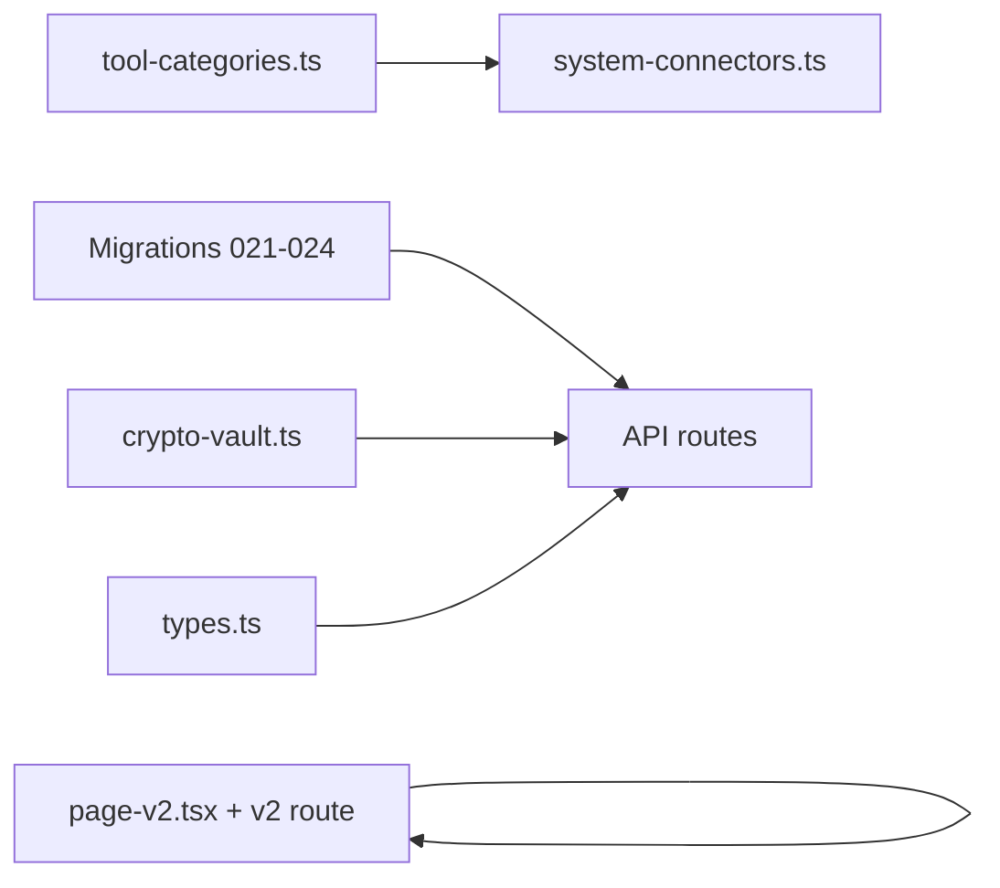

# Phase 1: Foundation (from HANDOFF / PLAN.md)

## Constraints (from [CLAUDE.md](CLAUDE.md) + handoff)

- **Do not edit** `[webapp/src/app/app/page.tsx](webapp/src/app/app/page.tsx)`. All UI iteration happens in `**page-v2.tsx`** only.
- This work is **product code**, not a `specs/REQ-*` flow; still avoid unrelated refactors and do not commit/push unless the user does so.
- New persistence must respect **mandatory login** (session cookie + `validateSession` like `[webapp/src/app/api/auth/me/route.ts](webapp/src/app/api/auth/me/route.ts)`).

## Current repo facts

- Main chat UI: **~2.5k lines**, `"use client"`, default export `Home` at `[webapp/src/app/app/page.tsx](webapp/src/app/app/page.tsx)` (sessionStorage-based chat today).
- Latest numbered migrations: **through `020`** under `[webapp/supabase/migrations/](webapp/supabase/migrations/)` — **021–024 do not exist yet**.
- `**page-v2.tsx` is not present** anywhere; no references in the codebase.

## Critical routing note (Next.js App Router)

A file named `page-v2.tsx` **next to** `page.tsx` is **not** a route entry. To make v2 testable without touching `page.tsx`, add a thin route segment that re-exports the v2 module:

- New: `[webapp/src/app/app/v2/page.tsx](webapp/src/app/app/v2/page.tsx)` — `import V2 from "../page-v2"; export default V2;` (or equivalent).
- New: `[webapp/src/app/app/page-v2.tsx](webapp/src/app/app/page-v2.tsx)` — **verbatim copy** of `page.tsx`, then rename the default component to something like `AppV2` for clarity (optional but helps debugging).

Users reach the redesign shell at `**/app/v2`** while production keeps `**/app`**.

## 1. Database: migrations 021–024

PLAN.md references “v3” for full DDL; it only spells out `**user_system_connections**` ([PLAN.md Part 5](docs/platform-redesign/PLAN.md)). Derive the rest from stated features: multi-chat, message persistence, artifacts, BYOK keys.

Proposed split (adjust column names to match existing `users` / RLS style in earlier migrations):

| Migration | Purpose                                                                                                                                                                                                                                                                                                                                                                                                                         |
| --------- | ------------------------------------------------------------------------------------------------------------------------------------------------------------------------------------------------------------------------------------------------------------------------------------------------------------------------------------------------------------------------------------------------------------------------------- |
| **021**   | `chats` (id, user_id, title, created_at, updated_at, metadata jsonb, optional `default_connection_id` uuid nullable) + `chat_messages` (id, chat_id, role, content jsonb, created_at, sort key) — **RLS**: `user_id` on `chats` matches `auth.uid()` pattern *or* server-only access via service role (match how `[006_user_instances.sql](webapp/supabase/migrations/006_user_instances.sql)` / app APIs access tables today). |
| **022**   | `session_artifacts` (id, user_id, chat_id nullable, tool_name, artifact_type, display_name, external_sys_id, payload jsonb, vapt jsonb nullable, created_at) + indexes on user/chat.                                                                                                                                                                                                                                            |
| **023**   | `user_api_keys` (id, user_id, provider/label, ciphertext + iv + tag or single encrypted blob jsonb, created_at, last_used_at) — **encrypted at rest** via `crypto-vault`.                                                                                                                                                                                                                                                       |
| **024**   | `user_system_connections` exactly as in PLAN (generic vault row per system: `system_type`, `label`, `config` jsonb, `credentials_enc` jsonb, `is_default`, `last_connected`).                                                                                                                                                                                                                                                   |

**Implementation detail:** Confirm whether the webapp uses **Supabase RLS with JWT** or **server-side `getSupabase()` service client** for mutations. Grep existing migrations for `users` / `sessions` RLS and mirror that pattern so new APIs do not leak cross-user data.

## 2. `crypto-vault.ts`

New: `[webapp/src/lib/crypto-vault.ts](webapp/src/lib/crypto-vault.ts)`

- AES-256-GCM (Node `crypto`): `encryptJson(plaintext: unknown) -> { iv, tag, ciphertext }` and `decryptJson`.
- Key from env e.g. `CREDENTIALS_MASTER_KEY` (32-byte base64 or hex) — document requirement in code comment only (no new markdown doc per project rules).
- Used by connection + API key APIs **only on the server** (route handlers / server actions).

## 3. `system-connectors.ts`

New: `[webapp/src/lib/system-connectors.ts](webapp/src/lib/system-connectors.ts)`

- Define `SystemConnector`, `ToolCategory`, `SystemCredentials`, `ToolResult` types per PLAN Part 2.2.
- **Phase 1 scope:** `ServiceNowConnector` stub that:
  - exposes `id: 'servicenow'`, display metadata;
  - `getToolCategories()` delegates to `tool-categories.ts`;
  - `executeToolCall` can throw `not implemented` or delegate to existing MCP path **only when** Phase 3 wires execution — for Phase 1, interfaces + registration map are enough if APIs do not call execute yet.

## 4. `tool-categories.ts`

New: `[webapp/src/lib/tool-categories.ts](webapp/src/lib/tool-categories.ts)`

- Build the hierarchical list from PLAN §2.3 (`SN_TOOL_CATEGORIES`), sourcing **actual tool names** from `[mcp-servicenow/src/tool-definitions.ts](mcp-servicenow/src/tool-definitions.ts)` (147 tools / 8 groups) so every `tools: [...]` entry is valid.
- Export helpers: `getCategoryTree()`, `getToolIdsInCategory()`, `findToolCategory(toolName)` for later Tool Workbench.

Optional Phase 1 follow-up (listed in PLAN “Modified Files”): add lightweight **category metadata** into MCP `tool-definitions.ts` — **defer** unless needed immediately; categories file can stand alone first.

## 5. API routes (all authenticated)

Pattern: read `SESSION_COOKIE_NAME` cookie → `validateSession(token)` from `[webapp/src/lib/auth.ts](webapp/src/lib/auth.ts)`; **401** if null.

| Route                                                                                                                       | Behavior                                                                     |
| --------------------------------------------------------------------------------------------------------------------------- | ---------------------------------------------------------------------------- |
| `GET/POST` `[webapp/src/app/api/chats/route.ts](webapp/src/app/api/chats/route.ts)`                                         | List user chats / create chat                                                |
| `GET/PATCH/DELETE` `[webapp/src/app/api/chats/[id]/route.ts](webapp/src/app/api/chats/[id]/route.ts)`                       | Single chat CRUD (enforce `user_id`)                                         |
| `GET/POST` `[webapp/src/app/api/chats/[id]/messages/route.ts](webapp/src/app/api/chats/[id]/messages/route.ts)`             | Paginated messages / append (append used in later phases)                    |
| `GET/POST` `[webapp/src/app/api/user/connections/route.ts](webapp/src/app/api/user/connections/route.ts)`                   | List / create `user_system_connections` (encrypt `credentials_enc` on write) |
| `GET/PATCH/DELETE` `[webapp/src/app/api/user/connections/[id]/route.ts](webapp/src/app/api/user/connections/[id]/route.ts)` | Update/delete one connection                                                 |
| `GET/POST` `[webapp/src/app/api/user/api-keys/route.ts](webapp/src/app/api/user/api-keys/route.ts)`                         | List (masked) / create encrypted key                                         |
| `GET/PATCH/DELETE` `[webapp/src/app/api/user/api-keys/[id]/route.ts](webapp/src/app/api/user/api-keys/[id]/route.ts)`       | Rotate/delete                                                                |

**Security:** Never return full decrypted secrets on `GET`; return labels, `system_type`, `is_default`, and masked previews only.

## 6. Types

Extend `[webapp/src/lib/types.ts](webapp/src/lib/types.ts)` with DB-shaped types for `Chat`, `ChatMessageRow`, `UserSystemConnection`, `UserApiKey` (public view), matching migration columns — keeps API handlers typed.

## 7. `page-v2.tsx` work in Phase 1 (minimal functional hookup)

Per HANDOFF, Phase 1 is **foundation**; full FDE shell is Phase 4. For Phase 1, after the copy:

- Add a **visible but subtle** indicator (e.g. small “v2 shell” badge or `document.title` suffix) so `/app/v2` is distinguishable from `/app`.
- Optionally add **stub calls** to `GET /api/chats` on mount (behind logged-in user) to verify wiring — or leave UI on sessionStorage until Phase 5; choose one to avoid half-broken dual persistence. **Recommendation:** Phase 1 only **proves APIs** (manual/curl or minimal `useEffect` fetch + console) without migrating chat state yet.

## Dependency order

## Verification

- Run new SQL locally (Supabase CLI or dashboard) and smoke-test APIs with a valid session cookie.
- Load `/app` → unchanged; load `/app/v2` → v2 copy renders.
- `node scripts/validate.cjs` only if you touch a REQ folder (not required for this slice).

## Out of scope for Phase 1 (later phases)

- Multi-agent harness, `sn-engine.ts` changes, Tool Workbench UI, direct `/api/tools/execute`, NavRail — per PLAN Phases 2–4.

