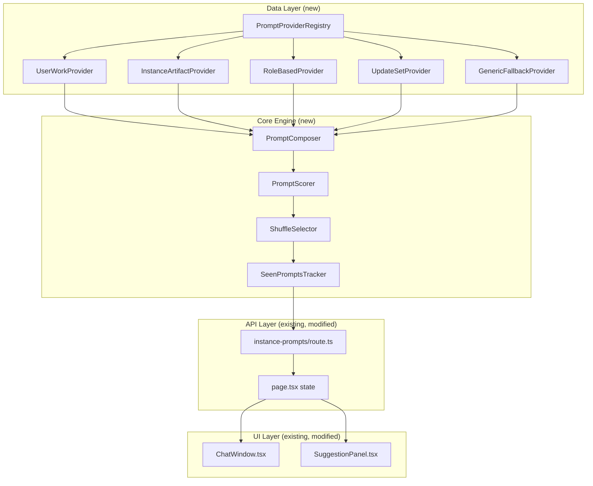
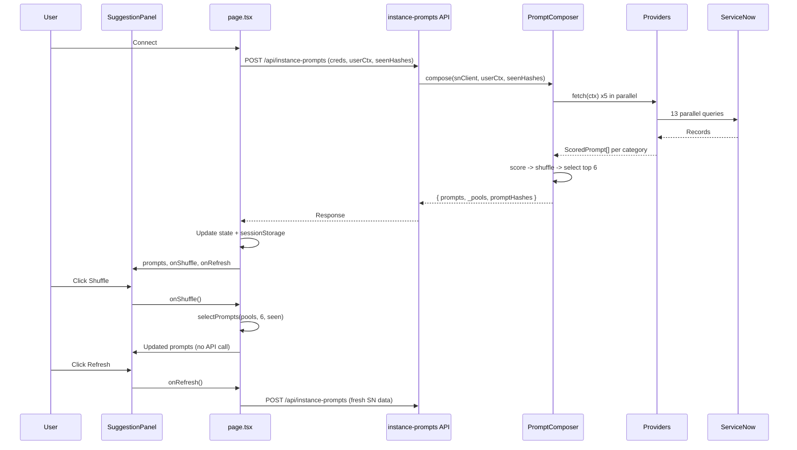

# Suggestion Engine Enhancement Plan

## Root Cause Analysis

The suggestions never change on refresh because the entire pipeline is **100% deterministic**:

1. `**topN()` in `[sn-engine.ts:930-935](webapp/src/lib/sn-engine.ts)`** sorts strictly by descending priority, then takes the first 6. V8's stable sort preserves insertion order for equal priorities, so the same data always produces the same output.
2. **Fixed priority values** (10, 9, 7, 6, 5, 2) are hardcoded per prompt type with no jitter or randomization.
3. **ServiceNow queries** use fixed `ORDER BY` and `sysparm_limit`, returning the same records each time.
4. **No shuffle, rotation, or "seen" tracking** exists anywhere in the codebase.
5. **No caching** of `categorizedPrompts` in sessionStorage (lost on page refresh, re-fetched identically).
6. **Fallback inconsistency**: `ChatWindow.tsx` has `SUGGESTION_FALLBACK` with static prompts; `SuggestionPanel.tsx` shows "No suggestions available" when empty.

## Architecture: Modular Suggestion Engine

Extract suggestion logic into a standalone, extensible module separate from `sn-engine.ts`.




## Key Changes

### 1. New module: `webapp/src/lib/suggestion-engine/`

Create a modular suggestion engine directory with clear separation of concerns:

- `**types.ts**` -- Shared types: `PromptProvider` interface, `ScoredPrompt`, `SuggestionConfig`, `ProviderContext`, `SeenPromptEntry`, `PromptTemplate`, `TabKey`
- `**registry.ts**` -- `PromptProviderRegistry` class: register/unregister providers, iterate, filter by category
- `**providers/**` -- Individual provider files implementing `PromptProvider`:
  - `user-work.ts` -- My incidents, changes, approvals, group unassigned (priority 10/9)
  - `instance-artifacts.ts` -- Custom tables, business rules, catalog items, scheduled jobs, KBs, workflows, notifications, ACLs (priority 5-7)
  - `role-based.ts` -- Admin/ITIL/catalog_admin-specific suggestions (priority 7)
  - `update-sets.ts` -- Update set prompts + summaries (priority 6-7)
  - `generic-fallback.ts` -- Static fallback prompts (priority 2) + shared `SUGGESTION_FALLBACK` constant (unifies ChatWindow and SuggestionPanel fallbacks)
- `**scorer.ts**` -- `PromptScorer`: applies priority with configurable jitter noise (+/- 0.5 within tier)
- `**selector.ts**` -- `selectPrompts()`: Fisher-Yates shuffle within priority tiers, seen-deprioritization, top-N selection. **Exported for both server-side and client-side use** (isomorphic, no Node.js dependencies).
- `**seen-tracker.ts`** -- `SeenPromptsTracker`: tracks shown prompts via djb2 hash, sessionStorage persistence, LRU eviction at 200 entries
- `**composer.ts`** -- `PromptComposer`: orchestrates providers -> scorer -> selector -> output
- `**index.ts**` -- Barrel export of public API

### 2. Shuffle within priority tiers (core fix)

Replace the current `topN()` with a two-phase selection in `selector.ts`:

```typescript
export function selectPrompts(pool: ScoredPrompt[], n: number, seen?: Set<string>): ExamplePrompt[] {
  const tiers = groupByPriority(pool);
  for (const tier of tiers.values()) fisherYatesShuffle(tier);
  if (seen?.size) deprioritizeSeen(tiers, seen);
  return flattenTiers(tiers).slice(0, n).map(stripPriority);
}
```

Guarantees:

- Higher-priority prompts always win over lower-priority ones
- Within the same priority level, order is randomized on every call
- Previously-seen prompts are pushed to the back of their tier (not excluded)
- The function is pure (no side effects) and isomorphic (runs on server and client)

### 3. Expanded prompt templates (high-impact variety)

Each data source currently generates 1 prompt template per item. Expand to 2-4 templates per source, randomly selected per item. Concrete examples:

**Custom Tables** (currently 1 template each for explore/build/quick):

- explore: "Analyze the custom table X -- fields, rules, and ACLs" | "Show recent changes to table X" | "Compare X with similar OOB tables" | "Check X for missing indexes or performance issues"
- build: "Add validation rules or UI policies to X" | "Create a dashboard widget for X records" | "Build an approval workflow for X"
- quick: "Show schema and record count for X" | "List all fields on X with types" | "How many records in X were created this week?"

**Business Rules** (currently 1 explore + conditional build):

- explore: "Review N active business rules on T for conflicts" | "Find business rules on T that run on insert vs update" | "Check T business rules for GlideRecord performance issues"
- build: "Refactor and consolidate the N rules on T" | "Add logging and error handling to rules on T" | "Convert synchronous rules on T to async where safe"

**Catalog Items** (currently 1 each):

- explore: "Analyze catalog item X -- variables, workflow, improvements" | "Check X for missing mandatory variables" | "Review X approval and fulfillment flow"
- build: "Add approval workflow to X" | "Create order guide combining X with related items" | "Add dynamic variable visibility rules to X"

**Scheduled Jobs** (currently 1 explore):

- explore: "Review scheduled job X -- frequency and performance" | "Check if X has proper error handling and logging" | "Analyze X run history for failures"

**User Work** (currently 1 template per type):

- incidents: "You have N open incidents including X P1 -- triage them" | "Review your N open incidents by priority and age" | "Which of your N incidents have breached SLA?"
- changes: "You have N active change requests -- check status" | "Review your N changes for upcoming CAB dates" | "Which of your N changes need risk assessment?"

**Role-Based** (currently 2 admin + 1 itil):

- admin: add "Review system properties for security misconfigurations" | "Check for users with excessive roles"
- itil: add "Review SLA definitions and compliance rates" | "Analyze assignment group workload distribution"

### 4. Seen-prompts tracking

`SeenPromptsTracker` in `seen-tracker.ts`:

- Uses `djb2` hash (fast, no crypto dependency, 32-bit integer) on prompt text to generate compact keys
- Stores hashes in `sessionStorage` under key `ai-seen-suggestions` as JSON array
- Max 200 entries with LRU eviction (oldest seen entries dropped first)
- Cleared on "New Chat" (added to the existing `ALL_SESSION_KEYS` cleanup in `page.tsx`)
- API contract: client sends `seenHashes: string[]` to server; server returns `promptHashes: string[]` for newly selected prompts
- Deprioritization, not exclusion: seen prompts move to the end of their priority tier, so they still appear if the pool is small

### 5. Client-side re-shuffle capability

Two distinct user actions with different behaviors:

- **Shuffle button** (dice icon, next to refresh): re-runs `selectPrompts()` client-side from the cached full pool. No API call. Instant. Produces different selection from the same data.
- **Refresh button** (existing circular arrow): triggers `fetchCategorizedPromptsFromApi()` to hit ServiceNow for fresh data. Slower. Produces different data AND different selection.

Implementation:

- API returns `_pools: { foryou: ScoredPrompt[], build: ScoredPrompt[], ... }` alongside the selected `foryou: ExamplePrompt[]` etc.
- `page.tsx` stores `_pools` in state (not persisted to sessionStorage -- too large)
- Shuffle button calls `selectPrompts(pools[activeTab], 6, seenHashes)` and updates `categorizedPrompts` state
- `selectPrompts()` is imported from `suggestion-engine/selector.ts` (isomorphic)
- New type `CategorizedPromptsWithPool` extends `CategorizedPrompts` with optional `_pools` field

### 6. Unified fallback behavior

Currently `ChatWindow.tsx` has `SUGGESTION_FALLBACK` (lines 55-82) and `SuggestionPanel.tsx` shows "No suggestions available." Unify:

- Move `SUGGESTION_FALLBACK` into `suggestion-engine/providers/generic-fallback.ts` as an exported constant
- Both `ChatWindow.tsx` and `SuggestionPanel.tsx` import from the same source
- `SuggestionPanel.tsx` uses the fallback when `prompts` is null or category is empty (instead of showing "No suggestions available")
- Single source of truth for static prompts

### 7. Refactor `[sn-engine.ts](webapp/src/lib/sn-engine.ts)` `fetchCategorizedPrompts()`

- Replace the inline pool-building logic (lines 1062-1220) with a call to `PromptComposer.compose(snClient, userContext, seenHashes)`
- The 13 parallel SN queries move into individual providers (each provider owns its own queries)
- `fetchCategorizedPrompts()` becomes a thin function: create snClient -> pass to composer -> return result
- Keep `fetchInstancePrompts()` backward-compat wrapper unchanged
- `topN()` function (lines 930-935) and `ScoredPrompt` interface (lines 920-922) are removed from this file (moved to suggestion-engine)

### 8. Modify `[instance-prompts/route.ts](webapp/src/app/api/instance-prompts/route.ts)`

- Accept optional `seenHashes: string[]` in request body
- Pass to `fetchCategorizedPrompts(credentials, userContext, seenHashes)`
- Return `{ prompts, _pools, promptHashes }` (pools for client-side shuffle, hashes for seen tracking)
- Add proper error differentiation: 400 for missing credentials, 500 for SN errors (currently always 200)

### 9. Modify `[page.tsx](webapp/src/app/app/page.tsx)` state management

- Add `seenSuggestionHashes` state as `Set<string>`, persisted to sessionStorage under `ai-seen-suggestions`
- Add `promptPools` state as `PromptPoolMap | null` (not persisted -- too large, re-fetched on connect)
- Add `SK.SEEN_SUGGESTIONS` and `SK.CATEGORIZED_PROMPTS` to session persistence keys
- Persist `categorizedPrompts` to sessionStorage so they survive page refresh
- On fetch: send `Array.from(seenSuggestionHashes)` to API; on response: merge returned `promptHashes` into seen set
- On "New Chat": clear `seenSuggestionHashes` alongside other session state (add to `ALL_SESSION_KEYS`)
- Add `handleShufflePrompts` callback: re-runs `selectPrompts()` from `promptPools` without API call
- Pass `onShuffle={handleShufflePrompts}` to `SuggestionPanel`

### 10. Modify `[SuggestionPanel.tsx](webapp/src/components/SuggestionPanel.tsx)`

- Add `onShuffle` prop (optional callback for client-side re-shuffle)
- Add shuffle button (dice icon) next to existing refresh button in header
- Import `SUGGESTION_FALLBACK` from `suggestion-engine` for empty-state fallback
- Add crossfade animation when suggestions change (CSS transition on `.sp-items` children)
- Keep existing refresh button behavior unchanged

### 11. Modify `[ChatWindow.tsx](webapp/src/components/ChatWindow.tsx)`

- Replace inline `SUGGESTION_FALLBACK` constant (lines 55-82) with import from `suggestion-engine/providers/generic-fallback.ts`
- Accept optional `promptPools` prop for client-side shuffle on hero screen
- Keep existing tab rendering logic; only change is the fallback source

## Files to Create


| File                                                               | Purpose                                                                                                                                  |
| ------------------------------------------------------------------ | ---------------------------------------------------------------------------------------------------------------------------------------- |
| `webapp/src/lib/suggestion-engine/types.ts`                        | Shared types: PromptProvider, ScoredPrompt, ProviderContext, PromptTemplate, TabKey, SeenPromptEntry                                     |
| `webapp/src/lib/suggestion-engine/registry.ts`                     | PromptProviderRegistry class with register/unregister/getAll/getByCategory                                                               |
| `webapp/src/lib/suggestion-engine/providers/user-work.ts`          | User incidents, changes, approvals, group unassigned (priority 10/9) with 2-3 templates each                                             |
| `webapp/src/lib/suggestion-engine/providers/instance-artifacts.ts` | Custom tables, business rules, catalog items, scheduled jobs, KBs, workflows, notifications, ACLs (priority 5-7) with 2-4 templates each |
| `webapp/src/lib/suggestion-engine/providers/role-based.ts`         | Admin/ITIL/catalog_admin suggestions (priority 7) with expanded template set                                                             |
| `webapp/src/lib/suggestion-engine/providers/update-sets.ts`        | Update set prompts + UpdateSetSummary builder (priority 6-7)                                                                             |
| `webapp/src/lib/suggestion-engine/providers/generic-fallback.ts`   | Static fallback prompts (priority 2) + exported SUGGESTION_FALLBACK constant                                                             |
| `webapp/src/lib/suggestion-engine/scorer.ts`                       | PromptScorer with configurable jitter noise                                                                                              |
| `webapp/src/lib/suggestion-engine/selector.ts`                     | selectPrompts() -- isomorphic Fisher-Yates within tiers, seen-deprioritization                                                           |
| `webapp/src/lib/suggestion-engine/seen-tracker.ts`                 | SeenPromptsTracker with djb2 hash, sessionStorage, LRU eviction                                                                          |
| `webapp/src/lib/suggestion-engine/composer.ts`                     | PromptComposer orchestrating providers -> scorer -> selector                                                                             |
| `webapp/src/lib/suggestion-engine/index.ts`                        | Barrel export of public API                                                                                                              |


## Files to Modify


| File                                           | Change                                                                                                                                  |
| ---------------------------------------------- | --------------------------------------------------------------------------------------------------------------------------------------- |
| `webapp/src/lib/sn-engine.ts`                  | Replace inline pool logic (lines 920-1220) with PromptComposer delegation; remove topN/ScoredPrompt                                     |
| `webapp/src/lib/types.ts`                      | Add CategorizedPromptsWithPool, PromptPoolMap types                                                                                     |
| `webapp/src/app/api/instance-prompts/route.ts` | Accept seenHashes, return pools + promptHashes, add proper error status codes                                                           |
| `webapp/src/app/app/page.tsx`                  | Add seen-hash state, promptPools state, sessionStorage persistence for prompts, handleShufflePrompts, pass onShuffle to SuggestionPanel |
| `webapp/src/components/SuggestionPanel.tsx`    | Add shuffle button (dice icon), onShuffle prop, import shared SUGGESTION_FALLBACK, crossfade animation                                  |
| `webapp/src/components/ChatWindow.tsx`         | Replace inline SUGGESTION_FALLBACK with import from suggestion-engine, accept optional promptPools prop                                 |
| `webapp/src/app/globals.css`                   | Styles for shuffle button, crossfade animation on suggestion items                                                                      |


## Extensibility Design

The `PromptProvider` interface makes it trivial to add new suggestion sources:

```typescript
interface PromptProvider {
  id: string;
  name: string;
  categories: TabKey[];
  fetch(ctx: ProviderContext): Promise<ScoredPrompt[]>;
}

interface ProviderContext {
  snClient: SnClient;
  userContext?: UserContext;
  config: SuggestionConfig;
}
```

To add a new provider: create a file in `providers/`, implement the interface, register it in the default registry. No changes needed to the API route, page state, or UI components.

Future provider ideas:

- **TrendingTablesProvider** -- most-modified tables in last 24h
- **RecentErrorsProvider** -- from `syslog` table
- **PeerActivityProvider** -- what other admins are working on
- **SeasonalProvider** -- time-based suggestions (end-of-quarter audit, etc.)
- **AIGeneratedProvider** -- LLM suggests prompts based on conversation history

## Data Flow Summary




