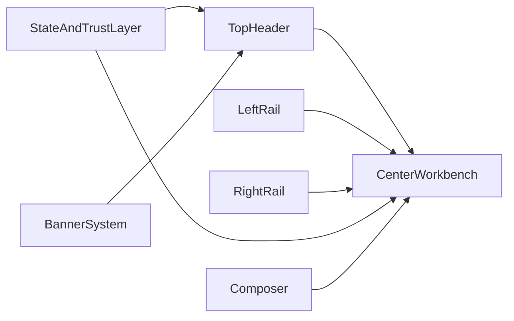

# UI/UX Elevation Plan

## Design Direction

Default to a restrained, dark-first productivity shell rather than a radical rebrand. Borrow principles, not visuals:

- **Linear and Vercel:** Typography-led hierarchy, low-noise chrome, restrained motion, rem-based scaling.
- **GitHub and Notion:** Scanability, predictable layout, progressive disclosure, contextual table of contents.
- **Figma:** Left/right rail inspector model, hairline dividers plus tonal separation, floating toast notifications.
- **ChatGPT, Claude, and Perplexity:** Clear streaming states, prompt guidance, trustworthy system status, compact past agent activity.

## What The Research Added

The original plan covered surfaces, logo, banners, typography, and polish. The review agents and augment context engine showed the plan should also add:

- **Design System & Accessibility:** WCAG AA contrast fixes for disabled text, converting `px` to `rem` for typography, tokenizing spacing/elevation, and preventing FOUC with a blocking script.
- **UX & Interaction:** "Focus Mode" for deep work, a sticky PhaseTracker, streamlined input bar (grouping secondary actions), rolled-up past agent activity, and progressive disclosure in settings.
- **Implementation Feasibility:** Mapping CSS variables directly into Tailwind v4's `@theme inline` block, using Tailwind opacity modifiers for semantic banners, and standardizing z-indexes (`z-state`, `z-modal`, `z-toast`) with a centralized `<StateOverlay>`.

## Current Architecture To Build On

The shell is already well structured in `webapp/src/app/app/page.tsx`, with a left settings rail, center chat surface, and right supporting panel. The global token system lives in `webapp/src/app/globals.css`, theme injection lives in `webapp/src/components/ThemeProvider.tsx`, and banner behavior is split across `webapp/src/components/BannerDisplay.tsx` and API routes.

## Recommended App Shell Model

## Execution Plan

### 1. Rebuild the shell contrast system & Tailwind v4 Integration

Refine the token hierarchy in `webapp/src/app/globals.css` so top, left, center, and right surfaces are visually distinct in both themes without becoming noisy.

- Move to a clearer 4-step surface hierarchy for dark mode and a cleaner elevation model for light mode.
- Map these surfaces explicitly into the `@theme inline` block (e.g., `--color-surface-app: var(--surface-app)`).
- Fix WCAG AA contrast for `--text-disabled` (darken in light mode, lighten in dark mode).
- Tokenize spacing (`--space-1`, `--space-4`) and elevation (`--shadow-sm`, `--shadow-md`) to remove magic numbers.
- Convert all typography to `rem` units and introduce intermediate steps (`.text-title` 24px/1.5rem, `.text-large` 16px/1rem).

### 2. Upgrade the logo and brand treatment to QHD quality

Improve the asset strategy in `webapp/public` and branding behavior in `webapp/src/lib/branding.ts`.

- Create a sharper, neutral-background logo that renders crisply from 32px through hero sizes.
- Use CSS `clamp()` for the logo container width to ensure fluid scaling.
- If the logo is SVG, keep `unoptimized`; if raster, remove `unoptimized` to allow Next.js to generate `srcSet`.
- Add safe fallbacks so empty `APP_LOGO` never produces broken images.

### 3. Add a unified system-state and trust layer

Strengthen status visibility across the app.

- Implement a centralized `<StateOverlay>` component with standardized z-indexes (`z-state: 40`, `z-modal: 50`, `z-toast: 60`).
- Move active connection status to a compact pill in the global header to de-clutter the post-connection UI.
- Anchor the `PhaseTracker` as a sticky header directly above the `ChatWindow`.
- Keep advanced details collapsible so the default experience stays calm.

### 4. Formalize message, banner, and notice semantics

Turn system communication into reusable primitives instead of one-off styling.

- Refactor `BannerDisplay.tsx` and API routes to use a `variant` system (`info`, `success`, `warning`, `critical`) mapped to semantic CSS variables with Tailwind opacity modifiers (e.g., `bg-warning/10 text-warning`).
- Render banners as floating, centered toast notifications at the top of the chat container to prevent jarring layout shifts.
- Persist dismissals locally and limit the amount of persistent chrome shown at once.

### 5. Redesign the composer, empty states, and prompt guidance

Improve first-run and long-session usability.

- **Smart Empty States:** Dynamically filter suggestions based on user roles (e.g., hide "Build" if not admin).
- **Composer Ergonomics:** Streamline the input bar by grouping secondary AI actions (Grammar/Enhance) under a popover.
- **Agent Activity Rollup:** Compact past agent turns into a single line (e.g., "✓ Analyzed 3 tables") to reduce vertical scrolling.
- **Contextual TOC:** Swap the left sidebar from Suggestions to Chat TOC for long conversations.

### 6. Apply accessibility and long-session UX rules

Support sustained use and deep work.

- **Focus Mode:** Introduce an automatic or manual mode that collapses all sidebars when the chat exceeds a certain length or when entering the Implementation phase.
- **Progressive Disclosure:** Hide complex ServiceNow auth methods and AI Provider selections behind an "Advanced Settings" toggle in `SettingsPanel`.
- Ensure keyboard reachability, fix focus states on `overflow: hidden` components, and use a blocking script in `<head>` to prevent FOUC from inline theme styles.

### 7. Sweep known bugs and cleanup opportunities during implementation

Bundle small fixes into the redesign while touching the same surfaces.

- Fix empty-logo rendering paths.
- Fix invalid color handling in `SDDModeChip`.
- Reduce unnecessary inline hover styling in favor of CSS-driven states where feasible.

## Suggested Implementation Order

1. Shell contrast, typography `rem` conversion, and design tokens (Tailwind v4 mapping).
2. Logo and branding fallback cleanup.
3. System-state, `<StateOverlay>`, and sticky PhaseTracker.
4. Banner simplification (floating toasts) and admin model cleanup.
5. Composer streamlining, agent activity rollup, and smart empty states.
6. Progressive disclosure in Settings, Focus Mode, and contextual TOC.
7. Accessibility, motion budget, FOUC prevention, and cross-theme QA.

## Success Criteria

- Top, left, center, and right sections are immediately distinguishable in both themes.
- Typography scales fluidly with browser settings (`rem`) and passes WCAG AA contrast.
- The interface feels calmer and more trustworthy over long sessions with Focus Mode and rolled-up activity.
- Banners float without layout shift and use semantic theme colors.
- Empty and onboarding states guide users into a first successful task quickly based on their role.