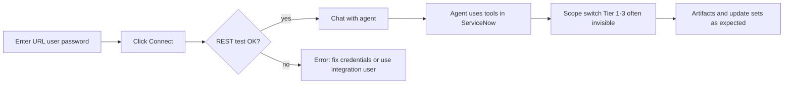

# ServiceNow connection and scope switching — user journey

> **Version:** 1.1 | **Date:** 2026-03-20 | **Audience:** End users and admins  
> **Related:** [application-scope-tier-design.md](./application-scope-tier-design.md) (technical tier details); product/engineering plan: *Tier 4 MFA/SSO* (`tier_4_mfa_sso_e093a654.plan.md` in Cursor plans)

This document describes what **you** experience in the SN AI Agent **webapp**: connecting to ServiceNow, chatting, and switching application scope — including **MFA and SSO**.

---

## 1. What “Connect” actually checks

When you click **Connect** in the app settings, the webapp validates that it can reach your instance using **REST (Table API)** with the **username and password you entered**.

- It does **not** open a full browser SSO login or walk you through MFA in the Connect step.
- Technically, this is **HTTP Basic Authentication** to ServiceNow’s REST API (see `ServiceNowClient.testConnection()` in `mcp-servicenow/src/client/sn-client.ts` and `/api/test-connection`).

So **“connected”** means: *these credentials work for API calls the agent will make*, not *I completed interactive SSO + MFA in a browser*.

---

## 2. My instance has MFA — how do I connect?

**Important distinction:** MFA is usually enforced on **interactive (browser) login**. The Connect step uses **API-style** access with username + password.

### Typical cases

| Situation | Can you connect in the webapp? | What to do |
|-----------|----------------------------------|------------|
| **MFA on browser login only**; your user also has a **local / LDAP password** accepted by **REST** | **Often yes** | Use **instance URL + username + password** that the **REST API** accepts (often the same password you use for API-capable access). MFA may **not** apply to this channel on many instances. |
| **Dedicated integration / service account** with password, no MFA on API | **Yes** | Prefer this for automation: admin creates a user with **least privilege** and a password used only for integrations. |
| **SSO-only** identity (no password ServiceNow accepts for Basic Auth) | **Usually no** | Connect will fail (redirect to login page, HTML instead of JSON, or invalid credentials). You need either a **separate integration user** with API password, or (future product) **OAuth** sign-in — not implemented in this codebase today. |
| **MFA required even for REST** for that user (uncommon but possible) | **No** with password-only Connect | There is **no** OTP/WebAuthn step in the Connect UI today. Use an account/policy that allows REST without interactive MFA, or wait for **OAuth**-based connection if your organization adopts it. |

**Practical guidance for organizations with MFA on the UI:**

1. Ask your ServiceNow admin for an **integration user** (or confirm your user can use **REST Basic Auth** with a known password).
2. Enter that user’s **ServiceNow** username and password in the app — **not** necessarily your corporate IdP password unless your admin says they are the same.
3. If Connect fails with “login page” / “redirect” / “invalid API response”, the instance is likely forcing **browser SSO** for the credentials you used — switch to an **API-capable** account or pursue OAuth when available.

---

## 3. End-to-end user journey (happy path)

1. **Configure** instance URL, username, password → **Connect**.
2. On success, you stay **connected** for the session; the app may show connection info (user, roles, instance).
3. You **chat**; the agent calls ServiceNow **in the background**.
4. For **custom application scope**, the system tries **automatic** scope switching (Tiers 1–3). You usually **do not** see separate “scope switch” UI — it succeeds or the agent asks you to do something (see below).

---

## 4. When scope switching is not automatic (what you see)

If automatic scope switching fails, the agent receives **`userActionRequired`** with a **checklist**. From your perspective:

1. Open your **ServiceNow instance in a normal browser** (where you already use **SSO/MFA** if your org requires it).
2. Use the **scope / application picker** (globe) in the header to select the correct application.
3. If needed, enable **Developer** settings so the picker appears (as described in the checklist).
4. Return to the **webapp** and confirm you switched (e.g. tell the agent you’re done, or continue the flow as prompted).

This path works well for **MFA/SSO** because **you** complete login and MFA in the browser; the app is not trying to drive OTP for you.

---

## 5. Tier 4 (browser automation) — do I see a browser?

**Usually no.** Tier 4 runs only if the **server** has enabled it (`ENABLE_BROWSER_SCOPE_SWITCH=true`) and optional Playwright dependencies are installed.

- Automation runs **headless** on the server: you do **not** get a browser window to complete MFA.
- If your instance sends login to **SSO** or shows an **MFA** challenge, Tier 4 **stops** and the flow falls back to **manual steps** (above) or errors.

So for **MFA-heavy** tenants, the **realistic** experience is still: **manual scope switch in ServiceNow**, then **continue in chat**.

---

## 6. Summary table

| Phase | MFA / SSO impact | What you do |
|-------|------------------|-------------|
| **Connect** | REST may **bypass** UI MFA; SSO-only users may **fail** today | Use **API-capable** user, integration account, or (**roadmap**) **OAuth / browser-assisted** connect — see [section 9](#9-roadmap-connecting-across-instance-types-mfa--sso) |
| **Chat + auto scope** | Usually none | Nothing special if Tier 1 works |
| **Manual scope (Tier 5)** | You use **normal browser** (SSO/MFA OK) | Follow checklist, switch scope, return to chat |
| **Tier 4** | Headless login **cannot** complete MFA | You typically never see it; falls through to manual |

---

## 7. For administrators

- Document for users: **Connect** = **REST credentials**, not “my SSO password” unless confirmed.
- Prefer **integration users** with minimal roles for AI agent access.
- If evaluating **OAuth** for Connect, see [section 9](#9-roadmap-connecting-across-instance-types-mfa--sso) below and [application-scope-tier-design.md](./application-scope-tier-design.md).

---

## 8. Code references (for implementers)

| Concern | Location |
|--------|----------|
| Connect API | `webapp/src/app/api/test-connection/route.ts` |
| Connection test logic | `webapp/src/lib/sn-engine.ts` (`testConnection`) |
| REST probe + Basic Auth | `mcp-servicenow/src/client/sn-client.ts` (`testConnection`, constructor) |
| Scope tiers | `mcp-servicenow/src/client/sn-client.ts` (`ensureScopeActive`) |
| Tier 4 browser | `webapp/src/lib/browser-scope-switcher.ts` |
| Tier 4 injection | `webapp/src/lib/sn-engine.ts` (`createSnClient`) |

---

## 9. Roadmap: connecting across instance types (MFA / SSO)

**Today:** Connect uses **username + password** and checks the **REST (Table API)** only. That is separate from browser SSO and does not walk users through MFA in the Connect UI.

**Direction (aligned with the Tier 4 / MFA / SSO engineering plan):** add one or more **additional** ways to connect so **SSO + MFA** orgs are not stuck on “integration user only,” while staying honest about limits.

### Can we support “every” instance?

**Not literally.** Some organizations block OAuth apps, forbid non-interactive API access, or require controls this app cannot satisfy. The realistic goal is **high coverage** where admins can register an OAuth application (or approve a browser-assisted flow), not a guarantee for every policy.

### Planned connection mechanisms (conceptual)

| Step | What it is | Who it helps |
|------|------------|--------------|
| 1. Basic Auth (current) | URL + username + password → REST probe | Instances where REST accepts a password (often integration users, or MFA not applied to REST) |
| 2. OAuth Authorization Code (+ PKCE) | User signs in via browser/IdP (**MFA happens there**); app uses **access/refresh tokens** for REST | **SSO-only** or MFA-on-login users who cannot use Basic Auth |
| 3. OAuth Client credentials | Machine client id/secret → token for REST | Dedicated integration identities (no human MFA step on that path) |
| 4. Browser-assisted Connect (optional fallback) | User completes login + MFA in a **real** browser session; session cookies are **bridged** into the same REST client the agent uses (high security bar) | Tenants that cannot use OAuth yet but allow interactive login |

**Note:** **Headless** server-side browser login (today’s Tier 4 style) does **not** replace Connect for MFA/SSO — it cannot complete OTP/WebAuthn in most setups. **OAuth** or **interactive** browser Connect are the right models for connection phase.

### What you will see later (user experience)

- If password Connect fails because the instance expects SSO, the app should guide you to **“Connect with ServiceNow (OAuth)”** or similar instead of only “wrong password.”
- After OAuth, you stay **connected** the same way as today; chat and scope behavior follow once tokens are wired through the ServiceNow client (exact scope semantics must match ServiceNow docs for bearer sessions).

### For administrators (roadmap)

- Plan for an **OAuth application** (or delegated auth) on the instance per ServiceNow documentation for your release.
- Decide whether users connect as **themselves** (auth code) or a **service** identity (client credentials).
- Any **cookie / session bridge** flow requires security review (session artifacts are as sensitive as passwords).
