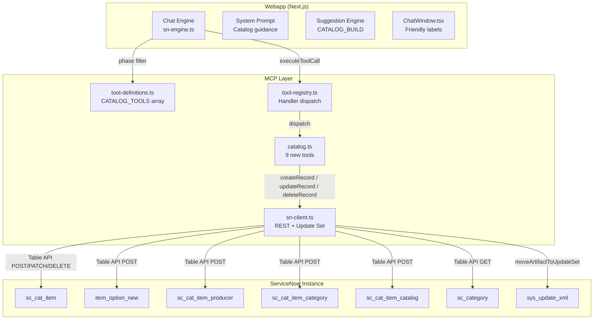
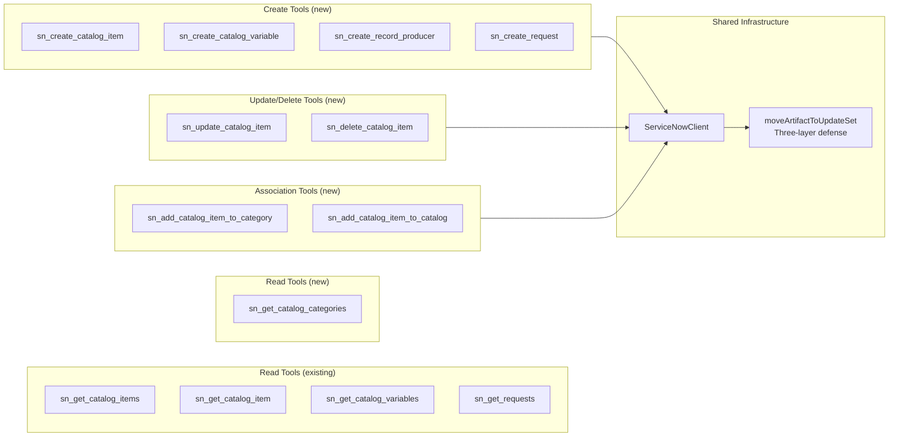
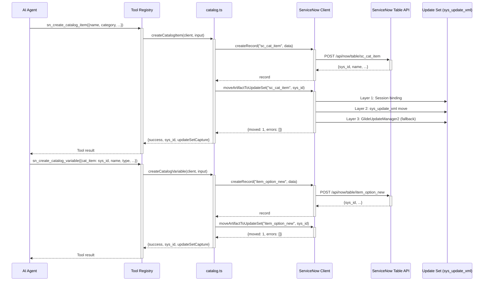
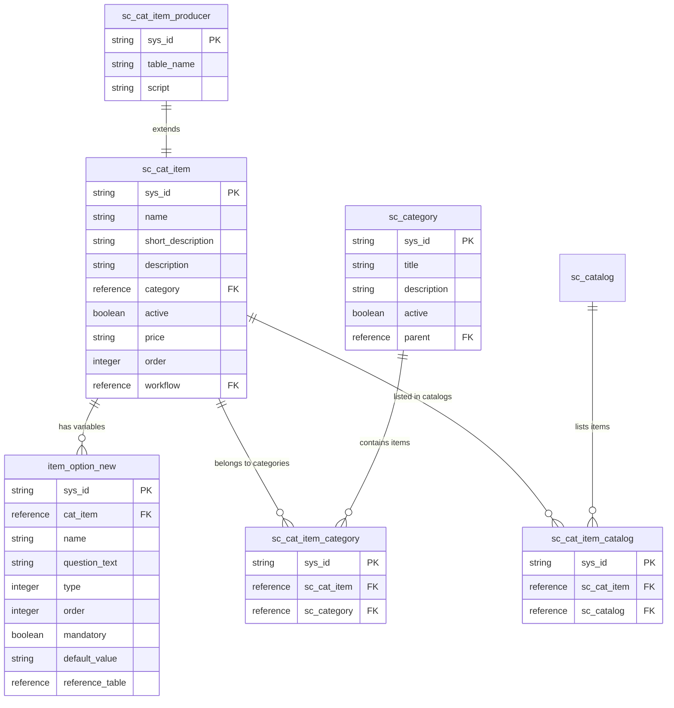
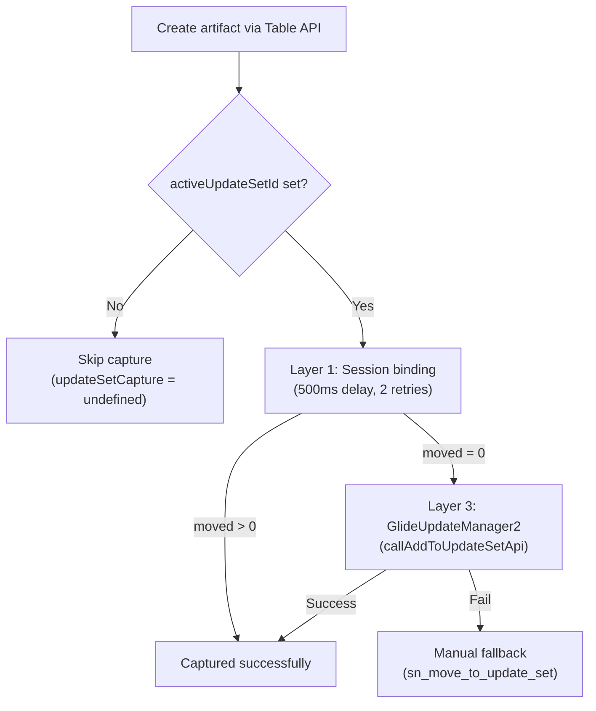

# REQ-001: Service Catalog Item Creation Capability — Technical Design

## Document Control

| Field | Value |
|-------|-------|
| **Requirement ID** | REQ-001 |
| **Spec Version** | 1.0 |
| **Author** | AI Agent |
| **Created** | 2026-03-24 |
| **Last Updated** | 2026-03-24 |
| **Version** | 1.0 |
| **Status** | Implemented |

---

## 1. Instance Discovery

### 1.1 Discovery Summary

| Metric | Value |
|--------|-------|
| **Tables Analyzed** | `sc_cat_item`, `item_option_new`, `sc_cat_item_producer`, `sc_cat_item_category`, `sc_cat_item_catalog`, `sc_category`, `sc_req_item` |
| **Keywords Used** | catalog, service catalog, catalog item, record producer, variable |
| **Total Artifacts Found** | 4 existing read-only MCP tools + 1 dead `createRequest` function |
| **Discovery Date** | 2026-03-24 |

### 1.2 Relevant Existing Artifacts

| Artifact Name | Type | Action | Reason |
|---------------|------|--------|--------|
| `sn_get_catalog_items` | MCP Tool (read) | ☑ Reuse | Queries `sc_cat_item` — no changes needed |
| `sn_get_catalog_item` | MCP Tool (read) | ☑ Reuse | Returns item + variables — no changes needed |
| `sn_get_catalog_variables` | MCP Tool (read) | ☑ Reuse | Queries `item_option_new` — no changes needed |
| `sn_get_requests` | MCP Tool (read) | ☑ Reuse | Queries `sc_request` — no changes needed |
| `createRequest` (dead code) | Unregistered function | ☑ Extend | Wired into tool registry as `sn_create_request` |
| `sn_create_record` (generic) | MCP Tool (write) | ☑ Reuse | Can insert into any table; dedicated tools add schema validation and AI guidance on top |

### 1.3 OOTB Capabilities Check

| OOTB Feature | Matches Requirement? | Notes |
|--------------|---------------------|-------|
| Table API (`/api/now/table/sc_cat_item`) | ☑ Full | REST POST to `sc_cat_item` works with `catalog_admin` role |
| Generic `sn_create_record` | ☑ Partial | Creates rows but lacks typed schema, defaults, and creation-order guidance |
| Service Catalog API (`/api/sn_sc/`) | ☐ None | Consumer/ordering API, not for catalog item authoring |

### 1.4 Implementation Decision

> **Based on discovery, we will:**
> - ☑ **Extend Existing** — Add dedicated create/update/delete MCP tools in `catalog.ts` alongside existing read tools, following the established `scripts.ts` / `records.ts` patterns for update-set capture. Wire dead `createRequest` into the registry.

### 1.5 Documentation References

| # | Platform Feature | Documentation Path | Table(s) | Plugin Dependency |
|---|------------------|--------------------|----------|-------------------|
| 1 | Service Catalog | ServiceNow Docs > IT Service Management > Service Catalog | `sc_cat_item`, `sc_category` | com.glideapp.servicecatalog |
| 2 | Catalog Variables | ServiceNow Docs > Service Catalog > Catalog Variables | `item_option_new` | com.glideapp.servicecatalog |
| 3 | Record Producers | ServiceNow Docs > Service Catalog > Record Producers | `sc_cat_item_producer` | com.glideapp.servicecatalog |
| 4 | Table API | ServiceNow Docs > Application Development > REST API > Table API | All | Core platform |

---

## 2. Solution Overview

### 2.1 Summary

Add first-class Service Catalog creation, update, and delete capabilities to the MCP tool layer. Nine new tools enable the AI agent to programmatically author catalog items, variables, record producers, and category/catalog associations — with typed Zod schemas, update-set capture, and phase-aware availability.

### 2.2 Goals

- Create catalog items (`sc_cat_item`) with validated fields and sensible defaults
- Add form variables (`item_option_new`) to catalog items with correct type codes
- Create record producers (`sc_cat_item_producer`) that generate records on target tables
- Associate items with categories and catalogs via M2M junction tables
- Update and deactivate/delete existing catalog items
- Capture all artifacts in the active update set via the three-layer defense strategy
- Guide the AI agent with creation-order rules and tool-preference in the system prompt

### 2.3 Non-Goals

- Variable set management (`item_option_new_set`, `io_set_item`)
- Catalog UI Policy creation (`catalog_ui_policy`)
- Catalog Client Script creation (`catalog_script_client`)
- Order Guide creation (`sc_cat_item_guide`)
- Cart/Order Now API integration for submitting requests programmatically

---

## 3. Architecture

### 3.1 System Context Diagram



### 3.2 Component Diagram



### 3.3 Sequence Diagram — Create Catalog Item with Variables



### 3.4 Entity-Relationship Diagram



---

## 4. Artifacts to Create

### 4.1 Naming Convention

All new tools follow the existing MCP tool naming pattern:
- Read tools: `sn_get_<entity>` (e.g., `sn_get_catalog_categories`)
- Create tools: `sn_create_<entity>` (e.g., `sn_create_catalog_item`)
- Update tools: `sn_update_<entity>` (e.g., `sn_update_catalog_item`)
- Delete tools: `sn_delete_<entity>` (e.g., `sn_delete_catalog_item`)
- Association tools: `sn_add_<entity>_to_<target>` (e.g., `sn_add_catalog_item_to_category`)

### 4.2 Summary Table

| Artifact | Type | File | Automatable | Description |
|----------|------|------|-------------|-------------|
| `sn_get_catalog_categories` | MCP Tool (read) | `catalog.ts` | ✅ | List `sc_category` records |
| `sn_create_catalog_item` | MCP Tool (create) | `catalog.ts` | ✅ | Create `sc_cat_item` with update-set capture |
| `sn_create_catalog_variable` | MCP Tool (create) | `catalog.ts` | ✅ | Create `item_option_new` with update-set capture |
| `sn_create_record_producer` | MCP Tool (create) | `catalog.ts` | ✅ | Create `sc_cat_item_producer` with update-set capture |
| `sn_update_catalog_item` | MCP Tool (update) | `catalog.ts` | ✅ | Update any `sc_cat_item` fields |
| `sn_delete_catalog_item` | MCP Tool (delete) | `catalog.ts` | ✅ | Soft delete (deactivate) or hard delete |
| `sn_add_catalog_item_to_category` | MCP Tool (M2M) | `catalog.ts` | ✅ | Create `sc_cat_item_category` junction row |
| `sn_add_catalog_item_to_catalog` | MCP Tool (M2M) | `catalog.ts` | ✅ | Create `sc_cat_item_catalog` junction row |
| `sn_create_request` | MCP Tool (create) | `catalog.ts` | ✅ | Submit `sc_req_item` (wired from dead code) |
| `CATALOG_TOOLS` array | Tool Definitions | `tool-definitions.ts` | ✅ | JSON Schema defs for all 9 new tools |
| Phase updates | Phase Config | `tool-definitions.ts` | ✅ | `PHASE_TOOL_NAMES` for spec/design/impl/testing |
| 9 handler mappings | Registry | `tool-registry.ts` | ✅ | Dispatch entries in `TOOL_HANDLERS` |
| 9 friendly labels | UI Config | `ChatWindow.tsx` | ✅ | `explicitMap` entries in `friendlyToolLabel` |
| Catalog creation guidance | System Prompt | `system-prompt.ts` | ✅ | OOB-first decision matrix entry |
| 2 suggestion templates | Suggestions | `instance-artifacts.ts` | ✅ | `CATALOG_BUILD` creation-oriented entries |

### 4.3 Artifact Details

#### 4.3.1 Catalog Tool Schemas (catalog.ts)

Each schema uses Zod with type coercion helpers duplicated locally from `scripts.ts`:

| Schema | Required Fields | Key Optional Fields |
|--------|----------------|---------------------|
| `createCatalogItemSchema` | `name` | `short_description`, `category`, `active`, `price`, `order`, `workflow` |
| `createCatalogVariableSchema` | `cat_item`, `name`, `question_text` | `type` (default 6=Single Line), `order`, `mandatory`, `default_value`, `reference` |
| `createRecordProducerSchema` | `name`, `table_name` | `short_description`, `category`, `active`, `script` |
| `updateCatalogItemSchema` | `sys_id`, `data` | — |
| `deleteCatalogItemSchema` | `sys_id` | `hard_delete` (default false = soft delete) |
| `addItemToCategorySchema` | `sc_cat_item`, `sc_category` | — |
| `addItemToCatalogSchema` | `sc_cat_item`, `sc_catalog` | — |
| `getCatalogCategoriesSchema` | — | `query`, `activeOnly`, `limit` |
| `createRequestSchema` | `catalogItem` | `requestedFor`, `variables` |

#### 4.3.2 Variable Type Codes

ServiceNow uses numeric type codes for catalog variables:

| Code | Type | Use Case |
|------|------|----------|
| 1 | Yes/No | Boolean fields |
| 6 | Single Line Text | Short text input (default) |
| 7 | Multi Line Text | Paragraphs, descriptions |
| 8 | Reference | Lookup to another table |
| 10 | Select Box | Dropdown with choices |
| 18 | Lookup Select Box | Dropdown with table reference |
| 21 | List Collector | Multi-select from a table |

---

## 5. Data Model

### 5.1 Tables Used (no new tables created)

| Table | Label | Purpose in This Feature |
|-------|-------|------------------------|
| `sc_cat_item` | Catalog Item | Primary catalog item creation/update/delete |
| `item_option_new` | Variable | Form variables on catalog items |
| `sc_cat_item_producer` | Record Producer | Catalog items that create records on target tables |
| `sc_cat_item_category` | Item Category (M2M) | Associates items with additional categories |
| `sc_cat_item_catalog` | Item Catalog (M2M) | Associates items with service catalogs |
| `sc_category` | Category | Read-only — discover available categories |
| `sc_req_item` | Requested Item | Create catalog requests |

### 5.2 Creation Order (dependency chain)

```
1. sc_cat_item (or sc_cat_item_producer)  →  parent record, get sys_id
2. sc_cat_item_catalog (M2M)              →  which catalog(s) display the item
3. sc_cat_item_category (M2M)             →  additional category associations
4. item_option_new (variables)            →  each references cat_item via FK
5. io_set_item (variable set links)       →  reusable variable groups (future)
6. workflow / flow attachment              →  fulfillment automation (future)
```

Variables MUST be created AFTER the parent item exists (they hold a `cat_item` foreign key). The `category` field on `sc_cat_item` sets the primary category; M2M rows add secondary associations.

---

## 6. Integration Points

### 6.1 Internal Integrations

| System | Direction | Method | Purpose |
|--------|-----------|--------|---------|
| MCP Tool Registry | Inbound | `executeToolCall()` | Dispatch to catalog handlers |
| ServiceNow Client | Outbound | `createRecord()` / `updateRecord()` / `deleteRecord()` | Table API operations |
| Update Set System | Outbound | `moveArtifactToUpdateSet()` | Three-layer artifact capture |
| Phase Filter | Config | `PHASE_TOOL_NAMES` | Controls tool availability per SDLC phase |
| System Prompt | Config | `buildSystemPrompt()` | AI guidance for tool selection and creation order |
| Suggestion Engine | Config | `CATALOG_BUILD` array | Populates "Build" tab with catalog suggestions |
| Chat UI | Config | `friendlyToolLabel()` | Human-readable inline activity labels |

### 6.2 Phase Availability

| Phase | Read Tools | Write Tools |
|-------|-----------|-------------|
| **spec** | `sn_get_catalog_categories` + existing reads | — |
| **design** | `sn_get_catalog_categories` + existing reads | — |
| **implementation** | All catalog reads | All 9 new tools |
| **testing** | `sn_get_catalog_categories` + existing reads | — |
| **scope_selection** | — | — |
| **deployment** | — | — |

---

## 7. Security Considerations

### 7.1 Access Control

| Role | Access Level | Notes |
|------|-------------|-------|
| `catalog_admin` | Full CRUD on `sc_cat_item` and related tables | Required for Table API writes |
| `admin` | Full | Includes `catalog_admin` capabilities |
| `itil` | Read only | Can browse but not create catalog items |

### 7.2 MCP Read-Only Mode

When `SN_READONLY_MODE=true`, the MCP stdio server filters tools to `sn_get*` / `sn_search*` prefixes only. All new `sn_create_*`, `sn_update_*`, `sn_delete_*`, and `sn_add_*` tools are automatically blocked. `sn_get_catalog_categories` passes the filter and remains available.

---

## 8. Performance Considerations

- Each create/update triggers a `moveArtifactToUpdateSet` call with 500ms initial delay and 2 retries (standard non-metadata table behavior)
- Creating a catalog item with N variables requires N+1 API calls + N+1 update-set captures — sequential, not parallelized
- Catalog tables are NOT in `METADATA_TABLES`; do not add them unless capture latency is observed
- Layer 3 (`GlideUpdateManager2`) fires automatically when Layer 2 finds nothing — no manual intervention needed

---

## 9. Error Handling

| Error Scenario | Handling Strategy | User Message |
|----------------|-------------------|--------------|
| Missing `catalog_admin` role | ServiceNow returns 403 | `"Failed to create catalog item: 403 — Insufficient permissions. Ensure the user has catalog_admin role."` |
| Instance-specific mandatory field missing | ServiceNow returns 400 with field list | Tool returns `success: false` with the platform error message |
| Variable created before parent item | `cat_item` FK validation fails | Agent guided by system prompt to create item first |
| Duplicate M2M junction row | Platform rejects duplicate | Tool returns error from Table API |
| Update set not active | `moveArtifactToUpdateSet` skipped | `updateSetCapture` is `undefined` in response (no error) |

---

## 10. Rollback Plan

1. Remove new tool names from `PHASE_TOOL_NAMES` in `tool-definitions.ts`
2. Remove `CATALOG_TOOLS` array and its reference in `ALL_TOOLS`
3. Remove new handler mappings from `tool-registry.ts`
4. Revert `catalog.ts` to read-only tools (restore from git)
5. Remove friendly labels from `ChatWindow.tsx`
6. Revert system prompt and suggestion engine changes
7. Rebuild: `cd mcp-servicenow && rm -rf dist && npx tsc`
8. Restart Next.js dev server

---

## 11. Files Modified

| File | Change Summary |
|------|---------------|
| `mcp-servicenow/src/tools/catalog.ts` | Added coercion helpers, 8 schemas, 9 handler functions |
| `mcp-servicenow/src/tool-definitions.ts` | Added `CATALOG_TOOLS` array, merged into `ALL_TOOLS`, updated 4 phase sets |
| `mcp-servicenow/src/tool-registry.ts` | Added 9 handler mappings in `TOOL_HANDLERS` |
| `webapp/src/components/ChatWindow.tsx` | Added 9 friendly labels in `explicitMap` |
| `webapp/src/lib/system-prompt.ts` | Added catalog tool guidance in OOB-first matrix |
| `webapp/src/lib/suggestion-engine/providers/instance-artifacts.ts` | Added 2 creation templates to `CATALOG_BUILD` |

---

## 12. Update Set Capture Strategy

Each created/updated record is individually captured via `moveArtifactToUpdateSet`:



After all creates, optionally call `sn_verify_update_set_capture` with the full `{table, sys_id}` list.

---

## Sign-Off

| Role | Name | Date | Signature |
|------|------|------|-----------|
| Author | AI Agent | 2026-03-24 | ☐ |
| Approver | | | ☐ |

> **Status:** ⬜ Draft
