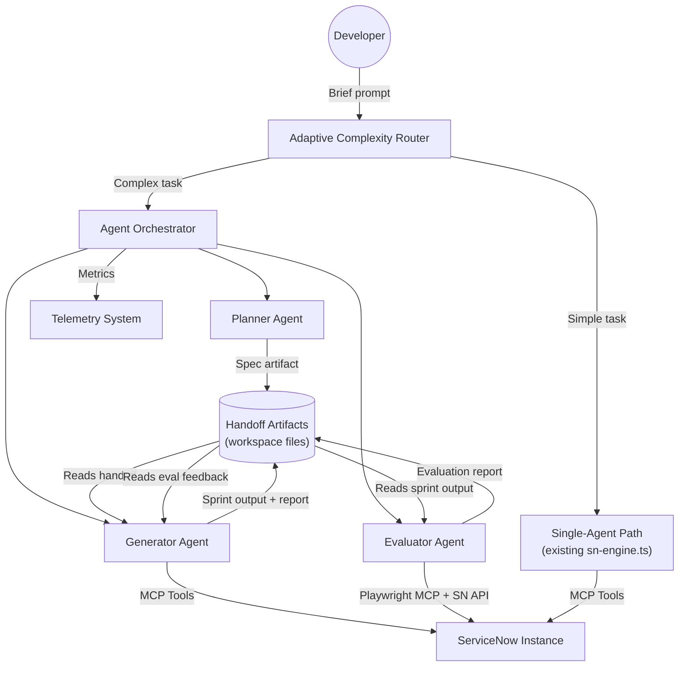
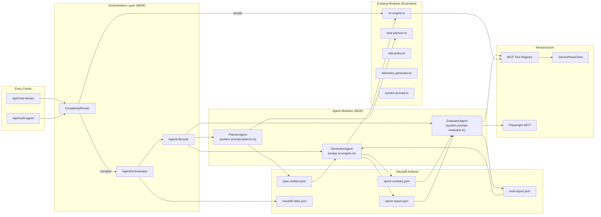
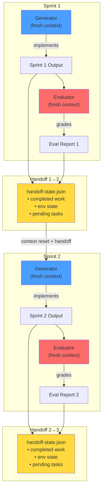
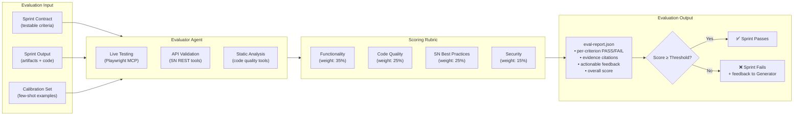

# REQ-002: Technical Design Document

## Document Control

| Field | Value |
|-------|-------|
| **Requirement ID** | REQ-002 |
| **Spec Version** | 1.0 |
| **Author** | AI Agent |
| **Created** | 2026-03-24 |
| **Last Updated** | 2026-03-24 |
| **Version** | 1.0 |
| **Status** | Draft |

---

## 1. Instance Discovery (Required First Step)

> This requirement is an **internal platform enhancement** — it modifies the AI agent harness architecture itself, not ServiceNow instance artifacts. Instance discovery does not apply in the traditional sense; instead, we document the existing internal components that will be extended.

### 1.1 Discovery Summary

| Metric | Value |
|--------|-------|
| **Area Analyzed** | webapp/src/lib/ (agent orchestration layer) |
| **Keywords Used** | agent, orchestrator, planner, evaluator, context, session, handoff |
| **Total Components Found** | 7 key modules |
| **Discovery Date** | 2026-03-24 |

### 1.2 Relevant Existing Components

| Component | Type | Action | Reason |
|-----------|------|--------|--------|
| `sn-engine.ts` | Core Engine | ☑ Extend | Main LLM loop; becomes the Generator agent's execution core |
| `task-planner.ts` | Planning Module | ☑ Extend | Plan-then-execute pattern; becomes foundation for Planner agent |
| `sdd-policy.ts` | Phase Policy | ☑ Reuse | Phase gate enforcement remains unchanged; multi-agent operates within gates |
| `session-cache.ts` | Cache Layer | ☑ Extend | Needs per-agent cache isolation |
| `telemetry-generator.ts` | Observability | ☑ Extend | Needs per-agent metrics dimensions |
| `logger.ts` | Logging | ☑ Extend | Needs agent-role tagging in JSONL entries |
| `system-prompt.ts` | Prompt Layer | ☑ Extend | Needs agent-specific prompt variants |

### 1.3 OOTB Capabilities Check

| Feature | Matches Requirement? | Notes |
|---------|---------------------|-------|
| `task-planner.ts` plan/execute | ☑ Partial | Single-LLM-call planning; no agent separation or context reset |
| `sn-engine.ts` tool loop | ☑ Partial | Core tool execution works; needs wrapping for multi-agent |
| Progressive compression | ☑ Partial | Helps but doesn't solve context anxiety (per Anthropic findings) |
| Session telemetry | ☑ Partial | Captures session-level; needs agent-level granularity |

### 1.4 Implementation Decision

> **Based on discovery, we will:**
> - ☑ **Extend Existing** — Wrap `sn-engine.ts` in a new orchestrator; evolve `task-planner.ts` into full Planner agent; add Evaluator as new module. No replacement of existing code paths.

---

## 2. Solution Overview

### 2.1 Summary

Introduce a **three-agent orchestration layer** on top of the existing `sn-engine.ts` tool-use loop. Each agent (Planner, Generator, Evaluator) runs as an isolated LLM session with its own system prompt, tool set, and context window. Agents communicate exclusively through structured **handoff artifacts** — JSON and markdown files written to a workspace directory. An **Agent Orchestrator** manages lifecycle, sequencing, retry logic, and telemetry.

The design follows Anthropic's proven pattern:
- **Planner** expands brief prompts into comprehensive specs (automates spec phase)
- **Generator** implements in sprints with sprint contracts (structured implementation)
- **Evaluator** independently tests and grades via live interaction (separated quality gate)

An **Adaptive Complexity Router** at the entry point determines whether a task warrants multi-agent orchestration or should use the existing single-agent fast path.

### 2.2 Goals
- Enable autonomous multi-hour SDLC sessions without context degradation
- Separate generation from evaluation to improve output quality
- Provide structured sprint contracts for objective quality measurement
- Maintain backward compatibility with existing single-agent chat flow
- Instrument per-agent telemetry for cost and quality optimization

### 2.3 Non-Goals
- Replacing the existing `/api/chat` endpoint (it remains the default)
- Implementing visual/aesthetic evaluation (ServiceNow is functional, not design-focused)
- Training custom models or fine-tuning evaluator scoring
- Cross-instance agent orchestration

---

## 3. Architecture

### 3.1 System Context Diagram



### 3.2 Component Diagram



### 3.3 Sequence Diagram — Full Multi-Agent Sprint Cycle

```mermaid
sequenceDiagram
    participant U as Developer
    participant R as ComplexityRouter
    participant O as AgentOrchestrator
    participant P as PlannerAgent
    participant G as GeneratorAgent
    participant E as EvaluatorAgent
    participant A as Handoff Artifacts
    participant SN as ServiceNow
    
    U->>R: Submit requirement (brief prompt)
    R->>R: Analyze complexity (artifact count, phases, scope)
    
    alt Simple Task
        R->>G: Route to single-agent (existing flow)
        G->>SN: Execute via MCP tools
        G->>U: Return result
    else Complex Task
        R->>O: Route to multi-agent orchestration
        
        rect rgb(40, 40, 80)
            Note over O,P: Phase 1: Planning
            O->>P: Start with user prompt + SDLC templates
            P->>P: Expand prompt into full spec
            P->>A: Write spec-artifact.json
            O->>U: Present spec for review (phase gate)
            U->>O: Approve spec
        end
        
        rect rgb(40, 80, 40)
            Note over O,G,E: Phase 2: Sprint Cycle (repeats per sprint)
            O->>G: Start sprint with spec + previous handoff
            G->>A: Propose sprint-contract.json
            O->>E: Review sprint contract
            E->>A: Amend/approve contract
            
            loop Contract Negotiation
                G->>A: Update contract
                E->>A: Review contract
            end
            
            Note over G: Implementation
            G->>SN: Create artifacts via MCP tools
            G->>A: Write sprint-report.json
            
            Note over E: Evaluation
            O->>E: Start evaluation with contract + sprint output
            E->>SN: Test via Playwright MCP + SN API
            E->>A: Write eval-report.json (scored)
            
            alt Sprint Passes
                O->>O: Advance to next sprint
            else Sprint Fails
                O->>G: Retry with eval feedback
            end
        end
        
        rect rgb(80, 40, 40)
            Note over O: Phase 3: Completion
            O->>A: Write final handoff-state.json
            O->>U: Present results + evaluation summary
        end
    end
```

### 3.4 Agent Lifecycle & Context Reset Diagram



### 3.5 Evaluator Scoring Flow



---

## 4. Artifacts to Create

### 4.1 Naming Convention

> ☑ **Following project naming rules**: No REQ-IDs in artifact names. Clean, descriptive PascalCase for modules.

### 4.2 Summary Table

| Artifact | Type | Location | Description |
|----------|------|----------|-------------|
| `AgentOrchestrator` | TypeScript Module | `webapp/src/lib/agent-orchestrator.ts` | Manages multi-agent lifecycle, sequencing, handoffs, retries |
| `ComplexityRouter` | TypeScript Module | `webapp/src/lib/complexity-router.ts` | Analyzes task complexity; routes to single-agent or multi-agent path |
| `PlannerAgent` | TypeScript Module | `webapp/src/lib/agents/planner-agent.ts` | Planner agent: expands prompts into SDLC specs |
| `GeneratorAgent` | TypeScript Module | `webapp/src/lib/agents/generator-agent.ts` | Generator agent: wraps sn-engine for sprint-based implementation |
| `EvaluatorAgent` | TypeScript Module | `webapp/src/lib/agents/evaluator-agent.ts` | Evaluator agent: independent testing and scoring via Playwright + SN API |
| `SprintContractSchema` | JSON Schema | `webapp/src/lib/agents/schemas/sprint-contract.schema.json` | Schema for sprint contract artifacts |
| `HandoffArtifactSchema` | JSON Schema | `webapp/src/lib/agents/schemas/handoff-state.schema.json` | Schema for inter-agent handoff artifacts |
| `EvalReportSchema` | JSON Schema | `webapp/src/lib/agents/schemas/eval-report.schema.json` | Schema for evaluator output reports |
| `ScoringCriteria` | Config (TypeScript) | `webapp/src/lib/agents/scoring-criteria.ts` | Configurable evaluation rubric with weights, thresholds, few-shot examples |
| `AgentSystemPrompts` | TypeScript Module | `webapp/src/lib/agents/agent-prompts.ts` | System prompts for each agent role (planner, generator, evaluator) |
| `MultiAgentRoute` | API Route | `webapp/src/app/api/multi-agent/route.ts` | New API endpoint for multi-agent sessions |
| `AgentTelemetry` | TypeScript Module | `webapp/src/lib/agent-telemetry.ts` | Per-agent metrics collection and dashboard extension |

### 4.3 File-Based Handoff Artifacts (Runtime)

These are created at runtime during multi-agent sessions, stored in a workspace directory:

| Artifact | Format | Written By | Read By | Purpose |
|----------|--------|------------|---------|---------|
| `spec-artifact.json` | JSON | Planner | Generator, Orchestrator | Expanded spec from user prompt |
| `sprint-contract.json` | JSON | Generator ↔ Evaluator | Both | Negotiated "done" criteria per sprint |
| `sprint-report.json` | JSON | Generator | Evaluator, Orchestrator | What was built, artifacts created, self-assessment |
| `eval-report.json` | JSON | Evaluator | Generator, Orchestrator | Scored assessment with per-criterion grades |
| `handoff-state.json` | JSON | Orchestrator | Next agent session | Complete state for context reset pickup |

---

## 5. Detailed Component Design

### 5.1 AgentOrchestrator (`agent-orchestrator.ts`)

The central coordinator. Responsibilities:

- **Lifecycle management**: Start, monitor, restart, and terminate agent sessions
- **Sequencing**: Enforce Planner → (Generator ↔ Evaluator)* → Completion
- **Handoff**: Write/validate handoff artifacts between agent transitions
- **Retry logic**: Re-run Generator sprints with Evaluator feedback (max 3 retries per sprint)
- **Cost controls**: Track token usage per agent; enforce per-agent and per-session budgets
- **Phase gate integration**: Respect existing SDLC phase gates from `sdd-policy.ts`

```typescript
interface OrchestratorConfig {
  maxSprintRetries: number;       // Default: 3
  maxSprintsPerSession: number;   // Default: 10
  tokenBudgetPerAgent: number;    // Default: 200,000
  tokenBudgetPerSession: number;  // Default: 1,000,000
  enableContextResets: boolean;   // Default: true
  artifactDir: string;            // Workspace path for handoff files
}

interface SprintResult {
  sprintNumber: number;
  generatorReport: SprintReport;
  evaluatorReport: EvalReport;
  passed: boolean;
  retryCount: number;
  tokenCost: { generator: number; evaluator: number };
}
```

### 5.2 ComplexityRouter (`complexity-router.ts`)

Analyzes incoming requests to decide execution path:

**Routing heuristics:**

| Signal | Simple (single-agent) | Complex (multi-agent) |
|--------|----------------------|----------------------|
| Estimated artifact count | ≤ 2 | > 2 |
| SDLC phases involved | Single phase | Multiple phases |
| Scope keywords | "add field", "update rule" | "build system", "create workflow" |
| Explicit user flag | `--simple` | `--multi-agent` |
| Historical pattern | Similar past task was simple | Similar past task was complex |

The router is conservative: when uncertain, it defaults to single-agent (lower cost, lower latency).

### 5.3 PlannerAgent (`planner-agent.ts`)

**System prompt strategy:**
- Instructed to be "ambitious about scope" (per Anthropic's finding that planners should push beyond the obvious)
- Focuses on **product context and high-level technical direction**, not granular implementation details
- Explicitly told to find opportunities for AI-assisted features
- Reads the project's SDLC templates to produce conformant specs
- Has access to SN instance discovery tools to ground the spec in real instance capabilities

**Input:** User's brief prompt (1-4 sentences) + instance context  
**Output:** `spec-artifact.json` containing structured spec conforming to `templates/spec.md`  
**Tools available:** Instance analyzer tools (read-only), template access

### 5.4 GeneratorAgent (`generator-agent.ts`)

**Wraps `sn-engine.ts`** with sprint-based execution:

- Before each sprint: proposes sprint contract to Evaluator
- During sprint: creates SN artifacts via MCP tools, self-evaluates at end
- After sprint: writes sprint report for Evaluator
- On failure feedback: reads eval report, plans fixes, re-implements

**Input:** Spec artifact + sprint contract + (optional) previous eval feedback + handoff state  
**Output:** Sprint report + SN artifacts deployed  
**Tools available:** Full MCP tool registry (filtered by SDLC phase as today)

### 5.5 EvaluatorAgent (`evaluator-agent.ts`)

**The hardest agent to calibrate** (per Anthropic: "Getting the evaluator to perform at this level took work").

**System prompt strategy:**
- Explicitly instructed to be **skeptical**, not generous
- Given few-shot examples of known-bad work with expected fail grades
- Given few-shot examples of known-good work with expected pass grades
- Told to "find the bugs a real user would hit in the first 5 minutes"
- Hard prohibition against phrases like "overall the work is solid" without evidence

**Evaluation flow:**
1. Read sprint contract criteria
2. Navigate running instance via Playwright MCP (if UI components)
3. Test API endpoints via SN REST tools
4. Run static analysis via code quality tools
5. Grade each criterion PASS/FAIL with evidence
6. Compute weighted score
7. Fail the sprint if any dimension falls below threshold

**Input:** Sprint contract + sprint report + live SN instance access  
**Output:** `eval-report.json` with scored assessment  
**Tools available:** Playwright MCP, SN REST validation tools, code quality analyzer

### 5.6 Scoring Criteria (`scoring-criteria.ts`)

Configurable rubric inspired by Anthropic's four-criterion system, adapted for ServiceNow:

| Dimension | Weight | Threshold | What It Measures |
|-----------|--------|-----------|-----------------|
| **Functionality** | 35% | 70% | Does the implementation actually work? Can a user complete the intended workflow? API endpoints return correct data? Business rules fire correctly? |
| **Code Quality** | 25% | 60% | Clean code, proper error handling, no hardcoded values, appropriate logging, GlideRecord best practices |
| **SN Best Practices** | 25% | 60% | Follows ServiceNow patterns: scoped app conventions, ACLs in place, no direct DOM manipulation in client scripts, proper table inheritance |
| **Security** | 15% | 80% | ACLs configured, no script injection vectors, role-based access enforced, sensitive data handling |

**Calibration approach:**
- Ship with 10-15 few-shot examples per dimension (known-good and known-bad)
- Each example includes: the artifact, the expected grade, and a detailed rubric walkthrough
- Calibration set is versioned and reviewable
- Teams can add domain-specific examples over time

### 5.7 Handoff Artifact Schemas

**`handoff-state.json`** (written by Orchestrator at each context reset):
```json
{
  "version": "1.0",
  "sessionId": "uuid",
  "timestamp": "ISO-8601",
  "requirementId": "REQ-XXX",
  "currentPhase": "implementation",
  "completedSprints": [
    {
      "sprintNumber": 1,
      "summary": "Created Business Rule and Script Include for...",
      "artifactsCreated": ["sys_id_1", "sys_id_2"],
      "evaluationScore": 82,
      "passed": true
    }
  ],
  "pendingWork": [
    "Sprint 2: Client Script for form validation",
    "Sprint 3: UI Policy for field visibility"
  ],
  "environmentState": {
    "updateSetId": "sys_id",
    "scopeId": "sys_id",
    "instanceUrl": "dev300943.service-now.com"
  },
  "specSummary": "Compressed spec highlights...",
  "designDecisions": ["Decision 1: using async BR because...", "Decision 2: ..."]
}
```

**`sprint-contract.json`**:
```json
{
  "sprintNumber": 2,
  "title": "Form Validation Client Script",
  "proposedBy": "generator",
  "approvedBy": "evaluator",
  "deliverables": [
    "Client Script: ValidateIncidentFields on incident form"
  ],
  "successCriteria": [
    {
      "id": "SC-001",
      "description": "Client script fires on form submit",
      "testMethod": "Playwright: submit form, verify script execution",
      "required": true
    },
    {
      "id": "SC-002",
      "description": "Validation message shown for empty required field",
      "testMethod": "Playwright: leave field empty, submit, check error div",
      "required": true
    }
  ]
}
```

**`eval-report.json`**:
```json
{
  "sprintNumber": 2,
  "evaluatorVersion": "1.0",
  "timestamp": "ISO-8601",
  "overallScore": 74,
  "passed": false,
  "dimensions": {
    "functionality": { "score": 65, "weight": 35, "threshold": 70, "passed": false },
    "codeQuality": { "score": 80, "weight": 25, "threshold": 60, "passed": true },
    "snBestPractices": { "score": 75, "weight": 25, "threshold": 60, "passed": true },
    "security": { "score": 85, "weight": 15, "threshold": 80, "passed": true }
  },
  "criteriaResults": [
    {
      "contractCriterionId": "SC-001",
      "result": "PASS",
      "evidence": "Playwright confirmed script execution on form submit via network intercept"
    },
    {
      "contractCriterionId": "SC-002",
      "result": "FAIL",
      "evidence": "Error div not rendered. Root cause: client script checks `g_form.getValue('field')` but field name is 'u_custom_field'. Line 23 of ValidateIncidentFields.",
      "severity": "high",
      "suggestedFix": "Change field name reference from 'field' to 'u_custom_field' on line 23"
    }
  ],
  "summary": "Sprint failed on Functionality (65% < 70% threshold). SC-002 failure: field name mismatch in client script validation. One-line fix required.",
  "retryRecommendation": "Fix field name reference and re-test. Expected to pass on retry."
}
```

---

## 6. Integration Points

### 6.1 Internal Integrations

| Component | Direction | Method | Purpose |
|-----------|-----------|--------|---------|
| `sn-engine.ts` | Bidirectional | Function call | Generator wraps engine for tool execution |
| `task-planner.ts` | Inbound | Import | Planner reuses planning logic |
| `sdd-policy.ts` | Inbound | Import | Phase gate enforcement during orchestration |
| `telemetry-generator.ts` | Outbound | Function call | Agent-level metrics emission |
| `system-prompt.ts` | Inbound | Import | Base prompt construction; agents extend with role-specific prompts |
| `/api/chat-stream` | Bidirectional | HTTP | Streaming responses back to client during multi-agent sessions |

### 6.2 External Integrations

| System | Direction | Protocol | Authentication |
|--------|-----------|----------|----------------|
| Anthropic Claude API | Outbound | REST/Streaming | API Key |
| ServiceNow Instance | Bidirectional | REST | Session cookie (per-request client) |
| Playwright MCP | Outbound | MCP stdio | Local process |

---

## 7. Security Considerations

### 7.1 Access Control

| Component | Security Boundary | Controls |
|-----------|------------------|----------|
| Agent Orchestrator | Server-side only | No direct client access; invoked via API routes |
| Handoff Artifacts | Session-scoped file storage | Isolated per session; cleaned up after completion |
| Evaluator SN Access | Same credentials as user session | No privilege escalation; uses user's SN permissions |
| Scoring Criteria | Read-only config | Cannot be modified at runtime by agents |

### 7.2 Cost Controls

| Control | Mechanism | Default |
|---------|-----------|---------|
| Per-agent token budget | Orchestrator enforces | 200,000 tokens |
| Per-session token budget | Orchestrator enforces | 1,000,000 tokens |
| Max sprint retries | Hard limit | 3 per sprint |
| Max sprints per session | Hard limit | 10 |
| Complexity routing | Defaults to single-agent when uncertain | Conservative threshold |

---

## 8. Performance Considerations

- **Latency**: Multi-agent sessions are inherently longer (hours vs minutes). This is a feature, not a bug — the harness targets complex tasks where quality > speed.
- **Streaming**: Each agent's output streams to the client via `/api/chat-stream` or a dedicated `/api/multi-agent` SSE endpoint, maintaining responsiveness.
- **Parallelism**: Contract negotiation can overlap with previous sprint's artifact cleanup. Evaluator can pre-load tools while Generator finishes.
- **Context resets**: Each agent starts with a clean context window. Handoff artifact is the only carryover — typically 2-5KB, negligible overhead.

---

## 9. Error Handling

| Error Scenario | Handling Strategy | User Message |
|----------------|-------------------|--------------|
| Agent exceeds token budget | Graceful stop; save partial work to handoff artifact | "Agent reached token limit. Partial work saved. Resume to continue." |
| Evaluator fails 3 consecutive sprints | Escalate to user with eval reports | "Evaluator found persistent issues. Please review the evaluation reports and provide guidance." |
| SN connection lost mid-sprint | Retry 3x; if persistent, save state and stop | "ServiceNow connection lost. Work saved. Reconnect and resume." |
| Handoff artifact validation fails | Orchestrator regenerates from last valid state | Internal recovery; transparent to user |
| Playwright MCP unavailable | Evaluator falls back to API-only testing | "UI testing unavailable. Evaluation limited to API and static analysis." |
| Complexity router misclassifies | User can override via explicit `--multi-agent` or `--simple` flag | N/A (user-initiated) |

---

## 10. Rollback Plan

1. Multi-agent routes are **additive** — existing `/api/chat` and `/api/chat-stream` are unchanged
2. `ComplexityRouter` defaults to single-agent; flip `ENABLE_MULTI_AGENT=false` to disable entirely
3. All new modules are in `webapp/src/lib/agents/` — can be removed without affecting existing code
4. Handoff artifacts are session-scoped temp files — no persistent state changes
5. No database schema changes; no ServiceNow instance modifications

---

## 11. Implementation Phases

### Phase A: Foundation (Sprint 1-2)
- `AgentOrchestrator` with basic lifecycle management
- `ComplexityRouter` with heuristic-based routing
- Handoff artifact schemas and validation
- `AgentTelemetry` extension to existing telemetry system

### Phase B: Core Agents (Sprint 3-5)
- `PlannerAgent` with spec expansion and template conformance
- `GeneratorAgent` wrapping `sn-engine.ts` with sprint structure
- `EvaluatorAgent` with Playwright MCP integration and scoring rubric
- Sprint contract negotiation protocol

### Phase C: Calibration & Tuning (Sprint 6-7)
- Evaluator calibration set (10-15 few-shot examples per dimension)
- Scoring threshold tuning based on real-world runs
- Prompt refinement for each agent role
- Cost optimization (identifying unnecessary agent calls)

### Phase D: Integration & Polish (Sprint 8-9)
- `/api/multi-agent` API endpoint
- UI integration (agent progress visualization, evaluation reports in chat)
- End-to-end testing with real ServiceNow requirements
- Documentation and team onboarding materials

---

## 12. Open Questions

| ID | Question | Owner | Status | Resolution |
|----|----------|-------|--------|------------|
| Q-001 | Should Planner have access to ServiceNow instance for discovery, or work from cached instance metadata? | Architect | Open | Instance access is richer but adds latency; cached metadata is faster but may be stale |
| Q-002 | What is the right max retry count before escalating to user? Anthropic used 5-15 iterations for design. | Architect | Open | Start with 3 retries; tune based on telemetry data |
| Q-003 | Should sprint contracts be user-visible and editable, or fully automated? | Product | Open | Recommend visible for transparency, editable for override |
| Q-004 | How should the harness handle model version differences? (e.g., Opus 4.6 needs less scaffolding than Sonnet 4.5) | Architect | Open | Model-aware orchestrator config; test matrix across supported models |
| Q-005 | Should we use Claude Agent SDK for orchestration or build custom on direct API? | Architect | Open | Agent SDK simplifies orchestration but adds dependency; direct API gives more control |
| Q-006 | What is the acceptable cost ceiling for multi-agent sessions? | Product | Open | Anthropic's runs cost $124-$200; SN tasks are smaller scope, target $20-50 |

---

## Sign-Off

| Role | Name | Date | Signature |
|------|------|------|-----------|
| Author | AI Agent | 2026-03-24 | ☐ |
| Technical Reviewer | | | ☐ |
| Architect | | | ☐ |

### Approval Status

> **Status:** ⬜ Draft
