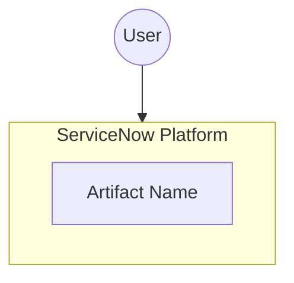
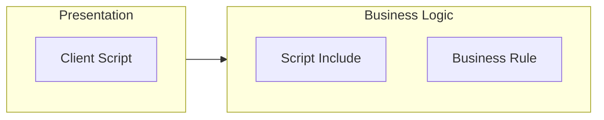
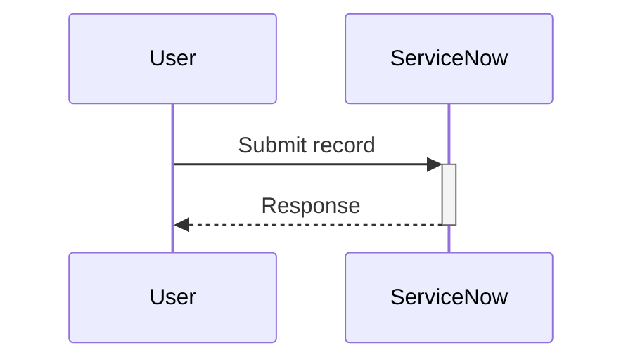

# REQ-XXX: Technical Design Document

## Document Control

| Field | Value |
|-------|-------|
| **Requirement ID** | REQ-XXX |
| **Spec Version** | 1.0 |
| **Author** | |
| **Created** | YYYY-MM-DD |
| **Last Updated** | YYYY-MM-DD |
| **Version** | 1.0 |
| **Status** | Draft / In Review / Approved |

---

## 1. Instance Discovery (Required First Step)

> ⚠️ **BEFORE designing, analyze what already exists in the instance!**
>
> Run: `node mcp-servicenow/analyze/instance-analyzer.js --table=<table> --keywords="<from spec>"`

### 1.1 Discovery Summary

| Metric | Value |
|--------|-------|
| **Table Analyzed** | |
| **Keywords Used** | |
| **Total Artifacts Found** | |
| **Discovery Date** | |

### 1.2 Relevant Existing Artifacts

| Artifact Name | Type | Action | Reason |
|---------------|------|--------|--------|
| | | ⬜ Reuse / ⬜ Extend / ⬜ Ignore | |
| | | ⬜ Reuse / ⬜ Extend / ⬜ Ignore | |

### 1.3 OOTB Capabilities Check

| OOTB Feature | Matches Requirement? | Notes |
|--------------|---------------------|-------|
| | ⬜ Full / ⬜ Partial / ⬜ None | |

### 1.4 Implementation Decision

> **Based on discovery, we will:**
> - ⬜ **Use OOTB** - No custom development needed
> - ⬜ **Extend Existing** - Modify: [list artifacts]
> - ⬜ **Build New** - Reason OOTB doesn't work: [explanation]

### 1.5 Documentation References

| # | Platform Feature | Documentation Path | Table(s) | Plugin Dependency |
|---|------------------|--------------------|----------|-------------------|
| 1 | | | | |

> **Note:** All platform features used in this design have been validated against official ServiceNow documentation.

---

## 2. Solution Overview

### 2.1 Summary
[High-level description of the technical solution]

### 2.2 Goals
- Goal 1
- Goal 2

### 2.3 Non-Goals
- Non-goal 1

---

## 3. Architecture

> Diagrams are auto-generated from the artifacts table (Section 4.2), data model (Section 5),
> and integration points (Section 6). Use `node scripts/enhance-design.cjs --req REQ-XXX`
> to regenerate after editing those sections.

### 3.1 System Context Diagram

<!-- AUTO_DIAGRAM:system_context -->

### 3.2 Component Diagram

<!-- AUTO_DIAGRAM:component -->

### 3.3 Sequence Diagram

<!-- AUTO_DIAGRAM:sequence -->

### 3.4 Entity-Relationship Diagram (if new tables)

<!-- AUTO_DIAGRAM:er -->

_Generated when data model defines new tables in Section 5._

### 3.5 Data Flow Diagram (if integrations)

<!-- AUTO_DIAGRAM:data_flow -->

_Generated when integration points are defined in Section 6._

---

## 4. Artifacts to Create

### 4.1 Naming Convention

> ⚠️ **IMPORTANT**: Use clean noun+verb naming for all artifacts.
>
> ✅ **CORRECT**: `ValidateHighImpactJustification`, `HandleHighImpactChange`, `incident.high_impact.notify`
> ❌ **WRONG**: `REQ003_ValidateHighImpact`, `REQ003_HighImpactHandler`, `req003.high_impact_incident`
>
> **Rationale**: Requirement IDs are for tracking, not for code. Clean names are:
> - Self-documenting (describe what they do)
> - Portable (can be reused across projects)
> - Maintainable (no coupling to requirement numbering)

### 4.2 Summary Table

| Artifact | Type | REST Table | Automatable | Description |
|----------|------|------------|-------------|-------------|
| | Script Include | sys_script_include | ✅ | |
| | Business Rule | sys_script | ✅ | |
| | UI Policy | sys_ui_policy | ✅ | |
| | UI Policy Action | sys_ui_policy_action | ✅ | |
| | Custom Field | sys_dictionary | ✅ | |
| | Event | sysevent_register | ✅ | |
| | Notification | sysevent_email_action | ✅ | |
| | Custom Table | sys_db_object | ✅ | |

> **⚠️ DEPLOYMENT GATE**: Every artifact MUST have `Automatable = ✅`.
> If any artifact cannot be automated, document the blocker and escalate.
> Reference: `_templates/servicenow-artifact-tables.md`

### 4.3 Deployment Mapping Checklist

Before implementation, verify each artifact can be created via REST API:

| # | Artifact Name | REST Table | Verified | Notes |
|---|---------------|------------|----------|-------|
| 1 | | | [ ] | |
| 2 | | | [ ] | |
| 3 | | | [ ] | |

### 4.4 Artifact Details

#### 4.4.1 [Artifact Name]
- **Type:** Script Include
- **Table:** sys_script_include
- **Purpose:** 
- **Key Methods:**
  - `methodName()` - Description
- **Dependencies:**

---

## 5. Data Model

### 5.1 New Tables

| Table | Label | Extends | Purpose |
|-------|-------|---------|---------|
| u_table_name | | task | |

### 5.2 Table Schema

#### u_table_name

| Column | Type | Length | Mandatory | Reference | Description |
|--------|------|--------|-----------|-----------|-------------|
| u_field | String | 100 | Yes | | |

### 5.3 Existing Table Changes

| Table | Change Type | Details |
|-------|-------------|---------|
| incident | New field | u_custom_field |

---

## 6. Integration Points

### 6.1 Internal Integrations

| System | Direction | Method | Purpose |
|--------|-----------|--------|---------|
| CMDB | Inbound | GlideRecord | Lookup CI |

### 6.2 External Integrations

| System | Direction | Protocol | Authentication |
|--------|-----------|----------|----------------|
| PagerDuty | Outbound | REST | API Key |

---

## 7. Security Considerations

### 7.1 Access Control

| Role | Access Level | Restrictions |
|------|--------------|--------------|
| itil | Read/Write | Own records |
| admin | Full | None |

### 7.2 ACLs Required

| Table | Operation | Role | Script |
|-------|-----------|------|--------|
| u_table | read | itil | |

---

## 8. Performance Considerations

- Consideration 1
- Consideration 2

### 8.1 Indexing Strategy

| Table | Index Fields | Reason |
|-------|--------------|--------|
| | | |

---

## 9. Error Handling

| Error Scenario | Handling Strategy | User Message |
|----------------|-------------------|--------------|
| | | |

---

## 10. Rollback Plan

1. Step 1
2. Step 2

---

## 11. Open Questions

| ID | Question | Owner | Status | Resolution |
|----|----------|-------|--------|------------|
| Q-001 | | | Open | |

---

## Sign-Off

| Role | Name | Date | Signature |
|------|------|------|-----------|
| Author | | | ☐ |
| Technical Reviewer | | | ☐ |
| Architect | | | ☐ |

### Approval Status

> **Status:** ⬜ Draft | ⬜ In Review | ⬜ Approved | ⬜ Rejected

